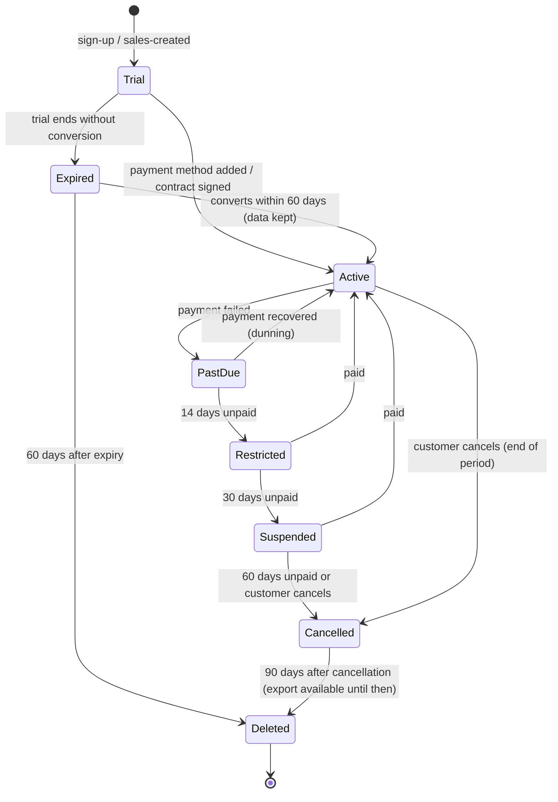

# Business Model, Subscription Plans & Pricing

> [Docs index](../README.md) › [01-product](README.md)

The goal is **many paying customers and recurring revenue**. That target shapes the architecture (multi-tenant from day 1), the roadmap order (sell value early) and the product (self-service onboarding, entitlements, billing).

## 2.1 Why customers pay (value proposition)

Quarry owners pay for software only when it **recovers money they can measure**. Karry's value comes from four levers, ordered by how fast they pay back:

| Lever | Mechanism in Karry | How we prove it to the customer |
|---|---|---|
| **1. Fuel loss reduction** | Per-asset consumption baselines, anomaly detection, tank reconciliation, signed dispensing | Compare L/h per machine during the first 30 days (baseline) with the following 60 days |
| **2. Billing accuracy and ticket fraud** | Signed scale tickets, no edits (reversals only), tare checks, indicator capture | Tonnes ticketed vs. tonnes produced vs. stockpile change |
| **3. Downtime avoided** | RUL prediction, procurement before lead time, grouped maintenance stops | Unplanned stop hours before vs. after; parts stock-outs |
| **4. Financial clarity** | Cost per hour, cost per tonne, DSCR per machine | CFO uses Karry numbers in bank meetings |

> **Positioning sentence (sales):** *"Karry pays for itself in fuel alone. Everything else is profit."* This claim is a hypothesis. We prove it with pilot data in Phase 3 before we use it in marketing.

## 2.2 Ideal customer profile (ICP) and segments

| Segment | Profile | Needs | Plan fit |
|---|---|---|---|
| **S1 — Independent quarry** | 1 site, 8–30 machines, owner-managed | Fuel control, weighbridge, simple maintenance | Starter → Professional |
| **S2 — Regional aggregates group** | 2–10 sites, central warehouse, 30–200 machines | Everything in S1 plus Magasin Général, transfers, consolidated dashboards | Professional → Business |
| **S3 — Construction company with own quarries** | Quarry is a cost centre feeding projects | Cost per tonne, transfers to projects, finance | Business |
| **S4 — Mining contractor / large mining group** | Many sites, compliance, IT department | SSO, dedicated hosting, API, telematics | Enterprise |

Initial geography is decided in Phase 0 (open question [§28](../05-quality/test-environments-and-devices.md) of the master plan). The product is French/English from day 1 to serve Francophone Africa, North Africa, France/Belgium/Canada and Anglophone markets.

## 2.3 Subscription plans (illustrative, validated in Phase 0 with real prospects)

Pricing is **per site per month** with included assets. That metric is simple to explain, it scales with customer size, and it is hard to game.

| | **Starter** | **Professional** | **Business** | **Enterprise** |
|---|---|---|---|---|
| Target | S1 | S1/S2 | S2/S3 | S4 |
| Indicative price | €249 / site / month | €590 / site / month | €990 / site / month | Custom (from €2,000 / site / month or annual contract) |
| Included assets per site | 20 | 50 | 120 | Unlimited |
| Extra asset | €6 / asset / month | €5 | €4 | Negotiated |
| Users | Unlimited field users, 5 office users | Unlimited field, 15 office | Unlimited field, 40 office | Unlimited |
| Field ops, verification, e-signatures | ✔ | ✔ | ✔ | ✔ |
| Weighbridge tickets & basic sales | ✔ | ✔ | ✔ | ✔ |
| Fuel management & anomaly detection | ✔ | ✔ | ✔ | ✔ |
| Integrity dashboard | ✔ | ✔ | ✔ | ✔ |
| Maintenance & RUL | — | ✔ | ✔ | ✔ |
| Inventory & warehouses (Magasin Général, transfers, counts) | Single store | ✔ | ✔ | ✔ |
| Plant graph, production, stockpiles | — | — | ✔ | ✔ |
| Asset finance, DSCR, weather advisory | — | — | ✔ | ✔ |
| AI Copilot | — | Add-on | Included (fair-use quota) | Included (custom quota) |
| Edge agent (weighbridge auto-capture) | Add-on | Add-on | 1 included per site | Included |
| Telematics connectors | — | — | Add-on | ✔ |
| SSO (SAML/OIDC federation) | — | — | ✔ | ✔ |
| Public API & webhooks | — | Read-only | ✔ | ✔ |
| Dedicated database / region / on-prem | — | — | — | ✔ |
| Support | Email, business hours | Email + chat | Priority, named CSM | 24/7 option, SLA 99.95 % |
| Data retention | 3 years | 7 years | 10 years | Custom |

**Add-ons**

| Add-on | Indicative price |
|---|---|
| AI Copilot (Professional) | €149 / site / month |
| Edge agent software licence | €79 / site / month (hardware sold or rented separately) |
| Telematics connector | €3 / connected asset / month |
| Additional AI quota | Bundles of usage |
| Premium onboarding (data migration, on-site training) | One-off fee: €1,500–€8,000 depending on number of sites |
| Hardware bundles (rugged tablets, weighbridge edge PC) | Resale at cost + margin, optional |

**Billing terms**
- Monthly or annual (annual = 2 months free, i.e. about 17 % discount). Annual billing is preferred because cash comes in up front and customers churn less.
- 30-day free trial on Starter/Professional with **demo tenant pre-loaded with realistic data** plus option to enter own data.
- Local currency pricing (EUR, USD, XOF, MAD, TND, CAD …) where payment rails exist; price book per currency (not a live FX conversion).
- Enterprise is invoiced by bank transfer with net-30 terms.

> **Pricing principle:** the field side (operators, drivers, weighmasters) is **unlimited users** on all plans. Charging per field user would make customers share logins, and shared logins destroy the anti-fraud value. We charge for sites, assets and office seats.

## 2.4 Pricing must be technically enforceable → Entitlements engine

The product needs an **entitlements engine** from Phase 1, not Phase 10. Without one, sales cannot sell plans, and engineering ends up hardcoding customer-specific behaviour.

```
Plan            = { code, version, features[], limits{}, priceBook[] }
Subscription    = { tenant, plan, addOns[], status, period, seats, quantities }
Entitlement     = resolved(feature flags + limits) for a tenant at time t
Usage meter     = { tenant, metric (sites, assets, office_users, ai_tokens, storage_gb, edge_agents), value, period }
```

- Features are checked in the API (`[RequiresFeature("maintenance")]`) **and** hidden in UI. The API check is what enforces them; hiding in the UI is only cosmetic.
- Limits are **soft** with a grace margin (e.g., +10 % assets for 30 days, then sales follow-up), never a hard block in the middle of a shift.
- Plan changes take effect immediately (upgrade) or at period end (downgrade).

**As built (P1.10, [ADR-0023](../adr/0023-plans-subscriptions-entitlements.md)).** Plans live in the `Billing` module as immutable **versions** (`billing.plans`); the table of §2.3 is seeded as version 1 of `starter`, `professional`, `business` and `enterprise` (EUR only, annual = 10 × monthly). These are still the **illustrative** values: the final ones are published as version 2 through `POST /api/v1/billing/plans` (owner input [N-01](../07-management/still_wanted_from_team.md#1-needed-now-)), and subscriptions keep their version until moved. Feature codes (`maintenance`, `plant`, `ai.copilot`, …) and limit codes (`office-users`, `assets-per-site`, `edge-agents-per-site`, `retention-years`) are declared in `Karry.SharedKernel.Entitlements`; a plan naming another code is refused. The operator console (P1.16) shows each company's **MRR** by this price book: sites × per-site price + extra machines × extra-machine price for the subscription's period (annual ÷ 12), in the company's currency when priced, counted only while the subscription is active, past due or restricted; add-ons are not priced yet ([ADR-0029 §3](../adr/0029-operator-console-support-access-audit-viewer.md#3-the-operator-console-reads-tenants-one-at-a-time-through-each-module)).

## 2.5 Tenant subscription lifecycle



| State | Field capture | Office app | Data export |
|---|---|---|---|
| Trial / Active | Full | Full | ✔ |
| PastDue | Full | Full + banner | ✔ |
| Restricted | **Full**: field data is never blocked, because losing shift data would destroy trust | Read-only except billing | ✔ |
| Suspended | Read-only | Read-only, billing only | ✔ |
| Cancelled | Disabled | Read-only | ✔ (90 days) |
| Deleted | — | — | — (crypto-shredding of tenant keys, ledger anchors kept as hashes only) |

## 2.6 Payment rails

| Option | Use | Note |
|---|---|---|
| **Merchant of Record (e.g., Paddle, Lemon Squeezy)** | Card payments worldwide, handles VAT/sales tax | Simplest for a small team; higher fee |
| **Stripe Billing** | Card + SEPA in supported countries | Not available to merchants in all African/MENA countries. Decide based on where the company is incorporated |
| **Regional providers (Flutterwave, Paystack, CinetPay, local banks)** | Mobile money / local cards | Important for West Africa (XOF) |
| **Bank transfer + invoice** | Enterprise, annual contracts | Manual reconciliation in v1 |

The billing module wraps providers behind `IBillingProvider` so the provider choice is a configuration decision.

## 2.7 Unit economics targets

| Metric | Target |
|---|---|
| Gross margin (infra + LLM + support cost vs revenue) | ≥ 80 % |
| Infra cost per standard site | ≤ €25 / month at 100+ tenants |
| AI cost per Business site | ≤ 15 % of AI-attributed revenue (quotas enforced) |
| CAC payback | ≤ 12 months |
| Net revenue retention | ≥ 110 % (expansion via sites, assets, upgrades) |
| Logo churn | ≤ 1.5 % monthly |
| Time-to-value | First verified shift within 48 h of sign-up; first fuel anomaly report within 30 days |

## 2.8 Illustrative revenue path (assumptions, not a forecast)

| Horizon | Paying sites | Avg. revenue / site / month | MRR | ARR |
|---|---|---|---|---|
| End of pilot (≈ month 5) | 1–3 | €300 (discounted pilot) | ≈ €900 | ≈ €11 k |
| Commercial v1 (≈ month 9) | 15 | €500 | €7.5 k | €90 k |
| Intelligence release (≈ month 12) | 40 | €650 | €26 k | €312 k |
| GA + 12 months (≈ month 24) | 150 | €750 | €112 k | €1.35 M |
| Scale (≈ month 36) | 400 | €800 | €320 k | €3.8 M |

This path is achievable only if: (1) the pilot proves measurable fuel/ticket savings, (2) onboarding takes less than a day, (3) a channel strategy exists (equipment dealers, crusher OEM distributors and fuel suppliers as resellers). See [§19](go-to-market.md).

## 2.9 Growth features that are part of the product (not afterthoughts)

| Feature | Phase | Why it makes money |
|---|---|---|
| Entitlements & plans | P1 | Lets sales sell tiers and upsell |
| Excel import wizard | P1 | Cuts onboarding from weeks to hours |
| Demo tenant with realistic data | P3 | Sales demos and trials work without setup |
| Savings report ("Karry saved you X this month") | P3 | Shows the value every month and keeps customers renewing |
| In-app upgrade prompts (locked features shown with value) | P4 | Self-serve expansion revenue |
| Multi-site consolidated dashboards | P5 | Sells more sites per customer |
| Referral programme | P10 | Low-cost acquisition in a word-of-mouth industry |
| Partner / reseller portal | P10 | Dealers sell Karry alongside machines |
| Self-service sign-up, checkout, plan management | P10 | Scales sales without headcount |
