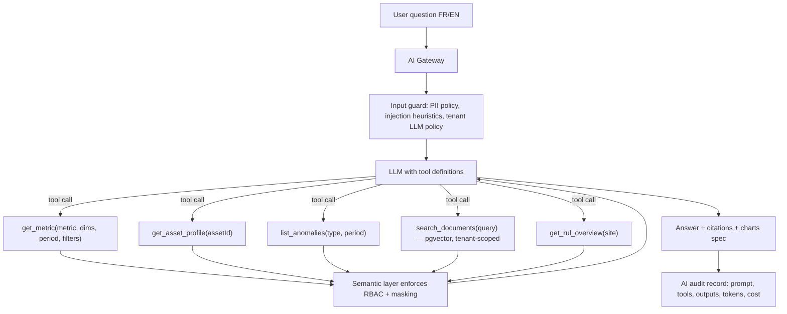

# AI Copilot Architecture

> [Docs index](../README.md) › [02-architecture](README.md)

## 15.1 Design stance

- The LLM **never computes business numbers**. It calls **tools** that return numbers computed by the deterministic engines, then explains them.
- No raw text-to-SQL against production. Tools query a **governed semantic layer** (named metrics, dimensions, filters) that applies RBAC and field masking automatically.
- Every answer shows **sources** (metric, period, filters, record links) — "show calculation".

## 15.2 Flow

## 15.3 Capabilities by phase

| Capability | Phase | Mechanism |
|---|---|---|
| Natural-language Q&A over metrics (FR/EN) | 8 | Tool calling over semantic layer |
| Daily/weekly executive summary | 8 | Scheduled job → tools → narrative, delivered by email/WhatsApp |
| Fuel anomaly **explanation** (detection is statistical, [§10.6](../03-domain/computational-engines.md#106-fuel-analytics-engine)) | 8 | Tools fetch anomaly context; LLM explains & suggests checks |
| Maintenance grouping suggestions | 8 | Optimiser output ([§10.5](../03-domain/computational-engines.md#105-hybrid-maintenance--rul-engine)) explained by LLM |
| Conveyor bottleneck alerts | 7 (rules) → 8 (narrative) | Engine detects, LLM explains |
| Weather-risk advisory for sales | 7 (engine) → 8 (narrative) | Engine probability + LLM explanation |
| Document Q&A (manuals, SOPs, contracts) | 9 | RAG with pgvector, tenant-scoped |

## 15.4 Provider strategy

- **AI Gateway** abstracts providers (`IChatModel`, `IEmbeddingModel`) — no SDK types leak into domain code.
- Default: Claude via Anthropic API (`claude-sonnet-5-5` for Q&A, `claude-haiku-5-5` for classification/routing, `claude-opus-5-5` for long monthly analysis). Model choice is configuration, re-evaluated at each release.
- Sovereign option: self-hosted open-weight model (vLLM) for tenants who forbid external processing.
- **Evaluation harness**: golden question set per capability (FR + EN), with expected tool calls and numeric answers; run in CI on prompt/model changes. Regression gate before rollout.
- Cost controls: per-tenant monthly token budget, caching of repeated summaries, rate limits.
