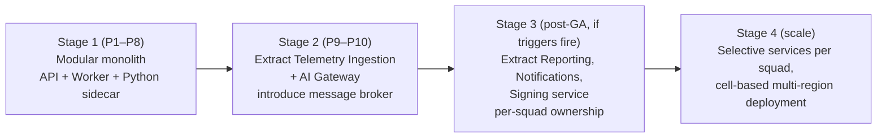

# Decision: Modular Monolith vs Microservices

> [Docs index](../README.md) › [02-architecture](README.md)

## 3.1 My recommendation

> **Do NOT start with microservices. Start with a _modular monolith_, built with microservice-grade boundaries, deployed as a small number of processes, and multi-tenant from day 1. Extract services only when a measured trigger fires ([§3.6](#36-extraction-triggers-when-we-will-create-a-microservice)).**

This is the professional choice for Karry. Below is why, what it means concretely, what we still separate from day 1, and exactly how we keep the door open to microservices.

## 3.2 What "modular monolith" means here (it is not a "big ball of mud")

- One .NET solution, **one deployable API image**, but internally split into ~17 **modules** (Tenancy, Assets, FieldOps, Fuel, Verification, Trust, Weighbridge, Maintenance, Inventory, Plant, Finance, Weather, Analytics, AiCopilot, Notifications, Billing, Organization).
- Each module has its own **database schema**, its own domain model, and a **public contract** project. Modules **never** read another module's tables and never reference another module's internals. Architecture tests in CI fail the build if they do.
- Modules communicate in two ways only:
  1. **Synchronous in-process calls** through the other module's public contract interface (like a service API, but a method call).
  2. **Asynchronous integration events** via the transactional outbox (exactly like a message bus between microservices).
- So the *logical* architecture is service-oriented. Only the *physical deployment* is unified.

## 3.3 Why not microservices from the beginning — the 10 reasons

**1. Team size (Conway's Law).**
Microservices exist to let **many independent teams** release without coordinating. We will have 5–7 engineers, which is one or two teams. With 15+ services, each engineer would own 2–3 services plus their pipelines, databases, dashboards and on-call. Most of the time would go to operating the system instead of building features customers pay for.

**2. Time-to-market is the #1 business risk.**
For a subscription business, the first goal is **reaching paying customers fast**. Microservices add an estimated 30–50 % overhead to early delivery (service templates, inter-service auth, distributed tracing, contract testing, deployment orchestration, versioned APIs between services). In our roadmap that delays the pilot by roughly 2–3 months and the first revenue with it.

**3. Our core guarantee is transactional, and microservices make it harder.**
Karry's selling point is **trust**: "every business change has a signed, hash-chained ledger entry, atomically." In a monolith that is **one PostgreSQL transaction** (business row + ledger entry + outbox event). With microservices, the same guarantee needs sagas, compensation, and eventual consistency between e.g. Verification, Trust and FieldOps services. Each of those adds failure modes, and each failure mode gives an auditor a reason to doubt the ledger.

**4. Offline sync wants one consistent server-side truth.**
Field devices upload batches containing shift entries, fuel records, tickets, signatures and photos that span several domains. A monolith validates and commits the batch coherently. With microservices, a batch would fan out across services with partial failures, and the device would need to reconcile per-service results. The protocol gets more complex at the most fragile point of the system, which is low-connectivity tablets.

**5. Domain boundaries are not yet proven.**
We have not yet run the Phase 0 event storming with real operators. Boundaries drawn now will move (e.g., does "Fuel" belong with "FieldOps"? does "Stockpiles" belong with "Weighbridge"?). In a modular monolith, moving a boundary is a **refactor in one repo with compiler help**. In microservices, it is a **data migration between databases plus API versioning across services**, which is expensive and risky.

**6. Infrastructure cost per tenant (gross margin).**
SaaS profitability depends on low cost per tenant. Microservices typically mean many always-on containers, often a database per service, a message broker cluster and a service mesh. Early on that can multiply the infrastructure bill several times over for the same load. A monolith with 2–3 stateless replicas plus managed PostgreSQL serves hundreds of tenants cheaply. That protects the ≥ 80 % gross margin target ([§2.7](../01-product/business-model-and-pricing.md#27-unit-economics-targets)).

**7. Our load profile does not need it.**
Even at the GA target (500 tenants, 20 M field entries/year), the write load averages **under 1 write/second**, with peaks at shift changes of perhaps a few hundred/second. A single well-indexed PostgreSQL and horizontally scaled stateless API pods handle that comfortably. The only data stream with genuinely high volume is **telemetry** (Phase 9), and that is exactly the first extraction candidate ([§3.6](#36-extraction-triggers-when-we-will-create-a-microservice)).

**8. Debugging and support are far simpler.**
When a weighmaster says "my ticket disappeared", support needs one trace and one log stream, not a hunt across 12 services and a broker. For a small team supporting customers in remote regions, this keeps support costs down.

**9. Security surface is smaller.**
Every network hop between services is something to authenticate, authorize, encrypt and monitor. Fewer hops means fewer mistakes and a smaller attack surface. That matters a lot for a product whose brand is tamper-evidence.

**10. Industry evidence.**
Many successful SaaS companies scaled very far on modular monoliths (Shopify being the most cited example) and extracted services selectively. Many startups that started with microservices later merged them back because the operational overhead was greater than the benefit at their size. A very common professional pattern is "monolith first, extract when it hurts", and it fits our situation.

## 3.4 The honest counter-arguments, and our answers

| Argument for microservices | Our answer |
|---|---|
| "We will need to scale." | We scale the monolith horizontally (stateless API pods behind a load balancer) and vertically (database). The one high-volume stream (telemetry) is designed as an extractable module from day 1. |
| "Different parts need different technologies." | True for Python analytics, so that **is** a separate process from day 1. Everything else is .NET. |
| "Investors / enterprise buyers want microservices." | Buyers want **uptime, security, isolation and SLAs**. We give them those, plus dedicated hosting for Enterprise. No serious buyer rejects a product for being a modular monolith; they reject products that are down or leaky. |
| "Refactoring a monolith later is painful." | That pain comes from **unstructured** monoliths. Ours enforces module boundaries in CI, uses per-module schemas and communicates by events, so extraction is mechanical ([§3.7](#37-how-we-keep-extraction-cheap-rules-enforced-from-phase-1)). |
| "One bug can take down everything." | Mitigated with bulkheads: separate **worker process** for background jobs, separate **edge agents**, separate **analytics sidecar**, rate limits per tenant, and circuit breakers on external calls. Field capture is offline-first, so the field keeps working even during a full cloud outage. |
| "Independent deployments." | With one or two teams we deploy the whole app many times a day using trunk-based development and feature flags. Independent deploys only start to matter when there are several teams. |

## 3.5 What IS separated from day 1 (justified, not dogmatic)

| Process / component | Why it is separate |
|---|---|
| **Karry API host** (modular monolith) | Main application, horizontally scaled |
| **Karry Worker host** (same codebase, different entry point) | Background jobs (outbox dispatch, RUL recompute, ledger anchoring, reports) must not steal CPU from user requests; it scales independently |
| **Python analytics sidecar** | Different runtime and ecosystem (forecasting, Weibull, anomaly models). It is stateless and called by the workers |
| **Keycloak** | Off-the-shelf identity provider |
| **Edge agent** | Runs physically at the quarry site |
| **PostgreSQL, Redis, object storage** | Managed infrastructure |

That gives about **4 custom deployables**, which is the right number for this team.

## 3.6 Extraction triggers (when we WILL create a microservice)

A module becomes a separate service **only if at least one trigger is measured and an ADR is approved**:

| Trigger | Threshold (indicative) | Likely first candidate |
|---|---|---|
| Throughput / resource profile differs radically | Sustained > 2,000 events/s or > 40 % of total CPU | **Telemetry ingestion** (Phase 9) |
| Security isolation needed | Secrets/keys that must not live in the main process; separate compliance scope | **AI Gateway** (LLM keys, prompt logging) and **Signing service** (KMS access) |
| Team topology | ≥ 3 squads with conflicting release cadences | Plant/Production squad, Commerce/Billing squad |
| Availability isolation | A module's failures measurably impact core SLO | Reporting / PDF generation, Notifications |
| Different scaling economics | Bursty workloads (monthly reports, AI summaries) | Reporting service on scale-to-zero |
| Customer-specific deployment | Enterprise demands a component on-prem while the rest stays in cloud | Edge-adjacent services |

## 3.7 How we keep extraction cheap (rules enforced from Phase 1)

1. **Schema per module**, no cross-module joins, no cross-module foreign keys (except IDs to tenancy reference data).
2. **Public contracts only** (`Karry.<Module>.Contracts`): commands, queries, DTOs, integration events, all versioned.
3. **Integration events via outbox** with a broker-agnostic envelope (`CloudEvents` format). Replacing the in-process dispatcher with RabbitMQ/Kafka/Azure Service Bus later only changes configuration and an adapter.
4. **No shared mutable state** in memory between modules.
5. **Module-level API route prefixes** (`/api/v1/maintenance/...`) so that an API gateway can later route a prefix to a new service without changing any client.
6. **Per-module observability** (spans and metrics tagged with `module`), so we can measure the triggers in [§3.6](#36-extraction-triggers-when-we-will-create-a-microservice).
7. **Architecture tests** (ArchUnitNET / NetArchTest) run in CI and block violations.

## 3.8 Evolution path

## 3.9 Multi-tenancy is the decision that really matters for a subscription business

Monolith vs. microservices matters far less for revenue than **how tenants are isolated and onboarded**:

- **Pool model** (shared DB with Row-Level Security) for Starter/Professional/Business: very low cost per tenant, instant provisioning.
- **Silo model** (dedicated DB or dedicated cell) for Enterprise: same code, separate infrastructure, higher price.
- **Cell-based architecture later**: groups of tenants per "cell" (an API + DB stack) to limit blast radius and allow regional data residency. A modular monolith fits this well, because each cell is one deployment.

**Conclusion:** the modular monolith gets us to revenue fastest and cheapest, protects the transactional trust guarantees, and is designed so that every future extraction is a planned, low-risk step and not a rewrite.
