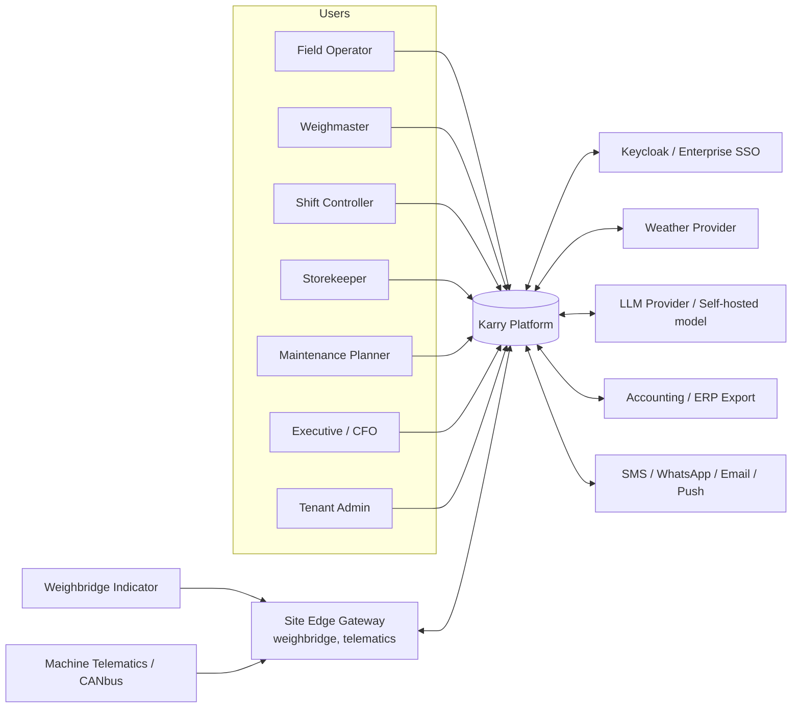
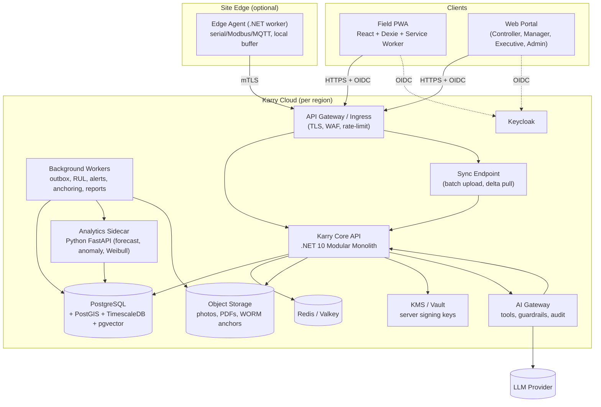
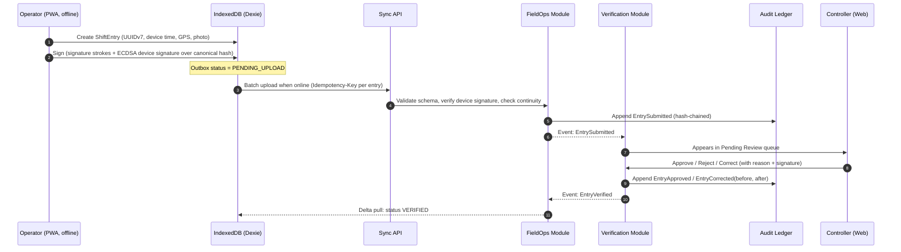

# System Architecture (C4)

> [Docs index](../README.md) › [02-architecture](README.md)

## 8.1 Context diagram (C4 Level 1)



## 8.2 Container diagram (C4 Level 2)



## 8.3 Internal layering of each module (Clean / Hexagonal)

```
Module (e.g., Karry.Maintenance)
├── Domain          Entities, Value Objects, Aggregates, Domain Events, Domain Services (pure, no I/O)
├── Application     Commands, Queries, Handlers, Validators, Ports (interfaces), DTOs
├── Infrastructure  EF Core mappings, repositories, external adapters, outbox publishers
└── Api             Endpoint groups, request/response contracts, authorization policies
```

Rules (enforced by architecture tests):

- `Domain` references nothing but `Karry.SharedKernel`.
- Modules never reference each other's `Domain`/`Infrastructure`; they integrate via **public contracts** (`Karry.<Module>.Contracts`) and **integration events**.
- Each module owns its **PostgreSQL schema** (`maintenance.*`, `inventory.*`, …). No cross-schema foreign keys except to `tenancy` and `identity` reference tables.

## 8.4 Key runtime flow — field entry to verified ledger


