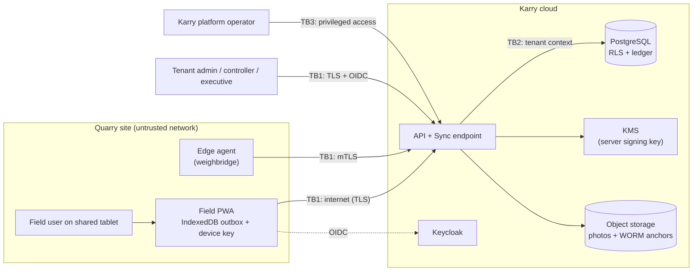

# Threat Model v1 (STRIDE)

> [Docs index](../README.md) › [02-architecture](README.md)

Scope: the **trust layer** (field capture, signatures, verification, ledger), **offline sync**, and **multi-tenancy**. These are the components whose failure would destroy Karry's core promise. Updated at every phase exit and whenever these components change ([llm_guidelines.md §10.1](../00-llm/llm_guidelines.md#101-baseline)).

## 1. System under analysis

Trust boundaries: **TB1** device/user ↔ cloud; **TB2** application ↔ database (tenant isolation); **TB3** Karry staff ↔ customer data.

## 2. Actors & motivations

| Actor | Motivation | Capability |
|---|---|---|
| Dishonest operator | Inflate hours, hide idle time, steal fuel | Physical access to tablet & machine, knows PINs of colleagues |
| Colluding operator + controller | Approve falsified entries together | Both roles' permissions |
| Dishonest weighmaster | Under-weigh trucks for kickbacks, delete tickets | Weighbridge PC, indicator |
| Dishonest storekeeper | Steal parts/lubricants, hide variance | Store tablet, stock movements |
| Malicious or curious tenant user | Read another company's data (competitor intelligence) | Valid account in their own tenant |
| External attacker | Data theft, ransomware, account takeover | Internet access, stolen credentials |
| Insider with DB access (customer or Karry) | Rewrite history to cover fraud | Database/infra credentials |
| Prompt injector | Make the AI copilot leak data or mislead | Free-text fields (remarks, comments) |

## 3. Top threats (STRIDE), mitigations and verification

| ID | STRIDE | Threat | Mitigation | Verified by |
|---|---|---|---|---|
| T-01 | Spoofing | Operator submits entries under a colleague's identity (shared tablet, known PIN) | Per-user PIN with lockout; auto-lock; photo of meter in-app only; signature per entry; anomaly rules on unusual user/asset pairs | US-P1-OFF-04, US-P2-FO-01, RULE-FO-05 |
| T-02 | Spoofing | Unenrolled or cloned device submits data | Device enrollment with non-extractable ECDSA key; server verifies every command signature; revocation | US-P1-OFF-02, US-P2-SIG-02, TC-P0-KEY-001/004, TC-P0-SIG-001/003 |
| T-03 | Tampering | Payload modified between signing and server (malware, proxy) | Signature over RFC 8785 canonical payload; hash check; reject on mismatch | TC-P0-KEY-004, TC-P0-SIG-003, TC-P2-SIG-002 |
| T-04 | Tampering | Backdated entries (device clock changed) | Server receive time + device time; clock-offset measurement per sync; CLOCK_SKEW flag | US-P2-OFF-05, RULE-FO-03 |
| T-05 | Tampering | Replay of an old valid batch to duplicate fuel/tickets | Idempotency by `commandId`; per-device monotonic sequence; gap detection | TC-P0-OFF-005, TC-P2-SYNC-001/003 |
| T-06 | Tampering | DB insider edits or deletes signed records / ledger rows | Append-only tables with triggers; app role INSERT/SELECT only; hash chain; WORM anchoring; verifier | US-P1-AUD-01..03, ADR-0008, TC-P1-AUD-002/003 |
| T-07 | Repudiation | Controller denies having approved / corrected an entry | Controller signature on every action; before/after diff in ledger; SoD | US-P2-VER-02..04, ADR-0006 |
| T-08 | Repudiation | Weighmaster denies issuing a ticket / claims edit | Tickets immutable; reversal requires countersignature; indicator-sourced weights signed by edge agent | US-P3-WB-01/02, US-P6-EDG-02 |
| T-09 | Information disclosure | Cross-tenant data read via API, export, report, notification, AI | RLS (forced, `nullif` policy, transaction-local tenant) + EF filters + isolation test suite on every endpoint | ADR-0004, TC-P0-RLS-001..010, US-P1-TEN-03 |
| T-10 | Information disclosure | Field roles see margins, prices, wages | Field-level masking in API serialization, exports, PDFs, AI tools | US-P1-IAM-07, CC-03 |
| T-11 | Information disclosure | Tenant context leaks across pooled connections | Transaction-local `set_config(..., true)` only; session-level SET forbidden | TC-P0-RLS-005/006 |
| T-12 | Denial of service | Sync flood from a compromised device or shift-change burst | Rate limits per device/tenant; batch size limits; queue back-pressure; load tests | US-P2-OFF-03, k6 shift-change test |
| T-13 | Elevation of privilege | User grants themselves admin rights; controller approves own entries | Privileged permission changes require step-up auth and are ledgered; SoD enforced in domain | US-P1-IAM-05, US-P2-VER-02 |
| T-14 | Elevation of privilege | Karry support staff browse customer data | Consent-based, time-boxed, audited support access in tenant ledger; break-glass alerts | US-P1-OPS-03 |
| T-15 | Info disclosure / Tampering | Prompt injection via remarks makes the copilot reveal masked data or mislead | Tools enforce RBAC/masking; user text delimited as data; no write tools; red-team set | ADR-0013, US-P8-AI-11, TC-P8-AI-004 |
| T-16 | Tampering | Weight spoofing at the indicator / edge PC | mTLS client certs, signed readings, stability window, ANPR match, physical seals procedure | US-P6-EDG-02, US-P9-EDG-01 |
| T-17 | Information disclosure | Lost/stolen tablet exposes cached data | Device revocation, auto-lock, short offline session, minimal cached scope; quarantine of revoked device uploads | US-P1-OFF-02/04 |

## 4. Residual risks & open items

| Item | Risk | Plan |
|---|---|---|
| R-01 | Browser storage can be cleared, losing device key and unsynced data | Re-enrollment flow; server alert on re-enrollment with sequence gaps (Phase 1/2) |
| R-02 | IndexedDB on a stolen unlocked tablet is readable | Evaluate app-level encryption of cached reference data with a PIN-derived key (Phase 2 spike) |
| R-03 | Legal weight of signatures differs by country | WP-P0-06 legal memo; QTSP integration for specific documents if required |
| R-04 | Collusion across several roles | Statistical anomaly detection independent of approvals; telematics cross-check (Phase 9) |
| R-05 | Supply-chain compromise of dependencies or actions | Lockfiles, actions pinned by SHA, SBOM, signed images, scanning (guidelines §10.2) |

## 5. Review log

| Date | Phase | Change | By |
|---|---|---|---|
| 2026-10-21 | P0 | v1 created; tenancy threats validated by spike WP-P0-12, device/signature threats by WP-P0-10/11 | Software architect |
