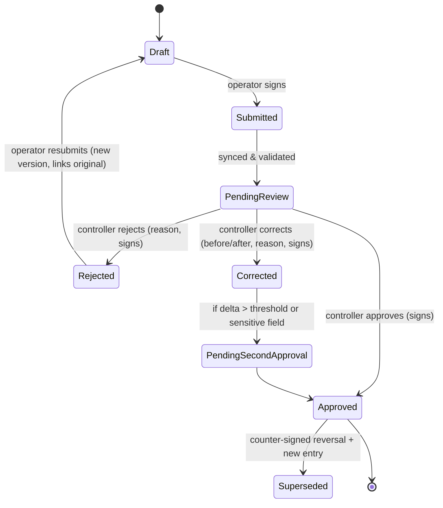

# Trust Layer: Verification, Signatures & Audit Ledger

> [Docs index](../README.md) › [02-architecture](README.md)

## 13.1 Generic verification workflow



Rules:

- **Segregation of duties:** a user can never approve their own entry; controller cannot be the operator on the same shift/asset.
- **Four-eyes for sensitive corrections** (meter changes beyond tolerance, ticket reversals, stock adjustments).
- **SLA & escalation:** pending items older than X hours escalate to site manager.
- Corrections create a **new version**; the original stays visible forever.

## 13.2 Signature envelope

Each signable record produces a `SignatureEnvelope`:

```json
{
  "envelopeId": "uuidv7",
  "recordType": "ScaleTicket",
  "recordId": "uuidv7",
  "canonicalPayloadHash": "sha256:…",          // RFC 8785 JSON Canonicalization
  "signer": { "userId": "…", "role": "WEIGHMASTER", "deviceId": "…" },
  "context": { "deviceTime": "…", "geo": { "lat": 0, "lon": 0, "acc": 8 }, "appVersion": "…" },
  "handwritten": { "strokesKey": "s3://…", "imageHash": "sha256:…" },
  "deviceSignature": { "alg": "ES256", "keyId": "device-…", "sig": "base64…" },
  "serverCountersignature": { "alg": "ES256", "kmsKeyId": "…", "sig": "base64…", "receivedAt": "…" },
  "timestampToken": "base64 RFC 3161 TST (optional, per tenant policy)"
}
```

- **Device signature** proves the record was signed on an enrolled device by an authenticated user at capture time (works offline).
- **Server countersignature** (KMS-held key) proves receipt and binds server time.
- **RFC 3161 timestamp** (TSA) gives independent time evidence — recommended for weighbridge tickets & waybills.
- **Public verification page**: scanning the QR code on a printed ticket/waybill shows the verified status and hash, without exposing private data.

> **Legal note:** The legal weight of electronic signatures depends on jurisdiction (e.g., eIDAS in the EU; national e-transaction laws elsewhere). Karry's design supports "advanced" signature characteristics (unique link to signer, signer control, tamper detection). Qualified signatures, if required by a customer, would require integration with a qualified trust service provider. **Confirm with legal counsel per target market in Phase 0.**

### 13.2.1 Canonical JSON (as implemented, P1.6)

`Karry.SharedKernel.Canonical.JsonCanonicalizer` implements RFC 8785 (JCS). It is checked byte for byte against vectors produced by a real ECMAScript engine: [`tests/vectors/rfc8785.json`](../../tests/vectors/rfc8785.json), generated by `node tests/vectors/generate-jcs-vectors.mjs`. The vectors cover the RFC examples, the 24 Appendix B number patterns and 300 random documents. The TypeScript side (`packages/crypto`, P1.15) must pass the same file.

**Rules beyond the RFC (strict mode, used for hashing and signing):** duplicate member names and lone surrogates are rejected, and so is any number a double cannot represent exactly (more than ~15–17 significant digits, integers above 2^53). Otherwise the canonical form would silently change the value. **Exact decimals (money, quantities) travel as strings in signed or ledgered payloads.**

## 13.3 Hash-chained ledger

```
entry_hash_n = SHA-256( prev_hash_{n-1} ‖ tenant_id ‖ seq_n ‖ event_type ‖ payload_hash ‖ occurred_at )
```

- Written in the **same transaction** as the business change (outbox pattern guarantees no business change without a ledger entry).
- Sequence gap-free per tenant (serialized via advisory lock per tenant; throughput is ample for this domain).
- DB enforcement: app role has `INSERT`/`SELECT` only on `audit.*`; a trigger rejects `UPDATE`/`DELETE`/`TRUNCATE`.
- **Anchoring job** (hourly): writes `{tenant, seq, entry_hash}` heads to object storage with **Object Lock (compliance mode)** and optionally a public transparency log. Tampering with DB history becomes detectable by any auditor.
- **Verifier tool** (CLI + admin UI): recomputes the chain and compares to anchors; part of quarterly audit procedure.

## 13.4 Scale ticket rules

- Weight captured from the **indicator via edge agent** whenever possible (`source = INDICATOR`); manual entry allowed only with reason and flagged.
- Tickets are never edited; correction = `Reversal` ticket (counter-signed by weighmaster + controller) + new ticket.
- Detection rules: same truck re-weighed within impossible interval, tare drift beyond tolerance vs. registered tare, net weight above truck legal payload, tickets issued outside site hours.
