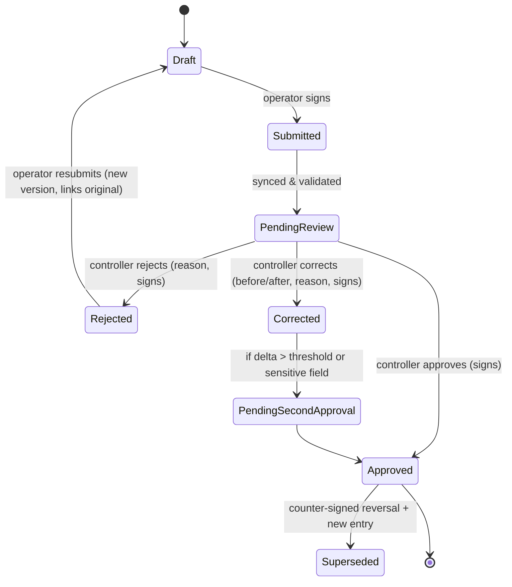

# Trust Layer: Verification, Signatures & Audit Ledger

> [Docs index](../README.md) › [02-architecture](README.md)

## 13.1 Generic verification workflow



Rules:

- **Segregation of duties:** a user can never approve their own entry; controller cannot be the operator on the same shift/asset.
- **Four-eyes for sensitive corrections** (meter changes beyond tolerance, ticket reversals, stock adjustments).
- **SLA & escalation:** pending items older than X hours escalate to site manager.
- Corrections create a **new version**; the original stays visible forever.

## 13.2 Signature envelope

Each signable record produces a `SignatureEnvelope`:

```json
{
  "envelopeId": "uuidv7",
  "recordType": "ScaleTicket",
  "recordId": "uuidv7",
  "canonicalPayloadHash": "sha256:…",          // RFC 8785 JSON Canonicalization
  "signer": { "userId": "…", "role": "WEIGHMASTER", "deviceId": "…" },
  "context": { "deviceTime": "…", "geo": { "lat": 0, "lon": 0, "acc": 8 }, "appVersion": "…" },
  "handwritten": { "strokesKey": "s3://…", "imageHash": "sha256:…" },
  "deviceSignature": { "alg": "ES256", "keyId": "device-…", "sig": "base64…" },
  "serverCountersignature": { "alg": "ES256", "kmsKeyId": "…", "sig": "base64…", "receivedAt": "…" },
  "timestampToken": "base64 RFC 3161 TST (optional, per tenant policy)"
}
```

- **Device signature** proves the record was signed on an enrolled device by an authenticated user at capture time (works offline).
- **Server countersignature** (KMS-held key) proves receipt and binds server time.
- **RFC 3161 timestamp** (TSA) gives independent time evidence — recommended for weighbridge tickets & waybills.
- **Public verification page**: scanning the QR code on a printed ticket/waybill shows the verified status and hash, without exposing private data.

> **Legal note:** The legal weight of electronic signatures depends on jurisdiction (e.g., eIDAS in the EU; national e-transaction laws elsewhere). Karry's design supports "advanced" signature characteristics (unique link to signer, signer control, tamper detection). Qualified signatures, if required by a customer, would require integration with a qualified trust service provider. **Confirm with legal counsel per target market in Phase 0.**

### 13.2.1 Canonical JSON (as implemented, P1.6)

`Karry.SharedKernel.Canonical.JsonCanonicalizer` implements RFC 8785 (JCS). It is checked byte for byte against vectors produced by a real ECMAScript engine: [`tests/vectors/rfc8785.json`](../../tests/vectors/rfc8785.json), generated by `node tests/vectors/generate-jcs-vectors.mjs`. The vectors cover the RFC examples, the 24 Appendix B number patterns and 300 random documents. The TypeScript side (`packages/crypto`, P1.15) must pass the same file.

**Rules beyond the RFC (strict mode, used for hashing and signing):** duplicate member names and lone surrogates are rejected, and so is any number a double cannot represent exactly (more than ~15–17 significant digits, integers above 2^53). Otherwise the canonical form would silently change the value. **Exact decimals (money, quantities) travel as strings in signed or ledgered payloads.**

## 13.3 Hash-chained ledger

```
entry_hash_n = SHA-256( prev_hash_{n-1} ‖ tenant_id ‖ seq_n ‖ event_type ‖ payload_hash ‖ occurred_at )
```

- Written in the **same transaction** as the business change (outbox pattern guarantees no business change without a ledger entry).
- Sequence gap-free per tenant (serialized by locking the tenant's chain-head row `FOR UPDATE`; throughput is ample for this domain).
- DB enforcement: app role has `INSERT`/`SELECT` only on `audit.*`; a trigger rejects `UPDATE`/`DELETE`/`TRUNCATE`.
- **Anchoring job** (hourly): writes `{tenant, seq, entry_hash}` heads to object storage with **Object Lock (compliance mode)** and optionally a public transparency log. Tampering with DB history becomes detectable by any auditor.
- **Verifier tool** (CLI + admin UI): recomputes the chain and compares to anchors; part of quarterly audit procedure.

### 13.3.1 As implemented (P1.6, Trust module, schema `audit`)

| Aspect | Implementation | Proven by |
|---|---|---|
| Hash spec | `entry_hash = hex(SHA-256(UTF-8(prev_hash "\n" tenant_id "\n" seq "\n" event_type "\n" payload_hash "\n" occurred_at)))`, `payload_hash = hex(SHA-256(RFC 8785 canonical payload))`, lowercase hex, UUID `D` form, `occurred_at` UTC with microseconds (`yyyy-MM-ddTHH:mm:ss.ffffffZ`), genesis = 64 zeros (`LedgerHash`) | golden values from an independent Python implementation |
| What is recorded | Every domain event of an `ITenantOwned` aggregate, and of `ITenantAudited` ones (the tenant catalog entry: provisioning is entry 1 of the tenant's chain). The canonical payload is stored as text, so the hashed bytes are kept exactly | Tenancy test, smoke test |
| Same transaction | `ModuleDbContext.SaveChangesAsync`: business rows + outbox rows, then `ILedgerWriter.AppendAsync` on the same connection and transaction, then commit. Without a registered writer, tenant events are refused | TC-P1-AUD-006 (rollback; failing ledger write rolls back the change) |
| Gap-free | Head row `audit.ledger_heads` created if missing, locked `FOR UPDATE`, entries chained, head moved; tenants in fixed order (no deadlocks) | TC-P1-AUD-001 (50 parallel writers; deterministic concurrent-append test) |
| Append-only | Triggers reject UPDATE/DELETE (row) and TRUNCATE (statement), also for the owner; `karry_app` has INSERT/SELECT only (privileges revoked) | TC-P1-AUD-002 (each layer separately) |
| Isolation | RLS on entries and heads (`EnableTenantRls`); the writer sets the entry's tenant for the rest of the transaction (platform work such as provisioning has none) and refuses another tenant's ledger inside a tenant's unit of work | RLS test, linter |
| Verification core | `LedgerVerifier` / `LedgerChainCheck` recompute payload hashes, links and entry hashes from storage (streamed) and report the first broken sequence | TC-P1-AUD-003 (8 kinds of tampering) |
| WORM anchoring | `AnchorLedgers` (Quartz job in `karry-workers`, hourly at :05 and at start-up; `Karry.Workers anchor-now` for a manual run): for each tenant whose head moved, `{tenantId, seq, entryHash, anchoredAt, keyId}` is signed (ECDSA P-256, P1363; software key locally in `~/.karry/`, KMS in P1.17) and written as canonical JSON to `<bucket>/<tenantId>/<seq:D20>.json` with **COMPLIANCE** retention; bookkeeping in `audit.anchors` (RLS). One tenant's failure does not stop the others; the next run catches up with the current head | TC-P1-AUD-004; real SeaweedFS: retention set, locked version cannot be deleted |
| Anchors in verification | Every anchor must be signed by a trusted key, and the entry at its sequence must carry exactly the anchored hash; an anchor beyond the chain's end means entries were removed. Object Lock forbids deleting or altering a version, **not adding a newer one**: the verifier reads every version, trusts the **oldest** and reports a key with several versions as overwritten | rewritten-chain, removed-entries, overwritten-anchor and foreign-key tests |
| Verifier (operators, auditors) | `karry-ledger verify --tenant <uuid> [--connection …]` (`tools/ledger-verifier`; connection also from `KARRY_LEDGER_CONNECTION`; anchors compared when `Trust__Anchoring__*` is set): exit 0 = intact, 1 = broken (first broken sequence and reason), 2 = usage. A read-only role suffices: RLS scopes the reads to the tenant | TC-P1-AUD-003: a row altered or deleted by a superuser (triggers disabled) is reported at its exact sequence |
| Subject index (P1.16) | `audit.ledger_subjects (tenant_id, seq, actor, entity_type, entity_id)`, one row per entry, written by `PostgresLedgerWriter` in the entry's transaction from the event's `[AuditSubject(entity, idProperty)]` (SharedKernel; the actor is its `Actor` text property). Foreign key to the entry, RLS, append-only like the entries (triggers + revoked privileges); **not hashed**: the viewer's filters use it, the payload stays the evidence. The foreign key also makes a plain `TRUNCATE audit.ledger_entries` fail before the trigger; `CASCADE` reaches the trigger. `Karry.Host migrate` runs `ILedgerSubjectBackfill` for every tenant after the migrations (batches of 500, idempotent; unknown event types left unindexed). Architecture rule: every `[EventType]` event names a subject whose ID property is a `Guid` or `string` | `LedgerIntegrationTests` (index written, append-only, isolation, backfill twice); `AuditSubjectTests`; `TypeRuleTests`; local database: 205 of 205 entries indexed |
| Verifier (tenant) | `POST /api/v1/audit/verify`: the caller's own chain only (RLS); admin/auditor roles from P1.9; "Integrity check" screen in P1.16 | endpoint test; isolation suite |

## 13.4 Scale ticket rules

- Weight captured from the **indicator via edge agent** whenever possible (`source = INDICATOR`); manual entry allowed only with reason and flagged.
- Tickets are never edited; correction = `Reversal` ticket (counter-signed by weighmaster + controller) + new ticket.
- Detection rules: same truck re-weighed within impossible interval, tare drift beyond tolerance vs. registered tare, net weight above truck legal payload, tickets issued outside site hours.
