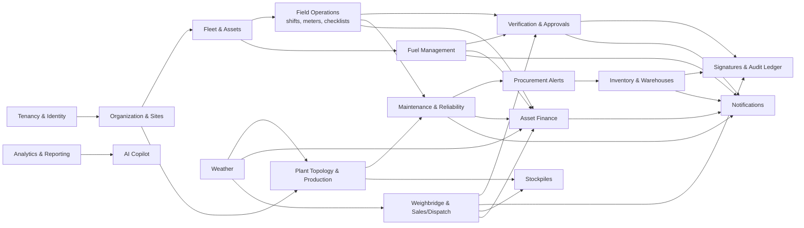

# Domain Model & Bounded Contexts

> [Docs index](../README.md) › [03-domain](README.md)

## 9.1 Context map

## 9.2 Bounded context catalogue

| Context | Responsibility | Key aggregates | Key events |
|---|---|---|---|
| **Tenancy & Identity** | Tenants, plans, users, roles, permissions, field masks, devices | `Tenant`, `User`, `Role`, `PermissionSet`, `Device` | `TenantProvisioned`, `DeviceEnrolled`, `RoleChanged` |
| **Organization & Sites** | Company structure, quarries/sites, benches, zones, shift calendars | `Site`, `Bench`, `ShiftPattern` | `SiteCreated` |
| **Fleet & Assets** | Machines and attachments, meters, classifications, lifecycle, location history | `Asset`, `Meter`, `MeterReading`, `AssetAssignment` | `AssetRegistered`, `MeterReplaced`, `MeterFallbackActivated`, `AssetTransferred` |
| **Plant Topology & Production** | Directed graph of plant nodes and edges, materials, size classes, mass balance, blasts | `Plant`, `PlantNode`, `PlantEdge`, `Material`, `BlastEvent`, `ProductionRun` | `TopologyChanged`, `BlastRecorded`, `MassBalanceComputed` |
| **Field Operations** | Shifts, meter start/end, operator assignment, pre-start checklists, photos | `Shift`, `ShiftEntry`, `ChecklistSubmission` | `ShiftEntrySubmitted`, `ContinuityExceptionRaised` |
| **Fuel Management** | Tanks, bowsers, dispensing, deliveries, dips, consumption baselines | `FuelTank`, `FuelTransaction`, `TankDip` | `FuelDispensed`, `FuelAnomalyDetected` |
| **Verification & Approvals** | Generic review workflow for any verifiable record, SoD rules, escalation | `ReviewItem`, `ReviewPolicy` | `ItemApproved`, `ItemRejected`, `ItemCorrected` |
| **Signatures & Audit Ledger** | Signature capture, crypto verification, hash chain, anchoring, verification API | `SignatureEnvelope`, `LedgerEntry`, `ChainAnchor` | `LedgerAppended`, `ChainAnchored`, `TamperDetected` |
| **Weighbridge & Sales/Dispatch** | Customers, products, price lists, orders, trucks, scale tickets, delivery notes | `Customer`, `SalesOrder`, `ScaleTicket`, `DeliveryNote` | `TicketIssued`, `TicketReversed`, `OrderFulfilled` |
| **Stockpiles** | Finished-product stock per fraction, surveys, reconciliation | `Stockpile`, `StockpileSurvey` | `StockpileReconciled` |
| **Maintenance & Reliability** | Components/wear parts, ratings, RUL, work orders, PM plans, maintenance grouping | `Component`, `MaintenancePlan`, `WorkOrder` | `RulRecomputed`, `ComponentReplaced`, `WorkOrderClosed` |
| **Inventory & Warehouses** | Magasin Général + site stores, items, lots/serials, receipts, issues, transfers, counts | `Warehouse`, `Item`, `StockLedgerEntry`, `TransferWaybill`, `StockCount` | `TransferDispatched`, `TransferReceived`, `VarianceDetected` |
| **Procurement Alerts** | Reorder triggers from RUL & min/max levels; PR hand-off (not full purchasing) | `ProcurementAlert`, `PurchaseRequest` | `ProcurementTriggered` |
| **Asset Finance** | Acquisition cost, loans, schedules, residuals, cost rates, P&L, DSCR | `AssetFinancing`, `LoanSchedule`, `CostRate` | `DscrBreached` |
| **Weather** | Site forecasts, climatology normals, rain-stop days, risk scoring | `WeatherSnapshot`, `ClimateNormal` | `RainRiskForecast` |
| **Analytics & Reporting** | KPIs, read models, scheduled reports, exports | read models only | — |
| **AI Copilot** | Q&A, summaries, anomaly explanations, maintenance grouping suggestions | `Conversation`, `AiAuditRecord` | `InsightGenerated` |
| **Notifications** | Rules, channels, preferences, delivery tracking | `NotificationRule`, `Delivery` | — |

## 9.3 Core shared value objects (SharedKernel)

- `TenantId`, `SiteId`, typed IDs (UUIDv7 for time-ordered keys generated offline).
- `Quantity { value: decimal, unit: Unit, state?: MaterialState }`: unit codes `m3` (always with a state: `bank`, `loose`, `compacted`), `t` (metric tonne), `kg`, `st` (short ton), `l`, `km`, `h`, `day`, `pcs`; built in `Karry.SharedKernel.Units` ([ADR-0025](../adr/0025-units-engine-and-materials.md)).
- `Money { amount: decimal, currency: CurrencyCode }`.
- `MeterValue { value, meterType: HOURS|KM, meterId }`.
- `GeoPoint { lat, lon, accuracyM }`.
- `CapturedAt { deviceTime, serverReceivedTime, timezone }`.
- `DocumentHash { algorithm: SHA-256, hex }`.

## 9.4 Asset lifetime history (inter-site transfers)

The spec requires that history "follows" an asset across warehouses. The design does **not clone** metrics (cloning creates two truths). Instead:

- An `Asset` has a **single global identity within the tenant**.
- `AssetAssignment` rows (append-only) record `{asset, location (site/warehouse), from, to, transferWaybillId}`.
- All readings, fuel, costs, maintenance carry `assetId` + the `siteId` at time of event.
- "Lifetime timeline" = ordered union of events by asset; "site-specific" metrics = same query filtered by assignment interval. Depreciation continues uninterrupted.
