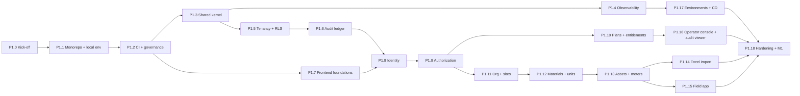

# Phase 1 Execution Plan: Sub-Phases P1.0 – P1.18

> [Docs index](../../README.md) › [04-phases](../README.md) › [Phase 1 plan](plan.md) · [Phase 1 tracker](tracker.md)

The [Phase 1 plan](plan.md) says **what** Phase 1 delivers (stories, acceptance criteria, test cases, exit gate). This file says **in which order** we build it: **19 sub-phases**, each small enough to finish, test and push before the next one starts.

**How to use it:** tell the agent **"start P1.x"**. The agent then follows the [way of working](#2-way-of-working-applies-to-every-sub-phase) (§2) and the sub-phase card below, and reports when the sub-phase is done. Live status is in the [Phase 1 tracker](tracker.md).

---

## Contents

1. [Overview and order](#1-overview-and-order)
2. [Way of working (applies to every sub-phase)](#2-way-of-working-applies-to-every-sub-phase)
3. [Sub-phase cards](#3-sub-phase-cards)
   - Foundation: [P1.0](#p10--kick-off--prerequisites) · [P1.1](#p11--monorepo-module-template--local-environment) · [P1.2](#p12--ci-pipeline--repository-governance) · [P1.3](#p13--shared-kernel--building-blocks) · [P1.4](#p14--observability-baseline)
   - Security core: [P1.5](#p15--tenancy--isolation) · [P1.6](#p16--audit-ledger-core) · [P1.7](#p17--frontend-foundations-design-system-i18n-app-shells) · [P1.8](#p18--identity--authentication) · [P1.9](#p19--authorization-roles-scopes-masking)
   - SaaS and master data: [P1.10](#p110--plans-entitlements-subscriptions--feature-flags) · [P1.11](#p111--organization-sites-shifts--tenant-settings) · [P1.12](#p112--materials--units-engine) · [P1.13](#p113--assets--meters) · [P1.14](#p114--excel-import)
   - Field and operations: [P1.15](#p115--field-app-install-enrollment-offline-data-shared-tablet) · [P1.16](#p116--platform-operator-console--audit-viewer) · [P1.17](#p117--environments--continuous-delivery) · [P1.18](#p118--hardening-non-functional-tests-demo--exit-gate-m1)
4. [Story coverage check](#4-story-coverage-check)
5. [Owner inputs and when they are needed](#5-owner-inputs-and-when-they-are-needed)
6. [New test cases introduced by this plan](#6-new-test-cases-introduced-by-this-plan)

---

## 1. Overview and order

| # | Sub-phase | Stories | Size | Owner input needed before start |
|---|---|---|---|---|
| P1.0 | Kick-off & prerequisites | — | S | Docker access; PR review/merge rule |
| P1.1 | Monorepo, module template, local environment | PLT-01, PLT-02 | M | — |
| P1.2 | CI pipeline & repository governance | PLT-03 | M | ~~Branch protection~~ not available without a paid plan → merge guard (owner decision) |
| P1.3 | Shared kernel & building blocks | (technical scope §8.5) | M | — |
| P1.4 | Observability baseline | OPS-01, OPS-02 | S | Sentry: SaaS account or self-host (can defer to P1.17) |
| P1.5 | Tenancy & isolation | TEN-01, TEN-02, TEN-03 | L | — |
| P1.6 | Audit ledger core | AUD-01, AUD-02, AUD-03 | L | — |
| P1.7 | Frontend foundations (design system, i18n, app shells) | OFF-05, OFF-06 | M | Logo / brand colours (placeholders are fine) |
| P1.8 | Identity & authentication | IAM-01, IAM-02, IAM-03 | L | Email sender domain; SMS/WhatsApp provider (can stub) |
| P1.9 | Authorization: roles, scopes, masking | IAM-04, IAM-05, IAM-06, IAM-07 | L | Review default role matrix |
| P1.10 | Plans, entitlements, subscriptions, feature flags | BIL-01 … BIL-05, PLT-05 | L | Plan limits & prices (illustrative OK; final after pricing validation) |
| P1.11 | Organization, sites, shifts, tenant settings | ORG-01, ORG-02, TEN-04 | M | Typical shift patterns (open question 7) |
| P1.12 | Materials & units engine | UNI-01, AST-04 | M | Formula handbook sign-off (units section) |
| P1.13 | Assets & meters | AST-01, AST-02, AST-03 | M | Review seeded machine types |
| P1.14 | Excel import | ORG-03 | M | A real (anonymised) asset list from a prospect, if available |
| P1.15 | Field app: install, enrollment, offline data, shared tablet | OFF-01 … OFF-04 | L | A real low-end Android tablet for device tests |
| P1.16 | Platform operator console & audit viewer | OPS-03, AUD-04 | M | — |
| P1.17 | Environments & continuous delivery | PLT-04 | L | **Hosting provider & region (WP-P0-14)**, cloud account, domain name |
| P1.18 | Hardening, non-functional tests, demo & exit gate M1 | (exit gate) | M | Pilot master data; demo attendance |

Size: **S** ≈ 1–3 PRs, **M** ≈ 3–6 PRs, **L** ≈ 6–10 PRs (PRs ≤ 400 changed lines each, [guidelines §20.3](../../00-llm/llm_guidelines.md#203-pull-requests)).

**Parallel work.** The order above is the default. P1.4, P1.7 and P1.17 can move earlier or run alongside others, because they do not depend on business rules. P1.17 cannot start until the hosting provider is chosen; if that decision is late, everything else still proceeds on the local and CI environments.

**What waits for Phase 0 answers.** Sub-phases that encode business choices (P1.10 plans/prices, P1.11 shift patterns, P1.12 densities and formulas) are built with **data-driven configuration**, so late answers change seed data, not code.

---

## 2. Way of working (applies to every sub-phase)

These are the rules from [`llm_guidelines.md`](../../00-llm/llm_guidelines.md) applied to Phase 1. Every sub-phase follows the same loop.

### 2.1 Start of a sub-phase

1. Read [`llm_hands_off.md`](../../00-llm/llm_hands_off.md), this card, and the stories in [plan.md](plan.md) (§8.4) that the card lists.
2. Check that the card's **"Depends on"** sub-phases are ✅ in the [tracker](tracker.md) and that its **owner inputs** are available (or agreed placeholders).
3. **Verify current versions** of every new dependency before adding it (release notes, `npm view`, NuGet). Pin exact versions; never trust remembered numbers ([hand-off traps](../../00-llm/llm_hands_off.md)).
4. For each non-trivial story, write the **story implementation plan** ([guidelines §26.2](../../00-llm/llm_guidelines.md#262-story-implementation-plan-write-before-coding-non-trivial-stories)) in the PR description.
5. Mark the sub-phase 🟡 in the tracker.

### 2.2 During the sub-phase

- **Branches & PRs** (from P1.2 on, `main` is protected): one short-lived branch per story or slice (`feat/US-P1-TEN-02-rls-framework`), small PRs (≤ 400 changed lines), Conventional Commit titles with story IDs, PR template [§26.3](../../00-llm/llm_guidelines.md#263-pull-request-description).
- **No AI attribution** in commits or PRs ([§20.2](../../00-llm/llm_guidelines.md#202-commits)).
- **Tests first-class**: every AC mapped to ≥ 1 test; test names carry `TC-…` IDs and `[Trait("Story", …)]`; faithful tests ([§8](../../00-llm/llm_guidelines.md#8-test-quality-rules-faithful-senior-grade-tests)); for security-critical code, prove the test catches a deliberately injected bug (mutation check), as done in Phase 0.
- **Run the exact CI commands locally** before pushing ([§7.5](../../00-llm/llm_guidelines.md#75-running-tests-locally-expected-commands-keep-in-sync-with-the-real-repo)), then confirm in GitHub Actions that the **new tests actually ran** (test count went up) with `gh run view`.
- **Invariants are never traded off** ([§4](../../00-llm/llm_guidelines.md#4-non-negotiable-product-invariants)): tenant isolation, immutable signed records, ledger in the same transaction, explicit units, decimal money, offline never loses data.
- **Architecture changes** need an ADR ([§21](../../00-llm/llm_guidelines.md#21-decision-making-when-to-act-when-to-ask-when-to-write-an-adr)). Each card lists the decisions expected in that sub-phase with a recommendation.

### 2.3 Review & merge

The team is currently the owner plus the AI agent, so the "2 reviewers" rule for sensitive modules ([§20.3](../../00-llm/llm_guidelines.md#203-pull-requests)) is applied as follows until more engineers join:

1. The agent completes the **senior self-review checklist** ([§25](../../00-llm/llm_guidelines.md#25-senior-self-review-checklist-before-saying-done)) and, for `Tenancy`, `Identity`, `Trust`, `Billing`, `Sync` and CI security settings, a **separate security review pass** documented in the PR.
2. All required checks are green.
3. **Merges go through `tools/ci/merge_guard.py <pr>` only** (permanent: no paid GitHub plan) (never a hand-written `gh pr merge`): it waits for checks, refuses if any required check is missing or not green, refuses sensitive PRs without `--owner-approved`, then squash-merges. Reason: PR #7 was merged with a red `security` check by a hand-written command (2026-10-22). Branch protection would enforce this server-side but needs a paid plan on a private repository; the owner decided not to pay (2026-10-22), so the guard is the permanent control.
4. **Merge rule (owner decision, 2026-10-22):** the agent squash-merges **normal PRs** itself once every required check is green. PRs touching **`Tenancy`, `Identity`, `Trust` (ledger/signatures), `Billing`, `Sync`, ledger migrations or CI/CD security settings** wait for the owner's explicit approval.

### 2.4 End of a sub-phase

A sub-phase is ✅ only when **all** of these are true:

- [ ] Every listed story's ACs are implemented and each AC maps to ≥ 1 passing test (or the card explicitly defers an AC to a later sub-phase).
- [ ] The card's test cases pass locally **and** in GitHub Actions on `main`.
- [ ] [Definition of Done](../../00-llm/llm_guidelines.md#24-definition-of-done-copy-paste-checklist) satisfied for each story (N/A items noted).
- [ ] **Docs sweep done** ([guidelines §19](../../00-llm/llm_guidelines.md#19-documentation-policy)): every doc the change made stale is fixed (grep for obsolete names). Docs updated: ADRs, `docs/api/` (OpenAPI), runbooks, test plan rows, [§7.5 commands](../../00-llm/llm_guidelines.md#75-running-tests-locally-expected-commands-keep-in-sync-with-the-real-repo) if they changed; link checker reports 0 broken links.
- [ ] [Tracker](tracker.md) updated (status, evidence, CI run IDs) and [`llm_hands_off.md`](../../00-llm/llm_hands_off.md) session log and next steps updated.
- [ ] Short **sub-phase report** to the owner: what was built, test results, problems found, what is next, and owner inputs needed.

---

## 3. Sub-phase cards

### P1.0 — Kick-off & prerequisites

**In plain words:** get the machine, the repository and the rules ready so the real work does not stop halfway.

- **Stories:** none (preparation).
- **Depends on:** Phase 0 spikes ✅ (done). The M0 exit gate does not need to be fully passed for P1.0–P1.9 ([recommendation](../phase-00-discovery/tracker.md#4-m0-exit-gate)): they do not depend on discovery answers.
- **Owner inputs:**
  - Docker access for the agent: `sudo usermod -aG docker $USER`, then log out and in. **Required** from P1.1 (local stack, Testcontainers). Alternative: Podman with its Docker-compatible socket.
  - Confirm the merge rule (§2.3): owner approves every PR, or standing approval for non-sensitive PRs.
  - Accept or amend ADR-0001 … 0016 (at least 0001, 0002, 0003, 0004, 0008, 0012, 0015, which P1.1–P1.8 rely on).
- **What gets done:**
  - Verify toolchain: .NET SDK version in `global.json`, Node LTS, pnpm, Docker/Testcontainers, `actionlint`, `gh`.
  - Check current stable versions of the Phase 1 stack and record them in [technology-stack.md](../../02-architecture/technology-stack.md) (ASP.NET Core, EF Core, Npgsql, Keycloak, React, Vite, TanStack, Tailwind, shadcn/ui, i18next, OpenTelemetry, Testcontainers, Playwright, k6).
  - Decide and record (ADR or ADR update):
    - **In-process messaging:** recommend a **thin in-house dispatcher** over the outbox (ADR-0015). It has no licence risk and fits a small surface; Wolverine is the alternative.
    - **Background jobs:** recommend **Quartz.NET** for scheduled jobs (anchoring, usage snapshots, shift generation) plus the outbox worker. Hangfire's dashboard is not needed and adds a storage schema.
    - **Local orchestration:** recommend **Docker Compose** (portable, CI-friendly, no IDE lock-in). .NET Aspire stays optional for developer convenience.
    - **Feature flags:** recommend **OpenFeature SDK** with an in-house provider backed by our database (per-tenant flags, audited changes), so no extra service.
  - Create the [Phase 1 tracker](tracker.md) entries (status ⬜ → 🟡).
- **Tests:** none new; Phase 0 CI stays green.
- **Done when:** toolchain verified, decisions recorded, owner inputs received, tracker started.

---

### P1.1 — Monorepo, module template & local environment

**In plain words:** create the real project structure, a template that every future module copies, rules that stop modules from tangling together, and one command that starts the whole system on a laptop.

- **Stories:** US-P1-PLT-01 (AC1–AC4), US-P1-PLT-02 (AC1–AC3; AC2 seed data completed in P1.5/P1.8 when tenants and users exist).
- **Depends on:** P1.0.
- **What gets built** (layout per [repository-structure.md](../../02-architecture/repository-structure.md)):
  - Root: `global.json`, `Directory.Build.props` (net10.0, Nullable, TreatWarningsAsErrors, lock files, analyzers), `Directory.Packages.props` (central package versions), `Karry.slnx`, `.editorconfig`, `pnpm-workspace.yaml`, root `package.json`, `README.md` (≤ 10 commands to run everything).
  - Backend: `src/backend/Karry.Host` (ASP.NET Core, health endpoints `/health/live`, `/health/ready`), `Karry.Workers` (empty host), `Karry.SharedKernel` and `Karry.BuildingBlocks` (empty projects, filled in P1.3).
  - **Module template**: `tools/new-module.sh <Name>` (wraps `dotnet new karry-module`) produces `Contracts / Domain / Application / Infrastructure / Api / Tests` under `src/backend/Modules/<Name>/` with correct references, the `IModule` entry point and a sample test, and adds them to `Karry.slnx`. Template source in `tools/templates/karry-module/`; module tests live **inside the module folder**.
  - **Architecture tests** `tests/Karry.ArchitectureTests`: rules on the **project reference graph** of the real repository (a module may reference only other modules' `Contracts`; layers only point downwards; `Domain`/`Contracts` free of EF/ASP.NET/Npgsql; nothing references a host; kernel projects at the bottom; every project in `Karry.slnx`; module project naming). Each rule is proven by a test with a deliberately broken graph (TC-P1-PLT-001, TC-P1-PLT-014). Type-level rules with ArchUnitNET are added in P1.5, when the first real module exists.
  - Frontend workspace in `src/frontend/` (its own pnpm workspace, so the frozen Phase 0 spike is unaffected): `apps/portal`, `apps/field` (Vite + React + TS shells), source-first packages `ui`, `i18n`, `api-client`, `offline`, `crypto`; versions declared once in the pnpm **catalog**; shared strict `tsconfig.base.json` and type-aware ESLint config ([ADR-0020](../../adr/0020-frontend-toolchain-versions.md)); Node 24 pinned in `.nvmrc`.
  - **Local stack** `deploy/docker/compose.yaml`: PostgreSQL with PostGIS + TimescaleDB + pgvector + pgcrypto (image proven in WP-P0-13), Keycloak (realm import folder, empty realm for now), **SeaweedFS** S3 store with an Object Lock bucket ([ADR-0017](../../adr/0017-local-stack-and-object-storage.md); MinIO OSS is archived), Valkey, Mailpit. Versions from [technology stack §7.1.1](../../02-architecture/technology-stack.md#711-verified-versions-phase-1-start-2026-10-22). Readiness checks over TCP (Phase 0 finding).
  - `.gitignore` updates, `CODEOWNERS` placeholder.
- **Tests:**

  | Test | What it proves |
  |---|---|
  | TC-P1-PLT-001 | Adding a forbidden cross-module reference fails the architecture tests (pipeline test, completed in P1.2) |
  | TC-P1-PLT-003 *(new)* | `dotnet new karry-module -n Sample` output builds and its sample test passes; template output contains the 5 projects with the right references |
  | TC-P1-PLT-004 *(new)* | `docker compose up` brings every service to healthy; all 4 PostgreSQL extensions can be created; on the S3 store, deleting/overwriting an object locked in compliance mode or shortening its retention **fails** |
  | TC-P1-PLT-012 *(new)* | `/health/live` and `/health/ready` behave correctly with no, unreachable and reachable database; no infrastructure detail leaks |
  | TC-P1-PLT-013 *(new)* | Module contract: services registered, duplicate names rejected, endpoints mapped under `/api/v1/{module}` |
  | Smoke | Host `/health/ready` returns 200 against the local stack; portal and field dev servers build |

- **CI changes:** none yet (pipeline in P1.2); the existing `docs.yml` and `spikes.yml` stay green.
- **Done when:** a fresh clone + the README commands produce a running (empty) system; architecture tests fail on a deliberate violation; template verified.

---

### P1.2 — CI pipeline & repository governance

**In plain words:** every change is automatically built, tested and scanned, and nothing broken can enter `main`.

- **Stories:** US-P1-PLT-03 (AC1–AC3). AC1 items that need code from later sub-phases (OpenAPI diff, tenant-isolation job, integration tests) are added as **jobs that run and pass on an empty set**, then fill up as code arrives.
- **Depends on:** P1.1.
- **Owner inputs:** ~~enable branch protection~~ (approved, but GitHub requires a paid plan for private repositories and the owner decided not to pay, 2026-10-22: `tools/ci/merge_guard.py` enforces the same rules client-side). Confirm whether Renovate (GitHub App) may be installed.
- **What gets built** (target structure: [guidelines §9.1](../../00-llm/llm_guidelines.md#91-pipeline-structure-built-in-p11p12-us-p1-plt-03)):
  - `.github/workflows/ci.yml`, with jobs:
    - `backend`: restore `--locked-mode`, `dotnet format --verify-no-changes`, build `-warnaserror`, unit + integration tests (Testcontainers), TRX via `--report-xunit-trx`, coverage.
    - `frontend`: `pnpm install --frozen-lockfile`, lint, typecheck, Vitest.
    - `architecture`: architecture tests.
    - `security`: gitleaks (full history), Trivy (dependencies + misconfiguration), Semgrep CE (SAST). CodeQL is not used: it needs a paid licence on a private repository ([ADR-0021](../../adr/0021-security-scanning-private-repo.md)).
    - `openapi-diff` and `tenant-isolation`: **added in P1.5 with the first API**, not as empty placeholder jobs (a green check must always mean something was verified).
    - `tooling`: `actionlint` over all workflows + tests of our CI scripts.
  - Coverage gate: **≥ 80 % lines on `*.Domain` projects**; PR fails if it drops below.
  - `nightly.yml` skeleton (mutation tests with Stryker.NET on math/trust modules from P1.6/P1.12, full isolation suite, dependency audit).
  - All actions pinned by full SHA with version comments; least-privilege `permissions`; caching keyed on lockfiles; `concurrency` groups; test summary in the job summary.
  - Repository governance: merge guard with required checks (branch protection unavailable, see above) (`ci / backend`, `ci / frontend`, `ci / architecture`, `ci / security`, `docs`), PR template `.github/pull_request_template.md` (from [§26.3](../../00-llm/llm_guidelines.md#263-pull-request-description)), issue templates (bug [§26.5](../../00-llm/llm_guidelines.md#265-bug-report), story), Renovate config (grouped updates, pinned digests), `SECURITY.md`.
- **Tests:**

  | Test | What it proves |
  |---|---|
  | TC-P1-PLT-001 | A PR adding a cross-module reference fails `ci / architecture` |
  | TC-P1-PLT-002 | A PR containing a fake secret is blocked by gitleaks |
  | TC-P1-PLT-005 *(new)* | A PR lowering Domain coverage below 80 % fails (gate unit tests in `tools/ci/test_coverage_gate.py` + real gate on every run); a PR with a format violation fails |
  | Duration | PR pipeline p50 < 12 min (measured over the first 10 runs, recorded in the tracker) |

  These are demonstrated with throwaway PRs that are then closed (evidence: run IDs in the tracker).
- **Done when:** merge guard in place (branch protection unavailable); all required checks run on PRs; the three negative demos above are recorded; `docs/00-llm/llm_guidelines.md` §7.5 and §9 match the real commands.

---

### P1.3 — Shared kernel & building blocks

**In plain words:** the common bricks that every module reuses: IDs, money, results, errors, the database transaction pattern, and the reliable "outbox" that delivers events.

- **Stories:** technical scope [§8.5](plan.md#85-technical-scope) (prerequisite for TEN-02, AUD-01, BIL-03, IAM-07).
- **Depends on:** P1.2.
- **What gets built:**
  - `Karry.SharedKernel`:
    - strongly typed IDs on **UUIDv7** (`IEntityId<T>`, built-in `Guid.CreateVersion7`, no extra package)
    - `Money` + `Currency` (decimal, supported ISO 4217 codes with minor units, no float, commercial rounding, loss-free `Allocate`)
    - `Result<T>` and `Error` (stable codes, kinds mapped to HTTP statuses)
    - `DomainEvent` and `AggregateRoot<TId>`
    - time from .NET's built-in **`TimeProvider`** (`FakeTimeProvider` in tests) instead of a custom `IClock`
    - argument checks use the built-in `ArgumentException.ThrowIf…` helpers instead of a custom guard library
    - `Quantity` is **declared** here but implemented in P1.12.
  - `Karry.BuildingBlocks`:
    - **Persistence base:** EF Core `DbContext` base with one transaction per request/command; a migrations runner executed as a separate owner role; naming conventions.
    - **Unit of work:** a pipeline that commits the business change, the outbox rows and (from P1.6) the ledger entry in **one transaction**.
    - **Transactional outbox** (ADR-0015, ADR-0018): per-module `outbox_messages` and `processed_messages` tables in the module's schema (`ModuleDbContext`); events named by a stable versioned `[EventType("module.event.v1")]`, never by CLR type; in-house `OutboxDispatcher<TContext>` (one transaction per message, `FOR UPDATE SKIP LOCKED`, per-aggregate ordering, exponential back-off, dead-letter); `IDomainEventSubscriber<T>` gets the dispatch transaction so in-database effects are applied exactly once; hosted by `OutboxDispatcherService<TContext>` in `Karry.Workers`.
    - **Idempotency** (`.RequireIdempotencyKey()` + `IdempotencyMiddleware`, table `platform.idempotency_records`): replay, key-reuse and in-progress detection, 24 h retention; scope becomes tenant + user in P1.5/P1.8.
    - **Deferred to P1.5 (first real module):** EF Core migrations and the migrations runner as the owner role. P1.3 tests create schemas with `EnsureCreated`; production schemas will only come from migrations. *(Done in P1.5: `MigrationRunner`, `Karry.Host migrate`, `deploy/database/roles.sql`.)*
    - **Errors and API:** RFC 9457 problem details with stable error codes; API versioning (`/api/v1`); OpenAPI generation.
    - **Validation** pipeline.
    - **Hooks reserved** for the tenancy middleware (P1.5), authorization (P1.9) and the entitlement filter (P1.10).
- **Tests:**

  | Test | What it proves |
  |---|---|
  | TC-P1-PLT-006 *(new)* | `Money` arithmetic and rounding: property tests (associativity where valid, no currency mixing, decimal only) |
  | TC-P1-PLT-007 *(new)* | Outbox: event written in the same transaction as the change; rolled back together; dispatched exactly once to an idempotent handler even if the worker crashes after handling (Testcontainers PostgreSQL) |
  | TC-P1-PLT-008 *(new)* | Idempotency key replay returns the original response, does not execute twice |
  | Unit | UUIDv7 ordering; problem details mapping; validation errors |

- **Mutation check:** remove the transaction around outbox writes → TC-P1-PLT-007 must fail.
- **Done when:** a sample module command goes end-to-end (API → handler → DB + outbox → worker → handler) with tests green in CI.

---

### P1.4 — Observability baseline

**In plain words:** we can see what the system does, how fast, and where it fails, and we are alerted before customers notice.

- **Stories:** US-P1-OPS-01 (AC1–AC3), US-P1-OPS-02 (AC1, AC3; AC2 frontend error tracking completed in P1.7, production wiring in P1.17).
- **Depends on:** P1.3.
- **Owner inputs:** Sentry SaaS account or self-hosted (can be decided in P1.17; the SDK is wired with a no-op DSN until then).
- **What gets built:**
  - OpenTelemetry in Host and Workers: traces (ASP.NET Core, HTTP, Npgsql, EF Core), metrics (RED per module, DB pool, outbox/job lag), structured logs.
  - Span attributes `tenant_id`, `module`, `route`, `user_role`, with an **allow-list processor** that drops anything else, so no personal data leaks into telemetry.
  - Correlation: `traceparent` / `X-Correlation-Id` returned on every response and included in problem details.
  - Local observability: Grafana LGTM stack container added to `compose.yaml`; dashboards as code (`deploy/observability/dashboards/`).
  - Alert rules as code for the 5 alerts in OPS-02 AC1; one runbook per alert in [`docs/06-operations/runbooks/`](../../06-operations/runbooks/README.md) ([template §26.6](../../00-llm/llm_guidelines.md#266-runbook--docs06-operationsrunbooksalert-namemd)).
- **Tests:**

  | Test | What it proves |
  |---|---|
  | TC-P1-OPS-003 *(new)* | An API request emits a trace with the 4 required attributes and **no** PII (email, name, phone, token) in any attribute or log (in-memory exporter) |
  | TC-P1-OPS-005 *(new)* | Correlation ID present in response headers and in problem details |
  | TC-P1-OPS-006 *(new)* | Alert rules validate and are unit-tested with promtool; dashboards are generated from code and every query runs against Prometheus in the smoke test |

- **Done when:** a local request is visible end-to-end in Grafana; 5 alert rules + 5 runbooks committed; PII test green in CI.

---

### P1.5 — Tenancy & isolation

**In plain words:** each customer company gets its own sealed space. The database itself refuses cross-company access, and an automatic attack test checks every feature.

- **Stories:** US-P1-TEN-01 (AC1 partly: Keycloak config and first admin invitation completed in P1.8, default roles in P1.9, subscription in P1.10), US-P1-TEN-02 (AC1–AC5), US-P1-TEN-03 (AC1–AC2).
- **Depends on:** P1.3. Applies every Phase 0 RLS finding ([spike report](../../../spikes/rls-pooling/README.md), [ADR-0004](../../adr/0004-multi-tenancy-rls.md)).
- **What gets built:**
  - `Tenancy` module (from the template): tenant catalog (id, slug, name, status, created), provisioning service (idempotent, < 30 s), tenant resolution from the validated token and from the tenant URL (`<slug>.karry.app` or path fallback).
  - **RLS framework:**
    - **Roles:** `karry_owner` for migrations and `karry_app` for runtime (not owner, no `BYPASSRLS`).
    - **Policies:** a migration helper `EnableTenantRls("schema.table")` generates `ENABLE` + `FORCE` + a `nullif(current_setting('app.tenant_id', true), '')::uuid` policy for both `USING` and `WITH CHECK`.
    - **Tenant per transaction:** a connection/command interceptor sets the tenant with `set_config('app.tenant_id', $1, true)` **batched with the first statement** of the transaction. A missing tenant means the request is rejected before any query runs. *(As built: `SET LOCAL` with a formatted `Guid`, prefixed outside transactions and once per transaction inside; see [ADR-0004 implementation notes](../../adr/0004-multi-tenancy-rls.md#implementation-notes-p15-2026-10-23).)*
    - **Second layer:** an EF Core global query filter on `TenantId`.
  - **Migration linter** (CI step): fails when a new table lacks `tenant_id` + RLS, unless it is listed in `global-reference-tables.txt` with a reason.
  - **Tenant-isolation suite** `tests/Karry.TenantIsolationTests`: it reads the OpenAPI document, seeds data in tenant A, calls **every** endpoint with a tenant B token, and asserts 403/404 with no A data in the body. The `ci / tenant-isolation` job becomes real and required.
  - Seed: 2 demo tenants (`demo-carriere-a`, `demo-carriere-b`).
- **Tests:**

  | Test | What it proves |
  |---|---|
  | TC-P1-TEN-001 | SQL-level: data in A, query with B context → 0 rows |
  | TC-P1-TEN-002 | Every endpoint, cross-tenant token → 403/404, empty body |
  | TC-P1-TEN-003 | Request without tenant claim → 401/400 and **no DB query executed** (asserted with a command interceptor) |
  | TC-P1-TEN-004 | Migration adding a table without `tenant_id` → CI fails |
  | TC-P1-TEN-006 *(new)* | Provisioning twice with the same request → one tenant; completes < 30 s |
  | Regression | Phase 0 cases re-run against the real framework: reused pooled connection, session-level `SET` forbidden, `WITH CHECK` blocks writing another tenant's id |

  TC-P1-TEN-005 (10k mixed-tenant load) runs in P1.18.
- **Mutation checks:** remove `FORCE`, remove `nullif`, make `set_config` session-level, drop the EF filter → each must make at least one test fail.
- **Two-reviewer rule:** security review pass documented (§2.3).
- **Done when:** isolation suite is a required check and green; threat model T-09/T-11 marked "verified by TC-P1-TEN-…"; [threat model](../../02-architecture/threat-model.md) review log updated.

---

### P1.6 — Audit ledger core

**In plain words:** a permanent history of every important action. Entries are chained so any change is detectable, a fingerprint is locked away every hour, and a checker proves nothing was altered.

- **Stories:** US-P1-AUD-01 (AC1–AC4), US-P1-AUD-02 (AC1–AC2), US-P1-AUD-03 (AC1–AC3). AUD-04 (viewer UI) in P1.16.
- **Depends on:** P1.5 (ledger entries are tenant-scoped).
- **What gets built** ([ADR-0008](../../adr/0008-hash-chained-ledger.md), [trust layer §13.3](../../02-architecture/trust-layer-signatures-audit.md#133-hash-chained-ledger)):
  - `Trust` module, `audit` schema:
    - **Entries:** `audit.ledger_entry` with a gap-free per-tenant sequence (per-tenant counter row locked in the same transaction).
    - **Hash:** `entry_hash = SHA-256(prev_hash ‖ tenant ‖ seq ‖ type ‖ payload_hash ‖ occurred_at)`, with the payload canonicalized per **RFC 8785** (same rules as the Phase 0 spike).
    - **Immutability:** triggers reject UPDATE/DELETE/TRUNCATE, and `karry_app` has only INSERT/SELECT.
  - Ledger writer hooked into the unit of work from P1.3, so the business change, outbox rows and ledger entry commit or roll back **together**.
  - **Anchoring job** (Quartz, hourly): writes `{tenant, seq, hash, timestamp}` chain heads to the `anchors` bucket with **Object Lock (compliance mode)** (SeaweedFS locally, cloud S3 in P1.17), signed with a key behind an `IAnchorSigner` port (software key locally, KMS in P1.17). Catches up after outages; failure raises an alert (+ runbook).
  - **Verifier:** `tools/ledger-verifier` CLI `karry-ledger verify --tenant <id>` → OK or first broken sequence; same logic exposed as `POST /api/v1/audit/verify`.
- **Tests:**

  | Test | What it proves |
  |---|---|
  | TC-P1-AUD-001 | 50 parallel writers → gap-free sequence, valid chain |
  | TC-P1-AUD-002 | Direct UPDATE/DELETE/TRUNCATE as app role → denied |
  | TC-P1-AUD-003 | Tamper a row as superuser in a test DB → verifier reports the exact sequence |
  | TC-P1-AUD-004 | Anchor job down for 3 h → recovery anchors every head |
  | TC-P1-AUD-006 *(new)* | Business change rolled back → no ledger entry and no outbox row (same transaction) |
  | Property | Canonicalization is stable under key reordering; any 1-byte payload change changes the hash |

- **Mutation checks:** remove the trigger; compute the hash without `prev_hash`; write the ledger outside the transaction → tests must fail. Stryker on `Trust` in nightly with score ≥ 75 %.
- **Done when:** ledger written by the sample command; verifier CLI and endpoint green; threat T-06 updated.

---

### P1.7 — Frontend foundations (design system, i18n, app shells)

**In plain words:** the look and feel of both apps: big buttons for gloves, an outdoor high-contrast mode, French and English, and the empty "frames" of the office portal and the field app.

- **Stories:** US-P1-OFF-05 (AC1–AC3), US-P1-OFF-06 (AC1–AC2). Shell parts of US-P1-OFF-01 (install and offline come in P1.15). US-P1-OPS-02 AC2 (frontend error tracking SDK).
- **Depends on:** P1.2 (can run in parallel with P1.3–P1.6).
- **Owner inputs:** logo and brand colours (placeholders allowed; tenant branding overrides them anyway).
- **What gets built:**
  - `packages/ui`:
    - **Foundation:** Tailwind CSS + shadcn/ui (Radix) components with design tokens and **light, dark and outdoor high-contrast** themes.
    - **Components:** buttons, inputs, `QuantityInput` shell (logic in P1.12), selectors, lists/tables, dialogs, toasts, status chips, empty/error states, and a **standard list/detail page pattern** used by every admin screen (risk mitigation from [plan §8.10](plan.md#810-risks)).
    - **Field rules:** touch targets ≥ 48 px and body text ≥ 16 px in the field app.
  - **Storybook** with the axe accessibility addon; stories for every component and theme.
  - `packages/i18n`: i18next + ICU, FR/EN catalogs, instant language switch, default from tenant then user, a **pseudo-localization** build (staging), and a CI check for missing keys.
  - `apps/portal` shell (TanStack Router + Query, layout, navigation driven by permissions/entitlements later, error dialog showing the correlation ID); `apps/field` shell (home screen, large navigation, sync status placeholder).
  - `packages/api-client` generated from OpenAPI (generation script + CI check that it is up to date).
  - Frontend error tracking SDK (Sentry-compatible) with release version and **hashed** tenant.
- **Tests:**

  | Test | What it proves |
  |---|---|
  | TC-P1-OFF-006 *(new)* | axe-core: **zero serious/critical violations** across all Storybook stories and themes (CI) |
  | TC-P1-OFF-007 *(new)* | Every UI string has FR and EN keys; pseudo-localized build shows no hard-coded text; switching language needs no reload |
  | Vitest | Component behaviour (keyboard, focus, disabled states); `QuantityInput` rendering |
  | Visual | Touch target and font-size assertions in the field theme |

- **CI changes:** `ci / frontend` runs Storybook build + axe + i18n key check; api-client freshness check.
- **Done when:** both shells run in FR/EN with all 3 themes; Storybook published as a CI artifact; checks green.

---

### P1.8 — Identity & authentication

**In plain words:** secure login with Keycloak, two-step login for powerful roles, user invitations, field workers with employee number and PIN, and instant removal of leavers.

- **Stories:** US-P1-IAM-01 (AC1–AC4), US-P1-IAM-02 (AC1–AC2), US-P1-IAM-03 (AC1–AC4; AC2 device unlock and AC3 tablet part completed in P1.15; AC4 usage meter wired in P1.10). Completes TEN-01 AC1 (Keycloak config + first admin invitation).
- **Depends on:** P1.5, P1.6 (every identity change is ledgered), P1.7 (login UI).
- **Owner inputs:** email sender domain (for invitations; Mailpit locally); SMS/WhatsApp provider (behind a port, stubbed until chosen).
- **What gets built** ([ADR-0012](../../adr/0012-identity-authorization.md)):
  - **Keycloak realm as code** (`deploy/keycloak/`): Authorization Code + PKCE clients for portal and field, token lifetimes (access ≤ 10 min), refresh rotation with reuse detection, brute-force protection, password policy, FR/EN **login theme with tenant branding**.
  - **Tenant ↔ Keycloak mapping:** recommend **one realm with Keycloak Organizations** (current Keycloak feature) for SaaS scale; dedicated realm for Enterprise later. Recorded in an ADR-0012 update.
  - `Identity` module:
    - **Users and lifecycle:** user records linked to the Keycloak subject; invitation (email/phone link, 7-day expiry, role + site scope); deactivation that revokes sessions within 1 minute.
    - **Field workers:** employee-ID users with a PIN (stored as a salted hash; used offline in P1.15).
  - **MFA policy:** TOTP or WebAuthn is mandatory for roles flagged `privileged`, with forced enrolment.
  - **Token handling in apps:** tokens kept in memory only (never in localStorage), with silent refresh via a secure mechanism.
  - **Audit:** login failures, lockouts, invitations and deactivations are written to the ledger.
  - Seed: users for each default role in both demo tenants (completes PLT-02 AC2).
- **Tests:**

  | Test | What it proves |
  |---|---|
  | TC-P1-IAM-001 | E2E login FR/EN with tenant branding by URL |
  | TC-P1-IAM-002 | Privileged user without MFA → forced enrolment, no portal access |
  | TC-P1-IAM-003 | Refresh token reuse → session revoked |
  | TC-P1-IAM-007 *(new)* | Deactivated user loses API access within 60 s; historical records still show their name |
  | TC-P1-IAM-008 *(new)* | Invitation expires after 7 days (fake clock); reused invitation link rejected |
  | Security | No token in `localStorage`/`sessionStorage` (E2E assertion); lockout after N failures is audited |

- **Two-reviewer rule:** security review pass on Keycloak config (checklist from [plan §8.6](plan.md#86-test-plan-phase-1) security tests).
- **Done when:** login works end-to-end in both apps; Keycloak config reproducible from repository; tests green.

---

### P1.9 — Authorization: roles, scopes, masking

**In plain words:** who can see and do what, per site, and hiding prices, costs and wages from roles that must not see them, everywhere, including exports.

- **Stories:** US-P1-IAM-04 (AC1–AC2), US-P1-IAM-05 (AC1–AC3), US-P1-IAM-06 (AC1–AC2), US-P1-IAM-07 (AC1–AC3; AI tools part applies in Phase 8). Completes TEN-01 AC1 (default roles on provisioning).
- **Depends on:** P1.8.
- **Owner inputs:** review the [default role & permission matrix](../../03-domain/catalogues/roles-and-permissions.md).
- **What gets built:**
  - **Permissions:**
    - Permission = (resource, action, scope) registry declared by each module in code.
    - Default roles are seeded and cannot be deleted, but can be cloned. Custom roles are supported.
    - Role assignment **per scope**: tenant, site(s), warehouse(s).
  - **Enforcement:** an authorization policy pipeline (permission + scope) on every endpoint. List queries are filtered by scope, and out-of-scope IDs return **404**.
  - **Step-up:** privileged permission changes require re-authentication (Keycloak step-up / `max_age`).
  - **Field-level rules:** `READ / WRITE / MASKED / HIDDEN` per configurable sensitive field, applied **in the JSON serializer** (one place) and reused by export/PDF writers. Masked values serialize as a marker that the UI shows as `•••` with "hidden by policy".
  - Admin UI: roles list, permission matrix editor (grouped by module, effective permissions), role assignments with scopes, field policy editor; every change ledgered with before/after.
- **Tests:**

  | Test | What it proves |
  |---|---|
  | TC-P1-IAM-005 | Masked field for role X is **never present** in any endpoint response or export (generated from OpenAPI, like the isolation suite) |
  | TC-P1-IAM-006 | Out-of-scope site asset by ID → 404 |
  | TC-P1-IAM-009 *(new)* | Default roles cannot be deleted; clone works; privileged permission change without step-up → rejected |
  | Allow/deny matrix | For each default role × sample endpoint: allowed and denied cases (table-driven) |

- **Two-reviewer rule:** security review pass.
- **Done when:** masking suite and scope tests are required checks; threat T-10/T-13 marked verified.

---

### P1.10 — Plans, entitlements, subscriptions & feature flags

**In plain words:** the money engine: plans as data, what each customer may use, usage counting with soft limits, and what happens when a customer does not pay (field work never stops).

- **Stories:** US-P1-BIL-01 … BIL-05 (all ACs), US-P1-PLT-05 (AC1–AC2). Completes TEN-01 AC1 (subscription on provisioning) and IAM-03 AC4 (office-seat meter).
- **Depends on:** P1.9.
- **Owner inputs:** plan limits and prices. The **illustrative** values from [business model §2.3](../../01-product/business-model-and-pricing.md#23-subscription-plans-illustrative-validated-in-phase-0-with-real-prospects) are seeded until pricing validation (WP-P0-07) gives final numbers. Changing them later is a data change, not a code change.
- **What gets built** ([business model §2.5](../../01-product/business-model-and-pricing.md#25-tenant-subscription-lifecycle)):
  - `Billing` module:
    - **Plans:** a versioned plan catalogue (features, limits, price book per currency), with Starter / Professional / Business / Enterprise seeded.
    - **Subscriptions:** plan + add-ons + period + quantities; the **state machine** Trial → Active → PastDue → Restricted → Suspended → Cancelled → Expired → Deleted, with transitions ledgered; manual invoice records.
  - **Entitlement resolver:** plan + add-ons + overrides, cached ≤ 60 s per tenant.
    - API: `RequiresFeature("<code>")` returns the `feature_not_in_plan` problem. The HTTP status (402 vs 403) is decided in an ADR; the recommendation is **403** with the problem type, because 402 is poorly supported by clients and proxies.
    - Frontend: a `useEntitlement()` hook and an upgrade card.
  - **Usage meters:** a daily snapshot job (sites, assets per site, office users, storage); a 10 % grace margin; beyond it, only **creation** of over-limit items is blocked, **never field capture**; a "Plan & usage" page.
  - **Subscription enforcement middleware:** Restricted makes the office read-only while field sync is accepted; Suspended makes everything read-only with export allowed; Cancelled/Expired show export and reactivate only.
  - **Feature flags:** OpenFeature with a DB-backed provider, evaluable per tenant, user and environment, changeable without redeploy, with audited changes.
- **Tests:**

  | Test | What it proves |
  |---|---|
  | TC-P1-BIL-001 | Entitlement resolution: plan + add-ons + overrides (table-driven + property tests) |
  | TC-P1-BIL-002 | Gated endpoint without feature → `feature_not_in_plan` |
  | TC-P1-BIL-003 | Locked feature shows upgrade card; no data leaked in the response |
  | TC-P1-BIL-004 | +5 % over limit → banner only; +15 % → creation blocked; field capture unaffected |
  | TC-P1-BIL-005 | Subscription → Restricted: office read-only, field sync accepted |
  | TC-P1-BIL-006 *(new)* | Every illegal state transition rejected (state machine exhaustive test); plan version change does not move existing subscriptions |
  | TC-P1-PLT-009 *(new)* | Feature flag change takes effect without redeploy and is ledgered |

- **Two-reviewer rule:** security review pass (Billing).
- **Done when:** switching a demo tenant from Professional to Starter shows the upgrade card within 60 s; all tests green.

---

### P1.11 — Organization, sites, shifts & tenant settings

**In plain words:** the company's structure: its settings, its sites on the map, shift patterns and holidays.

- **Stories:** US-P1-ORG-01 (AC1–AC2), US-P1-ORG-02 (AC1–AC3), US-P1-TEN-04 (AC1–AC2).
- **Depends on:** P1.9 (scoped permissions), P1.10 (site count meter).
- **Owner inputs:** typical shift patterns and holiday calendars of target customers ([open question 7](../../00-llm/llm_hands_off.md#7-open-questions-awaiting-the-product-owner)); defaults are configurable either way.
- **What gets built:**
  - **Tenant settings** (TEN-04): legal name, logo, colour, language, currency, unit system, timezone and fiscal year start. Changes are audited and applied without re-login.
  - `Organization` module: sites (type, address, **GPS pin**, optional **boundary polygon** stored as PostGIS geometry, timezone, currency override), archive instead of delete.
  - **Shift patterns** per site with effective dates; **calendars** (non-working days, public holidays); a shift instance generator (Quartz) for the next 30 days, plus on-demand computation for any date. Correct across **DST changes and night shifts crossing midnight**.
  - Portal screens using the standard list/detail pattern, with a map picker (map library to verify in P1.0, e.g. MapLibre).
- **Tests:**

  | Test | What it proves |
  |---|---|
  | TC-P1-ORG-003 *(new)* | Shift instances: night shift crossing midnight, DST forward/back weekends, pattern change on an effective date, holiday exclusion (property tests over random dates) |
  | TC-P1-TEN-007 *(new)* | Settings change is ledgered and visible without re-login |
  | Integration | Site boundary polygon validated (closed, non-self-intersecting); site count updates usage meter |
  | Isolation | New endpoints automatically covered by the isolation suite (count increase checked in CI) |

- **Done when:** a demo tenant has 2 sites with shifts and holidays; tests green.

---

### P1.12 — Materials & units engine

**In plain words:** rock types and products with their densities, and a calculator that converts tonnes ↔ m³ correctly, refusing to mix in-ground, loose and compacted volumes.

- **Stories:** US-P1-UNI-01 (AC1–AC4), US-P1-AST-04 (AC1–AC2).
- **Depends on:** P1.11 (per-tenant settings for unit system).
- **Owner inputs:** expert sign-off on the units section of the [formula handbook](../../03-domain/formulas-worked-examples.md) (WP-P0-04). Code proceeds with the documented formulas; golden examples become tests, and **expected values are never changed without expert sign-off** ([§7.4](../../00-llm/llm_guidelines.md#74-test-data)).
- **What gets built** ([computational engines §10.1](../../03-domain/computational-engines.md#101-units--conversion-engine), [ADR-0010](../../adr/0010-material-state.md)):
  - **The `Quantity` value object:**
    - `Quantity(value, unit, state?)` in `SharedKernel`, with units M3 (with BANK/LOOSE/COMPACTED state), T, ST, KG, L, KM, H, DAY, PCS.
    - Arithmetic is allowed only between compatible units and states.
    - It is decimal-based.
  - **The conversion service:**
    - Volume ↔ mass conversion uses the material density of the matching state and moisture.
    - A state change goes through mass, consistent with the swell factor.
  - **Materials:** a catalogue (raw rock, products/fractions) with **versioned densities** (effective date). Historical conversions use the version valid at the event time.
  - **API and UI:**
    - The API serializes quantities as `{value, unit, state}`.
    - The `QuantityInput` component gets a unit/state toggle and shows the conversion factors used on tap.
- **Tests:**

  | Test | What it proves |
  |---|---|
  | TC-P1-UNI-001 | 10k random round trips `t → m³ → t` within 1e-9 relative; conversions monotonic |
  | TC-P1-UNI-002 | Density version valid at a historical date is used |
  | TC-P1-UNI-003 | Adding m³ BANK to m³ LOOSE without conversion → rejected |
  | Golden | Unit-related golden examples (GE-…) from the formula handbook pass exactly |
  | Frontend | `QuantityInput` toggle and factor display (Vitest) |

- **Mutation:** Stryker on the units engine in nightly, score ≥ 70 %.
- **Done when:** engine and materials API green; golden examples pass; mutation score recorded.

---

### P1.13 — Assets & meters

**In plain words:** the machine register with QR labels, and hour/km meters with a history nobody can erase.

- **Stories:** US-P1-AST-01 (AC1–AC2), US-P1-AST-02 (AC1–AC4), US-P1-AST-03 (AC1–AC2).
- **Depends on:** P1.12 (materials), P1.10 (asset count meter).
- **Owner inputs:** review the seeded machine types and default meters.
- **What gets built:**
  - `Assets` module:
    - **Machine types:** seeded asset types with default meters and component templates (templates used in Phase 4).
    - **Registry:** every field in AST-02 AC1, statuses, current site, photo (object storage), and search plus filters (Postgres full-text and trigram).
    - **QR labels:** a printable PDF A4 sheet containing a signed, tenant-scoped asset reference, not a guessable ID.
  - **Meters:** 0..n per asset (HOURS, KM) with initial reading and status. History is append-only and ledgered; meter replacement with offset is prepared for Phase 2.
  - Portal screens: asset list/detail, meter tab, label printing.
- **Tests:**

  | Test | What it proves |
  |---|---|
  | TC-P1-AST-001 *(new)* | QR label encodes a reference that resolves only inside the owning tenant; a label from tenant A scanned in tenant B → not found |
  | TC-P1-AST-002 *(new)* | Meter history cannot be updated or deleted (DB + API); readings ledgered |
  | Integration | Search by code/plate/make/model; filters by site/type/status; asset count updates usage meter |
  | Isolation / masking | New endpoints covered automatically by isolation and masking suites |

- **Done when:** a demo tenant has machines with meters and printable labels; tests green.

---

### P1.14 — Excel import

**In plain words:** a new customer loads machines, materials, users and sites from Excel on day one, with every error shown cell by cell.

- **Stories:** US-P1-ORG-03 (AC1–AC5).
- **Depends on:** P1.11, P1.12, P1.13, P1.8 (users).
- **Owner inputs:** an anonymised real asset list from a prospect, if available (best realism test).
- **What gets built:**
  - **Templates:** downloadable FR/EN templates for sites, assets, meters (initial readings), materials and users, with data validation lists in the sheets.
  - **Flow:** upload → validate (errors and warnings with **cell references**) → preview → commit. Parsing and validation are **server-side** with ClosedXML ([technology stack §7.1.1](../../02-architecture/technology-stack.md#711-verified-versions-phase-1-start-2026-10-22)).
    - The commit is **all-or-nothing per file** and idempotent on natural keys (asset code, employee ID).
    - The import runs as a background job with progress.
  - **Retention and safety:**
    - The original file is stored for 90 days (object storage lifecycle rule) and the import is ledgered.
    - Files are scanned and their size and type checked. **Formula injection is neutralised** on any later CSV/Excel export.
- **Tests:**

  | Test | What it proves |
  |---|---|
  | TC-P1-ORG-001 | 1,000 assets with 20 erroneous rows → report lists exactly those 20 with cell refs; commit blocked until fixed |
  | TC-P1-ORG-002 | Re-import of the same file → no duplicates |
  | TC-P1-ORG-004 *(new)* | 1,000 assets import in < 60 s (threshold assertion in CI on the reference runner) |
  | Security | Malformed/oversized/macro files rejected; cells starting with `=`, `+`, `-`, `@` are not executed on export |

- **Done when:** the demo scenario (60 machines with errors → fix → commit) works end-to-end; tests green.

---

### P1.15 — Field app: install, enrollment, offline data, shared tablet

**In plain words:** the real tablet app from the Phase 0 spike, done properly: it installs, registers by QR code, downloads what it needs to work offline, and lets several workers share one tablet with a PIN.

- **Stories:** US-P1-OFF-01 (AC1–AC3), US-P1-OFF-02 (AC1–AC3), US-P1-OFF-03 (AC1–AC3), US-P1-OFF-04 (AC1–AC3). Completes IAM-03 AC2/AC3 (device unlock, deactivation on tablet).
- **Depends on:** P1.13 (reference data to download), P1.8 (PIN users), P1.7 (field shell).
- **Owner inputs:** a **real low-end Android tablet** (2 GB RAM, Android 10–12) for device tests; also completes the Phase 0 device-lab checklist.
- **What gets built** (patterns proven in [WP-P0-10/11](../../../spikes/field-capture-pwa/README.md); [offline-sync](../../02-architecture/offline-sync.md)):
  - **Install and updates:** a PWA manifest and Workbox service worker. Updates are prompted only on the home screen, never mid-form; persistent storage is requested, with a warning if denied.
  - **Device enrollment:**
    - The admin generates a site QR code valid for 15 minutes.
    - The tablet creates a **non-extractable ECDSA P-256 key** and registers its public key and device info; the server verifies signatures in **IEEE P1363** format (Phase 0 finding).
    - Device list with revoke. A revoked device cannot sync, and any later uploads from it are **quarantined**.
    - A re-enrollment flow covers "clear site data" (Phase 0 finding).
  - **Offline reference data:**
    - `packages/offline` holds the Dexie schema v1.
    - The tablet downloads the reference data for the user's scopes and keeps it fresh with delta pulls from `/sync/v1/changes`; the last refresh time is visible.
  - **Shared tablet:**
    - Employee ID + PIN unlock offline, checked against a cached salted hash with lockout.
    - Auto-lock after 5 minutes; online re-authentication required after 72 hours.
    - QR scan selects an asset offline.
- **Tests:**

  | Test | What it proves |
  |---|---|
  | TC-P1-OFF-001 | Install, airplane mode, cold start < 3 s (Playwright in CI + real device run) |
  | TC-P1-OFF-002 | Expired enrollment QR rejected with a clear message |
  | TC-P1-OFF-003 | Offline PIN unlock 73 h after last online → online login required (fake clock) |
  | TC-P1-OFF-004 | 2,000 assets + 500 users offline search < 500 ms on reference device |
  | TC-P1-OFF-005 | Revoked device sync rejected; later upload quarantined |
  | TC-P1-IAM-004 | Deactivated user cannot unlock the tablet after next sync |
  | TC-P1-OFF-008 *(new)* | Device key non-extractable and re-enrollment after "clear site data" works; old key rejected |

- **CI changes:** `e2e.yml` (Playwright web + offline suites on `main` and nightly); device results recorded manually in the tracker.
- **Done when:** demo steps 4 of [plan §8.8](plan.md#88-demo-script) work on the real tablet; tests green.

---

### P1.16 — Platform operator console & audit viewer

**In plain words:** your own control room for all customers, plus the audit log screen for each customer's admin.

- **Stories:** US-P1-OPS-03 (AC1–AC3), US-P1-AUD-04 (AC1–AC2). Admin "Integrity check" UI for US-P1-AUD-03 AC2.
- **Depends on:** P1.10 (plans/MRR), P1.6 (ledger).
- **What gets built:**
  - **Operator console:**
    - It is a separate area of the portal, on a separate route and role, with **mandatory MFA**.
    - Tenant list (plan, state, sites, assets, last activity, MRR); create tenant, change plan or state, record invoices.
  - **Support access:**
    - Access needs a tenant admin **consent token**, or break-glass with a written reason.
    - It is time-boxed to 1 hour and **fully ledgered in the tenant's own ledger**, and break-glass access raises an alert.
  - **Audit viewer:**
    - Filter by actor, entity, date and event type; before/after diff.
    - CSV export that respects masking.
    - "Integrity check" button showing the last result and date.
- **Tests:**

  | Test | What it proves |
  |---|---|
  | TC-P1-OPS-004 *(new)* | Support access without consent or break-glass reason → denied; with consent → expires after 1 h; every access appears in the tenant ledger |
  | TC-P1-AUD-005 *(new)* | Audit CSV export respects field masking and scope |
  | E2E | Operator creates a tenant and changes its plan; tenant admin runs the integrity check |

- **Two-reviewer rule:** security review pass (privileged access).
- **Done when:** demo steps 1, 5 and 6 work locally; threat T-14 marked verified.

---

### P1.17 — Environments & continuous delivery

**In plain words:** real servers. Every approved change goes automatically to the **dev** environment, release candidates go to **staging**, and we prove we can undo a release and restore the database.

- **Stories:** US-P1-PLT-04 (AC1–AC4). Production wiring of OPS-02 AC2 (Sentry), KMS for anchoring (AUD-02), WORM bucket in the cloud.
- **Depends on:** P1.4; **owner decision on hosting provider and region (WP-P0-14)**. Can start as soon as that decision exists, in parallel with P1.8–P1.16.
- **Owner inputs:** hosting provider and region, a cloud account with billing, a domain name (e.g. `karry.app`) and DNS access, and the Sentry choice.
- **What gets built:**
  - **Infrastructure as code:** OpenTofu in `deploy/infra/` for dev and staging. It covers:
    - compute (managed Kubernetes or PaaS, chosen with the provider)
    - managed PostgreSQL with all 4 extensions (**re-run the WP-P0-13 check on the provider**), with PITR backups
    - object storage with **Object Lock** buckets (`photos`, `documents`, `anchors`)
    - Redis, **KMS keys**, DNS and TLS
  - **Deployment:**
    - Helm charts in `deploy/helm/`.
    - `deploy.yml`: merge to `main` deploys to dev; a release-candidate tag deploys to staging.
    - **Migrations run as a separate job before rollout**, and a failed migration aborts the deploy.
    - Smoke tests after deploy, then the ledger verifier.
  - **Supply chain:** images built once, **signed with cosign**, with an SBOM attached; Trivy image scan.
  - **Credentials:** GitHub → cloud via **OIDC federation** (no long-lived secrets), and GitHub Environments with reviewers for staging.
  - **Observability in the environments** (rules, dashboards and runbooks exist since P1.4): OTLP endpoint of the hosted backend for `karry-api`/`karry-workers`; alert notification routing (Alertmanager or Grafana contact points → e-mail/chat/on-call); node_exporter or the provider's exporter on the database host (`node_cpu_seconds_total{karry_role="database"}`, alert `KarryDatabaseCpuHigh`); blackbox_exporter HTTPS probes of public endpoints (`probe_ssl_earliest_cert_expiry`, alert `KarryCertificateExpiringSoon`).
  - **Runbooks:** deploy, rollback, restore, tenant provisioning.
- **Tests:**

  | Test | What it proves |
  |---|---|
  | TC-P1-OPS-001 | Kill an API instance under load → no failed requests beyond the retry budget |
  | TC-P1-OPS-002 | Restore staging DB from PITR to T-1h → success, duration documented (RTO/RPO) |
  | TC-P1-PLT-010 *(new)* | Deliberately failing migration aborts the rollout; app version unchanged |
  | TC-P1-PLT-011 *(new)* | Rollback to previous release works and is timed |
  | Pipeline | `tofu validate` + plan check in CI; signature verification of deployed images |

- **Done when:** merge to staging < 30 min measured; rollback and restore drills documented; extension check on the provider recorded in the Phase 0 tracker (closes WP-P0-13).

---

### P1.18 — Hardening, non-functional tests, demo & exit gate M1

**In plain words:** stress, security and recovery tests, loading the pilot customer's real data, the end-of-phase demo, and the formal "Phase 1 is done" check.

- **Stories:** exit gate [plan §8.9](plan.md#89-exit-gate-m1--walking-skeleton); non-functional and security tests [plan §8.6](plan.md#86-test-plan-phase-1).
- **Depends on:** P1.14, P1.15, P1.16, P1.17.
- **Owner inputs:** pilot customer master data (assisted import session = UAT); demo attendance; Sev-1/Sev-2 triage decisions.
- **What gets done:**
  - **Load and resilience tests:**
    - k6 baseline in `tests/load/`: auth + reference data pull with **500 concurrent devices**.
    - TC-P1-TEN-005: 10k mixed-tenant requests with 0 leaks and p95 < 300 ms.
    - A DB failover test on the managed PostgreSQL.
  - **Security:**
    - An OWASP ZAP baseline scan on the portal and API.
    - A Keycloak configuration review.
    - Threat model review: every tenancy, identity, ledger and device threat linked to a passing test.
  - **Nightly health:** the full isolation suite, Stryker scores (≥ 70 %, and ≥ 75 % for the ledger) and the dependency audit are all green.
  - **UAT:** the pilot admin imports their real asset list and creates users in staging.
  - **Demo:** run the 6-step demo ([plan §8.8](plan.md#88-demo-script)) and record it.
  - **Exit review:** write `docs/04-phases/phase-01-platform-foundation/exit-review.md` (gate checklist with evidence, metrics, known issues, lessons). Update the hand-off and roadmap.
- **Tests:** TC-P1-TEN-005, k6 thresholds, ZAP baseline (no high findings), failover test, full regression of all TC-P1-*.
- **Done when:** every [M1 exit gate](plan.md#89-exit-gate-m1--walking-skeleton) box is ticked with evidence and the owner accepts the exit review. Then Phase 2 starts.

---

## 4. Story coverage check

Every Phase 1 story is assigned to exactly one primary sub-phase (later sub-phases may complete specific ACs, as noted in the cards).

| Story | Sub-phase | Story | Sub-phase | Story | Sub-phase |
|---|---|---|---|---|---|
| US-P1-PLT-01 | P1.1 | US-P1-TEN-01 | P1.5 (→ P1.8, P1.9, P1.10) | US-P1-ORG-01 | P1.11 |
| US-P1-PLT-02 | P1.1 (→ P1.5, P1.8) | US-P1-TEN-02 | P1.5 | US-P1-ORG-02 | P1.11 |
| US-P1-PLT-03 | P1.2 | US-P1-TEN-03 | P1.5 | US-P1-ORG-03 | P1.14 |
| US-P1-PLT-04 | P1.17 | US-P1-TEN-04 | P1.11 | US-P1-AST-01 | P1.13 |
| US-P1-PLT-05 | P1.10 | US-P1-BIL-01 … 05 | P1.10 | US-P1-AST-02 | P1.13 |
| US-P1-OPS-01 | P1.4 | US-P1-IAM-04 | P1.9 | US-P1-AST-03 | P1.13 |
| US-P1-OPS-02 | P1.4 (→ P1.7, P1.17) | US-P1-IAM-05 | P1.9 | US-P1-AST-04 | P1.12 |
| US-P1-OPS-03 | P1.16 | US-P1-IAM-06 | P1.9 | US-P1-UNI-01 | P1.12 |
| US-P1-IAM-01 | P1.8 | US-P1-IAM-07 | P1.9 | US-P1-AUD-01 … 03 | P1.6 |
| US-P1-IAM-02 | P1.8 | US-P1-OFF-01 | P1.15 (shell in P1.7) | US-P1-AUD-04 | P1.16 |
| US-P1-IAM-03 | P1.8 (→ P1.10, P1.15) | US-P1-OFF-02 … 04 | P1.15 | US-P1-OFF-05, 06 | P1.7 |

All 33 planned test cases of [plan §8.6](plan.md#86-test-plan-phase-1) are assigned: TEN-001…004 (P1.5), TEN-005 (P1.18), IAM-001…003 (P1.8), IAM-004 (P1.15), IAM-005…006 (P1.9), BIL-001…005 (P1.10), UNI-001…003 (P1.12), AUD-001…004 (P1.6), ORG-001…002 (P1.14), OFF-001…005 (P1.15), PLT-001…002 (P1.1/P1.2), OPS-001…002 (P1.17).

---

## 5. Owner inputs and when they are needed

| Input | Needed by | If late |
|---|---|---|
| Docker access for the agent | **P1.1** | Blocks local stack and Testcontainers (CI still works) |
| PR merge rule (§2.3) | P1.2 | Owner approves each PR manually |
| Accept ADRs 0001–0016 | P1.1 (core ones) | Work proceeds on "Proposed"; changes later cost rework |
| Logo / brand colours | P1.7 | Placeholders |
| Email sender domain, SMS/WhatsApp provider | P1.8 | Mailpit / stubbed provider; real channel in P1.17 |
| Default role matrix review | P1.9 | Seeded defaults from the catalogue |
| Plan limits & prices | P1.10 | Illustrative values; final values = data change |
| Shift patterns | P1.11 | Configurable defaults |
| Formula handbook sign-off (units) | P1.12 | Code follows documented formulas; golden values flagged "pending sign-off" |
| Seeded machine types review | P1.13 | Catalogue defaults |
| Real anonymised asset list | P1.14 | Synthetic test files |
| Low-end Android tablet | P1.15 | Desktop Chromium only; device ACs stay open |
| **Hosting provider & region, cloud account, domain** | **P1.17** | Dev/staging environments, KMS and cloud WORM are delayed; M1 cannot pass |
| Sentry choice | P1.17 | No-op DSN |
| Pilot master data, demo attendance | P1.18 | M1 cannot pass |

---

## 6. New test cases introduced by this plan

These IDs extend the [Phase 1 test plan](plan.md#86-test-plan-phase-1) (§8.6), where they are also listed ([guidelines §7.3](../../00-llm/llm_guidelines.md#73-traceability)).

| Test ID | Sub-phase | Type | Description | Expected |
|---|---|---|---|---|
| TC-P1-PLT-003 | P1.1 | Integration | `dotnet new karry-module` output | Builds; 5 projects; sample test passes |
| TC-P1-PLT-004 | P1.1 | Smoke | `docker compose up` | All services healthy; 4 extensions created; S3 Object Lock blocks delete/overwrite |
| TC-P1-PLT-005 | P1.2 | Pipeline | Coverage drop below 80 % on Domain / format violation | CI fails |
| TC-P1-PLT-006 | P1.3 | Property | `Money` arithmetic and rounding | No currency mixing; decimal only; rounding per currency |
| TC-P1-PLT-007 | P1.3 | Integration | Outbox with worker crash | Same transaction; delivered exactly once |
| TC-P1-PLT-008 | P1.3 | API | Idempotency-Key replay | Original response; no second execution |
| TC-P1-PLT-009 | P1.10 | Integration | Feature flag change | Effective without redeploy; ledgered |
| TC-P1-PLT-010 | P1.17 | Pipeline | Failing migration during deploy | Rollout aborted; version unchanged |
| TC-P1-PLT-011 | P1.17 | Ops | Rollback to previous release | Works; duration recorded |
| TC-P1-OPS-003 | P1.4 | Integration | Trace attributes on API request | 4 attributes present; no PII |
| TC-P1-TEN-009 | P1.5 | API | Tenant address check | Own address OK; other/unknown → 403; platform address unaffected |
| TC-P1-TEN-008 | P1.5 | Integration | Database roles | App role: DML only, no DDL, owns nothing, no BYPASSRLS; migrations owned by `karry_owner` |
| TC-P1-OPS-006 | P1.4 | Unit (promtool) | Alert rules fire on threshold and duration | Fires after duration; quiet below threshold |
| TC-P1-OPS-005 | P1.4 | Integration | Correlation ID on every response | Header = trace ID = problem `traceId`; caller trace continued |
| TC-P1-OPS-004 | P1.16 | API | Support access consent / break-glass | Denied without; expires 1 h; ledgered |
| TC-P1-TEN-006 | P1.5 | Integration | Provision same tenant twice | One tenant; < 30 s |
| TC-P1-TEN-007 | P1.11 | Integration | Tenant settings change | Ledgered; applied without re-login |
| TC-P1-AUD-005 | P1.16 | API | Audit CSV export | Masking and scope respected |
| TC-P1-AUD-006 | P1.6 | Integration | Business change rolled back | No ledger entry, no outbox row |
| TC-P1-IAM-007 | P1.8 | Integration | Deactivate user | API access lost ≤ 60 s; history keeps name |
| TC-P1-IAM-008 | P1.8 | Integration | Invitation expiry / reuse | Rejected after 7 days / on reuse |
| TC-P1-IAM-009 | P1.9 | API | Default role delete; privileged change without step-up | Rejected |
| TC-P1-BIL-006 | P1.10 | Unit | Subscription state machine; plan versioning | Illegal transitions rejected; subscriptions keep version |
| TC-P1-ORG-003 | P1.11 | Property | Shift instances over DST / midnight / holidays | Correct instances |
| TC-P1-ORG-004 | P1.14 | Performance | Import 1,000 assets | < 60 s |
| TC-P1-AST-001 | P1.13 | API | QR label scanned in another tenant | Not found |
| TC-P1-AST-002 | P1.13 | Integration | Update/delete meter history | Denied; readings ledgered |
| TC-P1-OFF-006 | P1.7 | Accessibility | axe over all Storybook stories and themes | 0 serious/critical |
| TC-P1-OFF-007 | P1.7 | Unit/E2E | i18n keys and pseudo-localization | No missing keys; no hard-coded text |
| TC-P1-OFF-008 | P1.15 | E2E | Non-extractable key; re-enrollment after clearing site data | Old key rejected; new enrollment works |
| TC-P1-PLT-012 | P1.1 | Integration | Health endpoints | live 200 without DB; ready 503 if DB missing/unreachable (no details leaked), 200 when DB answers |
| TC-P1-PLT-013 | P1.1 | Unit | Module registration | All module services registered; duplicate names rejected; endpoints under `/api/v1/{module}` |
| TC-P1-PLT-014 | P1.1 | Architecture | Layer/dependency rules | Each kind of violation fails the build |
| TC-P1-PLT-015 | P1.1 | Unit | App shells render; lint/typecheck/build | Pass |
| TC-P1-PLT-016 | P1.2 | Unit | Merge guard | Red/incomplete/unapproved-sensitive PRs refused |
| TC-P1-PLT-017 | P1.3 | Unit | Typed entity IDs | UUIDv7, ordered, unique; bad GUIDs rejected |
| TC-P1-PLT-018 | P1.3 | Unit | Result/Error/aggregate events | Correct semantics |
| TC-P1-PLT-019 | P1.3 | Integration | Problem details | Status, code, type, traceId |
| TC-P1-PLT-020 | P1.3 | Integration | Validation | 400 with field errors |
| TC-P1-PLT-021 | P1.3 | Integration | Unhandled exception | Generic 500, nothing leaked |
| TC-P1-PLT-022 | P1.3 | Integration | OpenAPI | Published outside production only |
| TC-P1-PLT-023 | P1.3 | Integration | End-to-end backbone | HTTP → DB + outbox → worker → subscriber |
