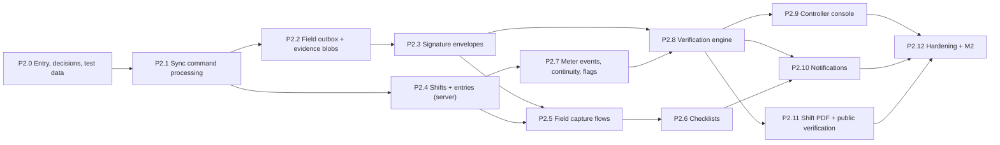
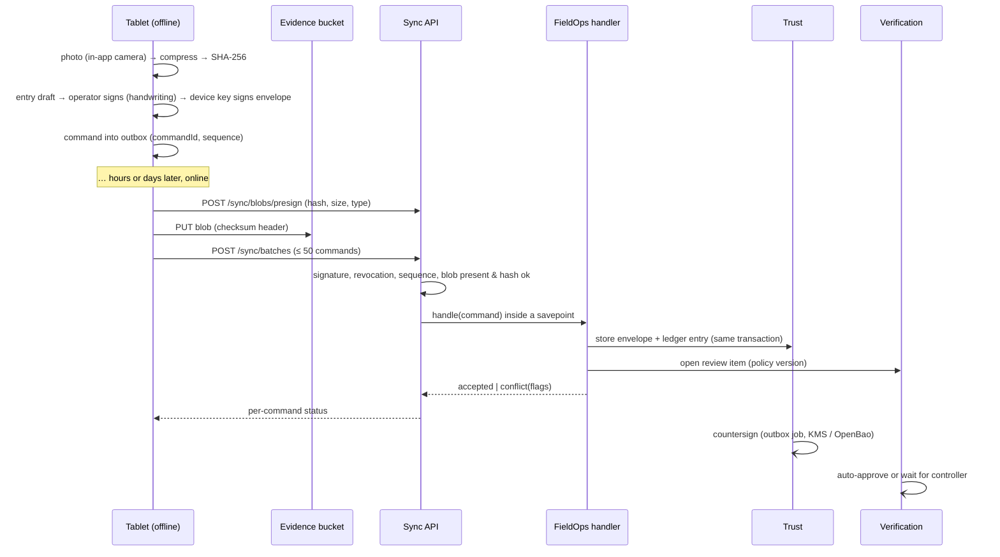

# Phase 2 Execution Plan: Sub-Phases P2.0 – P2.12

> [Docs index](../../README.md) › [04-phases](../README.md) › [Phase 2 plan](plan.md) · [Phase 2 tracker](tracker.md)

The [Phase 2 plan](plan.md) says **what** Phase 2 delivers: 31 stories in 8 epics, the test cases and the exit gate
(M2). This file says **in which order** we build it, **how** each piece is built, and **who checks what**:
**13 sub-phases**, each small enough to finish, test and merge before the next one starts. It is written from
every role of the team: architect (decisions and boundaries), software engineer (what gets built, module by module),
QA (test cases, test levels, mutation and property tests), DevOps/SRE (CI, local stack, metrics, alerts, runbooks),
security (threats per sub-phase, security review), UX (field ergonomics, usability targets) and product (owner
inputs, demo, exit gate).

**How to use it:** tell the agent **"start P2.x"**. The agent follows the [way of working](#2-way-of-working-applies-to-every-sub-phase)
(§2) and the sub-phase card (§4), and reports when the sub-phase is done. Live status is in the
[Phase 2 tracker](tracker.md).

---

## Contents

0. [Can Phase 2 start? (entry decision)](#0-can-phase-2-start-entry-decision)
1. [Overview and order](#1-overview-and-order)
2. [Way of working (applies to every sub-phase)](#2-way-of-working-applies-to-every-sub-phase)
3. [Architecture of Phase 2](#3-architecture-of-phase-2)
4. [Sub-phase cards](#4-sub-phase-cards)
   - Start: [P2.0](#p20--entry-decisions--test-data)
   - Pipes: [P2.1](#p21--sync-command-processing) · [P2.2](#p22--field-outbox-upload--evidence-blobs) · [P2.3](#p23--signature-envelopes-handwritten-device-server)
   - Capture: [P2.4](#p24--shifts--shift-entries-server) · [P2.5](#p25--field-capture-flows-tablet) · [P2.6](#p26--pre-start-checklists)
   - Trust in the numbers: [P2.7](#p27--meter-events-continuity--integrity-flags-v1) · [P2.8](#p28--verification-engine) · [P2.9](#p29--controller-console)
   - Around it: [P2.10](#p210--notifications-foundation) · [P2.11](#p211--shift-report-pdf--public-verification)
   - Finish: [P2.12](#p212--hardening-non-functional-tests-shadow-run--exit-gate-m2)
5. [Story coverage check](#5-story-coverage-check)
6. [Amendments to the Phase 2 plan](#6-amendments-to-the-phase-2-plan)
7. [Owner inputs and when they are needed](#7-owner-inputs-and-when-they-are-needed)
8. [New test cases introduced by this plan](#8-new-test-cases-introduced-by-this-plan)
9. [Risks specific to execution](#9-risks-specific-to-execution)

---

## 0. Can Phase 2 start? (entry decision)

**Short answer: yes, under conditions.** The architect's position (2026-11-04):

| Question | Answer |
|---|---|
| Is Phase 1's exit gate (M1) passed? | **No.** Four of its five criteria (staging deploy and rollback, restore drill, pilot data in staging, and with them the formal close of the Phase 1 Must stories) need a hosting provider, which is not chosen yet ([Phase 1 tracker §2](../phase-01-platform-foundation/tracker.md#2-m1-exit-gate)). |
| Does that block Phase 2 work? | **Not the build.** What blocks M1 is infrastructure (P1.17, P1.18b) and the real-tablet run of P1.15, not code Phase 2 builds on. Every Phase 2 module can be built and tested on the local stack and in CI, as Phase 1 was. Waiting idle would cost weeks on the product's core differentiator. |
| What must be finished first? | **P1.18a** (local and CI hardening): slice 6b (record versions on materials, assets, settings, subscription, roles; three PRs), the rest of slice 6 (H-C2, H-C3, threat traceability) and slice 7 (demo rehearsal, exit review draft). Starting Phase 2 on top of open hardening work would mix two changing foundations. P1.18a is about 6–8 PRs. |
| What may run in parallel? | **P2.0** (decisions, ADR drafts, test-data generator) can start at once: it changes no product code. |
| What carries over? | P1.15 real-tablet run, P1.17 environments, P1.18b staging work, and the M1 gate itself. They become **Phase 1 carry-overs** tracked in the [Phase 2 tracker](tracker.md#2-phase-1-carry-overs) and **must be closed before P2.12b** (the M2 shadow run happens on staging with a real pilot and real tablets). |
| What is the risk of starting before M1? | (1) The deployment path is unproven when Phase 2 code piles up: mitigated by keeping every artefact deployable (container image, migrations bundle, compose smoke) in CI on every merge. (2) Discovery is unvalidated (no interviews or site visits yet, WP-P0-01/02): the shift capture flow could miss real practices. Mitigated by data-driven configuration (tolerances, reason codes, checklists are data), a usability test before the field UX is frozen (P2.5), and the shadow run (P2.12b) as the real check. |

**Rule:** P2.1 starts only when P1.18a is ✅ in the Phase 1 tracker and `main` and the nightly run are green.

---

## 1. Overview and order

| # | Sub-phase | Stories | Size | Sensitive (owner-approved merge) | Owner input needed before start |
|---|---|---|---|---|---|
| P2.0 | Entry, decisions, test data | — | S | — | Read §0 and §6; confirm tolerances may start from the catalogue defaults |
| P2.1 | Sync command processing | OFF-03, OFF-05, OFF-04 AC1 | L | **Sync** | — |
| P2.2 | Field outbox, upload & evidence blobs | OFF-01, OFF-02 | M | **Sync** | Evidence retention period (legal, WP-P0-06), default proposed |
| P2.3 | Signature envelopes: handwritten, device, server | SIG-01 … SIG-04 | L | **Trust** | — (cloud KMS adapter waits for the hosting provider) |
| P2.4 | Shifts & shift entries (server) | FO-01, FO-04, FO-05 (server ACs) | M | — | Stoppage reason codes; ΔH tolerance (default 0.5 h) |
| P2.5 | Field capture flows (tablet) | FO-01, FO-04, FO-05, FO-06 (UI ACs) | L | — | 3–5 operators for a usability test (or a proxy group) |
| P2.6 | Pre-start checklists | FO-02, FO-03 | M | — | One real checklist (paper form photo is enough) |
| P2.7 | Meter events, continuity & integrity flags v1 | FO-07, AST-01, AST-02, INT-01 | L | — | Review default thresholds (catalogue) |
| P2.8 | Verification engine | VER-02 … VER-06, FO-08 | L | **Trust** (signed actions, ledger) | Default review policy; second-approval thresholds; SLA hours |
| P2.9 | Controller console | VER-01, VER-07, VER-08 | M | — | A controller (or proxy) for the 50-entries-in-5-minutes test |
| P2.10 | Notifications foundation | NOT-01, OFF-04 AC2, VER-06 AC2 | M | — | **E-mail sending provider and sender domain** (Mailpit until then) |
| P2.11 | Shift report PDF & public verification | SIG-05, SIG-06 | M | **Trust** | What the public page may show (names? company?), legal (WP-P0-06) |
| P2.12 | Hardening, NFR, shadow run & exit gate M2: **P2.12a** local and CI, **P2.12b** staging, device lab, pilot | (exit gate) | M | — | **Pilot site, tablets, staging (P1.17)**, shadow-run day |

Size: **S** ≈ 1–3 PRs, **M** ≈ 3–6 PRs, **L** ≈ 6–10 PRs (PRs ≤ 400 changed lines, [guidelines §20.3](../../00-llm/llm_guidelines.md#203-pull-requests)). Phase 2 is about **60–75 PRs**.

**Parallel work.** P2.4 can start as soon as P2.1 is merged (it only needs the handler contract); P2.7 runs alongside
P2.5/P2.6 once P2.4 is done. P2.10's framework (rules, in-app center) can be pulled earlier if a slot is free; its
producers arrive with P2.6 and P2.8.

**What waits for answers.** Business values (tolerances, reason codes, SLA hours, thresholds, checklist content) are
**data with defaults** from the [detection rules catalogue](../../03-domain/catalogues/detection-rules.md) and the plan;
late answers change seed data, not code (same rule as Phase 1).

---

## 2. Way of working (applies to every sub-phase)

Phase 2 keeps the Phase 1 loop unchanged ([Phase 1 §2](../phase-01-platform-foundation/sub-phases.md#2-way-of-working-applies-to-every-sub-phase)):
read the hand-off, the card and the stories; verify current versions of any new dependency (and the **7-day minimum
release age**); one short-lived branch and a small PR per slice; no AI attribution; every AC mapped to a test whose name
carries the `TC-…` ID; the CI commands run locally first; merges only through `tools/ci/merge_guard.py`; a docs sweep
and 0 broken links; tracker and hand-off updated; a sub-phase report that ends with **what is next**.

What Phase 2 adds:

### 2.1 Quality bar per role

| Role | Phase 2 rule |
|---|---|
| **Architect** | Each card's "Decisions" become an ADR (accepted before the code that depends on it merges). A new module comes from the template (`tools/new-module.sh`) and only talks to others through their `Contracts` (architecture tests). |
| **Software engineer** | Field facts are **immutable signed commands**; a correction is a new version, never an `UPDATE` of a signed row. Exact numbers travel as strings in anything signed or ledgered (RFC 8785 strict mode). Every save of a versioned aggregate handles `DbUpdateConcurrencyException` (D55). Every outage answers 503 (D54). |
| **QA** | Each AC has a test at the lowest level that can prove it, plus one end-to-end path per epic. **Property tests** for the continuity engine and Δ computation. **Mutation check** (a deliberately injected bug must fail a test) for every rule that protects money, evidence or permissions: signature checks, SoD, four-eyes, continuity, sequence handling, RLS on new tables. Concurrency claims get a deterministic interleaving test (Phase 1 lessons 12, 22, 27). |
| **DevOps / SRE** | New infrastructure (signing service, evidence bucket) goes into `deploy/docker/compose.yaml`, the CI `local-stack` job and the docs together. Every new background job exports metrics; every user-visible failure mode has an alert rule with a promtool test and a runbook entry. The nightly load suite grows with each sub-phase that adds an endpoint the field app calls. |
| **Security** | `Sync`, `Trust`, `Verification` and anything that signs or verifies get a **separate security review pass** in the PR, against the threats listed in the card. New tables: RLS enabled and forced, linter green, isolation suite extended. New permissions: added to the role matrix and the authorization suite. |
| **UX** | Field screens: one-hand use, ≥ 48 px targets, readable in sunlight (contrast ≥ 7:1 on the field theme), every action works offline, no free text where a choice works, all five languages (N'Ko by the tool, never by hand). The field bundle stays under its budget (250 KB gzip initial): camera, signature pad and checklists load on demand. |
| **Product** | Each sub-phase ends with a short demo step that maps to the [Phase 2 demo script](plan.md#98-demo-script). |

### 2.2 Invariants this phase can break, and the guard for each

| Invariant | How Phase 2 could break it | Guard |
|---|---|---|
| Offline never loses data | Outbox lost on app update, a rejected command dropped, a blob purged before confirmation | Outbox in IndexedDB (schema v1 already fixed), never deleted before `accepted`/`duplicate`; blob purge only after the command referencing it is confirmed; TC-P2-SYNC-002/007, TC-P2-SYNC-011 |
| Immutable signed records | A correction updates the original | Corrections are new versions; signed tables append-only (trigger + revoked `UPDATE`/`DELETE`, as `sync.inbox`); TC-P2-VER-004, TC-P2-SIG-007 |
| Ledger in the same transaction | Approval saved, ledger entry written later | Every state change goes through `ModuleDbContext` with the ledger writer; architecture test: no `SaveChanges` on a signed aggregate outside it |
| Tenant isolation | Pre-signed URL reused across tenants; a public verification token resolving another tenant's record | Object keys under `tenants/{tenantId}/`; URL scoped to key, content hash and 5-minute expiry; tokens are random 128-bit and bound to the envelope's tenant; TC-P2-SYNC-012, TC-P2-SIG-005 |
| Explicit units | Meter value stored as a bare number | `MeterValue` with its unit (`h`, `km`) in every payload; ΔH computed by the units engine |
| Decimal money / quantities | Meter values as doubles in signed JSON | Values as strings in signed payloads; parsed to `decimal` server side |

### 2.3 Merge rule

Unchanged from Phase 1 §2.3: the agent merges normal PRs once every required check is green; PRs touching **Sync,
Trust (ledger, signatures, keys), Verification decisions that carry signatures, Identity, Tenancy, Billing, ledger
migrations or CI/CD security** are owner-approved (standing approval given by the owner, merges still only through
the merge guard with `--owner-approved`).

### 2.4 End of a sub-phase

Same checklist as [Phase 1 §2.4](../phase-01-platform-foundation/sub-phases.md#24-end-of-a-sub-phase), plus:
- [ ] Threats listed on the card checked in the [threat model](../../02-architecture/threat-model.md) (status and test IDs).
- [ ] New metrics visible on a dashboard (dashboards as code), new alerts tested with promtool.
- [ ] The nightly run is green on the night after the last merge.

---

## 3. Architecture of Phase 2

### 3.1 Modules

| Module | New or existing | Owns (schema) | Main aggregates | Talks to |
|---|---|---|---|---|
| `Sync` | existing (P1.15) | `sync` | `InboxCommand`, `DeviceSequence`, `ProcessedCommand`, `EvidenceBlob` | handlers in other modules through `Sync.Contracts` (`ISyncCommandHandler`) |
| `FieldOps` | **new** | `fieldops` | `ShiftInstance`, `ShiftEntry` (versions, segments), `ChecklistTemplate`, `ChecklistSubmission`, `ContinuityException` | `Organization.Contracts` (shift patterns, geofence), `Assets.Contracts` (meters, events), `Trust.Contracts` (envelopes) |
| `Trust` | existing (P1.6) | `audit`, `trust` (new) | `SignatureEnvelope`, ledger, anchors | `IServerSigner` (signing port) |
| `Assets` | existing (P1.13) | `assets` | `MeterEvent` (new), meter offset | ledger |
| `Verification` | **new** | `verification` | `ReviewItem`, `ReviewAction`, `ReviewPolicy` (versions) | `IReviewableRecord` contract implemented by FieldOps (and later Weighbridge, Fuel, Inventory) |
| `Integrity` | **new** (small) | `integrity` | `Flag`, `RuleSetting` | rules registered by owning modules; read by Verification (risk sort) and P3's integrity dashboard |
| `Notifications` | **new** | `notifications` | `NotificationRule`, `Notification`, `Delivery`, `Preference` | subscribes to contract events of the other modules |
| `Documents` | inside `FieldOps` for P2 | — | shift report renderer | `Trust` (hash, QR) |

**Why a separate `Integrity` module** (not inside FieldOps): flags come from many contexts (fuel, tickets and
inventory in later phases) and the P3 integrity dashboard reads all of them. Keeping rules in their owning module but
flags in one place gives one queue, one severity model and one configuration screen.

**Why `Verification` is generic:** the [trust layer §13.1](../../02-architecture/trust-layer-signatures-audit.md#131-generic-verification-workflow)
workflow applies to shift entries now, and to tickets, fuel and stock adjustments later. A record type plugs in
through `IReviewableRecord` (snapshot for review, apply correction as a new version, SoD facts such as "who operated
this asset in this shift").

### 3.2 The life of a field entry

### 3.3 Decisions to record (ADRs)

| ADR | Decision (recommendation) | Card |
|---|---|---|
| ADR-0031 | **Sync command processing:** commands are verified and handled **synchronously in the upload request**, one savepoint per command, so the tablet gets a final answer per command; re-evaluation (late arrivals, continuity) runs from outbox events. Handlers are registered per command type through `ISyncCommandHandler` in `Sync.Contracts`. Business problems are **never rejections**: the fact is stored and flagged (`conflict`), because a field fact cannot be "wrong", only questioned. Rejections are for structure only (signature, schema, unknown type, revoked device, missing blob). | P2.1 |
| ADR-0032 | **Evidence blobs:** content-addressed (`tenants/{t}/devices/{d}/evidence/{sha256}`), uploaded by pre-signed `PUT` with `x-amz-checksum-sha256` so the store verifies the hash; ≤ 1 MB (photos are compressed to about 200 KB), so no multipart; Object Lock retention on the evidence bucket; photo authenticity is a **signed capture record** (in-app camera only), not EXIF (EXIF is stripped: it can carry the GPS position of a person's home). | P2.2 |
| ADR-0033 | **Signature envelopes and server keys:** envelope v1 as in [trust layer §13.2](../../02-architecture/trust-layer-signatures-audit.md#132-signature-envelope); handwritten strokes as vectors + PNG, both hashed into the signed payload; server countersignature through an `IServerSigner` port: **OpenBao transit** locally, in CI and on-premises (MPL-2.0; HashiCorp Vault is BSL-licensed), cloud KMS adapter in P1.17; countersigning is **asynchronous** (outbox job, target ≤ 5 min) so a signing-service outage never stops the field; the ledger entry written at receipt already binds the server time. Key rotation by `kid`; old keys stay verify-only forever. | P2.3 |
| ADR-0034 | **Shift entries:** shift instance resolved from the site's pattern version at the entry's local time ([ADR-0024](../../adr/0024-sites-geometry-and-shift-time.md)); an entry is a chain of versions (`root_id`, `version`) and segments (`segment_no`); meter values as `MeterValue` strings; "estimated" mode when the meter has failed. | P2.4 |
| ADR-0035 | **Verification engine:** generic `ReviewItem` per record version; policies versioned and pinned on the item; SoD and four-eyes evaluated server side from facts the record type supplies; every action is a signed envelope plus a ledger entry; SLA and escalation as scheduled jobs. | P2.8 |
| ADR-0036 | **Integrity rules:** a rule is code (owning module) + settings (tenant thresholds, on/off except security rules) + a flag (Integrity module); flags are re-evaluated when the facts they depend on change, and closed, never deleted. | P2.7 |
| ADR-0037 | **Notifications:** rule = event → audience (role + scope) → channels; in-app center read by **polling with ETag** (the queue's ≤ 10 s target does not need WebSockets for tens of users per company; it also works through every proxy); e-mail through an `IEmailSender` port (Mailpit locally, provider later); Web Push optional and behind a flag. | P2.10 |
| ADR-0038 | **Documents and public verification:** PDF engine chosen by a time-boxed spike (200 entries < 10 s, images, embedded fonts); candidates (P2.0 check, [technology stack §7.1.2](../../02-architecture/technology-stack.md#712-verified-versions-phase-2-start-2026-11-09)): **PDFsharp + MigraDoc pinned at 6.2.4**, the last MIT release (6.5.0 is AGPL-3.0-only), or **QuestPDF**, whose Community licence ends at USD 1 M revenue and needs owner approval, or another MIT engine. Public page on the platform address `/verify/{envelopeId}#{token}` until the `verify.` domain exists; token 128 random bits, stored hashed; rate-limited; shows only what the tenant's policy allows. | P2.11 |

### 3.4 New permissions (role matrix)

| Permission | Default roles | Notes |
|---|---|---|
| `fieldops.entries.capture` | Field Operator (device-unlocked) | Field app only |
| `fieldops.entries.read` | Site Manager, Shift Controller, Executive (scoped) | Masking applies |
| `fieldops.checklists.manage` | Site Manager, Tenant Admin | Templates |
| `fieldops.unsafe.override` | Site Manager | Audited, signed |
| `assets.meters.events.manage` | Site Manager, Maintenance | Meter replaced / reset / failed / repaired |
| `verification.review` | Shift Controller | Scoped to sites |
| `verification.second-approve` | Site Manager, Controller (senior) | Never the first approver |
| `verification.policies.manage` | Tenant Admin | Versioned |
| `integrity.flags.read` / `integrity.settings.manage` | Controller, Executive / Tenant Admin | Security rules cannot be switched off |
| `notifications.rules.manage` | Tenant Admin | Users manage their own preferences |

### 3.5 Non-functional budgets (checked in CI or nightly)

| Budget | Target | Where checked |
|---|---|---|
| Batch of 50 commands | p95 < 1 s server time | nightly k6 (shift-change burst) |
| Review queue freshness | ≤ 10 s after sync | E2E (polling interval) + nightly |
| Countersignature delay | ≤ 5 min p99 | metric `karry_trust_countersign_lag_seconds`, alert |
| Shift PDF, 200 entries | < 10 s | integration test with a generated shift |
| Field app initial bundle | ≤ 250 KB gzip | existing bundle budget check |
| Start a shift | median ≤ 60 s | usability test (P2.5) |
| 72 h offline, 400 entries, 300 photos, then 3G | all synced < 15 min, 0 loss | P2.12 (CI emulation) + device lab |

---

## 4. Sub-phase cards

### P2.0 — Entry, decisions & test data

**In plain words:** make sure the ground is solid, write down the big decisions before coding, and build a
generator of realistic shift data that every later test and demo uses.

- **Stories:** none (preparation).
- **Depends on:** may start now; P2.1 waits for P1.18a ✅ (§0).
- **What gets done:**
  - Phase 2 tracker started; Phase 1 carry-overs listed there with their owners.
  - **ADR drafts 0031–0033** (they shape the first three sub-phases); 0034–0038 drafted at the start of their card.
  - **Version checks** (current stable, ≥ 7 days old, licence): OpenBao server image and its .NET client approach
    (plain HTTP API, no SDK needed), FsCheck (property tests), PDF engine candidates (for P2.11), any camera or
    image helper (recommendation: none, the browser APIs are enough).
  - **Shift data generator** `tools/demo/generate-shifts` (built as `tools/demo/generate_shifts.py`, P2.0): N sites × M assets ×
    D days of shifts with realistic meter progressions, a configurable rate of anomalies (continuity gaps, skewed
    clocks, reused photos, negative Δ, night shifts across midnight, a meter replacement). Deterministic from a seed,
    so a failing test can be replayed. Used by property tests, load tests, the PDF test and the demo.
  - **Test strategy for Phase 2** added to [testing strategy](../../05-quality/testing-strategy.md): property tests,
    device lab protocol, usability test protocol.
- **Tests:** generator unit tests (same seed → same data; anomaly rates respected).
- **Done when:** ADRs 0031–0033 proposed, versions recorded, generator merged, tracker live.

---

### P2.1 — Sync command processing

**In plain words:** the server already stores what tablets send but does nothing with it. Now each command type gets
a handler, every command gets a final answer, gaps in a tablet's numbering are noticed and repaired, and the
tablet learns how far its clock is off.

- **Stories:** US-P2-OFF-03 (AC1–AC4), US-P2-OFF-05 (AC1–AC2), US-P2-OFF-04 AC1 (status pull mechanism; real
  statuses come with P2.8).
- **Depends on:** P2.0, P1.18a ✅.
- **Decisions:** ADR-0031 (above). Also: command type names are versioned (`fieldops.shift_entry.start.v1`), and
  an unknown type is `rejected(sync.type_unknown)` and kept in the inbox, never dropped, so a newer app talking to an
  older server loses nothing.
- **What gets built:**
  - `Karry.BuildingBlocks.Sync` (as built, ADR-0031 §8): `ISyncCommandHandler { string Type; Task<HandlerOutcome> HandleAsync(VerifiedCommand, …) }`,
    `HandlerOutcome = Accepted | Conflict(flags) | Rejected(code, retryable)`; registration through the module
    contract (as `ITenantProvisionedHandler`, ADR-0018).
  - Processing pipeline in the upload request: signature (exists) → revocation (exists, quarantine) → sequence →
    **per-command savepoint** → handler → `sync.processed_command (command_id, status, result, handled_at)`.
    A handler exception becomes `rejected(sync.handler_failed, retryable)` for that command only; the batch goes on.
  - **Sequence gaps:** a command whose sequence is ahead of the next expected one is stored but held (`waiting`)
    and the answer lists `missingSequences`; the tablet re-sends them; held commands are handled when the gap
    closes (TC-P2-SYNC-003). A gap open longer than 24 h raises a device alert (data may be lost on the tablet).
  - **Status pull:** `/sync/changes` gains a `submissions` section (statuses of commands sent by this device and
    of the records its users created), delta by cursor like the reference data.
  - **Clock offset:** every upload answer carries server time; the device's measured offset is stored per device
    (`identity.devices.clock_offset_ms`, last measured at); handlers get `deviceTime`, `receivedAt` and the offset.
  - A first real handler for tests only (`test.echo.v1`, compiled only into test hosts) and the contract test kit
    every later handler runs (idempotency, replay, rejection codes).
- **Tests:**

  | Test | What it proves |
  |---|---|
  | TC-P2-SYNC-001 | Same batch replayed 10× → one record per command (handler called once) |
  | TC-P2-SYNC-003 | Gap → `missingSequences`; re-send closes it; held commands then handled in order |
  | TC-P2-SYNC-009 *(new)* | Handler throws for command 3 of 5 → 1, 2, 4, 5 handled; 3 rejected retryable; nothing of 3 persisted (savepoint rollback, mutation check: without savepoint the test fails) |
  | TC-P2-SYNC-010 *(new)* | Quarantined commands (revoked device) are never given to a handler |
  | TC-P2-SYNC-013 *(new)* | Unknown command type → rejected, kept in inbox, sequence not advanced |
  | TC-P2-SYNC-008 (part) | Offset measured and stored; handler sees it |
  | Isolation | New tables under RLS; isolation suite extended |
  | Load | k6 `sync-batches` scenario with `test.echo.v1`: 50 commands p95 < 1 s |
- **Security review:** T-02, T-03, T-05, T-12 (replay, reordering, flooding a gap with high sequence numbers: a
  device may hold at most 500 waiting commands, then `rejected(sync.too_far_ahead)`).
- **DevOps:** metrics `karry_sync_commands_total{type,status}`, `karry_sync_batch_seconds`, `karry_sync_waiting_commands`;
  alert "gap open > 24 h"; runbook "a tablet has a sequence gap".
- **Done when:** the pipeline handles commands end to end with the test handler, all tests above green in CI.

---

### P2.2 — Field outbox, upload & evidence blobs

**In plain words:** the tablet gets its real upload loop: signed commands wait in a local outbox that survives
everything, photos go up first and are checked byte for byte, and the operator always sees what is still waiting.

- **Stories:** US-P2-OFF-01 (AC1–AC4), US-P2-OFF-02 (AC1–AC3).
- **Depends on:** P2.1.
- **Decisions:** ADR-0032 (above). Client batches ≤ 50 commands and ≤ 2 MB (server limit stays 100 × 64 KB).
- **What gets built:**
  - `packages/offline`: outbox API on the existing `OutboxRecord` schema (v1 was fixed in P1.15 for this):
    `enqueue` (assigns the next device sequence in the same IndexedDB transaction as the draft's state change),
    `nextBatch`, `markResult`. A command leaves the outbox only on `accepted`, `duplicate` or `conflict`.
  - Sync engine in the field app: triggers (app foreground, `online`, every 2 min while online, "Sync now"),
    exponential backoff with jitter, 429/503 as `busy` (existing), one upload at a time (Web Locks API, so two tabs
    cannot cross; server already answers 409 `sync.batch_conflict`).
  - **Evidence blobs:** `POST /api/v1/sync/blobs/presign {sha256, size, contentType}` → pre-signed `PUT` (15 min, ADR-0032 §2;
    exact key, exact checksum, size ≤ 1 MB, `image/jpeg|image/webp|image/png|application/json`); `sync.evidence_blob`
    registry (tenant, device, hash, size, uploaded_at, referenced_by). A command referencing a blob that is not there
    or whose stored checksum differs is `rejected(sync.blob_missing, retryable)` / `rejected(sync.blob_mismatch)` +
    security event.
  - **Evidence bucket** with Object Lock (compliance, retention from tenant policy, default proposed: 5 years),
    in compose and the CI local stack; lifecycle never deletes inside retention.
  - Local purge: blobs deleted from the tablet 7 days (setting) after the command that references them is confirmed;
    a thumbnail (≈ 10 KB) stays for "My history".
  - Sync center screen: "All sent" / "N waiting" / "Error — tap for details" with the reason per command.
- **Tests:**

  | Test | What it proves |
  |---|---|
  | TC-P2-SYNC-002 | App killed mid-upload (browser context closed in Playwright) → resumes, no duplicate |
  | TC-P2-SYNC-004 | Command before its blob → rejected retryable; succeeds after upload |
  | TC-P2-SYNC-005 | Corrupted blob (checksum mismatch) → store refuses the `PUT`; forged registry entry → command rejected, security event |
  | TC-P2-SYNC-007 | Service worker update while the outbox is not empty → outbox intact, upload continues |
  | TC-P2-SYNC-011 *(new)* | A blob is never purged locally while a command that references it is not confirmed |
  | TC-P2-SYNC-012 *(new)* | Pre-signed URL for tenant A used for another key, another hash or after expiry → refused |
  | TC-P2-SYNC-014 *(new)* | Two tabs of the field app → one upload at a time, no sequence reuse |
- **Security review:** T-03, T-05, T-09 (cross-tenant blob), T-17 (what stays on a lost tablet: thumbnails only after purge).
- **DevOps:** bucket and retention as code; metrics `karry_sync_blobs_total{result}`, bucket size per tenant (usage
  for plan limits later); runbook "evidence upload failing".
- **Done when:** a tablet in the E2E suite goes offline, queues 20 commands with photos, comes back and everything
  arrives once, verified. **As built (2026-11-09):** done at unit and host level (`uploads.test.ts`, `outbox.test.ts`,
  `SyncBlobsTests`, `SyncBatchesTests`). The browser E2E tests (TC-P2-SYNC-002, 007, 011, 014 and this "done when")
  **moved to P2.5**: no entry screen exists before P2.5 and no real command type before P2.4, and an E2E test that
  drives a fake command type through the real UI would test scaffolding. Bucket size per tenant waits for the usage
  module's next snapshot change (plan limits, Phase 3). See [ADR-0032 §7–§8](../../adr/0032-evidence-blobs.md#7-as-built-p22-2026-11-09).

---

### P2.3 — Signature envelopes: handwritten, device, server

**In plain words:** each signed record carries proof of who signed it, on which tablet, and that the server received
it at a given time, and anyone can check that proof later.

- **Stories:** US-P2-SIG-01 (AC1–AC3), US-P2-SIG-02 (AC1–AC3), US-P2-SIG-03 (AC1–AC2), US-P2-SIG-04 (AC1–AC2).
- **Depends on:** P2.2 (handwriting PNG and strokes are evidence blobs).
- **Decisions:** ADR-0033 (above). The envelope's signed payload is RFC 8785 of `{envelopeId, recordType, recordId,
  canonicalPayloadHash, signer, context, handwritten: {strokesHash, imageHash}}`; the device signs that text (IEEE
  P1363, as the commands); the server countersigns `{envelopeHash, receivedAt}`.
- **What gets built:**
  - `packages/ui` **SignaturePad** (own component, no dependency): pointer events, pressure when available,
    full-width canvas, Clear / Confirm, rejects dots and scribbles under a minimum stroke length, shows who signs
    what above the pad, all five languages and RTL.
  - `packages/crypto`: envelope builder and device signing (reuses the device key and RFC 8785).
  - `Trust`: `trust.signature_envelope` (append-only), envelope verification (payload hash, device signature against
    the key valid **at signing time**, server signature, ledger entry and chain), `GET /api/v1/trust/envelopes/{id}/verification`.
  - `IServerSigner` port; **OpenBao transit** adapter (ECDSA P-256 key, `kid` = key name + version); compose
    service with **file storage and a persistent volume** (dev mode keeps keys in memory: a restart would make every
    countersignature unverifiable), init script that creates the key and keeps the unseal key in an ignored file;
    CI uses an ephemeral instance.
  - Countersign job in `Karry.Workers` (outbox-driven, batch of 100, retries with backoff), state
    `pending → countersigned` visible in the verification answer.
  - Portal: "Verified ✔" badge component with a details drawer (each check and its result).
- **Tests:**

  | Test | What it proves |
  |---|---|
  | TC-P2-SIG-001 | Valid envelope → accepted, countersigned, verification all green |
  | TC-P2-SIG-002 | Payload changed after signing (one character) → `INVALID_SIGNATURE`, security event |
  | TC-P2-SIG-003 | Envelope from a revoked device key → quarantined, never accepted |
  | TC-P2-SIG-004 | Key rotation in OpenBao → old and new countersignatures both verify |
  | TC-P2-SIG-006 *(new)* | Signing service down → commands still accepted, countersign `pending`, done after recovery, alert fired |
  | TC-P2-SIG-007 *(new)* | `UPDATE`/`DELETE` on `trust.signature_envelope` by the app role → refused (trigger + grants) |
  | TC-P2-SIG-008 *(new)* | Signature pad: a dot or a 3 px line is refused; strokes JSON and PNG hashes match the envelope |
  | Cross-language | Envelope signed in the browser verifies in .NET (shared vectors, like `rfc8785.json`) |
- **Security review:** T-02, T-03, T-06, T-07; key custody (who can read the unseal key; production uses KMS).
- **DevOps:** OpenBao in compose and CI; metrics `karry_trust_countersign_lag_seconds`, `…_failures_total`; alerts
  (lag > 5 min, failures); runbooks "signing service down", "rotate the server signing key".
- **Done when:** a command signed in a Playwright browser is verified end to end, including after a key rotation.

---

### P2.4 — Shifts & shift entries (server)

**In plain words:** the server understands a shift: which shift instance an entry belongs to, what the meter said at
start and end, who drove, and whether the numbers make sense. Nothing is shown on the tablet yet.

- **Stories:** server ACs of US-P2-FO-01 (AC1 shift resolution, AC4 validation, AC5 geofence flag data),
  US-P2-FO-04 (AC2 Δ checks), US-P2-FO-05 (AC1–AC2 segments, overlaps).
- **Depends on:** P2.1 (handler contract); P2.3 for signed acceptance (entries can be built against a test envelope first).
- **Decisions:** ADR-0034 (above). Server checks never reject a signed fact for business reasons: "start below last
  end" or "Δ too large" become flags and a review item (§3.3, ADR-0031); the tablet blocks them before signing when it
  knows (P2.5).
- **What gets built:** new module `FieldOps` from the template; `fieldops.shift_instance` (materialised lazily from the
  pattern version, night shifts across midnight, the site's time zone), `fieldops.shift_entry` (append-only versions:
  `root_id`, `version`, `segment_no`, start/end `MeterValue`, fuel level, stoppages with reason codes, GPS, flags,
  `estimated`); command handlers `fieldops.shift_entry.start.v1`, `.end.v1`, `.handover.v1`; read API for the portal
  (list by site/shift/asset/operator, detail with versions); reason code catalogue (seeded, tenant-editable).
- **Tests:**

  | Test | What it proves |
  |---|---|
  | TC-P2-FO-001 (server part) | Entry at 23:30 and 00:30 local time resolves to the same night shift |
  | TC-P2-FO-003 (server part) | Start below last accepted end → accepted with `RULE-FO-02`/continuity flag, not rejected |
  | TC-P2-FO-005 | ΔH > shift length + tolerance → flagged; negative → flagged |
  | TC-P2-FO-006 | Handover → two segments, second start = first end |
  | TC-P2-FO-011 *(new)* | Same operator with two overlapping active segments → second flagged `OVERLAP` |
  | Property | ΔH is never negative unless a meter event explains it (generator, 10 000 cases) |
- **Security review:** T-01 (operator identity: PIN-unlocked user id is inside the signed payload), T-10 (masking on the read API).
- **Done when:** generated shifts load through the sync pipeline and read back with correct shifts and Δ.

---

### P2.5 — Field capture flows (tablet)

**In plain words:** the operator starts and ends a shift on the tablet in under a minute, with a photo of the meter,
a signature, and no network.

- **Stories:** UI ACs of US-P2-FO-01 (AC1 QR or list, AC2 in-app photo, AC3 fuel slider and remarks, AC6 offline
  draft, AC7 ≤ 60 s), US-P2-FO-04 (AC1, AC3), US-P2-FO-05 (handover screen), US-P2-FO-06 (my history, re-open a rejected entry).
- **Depends on:** P2.2, P2.3, P2.4.
- **What gets built:** in-app camera (`getUserMedia`, rear camera, tap to focus where supported, no gallery path at
  all, JPEG/WebP ≤ 1600 px ≈ 200 KB, capture record signed); start-shift flow (scan asset QR with the camera or pick
  from the site list, shift preselected, previous end shown as reference, start value with numeric pad, fuel slider
  with ¼ marks, remarks with the system's voice input); end-shift flow (end photo + value, Δ shown, stoppages);
  summary → SignaturePad → outbox; "My active shift", "My history" (14 days, statuses); local validation identical to the
  server's (shared test vectors so client and server never disagree); all five languages.
- **UX validation:** usability test with 3–5 operators (or a proxy group) on a mid-range phone and, when available, the
  low-end tablet: median start ≤ 60 s, no task failure; findings fixed before P2.6 (protocol in the testing strategy).
- **Tests:**

  | Test | What it proves |
  |---|---|
  | TC-P2-FO-001 | Offline QR start → draft saved, shift preselected (night shift across midnight) |
  | TC-P2-FO-002 | There is no way to attach a gallery image (no file input; camera stream only) |
  | TC-P2-FO-003 | Start below previous end → blocked on the tablet with the explanation |
  | TC-P2-FO-012 *(new)* | Client and server validation agree on the shared vector file (both test suites read it) |
  | E2E | Airplane mode → start, end, sign → back online → server has one signed entry with two photos |
  | Budget | Initial field bundle ≤ 250 KB gzip; camera and signature pad in lazy chunks |
  | TC-P2-SYNC-002 *(from P2.2)* | App killed mid-upload (browser context closed in Playwright) → resumes, no duplicate |
  | TC-P2-SYNC-007 *(from P2.2)* | Service worker update while the outbox is not empty → outbox intact, upload continues |
  | TC-P2-SYNC-011 *(from P2.2)* | In the browser: a photo is never purged while its entry is not confirmed |
  | TC-P2-SYNC-014 *(from P2.2)* | Two tabs of the field app → one upload at a time, no sequence reuse; the `PUT` passes the bucket's CORS rule |
- **Security review:** T-01 (who is unlocked is shown on every screen; auto-lock applies inside the flow), T-17.
- **Done when:** demo steps 1–2 of the [demo script](plan.md#98-demo-script) run on the local stack, and a tablet in
  the E2E suite goes offline, queues 20 entries with photos, comes back and everything arrives once, verified (from P2.2).

---

### P2.6 — Pre-start checklists

**In plain words:** before a machine starts, the operator goes through its checklist; a critical "not OK" stops the
machine until a manager decides.

- **Stories:** US-P2-FO-02 (AC1–AC3), US-P2-FO-03 (AC1–AC2).
- **Depends on:** P2.5.
- **What gets built:** portal template builder per asset type (items, critical, photo required, texts in the
  company's languages), versions; field checklist step before start (OK / Not OK / N/A, photo on critical Not OK);
  `fieldops.checklist_submission` keeps the template version; **unsafe asset** state (shown in both apps and the
  reference data), manager override (signed, ledgered, reason required); event `AssetMarkedUnsafe` for P2.10.
- **Tests:** TC-P2-FO-004 (critical Not OK → unsafe, start blocked, event raised), TC-P2-FO-013 *(new)* (template
  changed while a tablet is offline → submission keeps the version it used), TC-P2-FO-014 *(new)* (override without
  the permission → 403; with it → ledgered).
- **Done when:** a seeded excavator checklist works offline end to end, including the override.

---

### P2.7 — Meter events, continuity & integrity flags v1

**In plain words:** the system checks that each shift starts where the last one ended, explains the gaps it can
(meter replaced, reset, broken), and raises a flag for the ones it cannot.

- **Stories:** US-P2-FO-07 (AC1–AC3), US-P2-AST-01 (AC1–AC3), US-P2-AST-02 (AC1–AC3), US-P2-INT-01 (AC1–AC3).
- **Depends on:** P2.4.
- **Decisions:** ADR-0036 (above). Continuity is evaluated **in shift-time order**, not arrival order: a late entry
  re-runs the check for its neighbours, and flags that no longer hold are closed (with the reason), never deleted.
- **What gets built:** `assets.meter_event` (REPLACED / RESET / FAILED / REPAIRED, offsets so accumulated usage
  stays continuous, signed); failed-meter mode (tablet asks for operating times instead of readings; entries
  `estimated`); continuity engine as a pure function over a meter's ordered readings and events; new module
  `Integrity` (`integrity.flag`, `integrity.rule_setting`); rules RULE-FO-01 … 07 with severity, explanation (five
  languages) and evidence links; tenant thresholds and switches (security rules cannot be switched off).
- **Tests:**

  | Test | What it proves |
  |---|---|
  | TC-P2-FO-007 | Night start ≠ day end → exception, both entries linked |
  | TC-P2-FO-008 | Late offline entry arriving after the next shift synced → re-evaluated in shift order |
  | TC-P2-FO-009 | Meter replaced, then next reading → no exception, usage continuous |
  | TC-P2-FO-010 | Failed meter → entries `ESTIMATED` until repaired |
  | TC-P2-INT-001 … 007 | Each rule: one positive and one negative case |
  | Property | Random readings and events → an exception exists **exactly** where an unexplained discontinuity exists (FsCheck, shrinking on) |
  | Mutation | Off-by-one in the ordering or ignoring RESET makes the property test fail |
- **Security review:** T-04 (clock skew rule), T-05; rule switches cannot disable RULE-FO-07 (revoked device).
- **Done when:** the generator's anomalies all come out as the right flags, and only those.

---

### P2.8 — Verification engine

**In plain words:** every entry is reviewed: approved, rejected, or corrected with a before-and-after trail and,
for big corrections, a second person's approval. Nobody approves their own work.

- **Stories:** US-P2-VER-02 … VER-06 (VER-06 AC2 digest delivered with P2.10), US-P2-FO-08 (AC1–AC3).
- **Depends on:** P2.3, P2.7.
- **Decisions:** ADR-0035 (above).
- **What gets built:** new module `Verification`; `review_item` (one per record version; pinned policy version),
  `review_action` (append-only, envelope per action), `review_policy` (versions, effective from); actions approve /
  bulk approve (only unflagged; one envelope listing every entry hash) / reject (reason + comment) / correct (fields,
  reason, before → after, new record version) / second-approve; SoD (not own entry; not an asset the reviewer operated
  in that shift; second approver ≠ first) evaluated from facts given by `IReviewableRecord`; auto-approval rules
  (still a review item, actor `policy:<version>`); SLA due time and escalation job (Quartz, per tenant time zone);
  continuity exception resolution (reason codes; "unexplained" or > 48 h → `FRAUD_SUSPECTED`); every action ledgered in
  the same transaction.
- **Tests:** TC-P2-VER-001 (own entry → refused; mutation check), TC-P2-VER-002 (bulk with a flagged entry →
  refused), TC-P2-VER-003 (threshold → second approver required and ≠ first), TC-P2-VER-004 (trail: both versions,
  diff in the ledger), TC-P2-VER-005 (SLA breach → escalated), TC-P2-VER-006 (auto-approval audited with the policy
  version), TC-P2-VER-007 (policy changed mid-day → items keep theirs), TC-P2-VER-008 *(new)* (two controllers act on
  one item at the same time → one wins, the other gets 409 `request.version_conflict`, D55), TC-P2-VER-009 *(new)*
  (a reviewer's role removed between loading and acting → refused at action time).
- **Security review:** T-07, T-13 (self-approval through a role change, through bulk, through auto-approval policy
  edits by the same person: policy changes need `verification.policies.manage` and are ledgered).
- **Done when:** demo step 4 (correction beyond threshold → second approver → ledger diff) runs.

---

### P2.9 — Controller console

**In plain words:** the controller's screen: a queue sorted by risk, photos side by side, keyboard shortcuts, and
a board of the current shift.

- **Stories:** US-P2-VER-01 (AC1–AC4), US-P2-VER-07 (AC1–AC3), US-P2-VER-08 (AC1–AC2).
- **Depends on:** P2.8.
- **What gets built:** portal queue (scope = the controller's sites; flags first, then age; filters; thumbnails;
  polling with ETag, ≤ 10 s), item detail (values, Δ, flags with explanations, previous/current photo side by side with
  zoom, verification badge, history of versions), correction dialog (before → after, reason), keyboard shortcuts
  (A, R, C, J/K; shown in a help overlay; never fire inside text fields), swipe actions on tablets, shift board (planned
  / started / ended / missing end / pending / flags), "missing end" (RULE-FO-08) 1 h after shift end.
- **UX validation:** a controller (or proxy) reviews 50 unflagged entries in < 5 min (usability protocol).
- **Tests:** TC-P2-VER-010 *(new)* (queue shows a new synced entry within 10 s, E2E), TC-P2-VER-011 *(new)*
  (shortcuts do nothing while typing in the correction dialog), accessibility check (axe) on queue and detail.
- **Done when:** demo step 3 (queue shows the continuity exception with photos side by side) runs.

---

### P2.10 — Notifications foundation

**In plain words:** people learn what concerns them: the operator when an entry is rejected, the manager when a
machine is unsafe or reviews are late, by in-app notice, e-mail digest and, where the phone allows, a push message.

- **Stories:** US-P2-NOT-01 (AC1–AC3), US-P2-OFF-04 AC2, US-P2-VER-06 AC2; producers from FO-02 AC3 and FO-08 AC2.
- **Depends on:** P2.8 (main producers), P2.6.
- **Decisions:** ADR-0037 (above).
- **What gets built:** new module `Notifications`: rules (event → audience by role and scope → channels), default
  rules seeded, per-user preferences; notification center in portal and field app (read/unread, deep links; on a
  shared tablet only for the unlocked user); `IEmailSender` (SMTP adapter; Mailpit locally) with daily digests per
  site manager; Web Push (VAPID keys in configuration, subscription per device and user, behind a feature flag);
  delivery records with retries.
- **Tests:** TC-P2-NOT-001 *(new)* (rejection → the operator sees it on the tablet after the next pull),
  TC-P2-NOT-002 *(new)* (audience scope: a manager of site A gets nothing about site B; tenant isolation),
  TC-P2-NOT-003 *(new)* (digest content and time zone), TC-P2-NOT-004 *(new)* (notification text contains no
  masked field for a role that may not see it).
- **Security review:** T-09 (cross-tenant and cross-scope delivery), T-10 (masking in messages), T-18 (no personal
  data in logs of delivery).
- **Done when:** a rejection reaches the operator's tablet and a digest reaches Mailpit.

---

### P2.11 — Shift report PDF & public verification

**In plain words:** a signed shift report anyone can print, with a QR code that opens a page saying whether the
document is genuine.

- **Stories:** US-P2-SIG-05 (AC1–AC3), US-P2-SIG-06 (AC1–AC2).
- **Depends on:** P2.8 (approved entries), P2.3.
- **Decisions:** ADR-0038 (above), after a one-day spike of the PDF engine on the 200-entry generated shift.
- **What gets built:** shift report (per shift and site: entries, Δ, operator, controller, flags, signature images,
  document hash in the footer, verification QR; masking per the reader's role, carry-over from P1.9); document
  envelope (the PDF's hash is signed and ledgered); public page `/verify/{envelopeId}#{token}` on the platform address
  (no sign-in; shows type, date, company, status, hash; names only if the tenant's policy allows; rate-limited per
  address; the token travels in the fragment so it never reaches server logs, and the page posts it for the check).
- **Tests:** TC-P2-DOC-001 (200 entries < 10 s, QR verifies), TC-P2-SIG-005 (enumeration: random IDs and tokens →
  same "not found" answer and timing, rate limit hits), TC-P2-DOC-002 *(new)* (a changed PDF byte → "not genuine"),
  TC-P2-DOC-003 *(new)* (field role reads the report → masked columns absent).
- **Security review:** T-09, T-10, enumeration and timing, page policy (CSP) for the public page.
- **Done when:** demo step 5 (PDF → phone scans QR → "Verified") runs on the local stack.

---

### P2.12 — Hardening, non-functional tests, shadow run & exit gate M2

**In plain words:** prove it holds under the real shift change, after three days offline, on the cheap tablet in the
sun, and against someone trying to cheat; then run it next to paper at a real site.

Split like P1.18: **P2.12a** (local and CI, can run as soon as P2.11 is merged) and **P2.12b** (staging, device lab
and pilot; needs the Phase 1 carry-overs closed).

- **P2.12a:** shift-change burst in the nightly suite (300 devices × 10 commands + 10 photos in 15 min; p95 batch
  < 1 s, no 5xx, queue ≤ 10 s); 72 h offline emulation (400 entries, 300 photos, 3G profile in Playwright/Chromium
  network throttling) → < 15 min, 0 loss (TC-P2-SYNC-006); TC-P2-SYNC-008 (clock +3 h → `CLOCK_SKEW`); security
  review of sync and signatures (replay with a modified payload, forged enrollment, cross-tenant pre-signed URL, SoD
  bypass attempts, public page enumeration); ZAP baseline extended to the public page; threat model statuses; demo
  rehearsal of all six steps; exit report draft.
- **P2.12b:** device lab (3 low-end Android tablets + 1 mid-range phone: sunlight readability, gloves, battery over a
  12 h shift < 15 %, camera focus on dirty meters); the same burst on staging; **shadow run** at the pilot site: 2
  shifts, 5 machines, paper and Karry side by side, controller reviews, value agreement measured; feedback triaged.
- **Exit gate M2** (from [plan §9.9](plan.md#99-exit-gate)): shadow run ≥ 95 % agreement with differences explained;
  burst test passed; 72 h offline with zero loss; security review with no open high finding; controller usability
  target met. Plus, from this plan: Phase 1 carry-overs closed, every Must story ✅, nightly green for 7 days.

---

## 5. Story coverage check

| Story | Sub-phase |
|---|---|
| US-P2-FO-01 Start a shift | P2.4 (server), P2.5 (UI) |
| US-P2-FO-02 Pre-start checklist | P2.6 (notification in P2.10) |
| US-P2-FO-03 Checklist template builder | P2.6 |
| US-P2-FO-04 End a shift | P2.4, P2.5 |
| US-P2-FO-05 Handover / multiple assets | P2.4, P2.5 |
| US-P2-FO-06 My history | P2.5 |
| US-P2-FO-07 Continuity check | P2.7 |
| US-P2-FO-08 Resolve continuity exception | P2.8 (executive notification in P2.10) |
| US-P2-OFF-01 Outbox | P2.2 |
| US-P2-OFF-02 Blobs | P2.2 |
| US-P2-OFF-03 Batch processing | P2.1 |
| US-P2-OFF-04 Status pull / push | P2.1 (AC1), P2.10 (AC2) |
| US-P2-OFF-05 Clock offset | P2.1 (flag rule in P2.7) |
| US-P2-SIG-01 … 04 | P2.3 |
| US-P2-SIG-05, 06 | P2.11 |
| US-P2-VER-01, 07, 08 | P2.9 |
| US-P2-VER-02 … 06 | P2.8 (VER-06 AC2 digest in P2.10) |
| US-P2-AST-01, 02 | P2.7 |
| US-P2-INT-01 | P2.7 |
| US-P2-NOT-01 | P2.10 |

All 31 stories are placed; none is deferred to Phase 3.

---

## 6. Amendments to the Phase 2 plan

Changes the architect review makes to [plan.md](plan.md); each is recorded in the ADR named and in the plan itself
when the ADR is accepted.

| # | Plan says | Amended to | Why |
|---|---|---|---|
| A1 | OFF-02 AC2: resumable upload for files > 1 MB | Evidence ≤ 1 MB, single pre-signed `PUT` with checksum; no multipart | Photos are ≈ 200 KB by AC1; multipart adds failure modes for a case that cannot happen (ADR-0032) |
| A2 | OFF-03 AC1: `CONFLICT` as a status beside `REJECTED` | Lower-case statuses (`accepted`, `duplicate`, `rejected`, `conflict`) as P1.15 built them; `conflict` = **stored and flagged**, final, never re-sent | Field facts are never "wrong" (offline sync §12.3); a rejected fact would stay on the tablet forever (ADR-0031) |
| A3 | FO-01 AC4 / FO-04 AC2: the system "blocks" | The **tablet** blocks before signing; the **server** stores and flags | The server may know more (late entries); refusing a signed fact loses evidence (ADR-0031) |
| A4 | SIG-03 AC1: countersign "on acceptance" | Asynchronous, ≤ 5 min, state visible; the ledger entry at receipt binds the time | A signing-service outage must not stop sync (ADR-0033) |
| A5 | RULE-FO-05: "photo missing EXIF/in-app marker" | Signed capture record from the in-app camera; EXIF stripped | EXIF is easy to forge and leaks location; the device signature is the real proof (ADR-0032) |
| A6 | SIG-06: `https://verify.karry.app/…` | Platform address `/verify/…` until the domain exists (P1.17) | No domain yet; the path moves without breaking printed QR codes if the old path redirects |
| A7 | VER-01 AC4: near-real-time | Polling with ETag every 5 s | Meets ≤ 10 s with no extra infrastructure (ADR-0037) |
| A8 | Technical scope: RFC 3161 timestamp on envelopes | Not in Phase 2; with weighbridge tickets (Phase 3) per tenant policy | No consumer in Phase 2; a TSA is an external dependency and a cost |
| A9 | OFF-01 AC3: batches ≤ 50 / 2 MB | Kept for the client; the server keeps its 100 × 64 KB limits | Client and server limits are different safety margins |

---

## 7. Owner inputs and when they are needed

| Input | Needed by | Default if late |
|---|---|---|
| Finish P1.18a before P2.1 (agent work; nothing to give) | P2.1 | — |
| Evidence retention period (photos, signatures) — legal question for WP-P0-06 | P2.2 | 5 years, compliance mode (can be extended, never shortened) |
| Stoppage reason codes, ΔH tolerance | P2.4 | Plan list; 0.5 h |
| Operators for a usability test (3–5, or a proxy group) | P2.5 | Proxy group (owner + acquaintances), real operators in P2.12b |
| One real checklist (photo of the paper form) | P2.6 | Generic excavator / truck / loader templates |
| Integrity thresholds review | P2.7 | [Catalogue](../../03-domain/catalogues/detection-rules.md) defaults |
| Default review policy, second-approval thresholds, SLA hours | P2.8 | Plan: > 2 h or > 5 %; SLA 12 h; auto-approve off |
| E-mail sending provider and sender domain | P2.10 | Mailpit only (no real e-mail) |
| What the public verification page may show; legal weight of e-signatures (WP-P0-06) | P2.11 | Company name, document type, date, status, hash; no personal names |
| **Hosting provider (P1.17)**, pilot site and date, 3 low-end tablets + 1 phone | P2.12b | M2 cannot pass without them |

---

## 8. New test cases introduced by this plan

| ID | Sub-phase | Summary |
|---|---|---|
| TC-P2-SYNC-009 | P2.1 | Handler failure isolated to its command (savepoint) |
| TC-P2-SYNC-010 | P2.1 | Quarantined commands never reach a handler |
| TC-P2-SYNC-011 | P2.2 | No local blob purge before its command is confirmed |
| TC-P2-SYNC-012 | P2.2 | Pre-signed URL misuse refused (key, hash, expiry, tenant) |
| TC-P2-SYNC-013 | P2.1 | Unknown command type kept and rejected |
| TC-P2-SYNC-014 | P2.2 | One upload at a time across tabs |
| TC-P2-SIG-006 | P2.3 | Signing service outage: accepted, countersigned later |
| TC-P2-SIG-007 | P2.3 | Envelopes append-only for the app role |
| TC-P2-SIG-008 | P2.3 | Signature pad minimums and hash binding |
| TC-P2-FO-011 | P2.4 | Overlapping segments of one operator flagged |
| TC-P2-FO-012 | P2.5 | Client and server validation agree (shared vectors) |
| TC-P2-FO-013 | P2.6 | Submission keeps the template version used offline |
| TC-P2-FO-014 | P2.6 | Unsafe override needs the permission and is ledgered |
| TC-P2-VER-008 | P2.8 | Two reviewers at once: one wins, one 409 |
| TC-P2-VER-009 | P2.8 | Permission removed mid-review is enforced at action time |
| TC-P2-VER-010 | P2.9 | Queue freshness ≤ 10 s |
| TC-P2-VER-011 | P2.9 | Shortcuts inactive while typing |
| TC-P2-NOT-001 … 004 | P2.10 | Delivery to the tablet, scope isolation, digest, masking in messages |
| TC-P2-DOC-002, 003 | P2.11 | Changed PDF detected; masking in the PDF |

---

## 9. Risks specific to execution

| Risk | Likelihood / impact | Mitigation |
|---|---|---|
| No hosting provider for months: M2 cannot pass | Medium / High | Everything but P2.12b runs locally and in CI; carry-overs visible in the tracker every report |
| Field flow designed without real operators | High / High | Data-driven configuration, usability test in P2.5 (proxy if needed), shadow run as the real check, site visit (WP-P0-02) before P2.5 if at all possible |
| WebCrypto key lost when browser data is cleared | Medium / Medium | Re-enrollment flow (P1.15); server-side receipt and countersignature still prove receipt; the device list flags re-enrollment with unsynced history |
| Low-end tablet too slow for camera + compression | Medium / Medium | Compression in a worker, measured on the reference tablet as soon as it exists; fall back to a lower resolution setting |
| Continuity engine wrong in edge cases (late data, resets) | Medium / High | Property tests with shrinking, generator anomalies, mutation checks |
| Signing key custody before a KMS exists | Low / High | OpenBao with persistent storage; unseal key outside the repository; production waits for KMS (P1.17) |
| PDF licence surprise | **Happened** (P2.0: PDFsharp 6.5 became AGPL) / Medium | Licence read from the package, not the web page; pin the last MIT release or choose another engine in the spike (ADR-0038) |
| Notification noise makes people ignore them | Medium / Medium | Digests instead of one message per event; per-user preferences; defaults reviewed after the shadow run |
