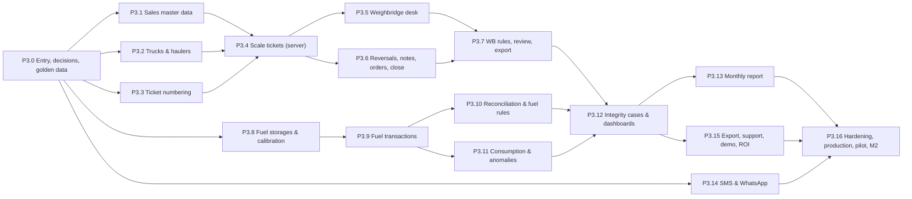

# Phase 3 Execution Plan: Sub-Phases P3.0 – P3.16

> [Docs index](../../README.md) › [04-phases](../README.md) › [Phase 3 plan](plan.md) · [Phase 3 tracker](tracker.md)

The [Phase 3 plan](plan.md) says **what** Phase 3 delivers: 22 stories in 8 epics (weighbridge, sales basics, fuel,
fuel analytics, the integrity dashboard, multi-channel notifications, production readiness and the demo tenant), the
test cases and the exit gate **M2 (pilot live, Starter sellable)**. This file says **in which order** we build it,
**how** each piece is built, and **who checks what**: **17 sub-phases**, each small enough to finish, test and merge
before the next one starts. It is written from every role of the team: architect (decisions and boundaries), software
engineer (what gets built, module by module), QA (test cases, property, model-based and mutation tests), DevOps/SRE
(CI, local stack, metrics, alerts, runbooks), security (threats per sub-phase), UX (the weighbridge desk and the fuel
attendant's flow) and product (owner inputs, demo, exit gate).

**How to use it:** tell the agent **"start P3.x"**. The agent follows the [way of working](#2-way-of-working-applies-to-every-sub-phase)
(§2) and the sub-phase card (§4), and reports when the sub-phase is done. Live status is in the
[Phase 3 tracker](tracker.md).

---

## Contents

0. [Can Phase 3 start? (entry decision)](#0-can-phase-3-start-entry-decision)
1. [Overview and order](#1-overview-and-order)
2. [Way of working (applies to every sub-phase)](#2-way-of-working-applies-to-every-sub-phase)
3. [Architecture of Phase 3](#3-architecture-of-phase-3)
4. [Sub-phase cards](#4-sub-phase-cards)
   - Start: [P3.0](#p30--entry-decisions--golden-datasets)
   - Selling: [P3.1](#p31--sales-master-data-customers-products-price-lists) · [P3.2](#p32--trucks--haulers)
   - Weighing: [P3.3](#p33--ticket-numbering-gap-free-offline) · [P3.4](#p34--scale-tickets-server) · [P3.5](#p35--weighbridge-desk-tablet-and-pc) · [P3.6](#p36--reversals-delivery-notes-orders--daily-close) · [P3.7](#p37--weighbridge-rules-ticket-review--export)
   - Fuel: [P3.8](#p38--fuel-storages-calibration--opening-stock) · [P3.9](#p39--fuel-transactions-deliveries-dispenses-dips) · [P3.10](#p310--tank-reconciliation--fuel-rules) · [P3.11](#p311--consumption-baselines--anomaly-detection)
   - Seeing it: [P3.12](#p312--integrity-cases-integrity--fuel-dashboards) · [P3.13](#p313--monthly-savings--integrity-report)
   - Around it: [P3.14](#p314--sms--whatsapp-channels-quotas--fallback) · [P3.15](#p315--tenant-export-support-tooling-demo-tenant--roi)
   - Finish: [P3.16](#p316--hardening-production-pilot--exit-gate-m2)
5. [Story coverage check](#5-story-coverage-check)
6. [Amendments to the Phase 3 plan](#6-amendments-to-the-phase-3-plan)
7. [Owner inputs and when they are needed](#7-owner-inputs-and-when-they-are-needed)
8. [New test cases introduced by this plan](#8-new-test-cases-introduced-by-this-plan)
9. [Risks specific to execution](#9-risks-specific-to-execution)

---

## 0. Can Phase 3 start? (entry decision)

**Short answer: yes, the build can, under the same conditions as Phase 2.** The architect's position (2026-11-27):

| Question | Answer |
|---|---|
| Is Phase 2's exit gate passed? | **Not yet.** P2.0–P2.11 and P2.12a are done; **P2.12b** (staging, device lab, shadow run with a pilot) needs the hosting provider (P1.17), real tablets and a pilot site, which are external ([Phase 2 tracker](../phase-02-field-operations/tracker.md)). |
| Does that block Phase 3 work? | **Not the build.** Weighbridge, sales, fuel and the dashboards build on modules that are done and tested (Sync, Trust, Verification, Integrity, Notifications, Documents, Materials, Assets, Imports). Everything in P3.0–P3.15 and P3.16a builds and tests on the local stack and in CI. |
| What must be finished first? | Nothing in code: `main` and the nightly run are green, P2.12a is done. Two small Phase 2 follow-ups are worth taking first because Phase 3 reuses the code they touch: **W-8** (a meter's last reading must include shift entries, so the tablet stops saying "no previous value"; RULE-FUEL-03 compares refuel meters with exactly that reading) and the portal's `?lang=` entry from the website (one PR, P2.13 follow-up). |
| What carries over? | P1.15 real-tablet run, P1.17 environments, P1.18b staging, P2.12b (shadow run) and the Phase 2 exit gate. They are tracked in the [Phase 3 tracker](tracker.md#2-carry-overs) and **must be closed before P3.16b** (the pilot runs in production, on real tablets). |
| What is the risk of building ahead of the pilot? | (1) The weighbridge flow is designed without having watched a real weighmaster: mitigated by a usability session on the desk before its UX is frozen (P3.5) and every threshold and format being data. (2) The legal status of offline ticket numbers is unknown (legal memo, WP-P0-06): mitigated by a tenant policy **online-only numbering** that is the default until the memo says otherwise (P3.3). (3) Fuel anomaly thresholds tuned on generated data: mitigated by golden datasets with an expert-computed answer (P3.0) and conservative defaults with minimum sample sizes (P3.11). |

**Milestone naming (correction).** The [roadmap](../phases-overview.md#61-timeline-team-of-57-indicative) puts **M2 at the end of
Phase 3** ("Pilot live, sell Starter"). The Phase 2 documents call their own exit gate "M2"; it is the **Phase 2 exit
gate** (shadow run). This plan uses M2 only for the Phase 3 exit.

---

## 1. Overview and order



| # | Sub-phase | Stories | Size | Sensitive (owner-approved merge) | Owner input needed before start |
|---|---|---|---|---|---|
| P3.0 | Entry, decisions, golden datasets | — | S | — | Read §0 and §6 |
| P3.1 | Sales master data: customers, products, price lists | SAL-01, SAL-02 | M | — (price fields masked) | Pilot's product list and one price list (sample is enough); currency |
| P3.2 | Trucks & haulers | SAL-04 | S | — | — |
| P3.3 | Ticket numbering (gap-free, offline) | WB-01 AC4, AC6 | M | **Sync** | Legal memo on provisional numbers (WP-P0-06); default online-only |
| P3.4 | Scale tickets (server) | WB-01 AC1–AC5 (server) | L | **Trust** (signed, immutable) | Ticket number prefix per site; flows used (inbound/outbound); stored-tare policy |
| P3.5 | Weighbridge desk (tablet and PC) | WB-01 (UI), WB-03 AC2 | L | — | A weighmaster (or proxy) for the 90-second test; printer type (A5 laser or 80 mm thermal) |
| P3.6 | Reversals, delivery notes, orders, daily close | WB-02, WB-03, WB-05, SAL-03 | M | **Trust** (countersigned reversal) | Over-delivery tolerance; who may approve tickets after close |
| P3.7 | Weighbridge rules, ticket review, export | WB-04, WB-06, WB-02 AC3 | M | — | Accounting export columns of the pilot's accountant (default proposed) |
| P3.8 | Fuel storages, calibration, opening stock | FUEL-01 | M | — | Pilot's tanks and one calibration table (CSV or photo) |
| P3.9 | Fuel transactions: deliveries, dispenses, dips | FUEL-02, FUEL-03, FUEL-05, FUEL-04 AC1 | L | **Sync** (new field commands) | — |
| P3.10 | Tank reconciliation & fuel rules | FUEL-04 AC2–AC3, rules FUEL-01…04, 06…08 | M | — | Reconciliation tolerance (default ±0.5 %) |
| P3.11 | Consumption, baselines & anomaly detection | FUEL-06, FUEL-07 | L | — | One month of the pilot's fuel log (paper is fine) for the golden dataset |
| P3.12 | Integrity cases, integrity & fuel dashboards | INT-01, FUEL-08 | L | — | Who sees the leaderboard |
| P3.13 | Monthly savings & integrity report | INT-02 | M | — | Average fuel price source; executives' list |
| P3.14 | SMS & WhatsApp channels, quotas, fallback | NOT-01 (P3) | M | — | **SMS/WhatsApp provider** (fakes until then); plan quotas |
| P3.15 | Tenant export, support tooling, demo tenant, ROI calculator | OPS-04, OPS-02, GRW-01, GRW-02 | M | **Tenancy** (export of a whole tenant) | Support inbox address and SLAs per plan |
| P3.16 | Hardening, production, pilot & exit gate M2: **P3.16a** local and CI, **P3.16b** production and pilot | OPS-01, OPS-03, (exit gate) | M | — | **Hosting provider (P1.17), pilot customer, cut-over date** |

Size: **S** ≈ 1–3 PRs, **M** ≈ 3–6 PRs, **L** ≈ 6–10 PRs (PRs ≤ 400 changed lines). Phase 3 is about **75–90 PRs**.

**Parallel work.** Weighing (P3.1–P3.7) and fuel (P3.8–P3.11) are independent until the dashboards: with one agent
they run one after the other, weighing first (it is the money that leaves the gate); P3.14 can be pulled into any free
slot after P3.0, and is needed by P3.10's alerts at the latest.

**What waits for answers.** Thresholds, tolerances, prefixes, formats and export columns are **data with defaults**
from the [detection rules catalogue](../../03-domain/catalogues/detection-rules.md) and this plan; late answers change
seed data, not code.

---

## 2. Way of working (applies to every sub-phase)

Phase 3 keeps the Phase 2 loop unchanged ([Phase 2 §2](../phase-02-field-operations/sub-phases.md#2-way-of-working-applies-to-every-sub-phase)):
read the hand-off, the card and the stories; verify current versions of any new dependency (and the **7-day minimum
release age**); one short-lived branch and a small PR per slice; no AI attribution; every AC mapped to a test whose
name carries the `TC-…` ID; the CI commands run locally first; merges only through `tools/ci/merge_guard.py`; a docs
sweep and 0 broken links; tracker and hand-off updated; a sub-phase report that ends with **what is next**.

What Phase 3 adds:

### 2.1 Quality bar per role

| Role | Phase 3 rule |
|---|---|
| **Architect** | Each card's "Decisions" become an ADR, accepted before the code that depends on it merges. New modules (`Sales`, `Weighbridge`, `Fuel`) come from the template and only talk to others through their `Contracts` (architecture tests). Weighbridge and Fuel records plug into the existing engines: `IReviewableRecord` (Verification), rules into `Integrity`, documents through the `Documents` renderer, notifications through events. No second copy of any of them. |
| **Software engineer** | **Money is `decimal` with its currency**, never a bare number; quantities carry their unit and state (`t`, `m3 LOOSE`, `L`); conversions only through the units engine with the density **version** in force at the ticket's time. Signed records (tickets, dispenses, dips, reversals) are immutable; corrections are new records that reference the old ones. Price and amount are resolved at issue time and **frozen** on the ticket. Every save of a versioned aggregate handles `DbUpdateConcurrencyException` (D55). |
| **QA** | Each AC has a test at the lowest level that can prove it, plus one end-to-end path per epic. **Model-based test** for ticket numbering (random online/offline interleavings of several devices: no gap, no duplicate). **Property tests** for the reconciliation identity and the consumption engine. **Golden datasets** with an expert-computed answer for the fuel engine (≤ 1 % difference). **Mutation check** for every rule that protects money or evidence: numbering, net computation, price freeze, reversal countersignature, reconciliation, each WB and FUEL rule, RLS on new tables. |
| **DevOps / SRE** | New background jobs (baseline recompute, monthly report, export, demo expiry, SMS delivery) export metrics and have alerts with promtool tests and runbook entries. The nightly load suite gains the weighbridge peak (60 tickets/h per site × 50 sites) and the dashboard query on 12 months of data. |
| **Security** | `Sync` changes (new field commands, numbering blocks) and `Trust` changes (signed tickets and reversals) get a separate security review pass. New tables: RLS enabled and forced, isolation suite extended. Price fields are sensitive (masking, `SensitiveExport`). Provider credentials (SMS, WhatsApp) only through the secrets store; webhooks verified by signature. |
| **UX** | **Weighbridge desk:** keyboard-first, one screen per pass, the next field always focused, ≤ 90 s per truck measured, works offline, prints without a dialog where the browser allows. **Fuel attendant:** scan the machine's QR, three numbers and two signatures, one hand, sunlight contrast, offline. Five languages (N'Ko by the tool only). |
| **Product** | Each sub-phase ends with a short demo step mapped to the [Phase 3 demo script](plan.md#108-demo-script). |

### 2.2 Invariants this phase can break, and the guard for each

| Invariant | How Phase 3 could break it | Guard |
|---|---|---|
| Decimal money / quantities | Price × net in floating point; litres summed as doubles | `Money` and `Quantity` value objects (`decimal`, currency/unit); signed payloads carry strings; architecture test: no `double`/`float` in `Sales`, `Weighbridge`, `Fuel` domain types; TC-P3-WB-003, TC-P3-FUEL-002 |
| Explicit units | Tonnes and kilograms mixed; m³ without state | Ticket stores kg (authoritative mass) and derived tonnes and volume with the density version id; units engine only (ADR-0025) |
| Immutable signed records | A ticket edited after signing; a dispense corrected in place | Append-only tables (trigger + revoked `UPDATE`/`DELETE`); corrections are reversals or new versions; TC-P3-WB-004 |
| Ledger in the same transaction | Ticket saved, ledger entry later | Every state change through `ModuleDbContext` with the ledger writer; architecture test |
| Gap-free numbering | Two devices issue the same number offline; a number skipped | Device blocks reserved online, provisional numbers offline, renumbered on sync in issue order; model-based test TC-P3-WB-006/007 |
| Tenant isolation | Price list or ticket of another tenant through a shared truck plate | Every table tenant-scoped with RLS; plates unique **per tenant**; isolation suite extended |
| Offline never loses data | Ticket or dispense lost on app update | Same outbox as Phase 2 (never deleted before `accepted`/`duplicate`) |

### 2.3 Merge rule

Unchanged: the agent merges normal PRs once every required check is green; PRs touching **Sync, Trust (ledger,
signatures, keys), Verification decisions that carry signatures, Identity, Tenancy, Billing, ledger migrations or
CI/CD security** are owner-approved (standing approval given by the owner, merges still only through the merge guard
with `--owner-approved`).

### 2.4 End of a sub-phase

Same checklist as [Phase 2 §2.4](../phase-02-field-operations/sub-phases.md#24-end-of-a-sub-phase): tests green locally
and in CI, threats checked, metrics and alerts, docs swept with 0 broken links, tracker and hand-off updated, nightly
green the night after the last merge.

---

## 3. Architecture of Phase 3

### 3.1 Modules

| Module | New or existing | Owns (schema) | Main aggregates | Talks to |
|---|---|---|---|---|
| `Sales` | **new** | `sales` | `Customer`, `Product`, `PriceList` (versions), `SalesOrder` | `Materials.Contracts` (fractions, densities), `Organization.Contracts` (sites) |
| `Weighbridge` | **new** | `weighbridge` | `Truck`, `Hauler`, `NumberBlock`, `ScaleTicket` (two passes), `Reversal`, `DeliveryNote`, `DailyClose` | `Sales.Contracts` (customer status, price at a time), `Materials.Contracts` (units engine), `Trust.Contracts`, `Sync.Contracts` (field commands), `Verification` (`IReviewableRecord`), `Integrity` (rules) |
| `Fuel` | **new** | `fuel` | `Storage` (tank / bowser, calibration table versions, dispenser meter), `Delivery`, `Dispense`, `Dip`, `Reconciliation`, `ConsumptionInterval`, `Baseline` | `Assets.Contracts` (tank capacity, meters, last reading), `FieldOps.Contracts` (shift entries for ΔH), `Trust`, `Sync`, `Verification`, `Integrity` |
| `Integrity` | existing (P2.7) | `integrity` | `Flag`; **new:** `Case` (assignment, comments, resolution), dashboard read models | every module's rules |
| `Notifications` | existing (P2.10) | `notifications` | **new:** `ChannelQuota`, `UsageMeter`; SMS and WhatsApp channels | `ISmsSender`, `IWhatsAppSender` ports |
| `Documents` | existing (P2.11) | — | **new renderers:** scale ticket (A5 and 80 mm), delivery note, daily close, monthly report | `Trust` (hash, QR), PDFsharp/MigraDoc (ADR-0040) |
| `Tenancy` | existing | `tenancy` | **new:** `ExportJob` | every module's `IExportable` |

**Why `Weighbridge` and `Sales` are separate modules** (the [bounded contexts](../../03-domain/bounded-contexts.md) draw
one "Weighbridge & Sales/Dispatch" context): customers, products and price lists are also read by invoicing (P7) and
the customer portal later, and change at a commercial pace; tickets are field facts with signatures and numbering. One
module would mix master data with signed evidence. Trucks live with the weighbridge (tares, turnaround rules).

### 3.2 The life of a scale ticket

```mermaid
sequenceDiagram
    participant D as Weighbridge desk (offline-capable)
    participant API as Sync API
    participant W as Weighbridge handler
    participant S as Sales (price, customer)
    participant TR as Trust
    participant V as Verification / Integrity
    D->>D: pass 1: truck, weight, indicator photo (in-app camera)
    D->>D: pass 2: weight, product, customer → net, volume, price (preview)
    D->>D: weighmaster signs → number from the device block (or provisional)
    D->>API: commands (ticket issued: both passes, signature, photos)
    API->>W: handle (savepoint)
    W->>S: customer status + price at issue time (frozen on the ticket)
    W->>TR: envelope + ledger entry (same transaction)
    W->>V: rules (RULE-WB-01…07) → flags; review item per policy
    W-->>API: accepted (final number) | conflict (flags)
    API-->>D: final number (renumbers a provisional one), PDF reprint
```

### 3.3 Decisions to record (ADRs)

| ADR | Decision (recommendation) | Card |
|---|---|---|
| ADR-0042 | **Sales and weighbridge modules:** `Sales` (customers, products mapped to material fractions, price lists as effective-dated versions per site and optionally per customer, one currency per list) and `Weighbridge` (trucks, tickets); price resolved by `Sales.Contracts.PriceAt(site, customer, product, instant)` and frozen on the ticket; customers blocked by status with a reason. | P3.1 |
| ADR-0043 | **Gap-free ticket numbering offline:** a per-site counter in `weighbridge.number_block`; an enrolled desk device reserves a block (default 50) while online; numbers are consumed in order and released blocks never reused; with the tenant policy `online_only` (default until the legal memo) a desk without a block cannot issue; with `provisional_allowed`, an offline ticket gets `P-{device}-{seq}` and is renumbered on sync in issue order, the provisional number kept on the ticket and printed on the reprint; the model-based test is the acceptance. | P3.3 |
| ADR-0044 | **Scale ticket:** two signed passes in one ticket (`first_pass`, `second_pass`, direction inbound/outbound); mass in kg is authoritative, tonnes and volume derived with the density version id; net never negative (reversals carry the sign); stored-tare single pass only when the tenant policy allows, flagged `STORED_TARE`; manual weight requires an in-app indicator photo (RULE-WB-05); immutable after signature. | P3.4 |
| ADR-0045 | **Weighbridge desk:** the field PWA (enrolled device, outbox, device signatures) with a desk layout (keyboard-first, wide screen), not a separate app; printing through the browser with print CSS for A5 and 80 mm thermal (no driver integration in P3); indicator capture stays manual (automatic capture is P6's edge agent). | P3.5 |
| ADR-0046 | **Fuel storages and stock:** a storage has versions of its calibration table (dip cm → litres, linear interpolation between points, out of range refused); all volumes in litres as `decimal(12,2)` at 15 °C not corrected in P3 (temperature recorded only); stock is derived, never stored: opening + deliveries − dispenses − transfers, compared with dips. | P3.8 |
| ADR-0047 | **Fuel analytics:** consumption intervals between consecutive refuels of an asset; usage from verified shift entries (ΔH or ΔKM) through `FieldOps.Contracts`; baseline = rolling median and MAD of the last N intervals per asset and activity (type-level baseline until N ≥ 8); anomaly when deviation > threshold and robust z > 3.5; deterministic and recomputed on late data; every anomaly stores its explanation (expected, actual, intervals, refuels, shift entries). | P3.11 |
| ADR-0048 | **Integrity cases and dashboards:** a case groups one or more flags with an assignee, comments and a resolution (signed, ledgered); dashboard tiles read from read models refreshed by events (no query over raw tables at view time); leaderboards behind their own permission. | P3.12 |
| ADR-0049 | **SMS and WhatsApp:** `ISmsSender` and `IWhatsAppSender` ports with a local fake (Mailpit-like inspection page) until the owner chooses providers; per-tenant monthly quota from the plan, metered per message; over quota or failure → e-mail fallback and an admin notice; delivery status from provider webhooks (signature verified). | P3.14 |
| ADR-0050 | **Tenant export:** an asynchronous job writes one CSV per entity (UTF-8, documented columns) and a manifest of documents with their hashes into a ZIP in the tenant's prefix; download by a signed link valid 7 days; every export ledgered; sensitive fields follow the requester's masking. | P3.15 |

### 3.4 New permissions (role matrix)

| Permission | Default roles | Notes |
|---|---|---|
| `sales.customers.manage` / `sales.customers.read` | Commercial Manager / Weighmaster, Finance, Executive | Block / unblock with a reason |
| `sales.prices.manage` / `sales.prices.read` | Commercial Manager, Finance / Weighmaster (price only on the ticket) | Price fields masked for others |
| `sales.orders.manage` | Commercial Manager | — |
| `weighbridge.trucks.manage` | Weighmaster, Commercial Manager | Unknown trucks created at the desk are flagged |
| `weighbridge.tickets.issue` | Weighmaster (desk device) | Field app desk mode only |
| `weighbridge.tickets.read` | Site Manager, Controller, Commercial, Finance, Executive (scoped) | — |
| `weighbridge.tickets.reverse` / `.countersign` | Weighmaster / Controller | Never the same person |
| `weighbridge.close.approve-late` | Site Manager | Tickets after a daily close |
| `weighbridge.blocked.override` | Site Manager | RULE-WB-07, audited |
| `fuel.storages.manage` | Site Manager | Calibration tables, opening stock |
| `fuel.transactions.capture` | Fuel Attendant (field device) | Deliveries, dispenses, dips |
| `fuel.other-use.approve` | Site Manager | Non-asset dispensing |
| `fuel.reconciliation.read` | Site Manager, Controller, Finance, Executive | — |
| `integrity.cases.manage` | Controller, Site Manager | Assign, comment, resolve |
| `integrity.leaderboard.read` | Executive, Site Manager | Per tenant setting |
| `reports.monthly.read` | Executive, Finance | — |
| `tenancy.export.request` | Tenant Admin | Ledgered |
| `notifications.channels.manage` | Tenant Admin | SMS and WhatsApp per notification type |

### 3.5 Non-functional budgets (checked in CI or nightly)

| Budget | Target | Where checked |
|---|---|---|
| Ticket per truck at the desk | ≤ 90 s median (two passes) | usability session (P3.5) |
| Ticket command handling | p95 < 300 ms server time | nightly k6 |
| Weighbridge peak | 60 tickets/h per site × 50 sites, no error | nightly k6 (P3.16a) |
| Integrity dashboard | < 2 s for 12 months of one site | nightly with the demo generator's data |
| Reconciliation | exact to 0.01 L | property test |
| Baseline recompute, 1 site, 12 months | < 30 s | integration test |
| Monthly report, 3 sites | < 60 s, totals equal SQL ground truth | integration test (TC-P3-RPT-001) |
| Tenant export | < 1 h for a pilot-sized tenant | integration test with generated data |
| Demo tenant | created < 2 min | integration test |

---

## 4. Sub-phase cards

### P3.0 — Entry, decisions & golden datasets

**In plain words:** before any code, write down the decisions, reserve the ADR numbers, and build the data every later
test needs: a weighbridge day generator and a fuel month generator with a known answer.

- **Stories:** none (enabler).
- **Depends on:** Phase 2 P2.12a done (it is).
- **What gets built:** this plan reviewed; ADR-0042 … 0050 drafted (status Proposed); the Phase 2 test-data generator
  extended with: trucks and haulers, customers and products, a weighbridge day (inbound and outbound, stored tares,
  known anomalies: tare deviation, overload, impossible turnaround, after-hours, missing photo, a reversal), a fuel
  month per site (tanks with calibration tables, deliveries, dispenses, dips, and seeded anomalies: 25 % overconsumption
  on one machine, refuel without usage, frequent small refuels, a tank variance of 1.2 %); a **golden dataset** whose
  expected results (consumption per interval, baselines, anomalies, reconciliation variances) are computed independently
  in a spreadsheet-style script and committed as fixtures.
- **Tests:** generator determinism (same seed, same data); fixtures load; the expected-answer script reproduces the
  committed numbers.
- **Done when:** ADRs are drafted, generators produce the datasets, and the golden answers are committed with the method
  that produced them.

---

### P3.1 — Sales master data: customers, products, price lists

**In plain words:** the commercial side the weighbridge needs: who buys, what they buy, and at what price on a given day.

- **Stories:** US-P3-SAL-01 (AC1–AC3), US-P3-SAL-02 (AC1–AC3).
- **Depends on:** P3.0.
- **Decisions:** ADR-0042.
- **What gets built:** module `Sales` from the template; `Customer` (legal name, tax ID, addresses, contacts, payment
  terms, optional credit limit, status active/blocked with reason, allowed sites, invoicing basis tonnes or m³ LOOSE);
  `Product` mapped to a material fraction with its sale unit; `PriceList` versions (site, optional customer, currency,
  effective from, lines per product) and `PriceAt(site, customer, product, instant)` (customer list wins over site list;
  none → no price, the desk shows it); record versions (D55); Excel import targets for customers and products
  (`IImportTarget`, P1.14); portal screens: customers (list, detail, block/unblock), products, price lists (versions,
  effective dates, preview "price on date"); price masking.
- **Tests:**

  | Test | What it proves |
  |---|---|
  | TC-P3-SAL-001 | Customer created, blocked with a reason, unblocked; ledgered |
  | TC-P3-SAL-002 | Price resolution: customer list beats site list; effective dates on the company's clock; none → absent |
  | TC-P3-SAL-003 | Price fields masked for a role without `sales.prices.read` (API and export) |
  | TC-P3-SAL-004 | Excel import of 200 customers: row errors reported, nothing half-imported |
  | Isolation | New tables in the tenant-isolation suite |
- **Security review:** price data exposure (masking), import file handling (existing safe reader).
- **Done when:** a price for any customer, product and date is answered by one call, and the portal manages it.

---

### P3.2 — Trucks & haulers

**In plain words:** the trucks that cross the scale, with their registered empty weight and legal payload.

- **Stories:** US-P3-SAL-04 (AC1–AC2).
- **Depends on:** P3.0.
- **What gets built:** module `Weighbridge` (schema `weighbridge`) from the template; `Hauler`; `Truck` (plate unique per
  tenant, normalised; hauler; registered tare with date and method; max legal payload; axle configuration; status);
  creation at the desk of an unknown truck (`unverified`, raises a review flag); portal screens and Excel import.
- **Tests:** TC-P3-WB-016 (plate normalisation: spaces and case do not create duplicates), TC-P3-WB-017 (unknown truck
  at the desk → `unverified` + flag), isolation suite.
- **Done when:** the desk can find any truck by plate in under a keystroke's delay and create an unknown one.

---

### P3.3 — Ticket numbering (gap-free, offline)

**In plain words:** every ticket at a site has the next number, with no gap and no duplicate, even when two desks are
offline.

- **Stories:** US-P3-WB-01 (AC4 numbering, AC6 offline).
- **Depends on:** P3.0.
- **Decisions:** ADR-0043.
- **What gets built:** `NumberBlock` (site, range, device, state); `POST /api/v1/weighbridge/number-blocks` (device
  signed, reserves the next block atomically, `SELECT … FOR UPDATE` on the site counter); tenant policy
  `numbering = online_only | provisional_allowed`; field outbox command for block consumption; renumbering of
  provisional tickets on sync in issue order (device sequence), provisional number kept; release of unused numbers is
  **forbidden** (a block's unused numbers are cancelled with a signed "void range" record so the sequence stays
  explainable without gaps).
- **Tests:**

  | Test | What it proves |
  |---|---|
  | TC-P3-WB-006 | Offline, block exhausted → provisional number, renumbered on sync, link kept, no gap |
  | TC-P3-WB-007 | Two devices of one site offline → no duplicate |
  | TC-P3-WB-018 | `online_only` policy: a desk without a block cannot issue (clear message) |
  | Model-based | Random interleavings of 3 devices online/offline, reservations, issues, syncs → the site's sequence is gap-free (or every gap is a signed void range) and duplicate-free (FsCheck state machine, shrinking) |
  | Mutation | Reusing a released number or renumbering out of order fails the model-based test |
- **Security review:** a device reserving another site's block; replay of a block reservation (device sequence).
- **Done when:** the model-based test is green for 10 000 random runs.

---

### P3.4 — Scale tickets (server)

**In plain words:** the ticket itself: two weighings, the net, the volume if the customer buys by m³, the frozen price,
the weighmaster's signature, and a PDF with a QR anyone can verify.

- **Stories:** US-P3-WB-01 (AC1–AC5, server side).
- **Depends on:** P3.1, P3.2, P3.3.
- **Decisions:** ADR-0044.
- **What gets built:** `ScaleTicket` (direction, truck, driver, customer, product, optional order, first and second pass
  with weight in kg, time, indicator photo and source `MANUAL`), net in kg and t, volume through the units engine with
  the LOOSE density version in force at the second pass, price and amount frozen from `Sales`, weighmaster's signature
  envelope, append-only; sync command handler `weighbridge.ticket.issue` (savepoint, idempotent); blocked customer →
  refused unless override (RULE-WB-07); `GET /tickets`, `/tickets/{id}`, `/tickets/{id}/pdf` (A5 and 80 mm renderers,
  QR to the public verification page of ADR-0040); `IReviewableRecord` for tickets.
- **Tests:**

  | Test | What it proves |
  |---|---|
  | TC-P3-WB-001 | Two-pass outbound: net = gross − tare, sequential number, PDF QR verifies |
  | TC-P3-WB-002 | Customer basis m³: volume with the LOOSE density version at issue time |
  | TC-P3-WB-003 | Price change after the ticket: the ticket keeps its price |
  | TC-P3-WB-004 | Editing a ticket through the API: refused (405/409); `UPDATE` refused by the database |
  | TC-P3-WB-015 | Blocked customer: refused unless override (audited) |
  | TC-P3-WB-019 | Stored-tare single pass only with the policy; flagged `STORED_TARE` |
  | Property | Net never negative on a ticket; mass is never derived from a volume |
- **Security review:** T-ticket-tamper (signed payload covers weights, photo hashes, price); isolation of the public
  verification of tickets.
- **Done when:** a ticket goes from two commands to a signed PDF whose QR verifies on the public page.

---

### P3.5 — Weighbridge desk (tablet and PC)

**In plain words:** the screen the weighmaster uses all day: fast, keyboard-first, offline, printing the ticket.

- **Stories:** US-P3-WB-01 (UI), US-P3-WB-03 (AC2: customer or driver signature on the tablet).
- **Depends on:** P3.4.
- **Decisions:** ADR-0045.
- **What gets built:** desk mode in the field app (enrolled device role `weighbridge`): truck search by plate (fuzzy),
  pass 1 and pass 2 screens with the next field focused, keyboard shortcuts, in-app camera for the indicator photo,
  "open trucks" list (first pass done, waiting for the second), price preview, warnings (blocked customer, over legal
  payload, tare deviation) shown before signing, weighmaster signature, print (A5 and 80 mm print CSS), reprint;
  offline with the outbox; desk layout from 1024 px wide, tablet layout below.
- **Tests:** component tests per screen; E2E: a truck in and out in two passes, printed; offline issue then sync
  (provisional number replaced); axe in five languages; usability session (median ≤ 90 s per truck, TC-P3-WB-020).
- **Done when:** a weighmaster (or proxy) does 10 trucks with the median under 90 seconds.

---

### P3.6 — Reversals, delivery notes, orders & daily close

**In plain words:** fixing a wrong ticket the auditable way, the paper the driver takes away, linking tickets to an
order, and closing the day.

- **Stories:** US-P3-WB-02 (AC1–AC2), US-P3-WB-03 (AC1), US-P3-WB-05, US-P3-SAL-03.
- **Depends on:** P3.4.
- **What gets built:** `Reversal` (negative ticket referencing the original, reason, weighmaster signature +
  controller countersignature; effective only when countersigned; corrected ticket referencing both); "Reversed by #…"
  on the original; delivery note PDF per ticket and per order and day; `SalesOrder` (customer, site, product, quantity
  with unit, delivery window, status) with progress = Σ net of linked tickets and an over-delivery warning beyond
  tolerance; daily close (counts and tonnes per product and customer, signed, PDF) and controller approval for tickets
  dated in a closed day.
- **Tests:** TC-P3-WB-005 (reversal without countersignature stays pending, not effective), TC-P3-WB-021 (same person
  cannot countersign their own reversal), TC-P3-SAL-005 (order progress and over-delivery warning), TC-P3-WB-022 (ticket
  in a closed day needs approval), PDFs verify.
- **Security review:** four-eyes on reversals (mutation check: allowing the same person fails a test).
- **Done when:** the demo's reversal flow (step 2) runs end to end with the controller's countersignature.

---

### P3.7 — Weighbridge rules, ticket review & export

**In plain words:** the system watches the tickets for the known tricks, sends doubtful ones to review, and exports
the day to accounting.

- **Stories:** US-P3-WB-04 (AC1–AC2), US-P3-WB-06, US-P3-WB-02 AC3.
- **Depends on:** P3.5, P3.6.
- **What gets built:** RULE-WB-01 … 07 in `Weighbridge` registering with `Integrity` (thresholds as tenant settings,
  explanation in five languages, evidence links); review policy for tickets (Verification); reversal rate per
  weighmaster (read model for RULE-WB-06 and the dashboard); ticket export per period (CSV and Excel, one line per
  ticket: customer tax ID, product, quantity, unit, unit price, amount, currency) honouring masking.
- **Tests:** TC-P3-WB-008 … 014 (each rule: one positive and one negative case), TC-P3-WB-023 (export columns and totals
  equal the tickets; masked fields absent without permission), mutation check per rule.
- **Done when:** every anomaly in the generator's weighbridge day comes out as the right flag, and only those.

---

### P3.8 — Fuel storages, calibration & opening stock

**In plain words:** the tanks and bowsers, how to turn a dip into litres, and the starting stock.

- **Stories:** US-P3-FUEL-01 (AC1–AC2).
- **Depends on:** P3.0.
- **Decisions:** ADR-0046.
- **What gets built:** module `Fuel` from the template; `Storage` (fixed tank / mobile bowser, product diesel, petrol,
  AdBlue, capacity, site, dispenser meter); calibration table versions (CSV import, monotonic check, linear
  interpolation, out of range refused); signed opening stock; portal screens; asset tank capacity read from
  `Assets.Contracts` (added to the asset type if missing).
- **Tests:** TC-P3-FUEL-003 (interpolation for intermediate dips), TC-P3-FUEL-009 (non-monotonic table refused),
  TC-P3-FUEL-010 (dip out of range refused), property (interpolated litres are monotonic in the dip), isolation suite.
- **Done when:** any dip on any storage converts to litres from the table version in force.

---

### P3.9 — Fuel transactions: deliveries, dispenses, dips

**In plain words:** the fuel attendant's work on the tablet: receive fuel, refuel machines, measure the tanks.

- **Stories:** US-P3-FUEL-02, US-P3-FUEL-03, US-P3-FUEL-05, US-P3-FUEL-04 (AC1).
- **Depends on:** P3.8.
- **What gets built:** field commands and handlers `fuel.delivery`, `fuel.dispense`, `fuel.dip`, `fuel.other-use`
  (signed, offline, photos through the evidence pipeline); dispense flow on the tablet: scan the machine's QR → last
  refuel, last meter (includes shift entries, W-8), tank capacity → meter reading + photo, litres, totalizer before and
  after (photos), receiver present → attendant and receiver sign on the same device; delivery flow (supplier, delivery
  note number, ordered and delivered litres, dips before and after, optional temperature, photos); dip flow; other use
  with a reason and the site manager's approval.
- **Tests:** E2E per flow offline then synced; TC-P3-FUEL-011 (dual signature: two different people, both envelopes
  verify), TC-P3-FUEL-012 (other use stays pending until approved), axe in five languages.
- **Security review:** new Sync commands (signature, replay, sequence); evidence pipeline unchanged.
- **Done when:** the demo's refuel (step 3, offline, two signatures) runs end to end.

---

### P3.10 — Tank reconciliation & fuel rules

**In plain words:** for each tank and period, does what came in minus what went out match what is left?

- **Stories:** US-P3-FUEL-04 (AC2–AC3); rules RULE-FUEL-01 … 04, 06 … 08.
- **Depends on:** P3.9 (alerts use P3.14's channels when present, e-mail otherwise).
- **What gets built:** reconciliation per storage and period (opening + deliveries − dispenses − closing dip =
  variance, litres and %), tolerance per tenant (default ±0.5 %), recomputed when late data arrives; rules FUEL-01
  (delivery vs dip), FUEL-02 (dispense > asset capacity + 5 %), FUEL-03 (refuel meter vs shift entries), FUEL-04 (tank
  variance), FUEL-06 (refuel without usage), FUEL-07 (outside shift hours), FUEL-08 (≥ 3 small refuels in a shift) in
  `Integrity`; notification on FUEL-04.
- **Tests:** TC-P3-FUEL-001 (dispense > capacity), TC-P3-FUEL-002 (variance exact to 0.01 L), TC-P3-FUEL-013 … 019 (each
  rule, positive and negative), property (reconciliation identity holds for random sequences), mutation per rule.
- **Done when:** the generator's fuel month gives exactly the seeded variances and flags.

---

### P3.11 — Consumption, baselines & anomaly detection

**In plain words:** how many litres per hour each machine burns, what is normal for it, and when it is not.

- **Stories:** US-P3-FUEL-06 (AC1–AC2), US-P3-FUEL-07 (AC1–AC4).
- **Depends on:** P3.9 (and verified shift entries from Phase 2).
- **Decisions:** ADR-0047.
- **What gets built:** consumption intervals (refuel to refuel per asset: litres ÷ ΔH or ΔKM from verified shift
  entries; `ESTIMATED` when the meter is in failed mode); aggregates per day, week, month, asset, type, site; baselines
  (rolling median and MAD of the last 20 intervals per asset and activity; type-level baseline until 8 intervals);
  RULE-FUEL-05 (deviation > 18 % and robust z > 3.5; threshold relaxed per config for estimated intervals); explanation
  stored with each anomaly; recompute job on late data (idempotent, metrics).
- **Tests:** TC-P3-FUEL-004 (< 8 intervals → type baseline, no false alert), TC-P3-FUEL-005 (25 % overconsumption
  detected), TC-P3-FUEL-006 (±10 % not flagged), TC-P3-FUEL-007 (fallback meter → `ESTIMATED`, relaxed threshold),
  TC-P3-FUEL-008 (golden month: every interval within 1 % of the expert computation), property (median and MAD
  invariant to the order of intervals; scaling all litres scales rates), performance (12 months of a site < 30 s).
- **Done when:** the golden dataset passes and the explanation of each anomaly links to its refuels and shift entries.

---

### P3.12 — Integrity cases, integrity & fuel dashboards

**In plain words:** one screen every morning: where money may be leaking, who handles it, and is it getting better.

- **Stories:** US-P3-INT-01 (AC1–AC3), US-P3-FUEL-08 (AC1–AC3).
- **Depends on:** P3.7, P3.10, P3.11.
- **Decisions:** ADR-0048.
- **What gets built:** `Case` in `Integrity` (one or more flags, assignee, comments, resolution with a reason, signed
  and ledgered); read models refreshed by events (open flags by severity and type, continuity exceptions, fuel
  anomalies, tank variances, ticket flags, reversals, overdue reviews, clock-skew entries, devices unsynced > 24 h;
  30 and 90-day trends; leaderboard by site, controller, weighmaster behind its permission); portal: integrity
  dashboard (tiles, trends, drill-down to the flag and its evidence), fuel dashboard (litres per period, L/h per type,
  top 10 deviations, tank variance trend, scatter L/h vs hours, heatmap asset × day, drill-down to refuels and shift
  entries). Charts follow the project's chart rules (accessible, same in light and dark).
- **Tests:** TC-P3-INT-001 (flag lifecycle assign → resolve: audited, removed from open counts), TC-P3-INT-002
  (leaderboard hidden without the permission), TC-P3-INT-003 (tile counts equal SQL ground truth on the demo
  generator's data), performance (< 2 s for 12 months of one site), axe.
- **Done when:** the demo's step 4 runs: from a fuel anomaly tile to the exact refuels and shift photos.

---

### P3.13 — Monthly savings & integrity report

**In plain words:** on the 1st of the month, executives get a PDF that says what was found, what was fixed, and an
honest estimate of what it saved, with the method stated.

- **Stories:** US-P3-INT-02 (AC1–AC3).
- **Depends on:** P3.12.
- **What gets built:** report job (1st of the month, company clock, idempotent per month); content: fuel consumption vs
  the baseline period (litres and value at the period's average price), anomalies found and resolved, ticket
  corrections and reversals, signed records (paper forms eliminated), approval latency; a **method and assumptions**
  section; PDF (Documents) signed with a QR; e-mail to executives; portal archive.
- **Tests:** TC-P3-RPT-001 (3 sites: totals equal SQL ground truth), TC-P3-RPT-002 (the method section is present and
  states every estimate's inputs), TC-P3-RPT-003 (re-running a month produces the same document hash).
- **Done when:** the demo's step 5 PDF is generated from the demo tenant and verifies on the public page.

---

### P3.14 — SMS & WhatsApp channels, quotas & fallback

**In plain words:** critical alerts reach a phone even without the app, within the plan's quota, and fall back to
e-mail when they cannot.

- **Stories:** US-P3-NOT-01 (AC1–AC3).
- **Depends on:** P3.0 (Notifications from P2.10).
- **Decisions:** ADR-0049.
- **What gets built:** channels SMS and WhatsApp behind `ISmsSender` / `IWhatsAppSender` with a local fake and an
  inspection page (like Mailpit); per-tenant monthly quota from the plan, usage metering per message (Billing reads
  it); quiet hours per user; delivery status (queued, sent, delivered, failed) from webhooks with signature
  verification; retries with backoff; fallback to e-mail and an admin notice when over quota or failed; settings screen
  (channels per notification type).
- **Tests:** TC-P3-NOT-001 (quota exceeded → e-mail fallback, admin informed), TC-P3-NOT-002 (quiet hours respected
  except critical), TC-P3-NOT-003 (webhook with a bad signature refused), TC-P3-NOT-004 (retry then failure visible).
- **Security review:** provider credentials only in the secrets store; phone numbers are personal data (masking,
  export, retention).
- **Done when:** a tank variance reaches the fake WhatsApp inbox, and the quota's end switches to e-mail.

---

### P3.15 — Tenant export, support tooling, demo tenant & ROI

**In plain words:** customers can take their data with them, users can ask for help from inside the app, and sales
can show a living demo and estimate savings.

- **Stories:** US-P3-OPS-04, US-P3-OPS-02, US-P3-GRW-01, US-P3-GRW-02.
- **Depends on:** P3.12 (so the demo shows dashboards).
- **Decisions:** ADR-0050.
- **What gets built:** export job (ZIP of CSV per entity + documents manifest, ready < 1 h, signed link 7 days,
  ledgered); in-app "Help & feedback" (message + correlation ID, app version, device info with consent) to the support
  inbox; demo tenant generator in the operator console (1–3 sites, 40 assets, 90 days of shifts, fuel and tickets,
  seeded anomalies; fictional names; expires after 30 days with a scheduled purge); ROI calculator as an operator
  console page (fuel volume, machines, tickets per day → conservative savings range, assumptions shown).
- **Tests:** TC-P3-OPS-001 (full export: every entity present, row counts match), TC-P3-OPS-003 (export link expires;
  another tenant's link refused), TC-P3-GRW-001 (demo tenant: dashboards populated, anomalies visible), TC-P3-GRW-002
  (demo tenant purged after expiry), TC-P3-OPS-004 (feedback carries the correlation ID).
- **Security review:** export is a whole-tenant data exit: permission, ledger, link scope, masking.
- **Done when:** a demo tenant is created in under 2 minutes and its export opens in a spreadsheet.

---

### P3.16 — Hardening, production, pilot & exit gate M2

**In plain words:** prove it holds under load and attack, then go live at the pilot site.

- **Stories:** US-P3-OPS-01, US-P3-OPS-03, exit gate M2.
- **Depends on:** all of the above; **P3.16b also on the carry-overs** (§0).
- **P3.16a (local and CI):** weighbridge peak load (60 tickets/h × 50 sites), dashboard on 12 months, security review
  of ticket immutability and the reversal workflow, ZAP on the new public pages, demo rehearsal (the plan's five steps),
  exit review draft.
- **P3.16b (production and pilot):** production through IaC (HA PostgreSQL, PITR, multi-AZ, WAF, backups, alerting),
  status page and incident process, restore drill (TC-P3-OPS-002, RTO 4 h, ledger verifies), pilot onboarding playbook
  (import, users, devices, QR labels, training per role, cut-over), two weeks of hypercare.
- **Exit gate M2:** as in the [plan](plan.md#109-exit-gate-m2--pilot-mvp).
- **Done when:** the pilot runs two consecutive weeks without paper for shifts, fuel and tickets.

---

## 5. Story coverage check

| Story | Sub-phase(s) |
|---|---|
| US-P3-SAL-01, SAL-02 | P3.1 |
| US-P3-SAL-03 | P3.6 |
| US-P3-SAL-04 | P3.2 |
| US-P3-WB-01 | P3.3 (numbering), P3.4 (server), P3.5 (desk) |
| US-P3-WB-02 | P3.6 (AC1–AC2), P3.7 (AC3) |
| US-P3-WB-03 | P3.6 (AC1), P3.5 (AC2) |
| US-P3-WB-04, WB-06 | P3.7 |
| US-P3-WB-05 | P3.6 |
| US-P3-FUEL-01 | P3.8 |
| US-P3-FUEL-02, FUEL-03, FUEL-05 | P3.9 |
| US-P3-FUEL-04 | P3.9 (AC1), P3.10 (AC2–AC3) |
| US-P3-FUEL-06, FUEL-07 | P3.11 |
| US-P3-FUEL-08, INT-01 | P3.12 |
| US-P3-INT-02 | P3.13 |
| US-P3-NOT-01 | P3.14 |
| US-P3-OPS-01, OPS-03 | P3.16b |
| US-P3-OPS-02, OPS-04, GRW-01, GRW-02 | P3.15 |

All 22 stories are covered; none is split across more than three sub-phases.

---

## 6. Amendments to the Phase 3 plan

| # | Plan says | Amended to | Why |
|---|---|---|---|
| A1 | PDF generation via QuestPDF | **PDFsharp + MigraDoc** through the `Documents` renderers | ADR-0040: QuestPDF's Community licence ends at USD 1 M revenue; the platform already ships PDFsharp 6.2.4 (MIT) |
| A2 | One "Weighbridge & Sales/Dispatch" context | Two modules, `Sales` and `Weighbridge` | Master data at a commercial pace vs signed field evidence (§3.1) |
| A3 | Offline numbering by reservation blocks | Same, plus a tenant policy `online_only` as the **default** until the legal memo, and signed void ranges instead of released numbers | The plan's own risk table names the legal concern; void ranges keep the sequence explainable |
| A4 | Weighbridge as a separate desktop flow | Desk mode of the field PWA | One offline, signing and enrollment stack (ADR-0045) |
| A5 | SMS/WhatsApp providers integrated | Ports with local fakes now; providers when the owner chooses | No subscription without the owner (standing rule); behaviour fully testable with fakes |
| A6 | Production environment in P3 | P3.16b, after P1.17 chooses a hosting provider | External dependency; everything else builds without it |
| A7 | ROI calculator as a spreadsheet or web page | An operator console page | Internal sales tool; the public website (ADR-0041) must not carry it |
| A8 | M2 also used for the Phase 2 exit | M2 only for the Phase 3 exit (pilot live) | Roadmap §6.1 |

---

## 7. Owner inputs and when they are needed

| Input | Needed by | Default if late |
|---|---|---|
| Legal memo on provisional ticket numbers (WP-P0-06) | P3.3 | `online_only` numbering |
| Pilot's products, one price list, currency | P3.1 | Demo catalogue in the local currency of the demo tenant |
| Ticket number prefix per site, flows used, stored-tare policy | P3.4 | `{SITE}-` prefix, both flows, stored tare off |
| Printer type at the weighbridge (A5 or 80 mm thermal) | P3.5 | Both print layouts |
| A weighmaster (or proxy) for the 90-second test | P3.5 | Proxy user with the generator's trucks |
| Over-delivery tolerance; late-ticket approver | P3.6 | 5 %; site manager |
| Accountant's export columns | P3.7 | Columns of US-P3-WB-06 |
| Pilot tanks and a calibration table | P3.8 | Generator's tables |
| One month of the pilot's fuel log | P3.11 | Golden dataset from the generator |
| Leaderboard visibility | P3.12 | Executives and site managers only |
| Fuel price source for the report | P3.13 | Average price of the month's deliveries |
| **SMS / WhatsApp provider**, plan quotas | P3.14 | Fakes; quotas from the price book draft |
| Support inbox and SLAs | P3.15 | `support@` placeholder; SLAs from the plans document |
| **Hosting provider, pilot customer, cut-over date** | P3.16b | — (blocks M2) |

---

## 8. New test cases introduced by this plan

| ID | Description |
|---|---|
| TC-P3-SAL-001 … 005 | Customers, price resolution, masking, import, order progress |
| TC-P3-WB-016 … 023 | Plate normalisation, unknown truck, online-only numbering, stored tare, desk timing, reversal four-eyes, closed day, export |
| TC-P3-FUEL-009 … 019 | Calibration checks, dual signature, other-use approval, each fuel rule |
| TC-P3-INT-003 | Dashboard tiles equal SQL ground truth |
| TC-P3-RPT-002, 003 | Method section; reproducible monthly document |
| TC-P3-NOT-002 … 004 | Quiet hours, webhook signature, retries |
| TC-P3-OPS-003, 004 | Export link scope and expiry; feedback correlation ID |
| TC-P3-GRW-002 | Demo tenant purge |

---

## 9. Risks specific to execution

| Risk | Mitigation |
|---|---|
| Weighbridge UX too slow in practice | Usability session before freezing (P3.5); measure per truck; keyboard-first |
| False fuel alerts erode trust | Golden datasets, minimum samples, explanations, conservative defaults (P3.11) |
| Numbering bug discovered in the pilot | Model-based test with 10 000 runs, mutation check, `online_only` default (P3.3) |
| Scope creep into invoicing | Export only in P3; invoicing is P7 |
| Phase 3 code piles up before staging exists | Keep every artefact deployable in CI on every merge (Phase 2 rule) |
| Providers (SMS, WhatsApp, hosting) chosen late | Ports and fakes now; P3.16b is the only blocked part |
