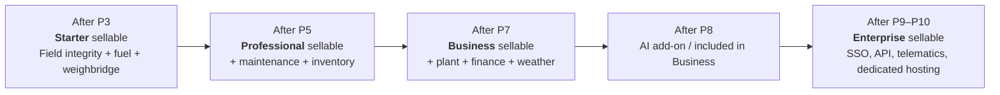
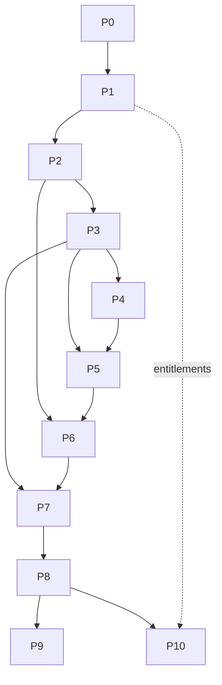

# Phases Overview, Timeline & Commercial Packaging

> [Docs index](../README.md) › [04-phases](README.md)

## 6.1 Timeline (team of 5–7, indicative)

| Phase | Name | Duration | Weeks (cumulative) | Milestone |
|---|---|---|---|---|
| P0 | Discovery & Architecture Baseline | 3 w | W1–W3 | **M0** Baseline approved |
| P1 | Platform Foundation & SaaS Core | 5 w | W4–W8 | **M1** Walking skeleton |
| P2 | Field Ops, Verification & Signatures | 6 w | W9–W14 | — |
| P3 | Weighbridge, Fuel, Integrity & Pilot | 5 w | W15–W19 | **M2** Pilot live → **sell Starter** |
| P4 | Maintenance & Reliability | 6 w | W20–W25 | — |
| P5 | Inventory & Warehouses | 6 w | W26–W31 | → **sell Professional** |
| P6 | Plant, Production, Stockpiles, Edge | 7 w | W32–W38 | **M3** Commercial v1 |
| P7 | Finance, Weather & Analytics | 6 w | W39–W44 | → **sell Business** |
| P8 | AI Copilot | 5 w | W45–W49 | **M4** Intelligence release |
| P9 | Integrations, Telematics & API | 6 w | W50–W55 (parallel) | → **sell Enterprise** |
| P10 | SaaS GA & Self-Service Growth | 6 w | W50–W55 (parallel) | **M5** GA |

## 6.2 Revenue starts early, not at the end

The roadmap is ordered so that **every phase from P3 onward unlocks a sellable plan**:

## 6.3 Phase dependency graph

---

Every phase section uses the same structure:

1. Objectives & business value
2. Scope (in / out)
3. Epics
4. User stories with acceptance criteria
5. Technical scope (backend, frontend, data, infrastructure, APIs)
6. Test plan
7. Deliverables
8. Demo script
9. Exit gate
10. Risks
11. Commercial outcome
