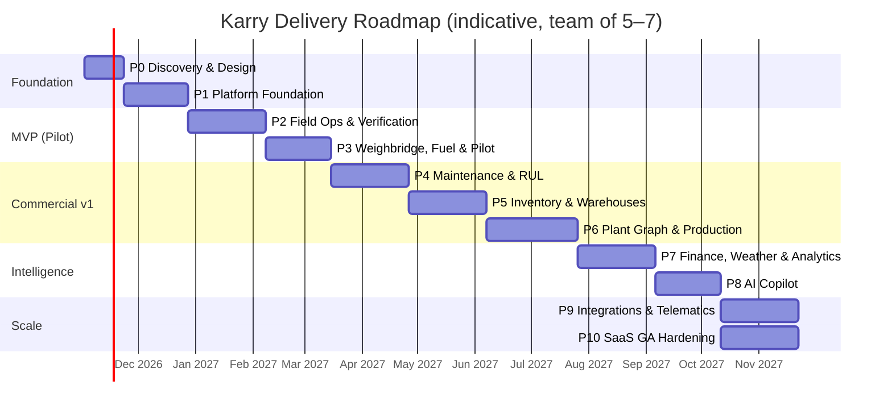

# Roadmap Summary

> [Docs index](../README.md) › [04-phases](README.md)

> **Detailed plan:** user stories, acceptance criteria, test plans, demo scripts and exit gates for every phase are in each phase folder (`phase-NN-*/plan.md`, see [phases overview](phases-overview.md)). Where this summary and a phase plan differ, the phase plan wins. Notable change: plans, entitlements and usage metering move into **Phase 1**, so the platform can be sold as a subscription from Phase 3 onward.

## 21.1 Roadmap overview

> Phases 4–6 can partially overlap with 2 squads. Dates are indicative and will be re-planned at each phase exit.

## 21.2 Release milestones

| Milestone | After phase | Meaning |
|---|---|---|
| **M0 — Architecture Baseline** | P0 | Spec corrected, ADRs signed, clickable prototype validated with real users |
| **M1 — Walking Skeleton** | P1 | Deployed platform with auth, tenancy, RLS, offline shell, CI/CD |
| **M2 — Pilot MVP** | P3 | Anti-fraud core live at 1 pilot quarry |
| **M3 — Commercial v1** | P6 | Sellable product: field ops, weighbridge, fuel, maintenance, inventory, plant |
| **M4 — Intelligence Release** | P8 | Finance, weather, dashboards, AI copilot |
| **M5 — SaaS GA** | P10 | Self-service onboarding, billing, SLAs, pen-tested |

---

## Phase 0 — Discovery, Domain Validation & Architecture Baseline (3 weeks)

**Goal:** Remove ambiguity and risk before writing production code.

**Activities**
- Domain workshops with 2–3 real quarry operators (site manager, weighmaster, controller, storekeeper, CFO).
- Site visit(s): observe shift change, fuel dispensing, weighbridge, store, crushing plant.
- Validate/correct every formula in [§3](../03-domain/spec-review-corrections.md) and [§10](../03-domain/computational-engines.md) with a domain expert; collect **golden datasets** (real Excel sheets).
- Legal review: e-signature validity, data protection, retention in target countries.
- Event Storming session → final bounded contexts and aggregates.
- UX: personas, journey maps, low-fi then hi-fi clickable prototype (Figma) for field PWA + controller queue; test on real tablets outdoors.
- Tech spikes: (1) Dexie + Workbox offline capture with photos on a 2 GB Android tablet; (2) WebCrypto non-extractable key persistence across browser restarts; (3) RLS + `SET LOCAL` with Npgsql pooling; (4) PostgreSQL 17 vs 18 with TimescaleDB/PostGIS availability on the chosen managed provider.
- Decide hosting region(s) and provider.

**Deliverables**
- This document, approved (v1.1).
- ADRs 0001–0015 (see [§24](../adr/README.md)).
- Domain glossary FR/EN, event storming board, context map.
- Clickable prototype + usability test report.
- Product backlog (epics → stories) for Phases 1–3 with acceptance criteria.
- Pilot customer letter of intent.

**Exit criteria:** Domain expert sign-off on formulas; prototype tested with ≥ 5 field users; spikes green; pilot site committed.

---

## Phase 1 — Platform Foundation / Walking Skeleton (5 weeks)

**Goal:** A production-grade skeleton that every later feature plugs into.

**Scope**
- Monorepo, solution structure, module template, architecture tests.
- CI/CD pipeline, environments (dev/staging), IaC, secrets management.
- Keycloak setup, OIDC in web & PWA, MFA policies.
- **Tenancy**: tenant catalog, provisioning, RLS framework, cross-tenant test harness.
- **RBAC/ABAC + field masking** engine with default roles; admin UI for roles/users/sites.
- Organization & Sites module (sites, shift patterns, timezones).
- Fleet & Assets master data (assets, meters, materials, densities, units) + **Excel import**.
- **Units & Conversion Engine** ([§10.1](../03-domain/computational-engines.md#101-units--conversion-engine)) with property tests.
- SharedKernel (typed IDs, Money, Quantity), outbox, domain events, background jobs.
- **Audit ledger core**: append-only tables, hash chain, anchoring job, verifier CLI.
- PWA shell: installable, offline app shell, Dexie schema, sync endpoint skeleton (push/pull), device enrollment, i18n FR/EN, design system (incl. outdoor mode).
- Observability baseline (OTel, dashboards, alerts), Sentry.

**Exit criteria:** A user from tenant A can log in on an enrolled tablet, see their sites/assets offline, and every admin change appears in a verifiable hash chain; tenant isolation suite passes; deploy to staging is one click.

---

## Phase 2 — Field Operations, Verification & Signatures (6 weeks)

**Goal:** The anti-fraud core: trusted shift data.

**Scope**
- Shift module: shift start/end, meter readings with in-app photo capture, fuel gauge, GPS, pre-start checklist (configurable templates).
- Offline outbox with blobs, idempotent batch sync, retry/backoff, sync status UI ("3 entries waiting").
- **Signature module**: signature_pad capture, device ECDSA signature, server KMS countersignature, envelope storage, QR verification page.
- **Verification workflow** ([§13.1](../02-architecture/trust-layer-signatures-audit.md#131-generic-verification-workflow)) generic engine: pending queue, approve/reject/correct with before/after, SoD, four-eyes thresholds, escalation.
- **Inter-shift continuity** checks + Continuity Exception workflow with reason codes.
- Meter replacement / reset events; **meter fallback switch** (data side; RUL usage in P4).
- Clock-skew and geofence flags.
- Controller web console (fast keyboard-driven review, bulk approve with sampling rules).
- Shift report PDF (signed).

**Exit criteria:** On a real tablet in airplane mode, an operator completes 2 shifts with photos and signatures; after reconnect everything syncs exactly once; controller corrections show full before/after history; continuity mismatch raises an exception; ledger verifies.

---

## Phase 3 — Weighbridge, Fuel Management & Pilot Launch (5 weeks)

**Goal:** Close the main money leaks and go live at the pilot site.

**Scope**
- Customers, products, simple price lists, sales orders (basic), trucks & registered tares.
- **Scale tickets**: manual entry with reason (edge agent comes in P6/P9), signed tickets, printable PDF with QR, reversal workflow, detection rules ([§13.4](../02-architecture/trust-layer-signatures-audit.md#134-scale-ticket-rules)).
- **Fuel management**: tanks/bowsers, deliveries, dispensing per asset, tank dips, reconciliation, baseline & anomaly detection v1 ([§10.6](../03-domain/computational-engines.md#106-fuel-analytics-engine)).
- Integrity dashboard v1 (pending reviews, exceptions, anomalies, reversals).
- Notifications v1 (in-app, email, WhatsApp/SMS for critical alerts).
- Pilot readiness: data import of the pilot's assets, users training material (FR), support runbook, on-call.
- Security review of Trust layer; load test of shift-change sync burst.

**Exit criteria (M2 — Pilot MVP):** Pilot quarry runs ≥ 2 weeks fully on Karry for shifts, fuel and weighbridge, with no paper forms; measured baseline of fuel consumption per asset; zero data loss incidents.

---

## Phase 4 — Maintenance & Reliability (6 weeks)

**Goal:** Prevent unplanned downtime.

**Scope**
- Component / wear-part catalogue per asset type; ratings (hours / km / days / tonnage), lead times per supplier.
- **Hybrid RUL engine** ([§10.5](../03-domain/computational-engines.md#105-hybrid-maintenance--rul-engine)) incl. fallback estimation, ESTIMATED flags, meter replacement offsets.
- Preventive maintenance plans (interval-based), work orders (open → in progress → closed, parts used, labour), workshop view.
- **Procurement triggers** with deduplication and stock-awareness (integrates with inventory in P5; stub until then).
- Maintenance grouping proposals v1 (greedy).
- Wear-decay trajectory charts with threshold lines.
- Mobile work-order completion for mechanics (offline, signed).

**Exit criteria:** Pilot's top 20 wear parts tracked; RUL validated against expert estimates within agreed tolerance; at least one procurement alert raised correctly in pilot.

---

## Phase 5 — Inventory & Multi-Warehouse Logistics (6 weeks)

**Goal:** Stop material leakage between Magasin Général and sites.

**Scope**
- Warehouses hierarchy (Magasin Général hub, site stores, workshop), bins/locations.
- Items, units of measure, lot/serial tracking for high-value parts, weighted average cost.
- Receipts, issues (to asset / work order), returns.
- **Transfer waybills**: dispatch → in transit → received (with discrepancy handling), signed at both ends, printable with QR.
- **Asset & attachment transfers** with continuous lifetime history ([§9.4](../03-domain/bounded-contexts.md#94-asset-lifetime-history-inter-site-transfers)).
- Min/max reorder levels + RUL-driven procurement → purchase requests export.
- **Physical counts** (scheduled 6/12 months, blind counts, mobile counting offline), variance engine with tolerances, audit cases.
- Inventory dashboards incl. Sankey of flows.

**Exit criteria:** Pilot completes a full physical count in Karry; a transfer between two warehouses is traceable end-to-end with both signatures; RUL alerts consume available stock before proposing purchase.

---

## Phase 6 — Plant Topology, Production & Stockpiles (7 weeks)

**Goal:** Know exactly how much material is produced, where, and at what yield.

**Scope**
- **Plant graph editor** (React Flow): node types, edges, size classes, versioned revisions, validation.
- Materials & size fractions (e.g., 0/4, 4/8, 8/16, 16/25, ballast).
- **Mass balance engine** steady state + transient simulation ([§10.3](../03-domain/computational-engines.md#103-plant-graph--mass-balance-engine)).
- Blast events (pattern, holes, explosives, powder factor; PostGIS polygons on site map).
- Production runs per shift (feed hours, stoppages with reason codes, throughput).
- Conveyor capacity engine + degradation estimation v1 ([§10.4](../03-domain/computational-engines.md#104-conveyor-capacity-engine)).
- **Stockpiles** per fraction: inflows from production, outflows from tickets, survey reconciliation (upload drone volume / manual survey).
- **Site Edge Agent v1** for weighbridge indicators at the pilot (if hardware available).
- Production dashboards: rate curves, yield, circulating load, bottleneck.

**Exit criteria (M3 — Commercial v1):** Pilot plant modelled; computed yield within agreed tolerance of measured sales + stockpile change over one month; edge agent capturing ≥ 95 % of tickets automatically.

---

## Phase 7 — Asset Finance, Weather & Analytics Suite (6 weeks)

**Goal:** Financial truth per machine, weather-aware planning.

**Scope**
- Asset financing: acquisition, loans & schedules (annuity/linear/balloon/grace), residual values, cost rates.
- **Cost engine** ([§10.7](../03-domain/computational-engines.md#107-asset-cost--finance-engine)): TCO/h, cash OpEx/h, revenue attribution policies, **DSCR** monthly & TTM, breach alerts.
- Multi-currency with FX rates; tenant functional currency.
- **Weather module**: site geolocation → forecasts + climatology normals, rain-stop day statistics, `P_eff(m)`, order delivery advisory with probability.
- Python **analytics sidecar** in production: robust baselines, seasonal forecasting, conveyor degradation regression.
- Full dashboard suite ([§16.1](../02-architecture/visual-analytics.md#161-dashboards)), scheduled reports (PDF/Excel) by email.
- Accounting export v1 (CSV/Excel journals).

**Exit criteria:** CFO of pilot validates asset P&L and DSCR for 3 machines against their own books; weather advisory back-tested on last rainy season.

---

## Phase 8 — AI Copilot (5 weeks)

**Goal:** Executives get answers in plain French/English, with proof.

**Scope**
- AI Gateway, provider abstraction, tenant LLM policy (on/off, provider, budget).
- Semantic layer: named metrics & dimensions with RBAC/masking.
- Tool set ([§15.2](../02-architecture/ai-copilot-architecture.md#152-flow)), conversation UI with citations and inline charts.
- Executive daily/weekly summaries; anomaly explanations; maintenance grouping explanations.
- AI audit records, cost tracking, evaluation harness in CI (FR/EN golden sets).
- Red-team for prompt injection and data leakage across roles/tenants.

**Exit criteria (M4):** ≥ 90 % accuracy on golden question set with correct citations; zero cross-role leakage in red-team; pilot executives use it weekly.

---

## Phase 9 — Integrations & Telematics (6 weeks, can run parallel to P10)

**Scope**
- ISO 15143-3 (AEMP 2.0) telematics connectors for main OEMs; meter cross-check fraud rules.
- Edge agent v2: multiple indicator protocols, ANPR, barrier control, OPC UA / Modbus for belt scales & PLCs.
- ERP/accounting connectors (Odoo, Sage), webhooks, public API v1 (read) with API keys/OAuth clients.
- Document RAG (manuals, SOPs) for the copilot.
- Optional Capacitor wrapper if MDM/kiosk/Bluetooth requirements emerged.

---

## Phase 10 — SaaS General Availability Hardening (6 weeks)

**Scope**
- Self-service tenant onboarding wizard (company → sites → assets import → users → roles).
- Subscription plans, usage metering (sites, assets, users, AI tokens), billing integration (e.g., Stripe / local payment providers).
- Platform operator console (tenant health, support impersonation with consent + audit).
- Performance & cost optimisation, autoscaling, multi-region readiness.
- External **penetration test** and remediation; ASVS L2 checklist; DR drill.
- Documentation: user guides FR/EN, admin guide, API docs, trust/security whitepaper (useful for sales).
- SLA, status page, support processes.

**Exit criteria (M5 — SaaS GA):** Pen test with no open high/critical issues; 3+ paying tenants; onboarding a new tenant without engineering involvement in < 1 day.

---

## Phase 11+ — Continuous Evolution (backlog)

- Weibull/ML reliability, MILP maintenance scheduling.
- Drone survey integration (automatic stockpile volumes from point clouds).
- HSE module expansion (incidents, permits, inspections).
- Native Arabic RTL, Spanish/Portuguese for new markets.
- Cross-tenant anonymised benchmarking (opt-in).
- Carbon/energy reporting (diesel → CO₂e per tonne) — increasingly demanded by large clients.
- Dedicated/on-prem deployment packaging for large mining groups.
