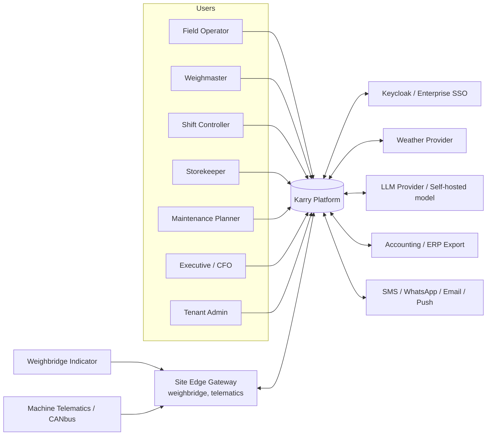
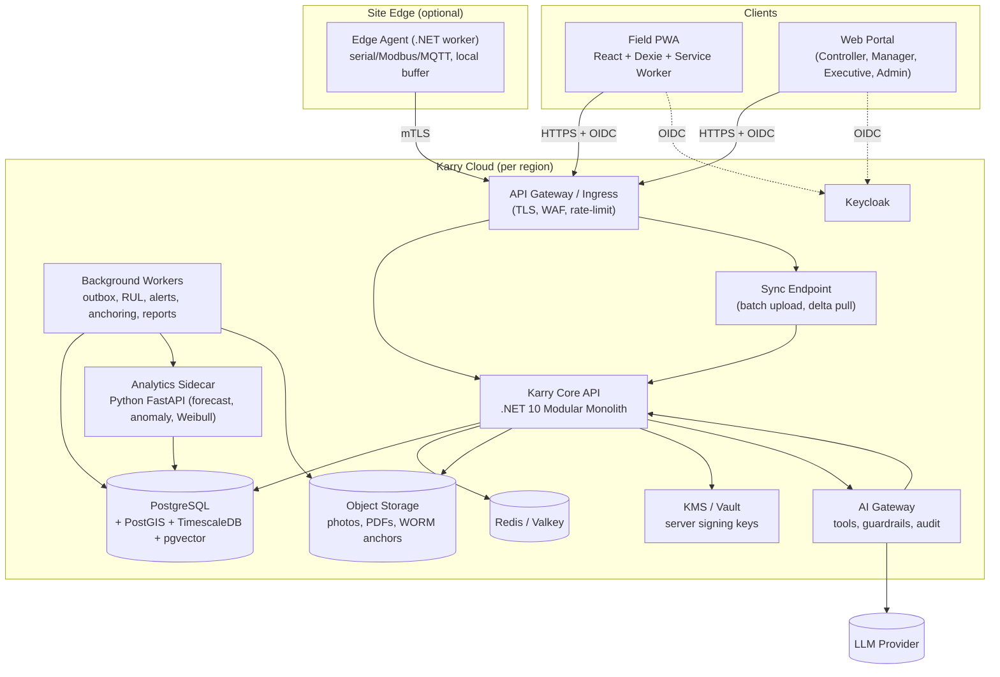
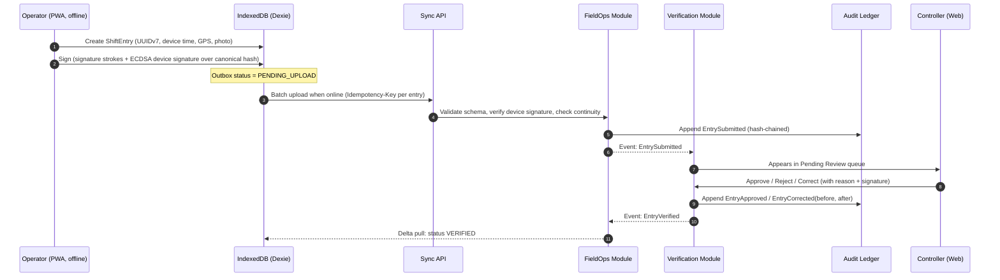
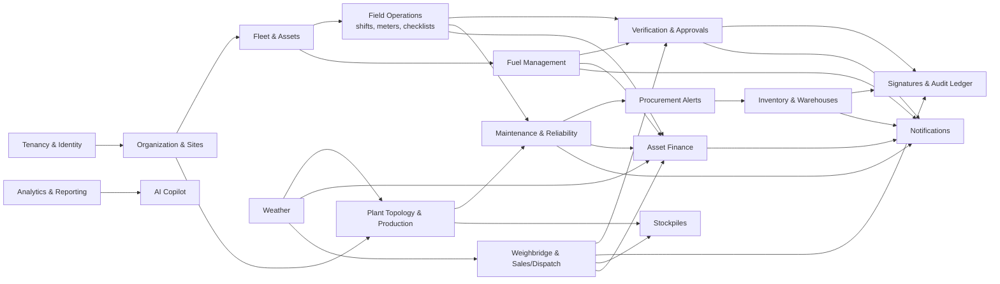
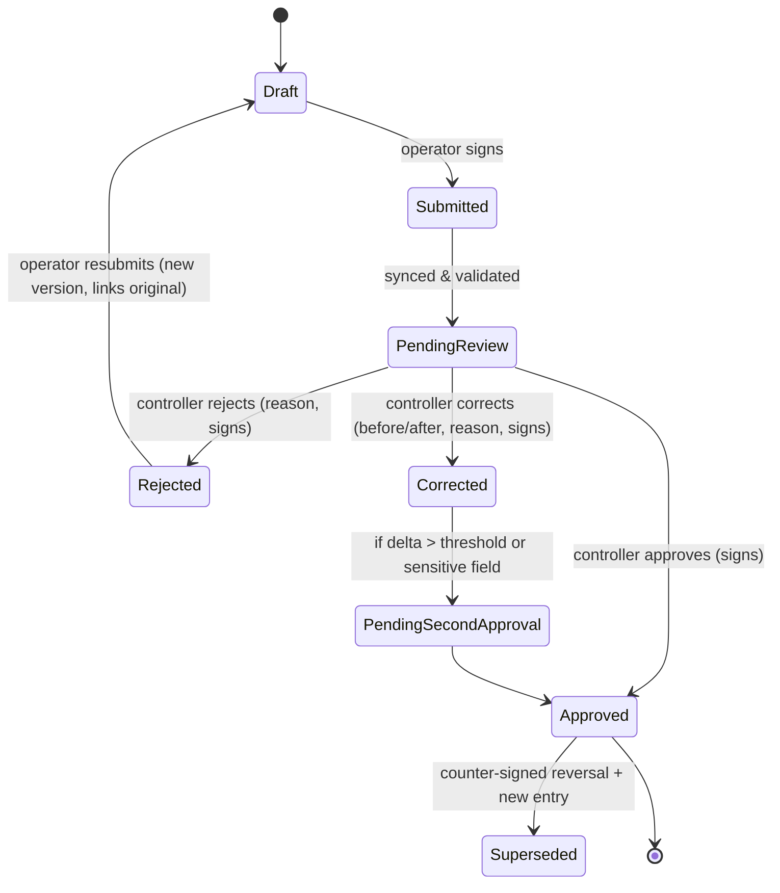
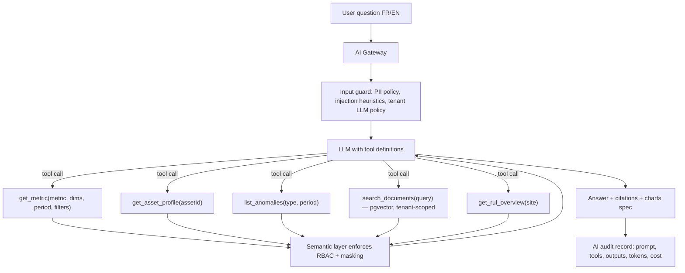
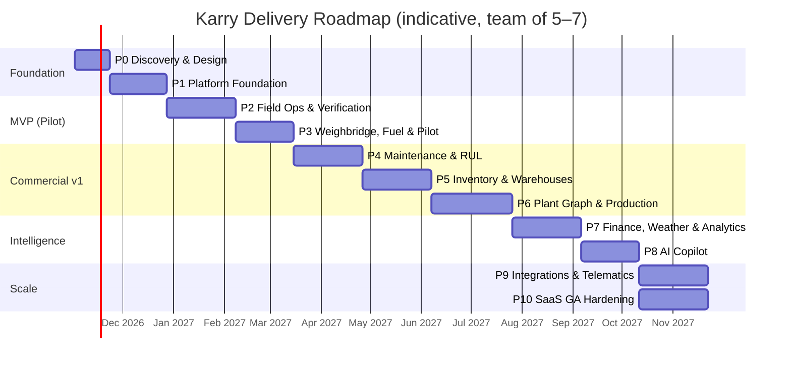

# Karry Platform — Master Architecture & Delivery Plan

> **Karry** — *Application pour la Gestion de Carrière*
> Enterprise Quarry & Mining Management Operating System (multi-tenant SaaS, offline-first PWA)

| Field | Value |
|---|---|
| Document | Master Architecture & Delivery Plan |
| Version | 1.0 (baseline) |
| Status | Draft for review |
| Date | 2026-10-20 |
| Owner | Software Architecture |
| Source | *Karry Platform — Comprehensive Technical Codex* (LaTeX specification) |
| Audience | Founders, engineering team, product, domain experts, future investors / auditors |

---

## Table of Contents

1. [Purpose of this Document](#1-purpose-of-this-document)
2. [Executive Summary](#2-executive-summary)
3. [Architect's Review of the Specification](#3-architects-review-of-the-specification)
4. [Product Scope, Personas & Core Use Cases](#4-product-scope-personas--core-use-cases)
5. [Non-Functional Requirements](#5-non-functional-requirements)
6. [Architecture Principles](#6-architecture-principles)
7. [Target Technology Stack](#7-target-technology-stack)
8. [System Architecture](#8-system-architecture)
9. [Domain Model & Bounded Contexts](#9-domain-model--bounded-contexts)
10. [Computational Engines (Corrected Mathematics)](#10-computational-engines-corrected-mathematics)
11. [Data Architecture](#11-data-architecture)
12. [Offline-First & Synchronization Design](#12-offline-first--synchronization-design)
13. [Trust Layer: Verification, Signatures & Tamper-Evident Audit](#13-trust-layer-verification-signatures--tamper-evident-audit)
14. [Security, Identity & Multi-Tenancy](#14-security-identity--multi-tenancy)
15. [AI Copilot Architecture](#15-ai-copilot-architecture)
16. [Visual Analytics Architecture](#16-visual-analytics-architecture)
17. [Integrations & Edge (Weighbridges, Telematics, Weather)](#17-integrations--edge-weighbridges-telematics-weather)
18. [API Design Standards](#18-api-design-standards)
19. [Infrastructure, DevOps & Observability](#19-infrastructure-devops--observability)
20. [Quality Engineering & Testing Strategy](#20-quality-engineering--testing-strategy)
21. [Delivery Roadmap — All Phases](#21-delivery-roadmap--all-phases)
22. [Team, Governance & Ways of Working](#22-team-governance--ways-of-working)
23. [Risk Register](#23-risk-register)
24. [Architecture Decision Records (ADR) Index](#24-architecture-decision-records-adr-index)
25. [Requirements Traceability Matrix](#25-requirements-traceability-matrix)
26. [Repository Structure](#26-repository-structure)
27. [Glossary (EN / FR)](#27-glossary-en--fr)
28. [Open Questions for Domain Experts](#28-open-questions-for-domain-experts)
29. [Next Steps](#29-next-steps)

---

## 1. Purpose of this Document

This document is the **single architectural source of truth** for building Karry. It:

- Translates the business/technical codex into an **implementable system design**.
- **Challenges and corrects** the specification where the mathematics, terminology, or timeline would cause defects, legal exposure, or delivery failure.
- Fixes the **technology stack** with explicit rationale and alternatives.
- Defines **every delivery phase** — scope, deliverables, exit criteria — from discovery to general availability.
- Establishes the **engineering standards** (APIs, testing, security, DevOps) the team is held to.

Changes to this document after baseline go through an ADR (see §24). Each major decision gets its own file in `docs/adr/`.

---

## 2. Executive Summary

Karry is a vertical SaaS operating system for quarries, crushing plants, sand-washing plants and open-pit mines. Its commercial value rests on three pillars:

1. **Trusted field data** — every meter reading, fuel dispatch, shift and scale ticket is captured offline on low-cost Android tablets, verified by a controller, signed, and written to a tamper-evident ledger. This attacks the #1 cost leak in the industry: **fuel theft and falsified shift reports**.
2. **Operational intelligence** — a configurable plant graph (crushers, screens, conveyors) computes mass balance and yield; a hybrid maintenance engine (hours / km / calendar) predicts wear-part failure early enough to order parts with long lead times.
3. **Financial truth per machine** — each asset's cost per hour, net margin, and debt-service coverage are visible, adjusted for weather-driven stoppages.

### Key architectural decisions (summary)

| Decision | Choice |
|---|---|
| Architecture style | **Modular monolith** (DDD bounded contexts), extractable to services later |
| Backend | **.NET 10 (LTS)**, ASP.NET Core, EF Core 10 |
| Analytics / ML sidecar | **Python 3.13 + FastAPI + NumPy/SciPy/pandas** — *only* for forecasting & anomaly models, not for core business rules |
| Database | **PostgreSQL 17/18** + PostGIS + TimescaleDB, Row-Level Security for tenancy |
| Frontend | **React 19 + TypeScript + Vite**, Tailwind CSS v4, shadcn/ui, TanStack Query/Router |
| Offline | Service Worker (Workbox), **Dexie.js (IndexedDB)**, outbox-based sync with idempotency |
| Charts | **Apache ECharts** (high-volume time-series, heatmaps) + Recharts for simple widgets |
| Identity | **Keycloak** (OIDC, MFA, per-tenant realms or organizations) |
| Signatures | Real asymmetric cryptography (ECDSA P-256 via WebCrypto + server KMS), hash-chained audit ledger, RFC 3161 timestamps |
| AI | Provider-agnostic AI gateway; **tool-calling over a governed semantic layer** (no free-form text-to-SQL); Claude as default provider, self-hosted open-weight model option for data-sovereign tenants |
| Infra | Containers, OpenTofu, GitHub Actions, Kubernetes (managed) from GA; OpenTelemetry + Grafana stack |

### Timeline reality

The codex proposes **8 weeks** for the full system. That is not achievable for this scope at professional quality. This plan delivers:

- a **pilot-ready MVP in ~16 weeks** (field capture, verification, signatures, weighbridge tickets, basic maintenance),
- **commercial v1 in ~9–10 months**,
- **full codex scope (plant graph, AI copilot, finance, SaaS self-service) in ~12–14 months**,

assuming a core team of 5–7 engineers (see §22). Phases are ordered so that **revenue-generating value (anti-fraud) ships first**.

---

## 3. Architect's Review of the Specification

A professional build starts by fixing the specification. The items below are **mandatory corrections** unless domain experts provide evidence otherwise. Each will be validated in Phase 0.

### 3.1 Mathematical & physical model corrections

| # | Spec item | Issue | Correction |
|---|---|---|---|
| M1 | `V_rock = A_pattern × h_bench × cos(θ)` | Blast volume is not reduced by `cos(θ)` of the face angle. For a blast pattern the in-situ (bank) volume is burden × spacing × bench height × number of holes. Inclined holes change drill length, not the bank volume per hole. | `V_bank = B × S × H_bench × N_holes` (or the surveyed polygon area × bench height). Drill length = `(H_bench + subdrill) / cos(α_hole)`. Best: reconcile against drone/survey volumes (PostGIS). |
| M2 | Unit toggle `m³ ↔ Tonnes` | **Missing the material state.** A cubic metre in the bench (bank), in a truck (loose), and in a compacted fill are different quantities. Ignoring swell factor will misprice every truck load by 30–60 %. | Every volume carries a **state**: `BANK`, `LOOSE`, `COMPACTED`. `V_loose = V_bank × (1 + s)` where `s` is the swell factor. Bulk density is per **material × state**. **Weighbridge mass is authoritative**; volumes are derived from mass, never the reverse, for invoicing. |
| M3 | `M_raw = V × ρ × κ_moisture` | Correct in form, but `ρ` must be the density matching the volume's state (see M2), and moisture should be recorded as a measured % where possible: `κ = 1 + w`. | `M = V_state × ρ_state(material) × (1 + w)` |
| M4 | Closed-loop recirculation with time iteration `t-1` | Time-stepping is fine for simulation, but operators want the **steady-state** balance. Also, a single scalar `γ` per crusher ignores particle-size distribution. | Model each node with a **partition/transfer matrix over size classes**. Steady state solves the linear system `m = f + Γ·m ⇒ m = (I − Γ)⁻¹ f` (valid when spectral radius of `Γ` < 1). Report **circulating load ratio**. Time-stepped simulation kept for "what-if". |
| M5 | `Q_belt(t) = Q_nom × φ_wear × ψ_incl × ω_weather` | The multiplicative factors are not physically derived and cannot be measured individually. Belt capacity follows `Q = A_cross × v × k_fill × k_incline` (CEMA / ISO 5048 / DIN 22101). | Use the standard capacity formula for **nominal** rating, then a **data-calibrated degradation factor** estimated from belt-scale or weighbridge reconciliation. Weather effect is a learned regression term, not a hand-set constant. |
| M6 | `RUL` uses `δ_abrasion` = "Bond abrasion index multiplier" | The Bond abrasion index `Ai` is a lab value (grams of metal loss), not a dimensionless multiplier ≥ 1. | Introduce a configurable **abrasion severity mapping** `δ = g(Ai)` per component type, calibrated over time. Phase 2+ moves to **Weibull** reliability models fitted on actual replacement history. |
| M7 | Loan solvency: `Σ(Revenue − C_ops·ΔH) > C_loan_annual / T` | **Dimensionally wrong.** An annual sum compared to annual debt service divided by the term. Also, `C_ops` includes depreciation, which double-counts capital already being repaid through the loan. | Use the bank-standard **Debt Service Coverage Ratio**: `DSCR = (Revenue − Cash OpEx) / Debt Service` over the same period (monthly and trailing-12-months). Solvent if `DSCR ≥ threshold` (configurable, typically 1.20–1.25). Depreciation is reported separately for TCO. |
| M8 | Fuel fraud: "+18 % above baseline" | A fixed threshold against a global baseline produces many false positives (load, terrain, idle time vary). | Per-asset, per-activity baseline (L/h, L/km, L/t) using **rolling median + MAD (robust z-score)**; 18 % is the default tenant-configurable threshold. Cross-check: dispensed fuel vs. tank-level deltas vs. ΔH vs. tonnage. |
| M9 | Inter-shift continuity `H_start,night ≡ H_end,day` | Correct as a rule but there are **legitimate exceptions** (meter replacement, reset/rollover, engine run for maintenance between shifts, towing for km). Flagging all as fraud destroys trust in alerts. | Strict equality by default; mismatch creates a **Continuity Exception** that must be resolved with a reason code (meter replaced, maintenance run, …) and second approval. Unresolved → fraud flag. |
| M10 | Stock variance `ΔStock ≠ 0 ⇒ audit flag` | For bulk / fluid goods (diesel, lubricants, aggregate stockpiles) zero variance is physically impossible (evaporation, temperature, survey precision). | Tolerance per item category (e.g., diesel ±0.5 %, stockpiles ±3 % via drone survey). Variance valued in currency. Flag only beyond tolerance. |
| M11 | Money / currencies | Not specified. | All money as `decimal(19,4)` + ISO-4217 currency; FX rates table with effective dates; reports in tenant functional currency. Never floating point. |

### 3.2 Terminology & legal corrections

| # | Spec item | Issue | Correction |
|---|---|---|---|
| T1 | "Native PKI electronic signature = canvas drawing + SHA-256" | A drawn image plus a hash is **not PKI**. PKI requires asymmetric key pairs bound to identities by certificates. A SHA-256 hash proves integrity only if the hash itself is protected. | Two layers: (1) **Handwritten signature image** (UX/evidence) and (2) **cryptographic signature** — ECDSA P-256 over the canonical payload hash, by a non-extractable device key + server KMS countersignature, optionally RFC 3161 timestamp. See §13. Legal qualification (simple / advanced / qualified e-signature) must be confirmed per country with counsel. |
| T2 | "Immutable audit log" | Database tables are not immutable by declaration. | **Append-only tables** (no UPDATE/DELETE grants, trigger-enforced), **hash chain** per tenant, periodic **anchoring** of chain heads to WORM object storage (S3 Object Lock). Tamper-*evident*, honestly named. |
| T3 | "Python FastAPI math & graph engine" | Splitting core business math into a second runtime duplicates domain rules, doubles deployment surface, and creates consistency risk. The formulas are not NumPy-heavy. | **Core deterministic math lives in .NET** (single source of truth, unit + property tested). Python is used only where its ecosystem wins: forecasting, anomaly detection, Weibull fitting, optimisation. |
| T4 | ".NET 9", "PostgreSQL 16" | .NET 9 is a Standard-Term release reaching end of support in **November 2026**. Starting a new product on it is a mistake. | **.NET 10 LTS** (supported to Nov 2028). PostgreSQL 17 or 18 (decided in Phase 0 after verifying TimescaleDB/PostGIS extension support). |
| T5 | "Background Sync" | The Background Sync API is not available on iOS Safari and is unreliable on some Android WebViews. | Sync on app foreground, on `online` event, and on a timer; Background Sync is an enhancement only. |
| T6 | RLS policy example | `tenant_id = current_setting(...)` compares `uuid` to `text`; also unsafe with connection pooling if set at session level. | `USING (tenant_id = current_setting('app.tenant_id', true)::uuid)` + `SET LOCAL` inside each transaction + `FORCE ROW LEVEL SECURITY` + non-owner app role. See §14.4. |
| T7 | 8-week roadmap | Unachievable for this scope at production quality. | Phased plan in §21. |

### 3.3 Missing requirements added by this plan

- **Sales & dispatch** (customers, price lists, orders, delivery notes, invoicing hand-off) — the weighbridge is meaningless without it.
- **Stockpile management** (finished-product inventory by fraction, survey reconciliation).
- **Fuel management** as its own module (tanks, bowsers, dispensers, deliveries, reconciliation).
- **HSE basics** (incident log, pre-start checklists) — expected by every quarry buyer and cheap to add on top of field forms.
- **Notifications** (in-app, push, SMS/WhatsApp for low-connectivity regions, email).
- **Data import/onboarding** (Excel templates for assets, parts, opening stock) — the #1 adoption blocker in SaaS sales.
- **Accounting export** (Sage, Odoo, QuickBooks, generic CSV/journal) — Karry is not an ERP and must not try to become one.
- **Tenant administration & billing** for SaaS (plans, seats, sites, usage metering).
- **Data protection compliance** (GDPR where applicable, local data-protection laws, data residency options).

---

## 4. Product Scope, Personas & Core Use Cases

### 4.1 Personas

| Persona | Device | Primary jobs |
|---|---|---|
| **Field Operator** (loader, excavator, truck driver) | Low-cost Android tablet / phone, often offline | Start/end shift, meter readings + photo, fuel level, pre-start checklist, sign |
| **Weighmaster** (*pontier*) | Desktop/tablet at weighbridge | Issue scale tickets, capture truck, product, customer, sign |
| **Fuel Attendant** | Tablet | Record fuel dispensing per asset, tank dips |
| **Shift Controller** (*contrôleur*) | Tablet / desktop | Review, approve, reject, correct entries; resolve continuity exceptions |
| **Storekeeper** (*magasinier*) | Desktop | Receipts, issues, transfers, physical counts |
| **Maintenance Planner / Workshop Chief** | Desktop | Work orders, wear-part tracking, meter fallback, procurement triggers |
| **Site Manager** | Desktop / tablet | Plant topology, production KPIs, approvals escalation |
| **Commercial Manager** | Desktop | Customers, orders, weather-adjusted delivery promises |
| **Finance / CFO** | Desktop | Asset P&L, DSCR, cost per tonne, exports |
| **Executive / Owner** | Desktop / mobile | Dashboards, AI copilot, fraud alerts |
| **Tenant Admin** | Desktop | Users, roles, field masking, sites, settings |
| **Platform Operator** (Karry staff) | Internal console | Tenant provisioning, support, billing, health |

### 4.2 Core use cases (MVP-critical marked ★)

1. ★ Operator records shift start/end with meter photo, offline, and signs.
2. ★ Controller approves / rejects / corrects; every correction is audited with before/after.
3. ★ System detects inter-shift meter discontinuity and opens an exception.
4. ★ Weighmaster issues a signed scale ticket; corrections only by counter-signed reversal.
5. ★ Fuel attendant records dispensing; system computes consumption per hour/km/tonne and flags anomalies.
6. ★ Maintenance planner sees RUL per wear part and gets procurement alerts before lead time expires.
7. Manager switches a broken meter to calendar fallback; alerts continue.
8. Storekeeper transfers a part/asset from *Magasin Général* to a site store with a signed waybill; full lifetime history follows the item.
9. Storekeeper performs a semi-annual count; variances beyond tolerance raise an audit case.
10. Site manager models the crushing plant graph; system computes steady-state mass balance and yield.
11. CFO sees per-asset net margin vs. loan service (DSCR) with rain-season overlay.
12. Commercial manager gets a weather-adjusted delivery date for a large order.
13. Executive asks the copilot in French/English and gets a cited, RBAC-filtered answer.

### 4.3 Out of scope (explicitly)

- Full ERP/general ledger, payroll, HR.
- Mine planning / geological block modelling (integrate with Deswik/Surpac etc. later if demanded).
- Real-time machine control (Karry observes; it never actuates equipment).

---

## 5. Non-Functional Requirements

| Category | Requirement |
|---|---|
| **Offline** | Field apps fully functional **≥ 72 h** without connectivity; ≥ 5,000 queued entries + photos per device without degradation. |
| **Device floor** | Usable on Android 10+, 2 GB RAM, Chrome/WebView ≥ last 2 years. First load ≤ 3 s on cached start, interaction ≤ 100 ms. |
| **Availability** | Cloud API SLO **99.9 %** monthly (MVP), 99.95 % at GA. Field capture is unaffected by cloud outages (offline-first). |
| **Performance** | p95 API latency < 300 ms for reads, < 500 ms for writes; dashboards < 2 s for 12 months of data per site. |
| **Scale (GA target)** | 500 tenants, 5,000 sites, 50,000 assets, 20 M field entries/year, 1 B telemetry points/year. |
| **Data integrity** | Zero silent data loss; every accepted entry is idempotent; audit chain verifiable end to end. |
| **Security** | OWASP ASVS **Level 2** baseline; MFA for privileged roles; encryption in transit (TLS 1.2+) and at rest; annual pen test. |
| **Privacy** | GDPR-aligned (data minimisation, DPA, right to access); location/photo data with explicit purpose; configurable retention. |
| **RPO / RTO** | RPO ≤ 5 min (PITR), RTO ≤ 4 h. Quarterly restore drills. |
| **i18n / l10n** | French & English at launch (Arabic RTL-ready architecture), locale-aware numbers/dates, metric + imperial units, multi-currency. |
| **Accessibility** | WCAG 2.2 AA for desktop apps; field UI: large touch targets (≥ 48 px), high-contrast outdoor mode, glove-friendly. |
| **Auditability** | Every state change attributable to user, device, time (device + server), location where captured. |
| **Maintainability** | Module boundaries enforced by architecture tests; ≥ 80 % coverage on domain/math code; ADRs for decisions. |

---

## 6. Architecture Principles

1. **Trust is the product.** Any feature that weakens the evidence chain (silent edits, unsigned overrides, deletes) is rejected.
2. **Offline is the default, online is the optimisation.** Field workflows are designed against the local store first.
3. **Append, don't overwrite.** Corrections are new facts referencing old ones (reversal + re-entry), never in-place mutation of signed data.
4. **One source of truth per rule.** Each business formula is implemented once, in the domain layer, and versioned.
5. **Modular monolith first.** Clear bounded contexts with internal APIs; extract a service only with a measured reason (scale, team, isolation).
6. **Configuration over code for topology.** Plants, machines, wear parts, units and roles are data, not deployments.
7. **Explainable numbers.** Every KPI and AI answer must be traceable to its inputs ("show calculation").
8. **Security and tenancy in depth.** Tenant isolation at the database (RLS), application (query filters), and API (claims) layers.
9. **Boring, supported technology.** LTS runtimes, mainstream libraries, permissive or budgeted licenses.
10. **Measure everything.** OpenTelemetry from day one; product analytics for adoption.

---

## 7. Target Technology Stack

### 7.1 Stack overview

| Layer | Technology | Rationale | Alternatives considered |
|---|---|---|---|
| **Field & Web client** | React 19, TypeScript (strict), Vite | Mature ecosystem, team availability, PWA tooling | Angular (heavier), Flutter (no true PWA parity) |
| **Routing / data** | TanStack Router, TanStack Query | Type-safe routes, cache + offline-aware mutations | React Router, SWR |
| **UI** | Tailwind CSS v4, shadcn/ui (Radix primitives), Lucide icons | Accessible primitives, owned components, fast theming per tenant | MUI (heavy bundle), Mantine |
| **Forms / validation** | React Hook Form + Zod (schemas shared with API via OpenAPI codegen) | Performance on low-end devices, typed validation | Formik |
| **PWA / offline** | vite-plugin-pwa (Workbox), Dexie.js (IndexedDB), Web Locks API | Proven offline caching, typed IndexedDB, multi-tab safety | RxDB, PouchDB/CouchDB |
| **Signatures (client)** | signature_pad (vector strokes), WebCrypto (ECDSA P-256, non-extractable keys) | Standard, no native app needed | Native wrappers |
| **Charts** | Apache ECharts (time-series, heatmaps, large datasets via canvas/WebGL), Recharts for small widgets | ECharts handles 100k+ points smoothly; Recharts is SVG and slows beyond ~5k points | Highcharts (commercial), uPlot |
| **Maps** | MapLibre GL JS + PostGIS vector tiles (pg_tileserv / Martin) | Open source, offline tile caching possible | Mapbox (licensed), Leaflet |
| **i18n** | i18next + ICU message format | Pluralisation, FR/EN, RTL-ready | FormatJS |
| **Optional native shell** | Capacitor (Phase 7+) | Only if MDM / kiosk / Bluetooth scale / camera control demands it | — |
| **Backend runtime** | **.NET 10 LTS**, ASP.NET Core Minimal APIs + endpoint groups | Performance, strong typing, LTS to Nov 2028, great PostgreSQL support | Node/NestJS, Java/Spring |
| **ORM / data access** | EF Core 10 (Npgsql) for writes; Dapper / raw SQL for analytics reads | Productivity + control where needed | Marten (event store), Linq2DB |
| **Messaging (in-process)** | Domain events + **transactional outbox** in PostgreSQL; Wolverine *or* lightweight in-house dispatcher | Reliable without extra infra in MVP. ⚠ MediatR, AutoMapper, MassTransit v9 moved to commercial licences in 2025 — avoid or budget | RabbitMQ / Kafka later if needed |
| **Background jobs** | Hangfire (PostgreSQL storage) or Quartz.NET | RUL recompute, alerts, report generation, chain anchoring | — |
| **Validation** | FluentValidation | Expressive server-side rules | DataAnnotations |
| **PDF / documents** | QuestPDF (check licence tier vs. revenue) | Scale tickets, waybills, shift reports | — |
| **Analytics/ML sidecar** | Python 3.13, FastAPI, NumPy, SciPy, pandas/Polars, statsmodels, scikit-learn, lifelines (Weibull) | Best ecosystem for forecasting & anomaly detection | ML.NET |
| **Database** | **PostgreSQL 17/18** | Reliability, RLS, JSONB, extensions | SQL Server |
| **Extensions** | PostGIS (spatial), TimescaleDB (telemetry hypertables, continuous aggregates), pgcrypto, pg_partman (if needed) | Spatial blast/stockpile, efficient time-series | Separate TSDB (InfluxDB) |
| **Cache** | Redis / Valkey | Sessions-free API, rate-limit counters, hot dashboard caches | — |
| **Object storage** | S3-compatible (AWS S3 / Cloudflare R2 / MinIO on-prem) with Object Lock | Photos, signatures, PDFs, WORM audit anchors | — |
| **Search (later)** | PostgreSQL full-text first; OpenSearch only if required | Avoid premature infra | — |
| **Identity** | **Keycloak** (OIDC/OAuth 2.1, PKCE, MFA, organizations) | Self-hostable, SSO for enterprise tenants, standards | Zitadel, Auth0/Entra (cost, residency) |
| **Authorization** | In-app policy engine: RBAC + ABAC (site scope) + field-level masking | Fine-grained, tenant-configurable | OpenFGA (if relationships get complex) |
| **Secrets / keys** | Cloud KMS / HashiCorp Vault (transit engine) | Server signing keys never leave KMS | — |
| **AI** | AI Gateway (.NET) → Claude (default: `claude-sonnet-5-5`; `claude-haiku-5-5` for classification; `claude-opus-5-5` for deep analysis) or self-hosted open-weight model; pgvector for retrieval | Tool-calling, multilingual, provider-swappable | Direct SDK coupling (rejected) |
| **Weather data** | Open-Meteo (forecast + historical climatology) behind an adapter; commercial provider optional | Free tier, historical normals for `R(m)` | Meteomatics, Tomorrow.io |
| **Containers / orchestration** | Docker, Kubernetes (managed: AKS/EKS/GKE or Scaleway/OVH for EU/Africa residency) | Standard, portable, on-prem option | Azure Container Apps for early stage |
| **IaC** | OpenTofu (Terraform-compatible) + Helm | Reproducible environments | Pulumi |
| **CI/CD** | GitHub Actions, Renovate, trunk-based development, environment promotion | — | GitLab CI |
| **Observability** | OpenTelemetry SDKs → Grafana (Prometheus/Mimir, Loki, Tempo), Sentry for client errors | Vendor-neutral, full traces from tablet to DB | Datadog (cost) |
| **Quality** | xUnit, FsCheck (property-based), Testcontainers, Playwright, Vitest, k6, Stryker.NET (mutation on math) | — | — |
| **Security tooling** | GitHub Advanced Security / CodeQL, Trivy, OWASP ZAP, gitleaks, Dependabot/Renovate | — | Snyk |

> Exact library versions are pinned in Phase 0 (`docs/adr/0002-version-pinning.md`) and upgraded monthly via Renovate.

### 7.2 Why a modular monolith (not microservices)

- A team of 5–7 cannot operate 10+ services well; distributed transactions would complicate the **signed, append-only** guarantees.
- Bounded contexts are enforced by **project references + ArchUnitNET tests**, and communicate via **domain events** through the outbox — so extraction later is mechanical.
- Expected first extractions (only if metrics justify): **Telemetry Ingestion** (high write volume), **AI Gateway** (independent scaling / provider keys), **Analytics sidecar** (already separate, Python).

---

## 8. System Architecture

### 8.1 Context diagram (C4 Level 1)



### 8.2 Container diagram (C4 Level 2)



### 8.3 Internal layering of each module (Clean / Hexagonal)

```
Module (e.g., Karry.Maintenance)
├── Domain          Entities, Value Objects, Aggregates, Domain Events, Domain Services (pure, no I/O)
├── Application     Commands, Queries, Handlers, Validators, Ports (interfaces), DTOs
├── Infrastructure  EF Core mappings, repositories, external adapters, outbox publishers
└── Api             Endpoint groups, request/response contracts, authorization policies
```

Rules (enforced by architecture tests):

- `Domain` references nothing but `Karry.SharedKernel`.
- Modules never reference each other's `Domain`/`Infrastructure`; they integrate via **public contracts** (`Karry.<Module>.Contracts`) and **integration events**.
- Each module owns its **PostgreSQL schema** (`maintenance.*`, `inventory.*`, …). No cross-schema foreign keys except to `tenancy` and `identity` reference tables.

### 8.4 Key runtime flow — field entry to verified ledger



---

## 9. Domain Model & Bounded Contexts

### 9.1 Context map



### 9.2 Bounded context catalogue

| Context | Responsibility | Key aggregates | Key events |
|---|---|---|---|
| **Tenancy & Identity** | Tenants, plans, users, roles, permissions, field masks, devices | `Tenant`, `User`, `Role`, `PermissionSet`, `Device` | `TenantProvisioned`, `DeviceEnrolled`, `RoleChanged` |
| **Organization & Sites** | Company structure, quarries/sites, benches, zones, shift calendars | `Site`, `Bench`, `ShiftPattern` | `SiteCreated` |
| **Fleet & Assets** | Machines and attachments, meters, classifications, lifecycle, location history | `Asset`, `Meter`, `MeterReading`, `AssetAssignment` | `AssetRegistered`, `MeterReplaced`, `MeterFallbackActivated`, `AssetTransferred` |
| **Plant Topology & Production** | Directed graph of plant nodes and edges, materials, size classes, mass balance, blasts | `Plant`, `PlantNode`, `PlantEdge`, `Material`, `BlastEvent`, `ProductionRun` | `TopologyChanged`, `BlastRecorded`, `MassBalanceComputed` |
| **Field Operations** | Shifts, meter start/end, operator assignment, pre-start checklists, photos | `Shift`, `ShiftEntry`, `ChecklistSubmission` | `ShiftEntrySubmitted`, `ContinuityExceptionRaised` |
| **Fuel Management** | Tanks, bowsers, dispensing, deliveries, dips, consumption baselines | `FuelTank`, `FuelTransaction`, `TankDip` | `FuelDispensed`, `FuelAnomalyDetected` |
| **Verification & Approvals** | Generic review workflow for any verifiable record, SoD rules, escalation | `ReviewItem`, `ReviewPolicy` | `ItemApproved`, `ItemRejected`, `ItemCorrected` |
| **Signatures & Audit Ledger** | Signature capture, crypto verification, hash chain, anchoring, verification API | `SignatureEnvelope`, `LedgerEntry`, `ChainAnchor` | `LedgerAppended`, `ChainAnchored`, `TamperDetected` |
| **Weighbridge & Sales/Dispatch** | Customers, products, price lists, orders, trucks, scale tickets, delivery notes | `Customer`, `SalesOrder`, `ScaleTicket`, `DeliveryNote` | `TicketIssued`, `TicketReversed`, `OrderFulfilled` |
| **Stockpiles** | Finished-product stock per fraction, surveys, reconciliation | `Stockpile`, `StockpileSurvey` | `StockpileReconciled` |
| **Maintenance & Reliability** | Components/wear parts, ratings, RUL, work orders, PM plans, maintenance grouping | `Component`, `MaintenancePlan`, `WorkOrder` | `RulRecomputed`, `ComponentReplaced`, `WorkOrderClosed` |
| **Inventory & Warehouses** | Magasin Général + site stores, items, lots/serials, receipts, issues, transfers, counts | `Warehouse`, `Item`, `StockLedgerEntry`, `TransferWaybill`, `StockCount` | `TransferDispatched`, `TransferReceived`, `VarianceDetected` |
| **Procurement Alerts** | Reorder triggers from RUL & min/max levels; PR hand-off (not full purchasing) | `ProcurementAlert`, `PurchaseRequest` | `ProcurementTriggered` |
| **Asset Finance** | Acquisition cost, loans, schedules, residuals, cost rates, P&L, DSCR | `AssetFinancing`, `LoanSchedule`, `CostRate` | `DscrBreached` |
| **Weather** | Site forecasts, climatology normals, rain-stop days, risk scoring | `WeatherSnapshot`, `ClimateNormal` | `RainRiskForecast` |
| **Analytics & Reporting** | KPIs, read models, scheduled reports, exports | read models only | — |
| **AI Copilot** | Q&A, summaries, anomaly explanations, maintenance grouping suggestions | `Conversation`, `AiAuditRecord` | `InsightGenerated` |
| **Notifications** | Rules, channels, preferences, delivery tracking | `NotificationRule`, `Delivery` | — |

### 9.3 Core shared value objects (SharedKernel)

- `TenantId`, `SiteId`, typed IDs (UUIDv7 for time-ordered keys generated offline).
- `Quantity { value: decimal, unit: Unit, state?: MaterialState }` — units: `M3`, `T` (metric tonne), `ST` (short ton), `L`, `KM`, `H`, `DAY`, `PCS`.
- `Money { amount: decimal, currency: CurrencyCode }`.
- `MeterValue { value, meterType: HOURS|KM, meterId }`.
- `GeoPoint { lat, lon, accuracyM }`.
- `CapturedAt { deviceTime, serverReceivedTime, timezone }`.
- `DocumentHash { algorithm: SHA-256, hex }`.

### 9.4 Asset lifetime history (inter-site transfers)

The spec requires that history "follows" an asset across warehouses. The design does **not clone** metrics (cloning creates two truths). Instead:

- An `Asset` has a **single global identity within the tenant**.
- `AssetAssignment` rows (append-only) record `{asset, location (site/warehouse), from, to, transferWaybillId}`.
- All readings, fuel, costs, maintenance carry `assetId` + the `siteId` at time of event.
- "Lifetime timeline" = ordered union of events by asset; "site-specific" metrics = same query filtered by assignment interval. Depreciation continues uninterrupted.

---

## 10. Computational Engines (Corrected Mathematics)

All engines are **pure, deterministic domain services** in .NET with versioned formulas (`FormulaVersion`) so historical results are reproducible after formula changes. Every computed KPI stores its inputs snapshot hash for explainability.

### 10.1 Units & Conversion Engine

```
V_loose      = V_bank × (1 + s_swell(material))
M            = V_state × ρ_state(material) × (1 + w_moisture)
V_state      = M / (ρ_state(material) × (1 + w_moisture))
1 short ton  = 0.90718474 t
```

- Densities, swell factors and moisture defaults are **tenant-configurable per material**, with effective dates.
- Field UI toggle shows the converted value **and** the factors used (tap to see).
- **Invoicing basis is configurable per customer contract** (tonnes from weighbridge, or m³ derived from tonnes).

### 10.2 Blast & Yield Engine

```
V_bank_blast  = B × S × H_bench × N_holes            (or surveyed polygon area × H_bench)
M_raw         = V_bank_blast × ρ_bank × (1 + w)
η_yield (%)   = Σ M_product_i / M_raw × 100
Powder factor = explosive_kg / V_bank_blast           (kg/m³, standard KPI)
```

- Reconciliation: blasted tonnes vs. tonnes fed to primary crusher vs. tonnes sold + stockpile change. Variance shown as "unaccounted material".

### 10.3 Plant Graph & Mass Balance Engine

- The plant is a **directed graph** `G = (N, E)`; nodes are typed (`FEEDER`, `CRUSHER`, `SCREEN`, `WASHER`, `CONVEYOR`, `STOCKPILE`, `SPLITTER`), edges carry routing by **size class** and **deck**.
- Each node has a transfer function over a size-class vector `x ∈ ℝᵏ`:
  - Crusher: `y = B · x` (breakage matrix from closed-side setting / manufacturer curves).
  - Screen: `y_over = E · x`, `y_under = (I − E) · x` (partition / efficiency curve per deck).
- **Steady state:** assemble global linear system and solve `m = (I − Γ)⁻¹ f` (sparse LU). Fail fast with a clear error if the loop does not converge (spectral radius ≥ 1).
- **Transient / what-if:** discrete time stepping (the spec's `t − 1` formulation) for start-up and degradation scenarios.
- **Topology changes are versioned** (`PlantRevision`); production data always references the revision active at the time.
- UI: a node-based editor (React Flow) where managers drag machines and connect edges; validation prevents orphan outputs and unrouted fractions.

### 10.4 Conveyor Capacity Engine

```
Q_nominal  = A_cross(belt width, trough angle, surcharge angle) × v_belt × k_incline(θ)
Q_actual   = Q_nominal × φ_degradation(t)
```

- `φ_degradation(t)` is **estimated** (not typed in) from reconciling belt-scale / weighbridge throughput against nominal over rolling windows; weather influence learned as a covariate by the analytics sidecar.
- Bottleneck detection: node utilisation `u = m_in / capacity` across the graph; highest sustained `u` is the bottleneck.

### 10.5 Hybrid Maintenance & RUL Engine

For component `p` with tracked metric `m ∈ {HOURS, KM, DAYS}` and optional tonnage rating:

```
RUL_usage(p)   = (U_rating − U_accumulated) / (ū_daily × δ)        [days]
RUL_tonnage(p) = (M_rating − M_processed)  / (m̄_daily × δ)        [days]
RUL_days(p)    = min(RUL_usage, RUL_tonnage, RUL_calendar)
```

- `ū_daily` = robust (trimmed) mean of the last 30 operating days; configurable window.
- **Meter Fallback Switch:** when a meter is marked `FAILED`, the engine switches `U_accumulated` to `U_last_valid + ū_daily(30d) × days_since_failure`, flags all derived values as **ESTIMATED**, and opens a work order to repair the meter. When a new meter is installed, an **offset** is recorded (`MeterReplaced` event) so accumulated usage stays continuous.
- **Procurement trigger:** `RUL_days ≤ T_lead_time(part, supplier) + τ_buffer` (τ default 7 days) → `ProcurementTriggered`, deduplicated per component per cycle, considering stock already available in any warehouse (*Magasin Général* first).
- **Maintenance grouping (optimisation):** components whose RUL windows overlap within a tolerance are proposed for a single plant stop; objective = minimise downtime cost + premature replacement cost (greedy heuristic in v1; MILP via the Python sidecar later).
- **Phase 2 reliability:** fit Weibull (β, η) per component type × site from replacement history; RUL becomes a distribution with P10/P50/P90.

### 10.6 Fuel Analytics Engine

```
Consumption rate  r = L_dispensed / ΔH     (or / ΔKM, or / tonnes moved)
Baseline          r̃ = rolling median per (asset, activity type, season)
Robust z-score    z = 0.6745 × (r − r̃) / MAD
Anomaly if        (r − r̃)/r̃ > threshold (default 18 %)  AND  z > 3.5
```

Plus reconciliation checks: tank deliveries − dispensed − Δtank-dip; dispensed to an asset whose meters show no usage; dispensing outside shift; volume above tank capacity.

### 10.7 Asset Cost & Finance Engine

```
Depreciation/h  = (C_capital − S_residual) / H_lifespan
Cash OpEx/h     = F_conso × P_fuel + W_operator + M_maintenance (+ tyres, wear parts, insurance)
TCO/h           = Depreciation/h + Cash OpEx/h
Net cash margin = Revenue_attributed − Cash OpEx                   (per period)
DSCR            = Net cash margin / Debt service (principal + interest)  (per period)
Solvent         ⇔ DSCR ≥ threshold (default 1.25), monthly and trailing-12-months
```

- **Revenue attribution** to individual machines is a policy decision (by tonnes moved, hours on productive activity, or plant-level allocation) — configurable, documented, shown in UI.
- Loan schedules support annuity, linear, balloon, grace periods; interest computed with the contract's day-count convention.

### 10.8 Weather & Delivery Engine

```
N_work(m)   = N_total(m) − N_non_working(m)          (Sundays, holidays from site calendar)
R(m)        = expected rain-stop days (climatology P50; forecast overrides for the next 14 days)
P_eff(m)    = P_nominal × (1 − (R(m) + σ_safety) / N_work(m))
T_delivery  = Q_order / P_eff  →  rolled forward across months, net of already-committed orders
```

- Commercial advisory: given an order's quantity and date, compute **probability of on-time delivery** using the P50/P90 rain distribution and current order book. Shown as green/amber/red with explanation.

### 10.9 Inventory Variance Engine

```
Expected   = Stock_initial + Receipts − Issues ± Transfers
ΔStock     = Stock_physical − Expected
ΔValue     = ΔStock × weighted average cost
Flag       ⇔ |ΔStock| > tolerance(item category)  OR  |ΔValue| > value threshold
```

Responsibility attribution: the storekeepers in charge of the warehouse during the period (from duty assignments) are listed on the audit case — **not** auto-accused.

---

## 11. Data Architecture

### 11.1 Storage layout

| Store | Content |
|---|---|
| PostgreSQL (OLTP) | One database per region; **schema per module**; all tenant tables carry `tenant_id` + RLS |
| TimescaleDB hypertables | `telemetry.machine_signal`, `production.flow_sample`, `fuel.tank_level` — continuous aggregates (1 min, 1 h, 1 day) |
| PostGIS | Site boundaries, benches, blast patterns, stockpile polygons, GPS of captures |
| pgvector | Embeddings of documents/manuals/SOPs for the copilot (tenant-scoped) |
| Object storage | Photos (meter evidence), signature images, PDFs, exports, ledger anchors (Object Lock, compliance mode) |
| Redis | Rate limits, short-lived caches, distributed locks |

### 11.2 Key conventions

- **Primary keys:** UUIDv7 (client-generatable offline, index-friendly).
- **Timestamps:** `timestamptz` UTC everywhere; site timezone stored on `Site`; shifts computed in site local time.
- **Soft delete:** *never* for signed/ledger data. Master data uses `archived_at`.
- **Optimistic concurrency:** `xmin`-based concurrency tokens on mutable aggregates.
- **Money:** `numeric(19,4)` + `char(3)` currency.
- **Quantities:** `numeric(18,6)` + unit code (+ material state where relevant).
- **Migrations:** EF Core migrations reviewed as SQL; expand/contract pattern for zero-downtime.

### 11.3 Illustrative core tables (abridged)

```sql
-- fieldops.shift_entry
id uuid pk, tenant_id uuid, site_id uuid, asset_id uuid, operator_id uuid,
shift_id uuid, meter_type text, start_value numeric, end_value numeric,
start_photo_key text, end_photo_key text, fuel_gauge_pct numeric,
device_time timestamptz, received_at timestamptz, geo geography(point),
status text check (status in ('PENDING','APPROVED','REJECTED','CORRECTED','SUPERSEDED')),
supersedes_id uuid null, signature_envelope_id uuid, payload_hash bytea

-- audit.ledger_entry   (append-only, hash-chained per tenant)
seq bigint, tenant_id uuid, occurred_at timestamptz, actor_id uuid, device_id uuid,
aggregate_type text, aggregate_id uuid, event_type text,
payload jsonb, payload_hash bytea, prev_hash bytea, entry_hash bytea,
primary key (tenant_id, seq)

-- weighbridge.scale_ticket   (no UPDATE allowed; reversals reference original)
id uuid, tenant_id uuid, site_id uuid, ticket_no text, truck_plate text,
gross_kg numeric, tare_kg numeric, net_kg numeric generated always as (gross_kg - tare_kg) stored,
product_id uuid, customer_id uuid, order_id uuid, weighmaster_id uuid,
source text check (source in ('INDICATOR','MANUAL')), reverses_ticket_id uuid null,
signature_envelope_id uuid, issued_at timestamptz
```

### 11.4 Read models & analytics

- CQRS-lite: commands write normalised tables; **projections** (updated by outbox consumers) feed dashboards.
- Heavy aggregates via TimescaleDB continuous aggregates and materialised views refreshed incrementally.
- Data warehouse (later, Phase 9+): nightly CDC to a columnar store (e.g., ClickHouse or DuckDB/Parquet in object storage) for cross-tenant **anonymised** benchmarking — opt-in only.

### 11.5 Retention

| Data | Default retention |
|---|---|
| Ledger, signed records, tickets, waybills | ≥ 10 years (configurable to local legal requirements) |
| Photos | 3 years (configurable), hash kept forever in ledger |
| Raw telemetry | 13 months raw, aggregates forever |
| AI conversation logs | 12 months |
| Application logs | 30 days hot, 1 year cold |

---

## 12. Offline-First & Synchronization Design

### 12.1 Client data layers

```
Dexie (IndexedDB)
├── reference/*       master data snapshot for the user's sites (assets, materials, customers, roles)
├── drafts/*          unsaved form state (auto-saved)
├── outbox            signed, immutable commands awaiting upload (ordered, with retry metadata)
├── blobs             photos/signature images (compressed WebP/JPEG, chunked upload)
└── sync_state        per-collection cursors, last success, device clock offset
```

### 12.2 Sync protocol

1. **Push:** `POST /sync/v1/batches` with up to N commands; each has `commandId` (UUIDv7) used as **Idempotency-Key**. Server responds per command: `ACCEPTED | DUPLICATE | REJECTED(reason) | CONFLICT(details)`.
2. **Blobs:** uploaded first via pre-signed URLs; commands reference blob hashes; server verifies hash on receipt.
3. **Pull:** `GET /sync/v1/changes?since=<cursor>&scopes=...` returns deltas for reference data and statuses of the user's own submissions.
4. **Ordering:** per-device monotonic sequence; server enforces it per device to detect lost/replayed batches.

### 12.3 Conflict policy

| Data type | Policy |
|---|---|
| Field facts (readings, fuel, tickets) | **No conflicts by design**: they are immutable facts. Duplicates deduplicated by ID. Business conflicts (e.g., continuity mismatch) become **exceptions** for review, not overwrites. |
| Master data edited offline (rare; restricted roles) | Server wins; client shows a diff and asks the user to reapply. |
| Drafts | Local only. |

### 12.4 Time integrity

- Each command stores **device time** and **server received time**; the client measures clock offset at every successful sync.
- Entries with device/server skew beyond tolerance (e.g., > 10 min unexplained) are tagged for controller attention — a common fraud vector (backdating).

### 12.5 Device management

- Devices are **enrolled** (QR code by admin) → device key pair generated (WebCrypto, non-extractable) → public key registered → device bound to tenant/site.
- Lost device: admin revokes; outstanding unsynced data from revoked device is quarantined for review.
- Shared tablets: fast user switching via PIN with per-user local encryption key wrap; session expiry per shift.

### 12.6 Storage & quota

- Request `navigator.storage.persist()`; monitor quota; compress photos client-side (max 1600 px, ~200 KB).
- Purge synced blobs after server confirmation + N days.

---

## 13. Trust Layer: Verification, Signatures & Tamper-Evident Audit

### 13.1 Generic verification workflow



Rules:

- **Segregation of duties:** a user can never approve their own entry; controller cannot be the operator on the same shift/asset.
- **Four-eyes for sensitive corrections** (meter changes beyond tolerance, ticket reversals, stock adjustments).
- **SLA & escalation:** pending items older than X hours escalate to site manager.
- Corrections create a **new version**; the original stays visible forever.

### 13.2 Signature envelope

Each signable record produces a `SignatureEnvelope`:

```json
{
  "envelopeId": "uuidv7",
  "recordType": "ScaleTicket",
  "recordId": "uuidv7",
  "canonicalPayloadHash": "sha256:…",          // RFC 8785 JSON Canonicalization
  "signer": { "userId": "…", "role": "WEIGHMASTER", "deviceId": "…" },
  "context": { "deviceTime": "…", "geo": { "lat": 0, "lon": 0, "acc": 8 }, "appVersion": "…" },
  "handwritten": { "strokesKey": "s3://…", "imageHash": "sha256:…" },
  "deviceSignature": { "alg": "ES256", "keyId": "device-…", "sig": "base64…" },
  "serverCountersignature": { "alg": "ES256", "kmsKeyId": "…", "sig": "base64…", "receivedAt": "…" },
  "timestampToken": "base64 RFC 3161 TST (optional, per tenant policy)"
}
```

- **Device signature** proves the record was signed on an enrolled device by an authenticated user at capture time (works offline).
- **Server countersignature** (KMS-held key) proves receipt and binds server time.
- **RFC 3161 timestamp** (TSA) gives independent time evidence — recommended for weighbridge tickets & waybills.
- **Public verification page**: scanning the QR code on a printed ticket/waybill shows the verified status and hash, without exposing private data.

> **Legal note:** The legal weight of electronic signatures depends on jurisdiction (e.g., eIDAS in the EU; national e-transaction laws elsewhere). Karry's design supports "advanced" signature characteristics (unique link to signer, signer control, tamper detection). Qualified signatures, if required by a customer, would require integration with a qualified trust service provider. **Confirm with legal counsel per target market in Phase 0.**

### 13.3 Hash-chained ledger

```
entry_hash_n = SHA-256( prev_hash_{n-1} ‖ tenant_id ‖ seq_n ‖ event_type ‖ payload_hash ‖ occurred_at )
```

- Written in the **same transaction** as the business change (outbox pattern guarantees no business change without a ledger entry).
- Sequence gap-free per tenant (serialized via advisory lock per tenant; throughput is ample for this domain).
- DB enforcement: app role has `INSERT`/`SELECT` only on `audit.*`; a trigger rejects `UPDATE`/`DELETE`/`TRUNCATE`.
- **Anchoring job** (hourly): writes `{tenant, seq, entry_hash}` heads to object storage with **Object Lock (compliance mode)** and optionally a public transparency log. Tampering with DB history becomes detectable by any auditor.
- **Verifier tool** (CLI + admin UI): recomputes the chain and compares to anchors; part of quarterly audit procedure.

### 13.4 Scale ticket rules

- Weight captured from the **indicator via edge agent** whenever possible (`source = INDICATOR`); manual entry allowed only with reason and flagged.
- Tickets are never edited; correction = `Reversal` ticket (counter-signed by weighmaster + controller) + new ticket.
- Detection rules: same truck re-weighed within impossible interval, tare drift beyond tolerance vs. registered tare, net weight above truck legal payload, tickets issued outside site hours.

---

## 14. Security, Identity & Multi-Tenancy

### 14.1 Identity

- Keycloak with OIDC Authorization Code + PKCE for SPAs; refresh tokens rotated; short-lived access tokens (5–10 min).
- **MFA mandatory** for admin, finance, controller roles; optional for operators (device enrollment + PIN covers them).
- Enterprise tenants: SSO federation (Entra ID, Google Workspace, SAML).
- Offline auth: on enrolled device, a locally cached, time-boxed **offline session** (e.g., 72 h) unlocked by user PIN; all offline actions are re-validated server-side on sync.

### 14.2 Authorization model

```
Permission = (resource, action, scope)        e.g. (FuelTransaction, Approve, Site:Quarry-A)
Role       = set of permissions + field rules
FieldRule  = (resource.field, READ | WRITE | MASKED | HIDDEN)
```

- **RBAC** for coarse roles, **ABAC** for scope (tenant → site → warehouse), **field-level masking** applied in the API serialisation layer (never only in UI).
- Default roles shipped (Operator, Weighmaster, Controller, Storekeeper, Planner, Site Manager, Finance, Executive, Tenant Admin) and fully customisable.
- Permission changes are themselves ledger events.

### 14.3 Threat model highlights (STRIDE)

| Threat | Mitigation |
|---|---|
| Operator backdates / fabricates readings | Device signature, server receive time, clock-skew flag, mandatory photo with EXIF + in-app capture only, GPS geofence check |
| Controller colludes with operator | SoD, four-eyes on large corrections, executive anomaly dashboard, AI anomaly review |
| Admin tampers with DB | Append-only ledger + external anchors, DB audit logging (pgaudit), break-glass access with alerts |
| Cross-tenant data leak | RLS + query filters + tenant claims + automated cross-tenant tests in CI |
| Stolen tablet | Device revocation, local encryption, PIN, short offline session |
| Prompt injection via user-supplied text into AI | Tool-based access with RBAC, content treated as data, output filtering, no write tools for AI in v1 |
| Weighbridge indicator spoofing | mTLS edge agent, signed readings from edge, physical tamper seals noted in procedures |

### 14.4 Multi-tenancy implementation

- **Pool model** (shared DB, `tenant_id` column) for standard tenants; **silo option** (dedicated DB / dedicated cluster / on-prem) for enterprise/regulatory tenants — same codebase, configured per tenant in a tenant catalog.
- PostgreSQL:

```sql
ALTER TABLE fieldops.shift_entry ENABLE ROW LEVEL SECURITY;
ALTER TABLE fieldops.shift_entry FORCE ROW LEVEL SECURITY;

CREATE POLICY tenant_isolation ON fieldops.shift_entry
  USING (tenant_id = current_setting('app.tenant_id', true)::uuid)
  WITH CHECK (tenant_id = current_setting('app.tenant_id', true)::uuid);
```

- The API opens a transaction per request and executes `SET LOCAL app.tenant_id = '<from validated token>'` (safe with connection pooling because `SET LOCAL` is transaction-scoped).
- App connects as a **non-owner role** without `BYPASSRLS`. Migrations run as a separate owner role.
- EF Core **global query filters** on `tenant_id` as a second layer; CI includes a test suite that attempts cross-tenant reads on every endpoint.

### 14.5 Data protection

- TLS everywhere; AES-256 at rest (managed disks + object storage SSE-KMS).
- PII minimisation: operators identified by employee ID; photos are of meters, not faces (UX guidance + optional face blur later).
- Data Processing Agreement template; subprocessor list (cloud, LLM provider) disclosed; per-tenant toggle to **disable external LLM** usage.
- Region selection per tenant (EU / Africa / Americas) as the platform grows.

---

## 15. AI Copilot Architecture

### 15.1 Design stance

- The LLM **never computes business numbers**. It calls **tools** that return numbers computed by the deterministic engines, then explains them.
- No raw text-to-SQL against production. Tools query a **governed semantic layer** (named metrics, dimensions, filters) that applies RBAC and field masking automatically.
- Every answer shows **sources** (metric, period, filters, record links) — "show calculation".

### 15.2 Flow



### 15.3 Capabilities by phase

| Capability | Phase | Mechanism |
|---|---|---|
| Natural-language Q&A over metrics (FR/EN) | 8 | Tool calling over semantic layer |
| Daily/weekly executive summary | 8 | Scheduled job → tools → narrative, delivered by email/WhatsApp |
| Fuel anomaly **explanation** (detection is statistical, §10.6) | 8 | Tools fetch anomaly context; LLM explains & suggests checks |
| Maintenance grouping suggestions | 8 | Optimiser output (§10.5) explained by LLM |
| Conveyor bottleneck alerts | 7 (rules) → 8 (narrative) | Engine detects, LLM explains |
| Weather-risk advisory for sales | 7 (engine) → 8 (narrative) | Engine probability + LLM explanation |
| Document Q&A (manuals, SOPs, contracts) | 9 | RAG with pgvector, tenant-scoped |

### 15.4 Provider strategy

- **AI Gateway** abstracts providers (`IChatModel`, `IEmbeddingModel`) — no SDK types leak into domain code.
- Default: Claude via Anthropic API (`claude-sonnet-5-5` for Q&A, `claude-haiku-5-5` for classification/routing, `claude-opus-5-5` for long monthly analysis). Model choice is configuration, re-evaluated at each release.
- Sovereign option: self-hosted open-weight model (vLLM) for tenants who forbid external processing.
- **Evaluation harness**: golden question set per capability (FR + EN), with expected tool calls and numeric answers; run in CI on prompt/model changes. Regression gate before rollout.
- Cost controls: per-tenant monthly token budget, caching of repeated summaries, rate limits.

---

## 16. Visual Analytics Architecture

### 16.1 Dashboards

| Dashboard | Key visuals | Audience |
|---|---|---|
| **Production** | Tonnage rate `ṁ(t)` lines per node; yield by fraction (stacked area); plant graph with live utilisation colouring; circulating load | Site manager |
| **Conveyor & Bottleneck** | `Q_actual` vs `Q_nominal` with degradation band; utilisation heat strip by node | Site manager, maintenance |
| **Maintenance / Wear** | RUL trajectories with procurement threshold line (`T_lead + τ`); Gantt of upcoming replacements; grouping proposals | Planner |
| **Fuel** | Scatter of L/h vs t/h per asset with anomaly points highlighted; heatmap asset × day; reconciliation waterfall | Executive, controller |
| **Integrity** | Pending reviews, correction rates by controller, continuity exceptions, clock-skew flags, reversal rates | Executive, auditor |
| **Finance** | Net cash margin vs debt service per asset (lines) with rain-season shaded overlay; DSCR gauge; cost per tonne trend | CFO |
| **Inventory** | Stock value by warehouse; transfer flow (Sankey: Magasin Général → sites); variance history | Storekeeper, finance |
| **Sales & Dispatch** | Orders vs. delivered, weather-adjusted delivery forecast, tickets per hour | Commercial |

### 16.2 Engineering rules

- One **chart component library** (`@karry/charts`) wrapping ECharts with the design system palette, both light/dark and **outdoor high-contrast** mode.
- Server returns **pre-aggregated series** sized to the viewport (LTTB downsampling for long ranges); the client never downloads millions of points.
- Every chart supports: tooltip with units, export PNG/CSV, "explain this number" link to calculation detail, keyboard accessibility and a data-table fallback.
- Field tablets get lightweight variants (sparklines, KPI tiles) and cached last-known values offline.

---

## 17. Integrations & Edge (Weighbridges, Telematics, Weather)

### 17.1 Site Edge Agent (Phase 6+, optional per site)

- Small .NET worker on an industrial mini-PC at the weighbridge/office.
- Reads weighbridge indicators (RS-232/RS-485 serial, TCP, common protocols of major indicator brands), optional ANPR camera for plates, barrier/printer control.
- Buffers locally (SQLite) during outages; signs readings with its device key; pushes via mTLS.
- Remote management: versioned updates, health heartbeat, config from cloud.

### 17.2 Telematics (Phase 9+)

- Ingest OEM telematics via **ISO 15143-3 (AEMP 2.0)** APIs (CAT, Komatsu, Volvo, etc.) for hours, fuel, location, fault codes.
- Direct CANbus / J1939 via third-party gateways (MQTT) when OEM data is unavailable.
- Telematics data **cross-checks** manual meter readings (strong fraud signal) rather than replacing the human workflow on day one.
- Plant PLCs/belt scales via **OPC UA** / Modbus through the edge agent.

### 17.3 External systems

| Integration | Approach |
|---|---|
| Weather | Adapter over Open-Meteo (forecast + historical); provider swappable |
| Accounting/ERP | Export journals & invoices: CSV/Excel templates, Odoo & Sage connectors (Phase 10), generic webhook |
| Notifications | Push (Web Push), email (SES/Postmark), SMS/WhatsApp Business via aggregator for low-connectivity regions |
| Public API | Versioned REST + webhooks for enterprise customers (Phase 11) |

---

## 18. API Design Standards

- **REST + JSON**, resource-oriented, `/api/v1/...`; OpenAPI 3.1 generated from code; TypeScript client generated (no hand-written fetch code).
- **Errors:** RFC 9457 Problem Details with stable `type` URIs and localisable `code`.
- **Idempotency:** `Idempotency-Key` header required on all POSTs that create facts.
- **Pagination:** cursor-based (`?cursor=&limit=`), max 200.
- **Filtering/sorting:** whitelisted fields only.
- **Concurrency:** `ETag` / `If-Match` on mutable master data.
- **Versioning:** URL major version; additive changes only within a version; deprecation headers + 6-month sunset.
- **Units in API:** quantities always as `{ "value": 12.5, "unit": "T", "state": "LOOSE" }` — never bare numbers.
- **Time:** ISO 8601 with offset; server stores UTC.
- **Security:** OAuth 2.1 bearer tokens; scopes per client type; rate limits per tenant & user; request size limits; audit log for all admin endpoints.

---

## 19. Infrastructure, DevOps & Observability

### 19.1 Environments

| Env | Purpose | Data |
|---|---|---|
| `local` | Dev via Docker Compose (Postgres+extensions, Keycloak, MinIO, Redis, Mailpit) / .NET Aspire for orchestration | Seeded synthetic |
| `dev` | Integration of main branch, auto-deploy | Synthetic |
| `staging` | Release candidates, UAT, load tests | Anonymised copies |
| `pilot` / `prod` | Customers | Real |

### 19.2 Pipeline

```
PR → lint/format → build → unit + property tests → architecture tests → integration (Testcontainers)
   → SAST (CodeQL) + dependency & container scan (Trivy) + secret scan
   → preview environment (optional) → review (2 approvals for Trust/Security modules)
main → build images (SBOM, signed with cosign) → deploy dev → E2E (Playwright) → tag → staging → manual gate → prod (progressive rollout)
```

- Trunk-based development, short-lived branches, feature flags (OpenFeature) for incomplete features.
- Database migrations run as a separate job before app rollout (expand/contract).
- PWA versioning: service worker update prompts at safe points (never mid-form); server supports **N-2 client versions** because offline devices update late.

### 19.3 Observability

- OpenTelemetry traces from PWA (sync calls) → API → DB; correlation ID shown in UI error messages for support.
- Metrics: RED (rate/errors/duration) per endpoint, sync backlog per device, outbox lag, ledger anchoring lag, AI tokens/cost per tenant.
- Business health alerts: "site X has not synced in 24 h", "pending reviews > SLA", "anchoring failed".
- Logs structured (Serilog → Loki), PII-scrubbed.

### 19.4 Backup & DR

- PostgreSQL PITR (WAL archiving) with ≥ 35-day retention; daily logical backups for tenant-level export/restore.
- Object storage versioning + cross-region replication for prod.
- Quarterly restore drill with documented RTO/RPO results; ledger verification run on restored copy.

### 19.5 Cost posture

- Start on a single managed Kubernetes cluster (or a container PaaS) + managed PostgreSQL; scale vertically first.
- Target infra cost per standard tenant tracked from pilot onward (unit economics for SaaS pricing).

---

## 20. Quality Engineering & Testing Strategy

| Level | Tooling | Scope / Rules |
|---|---|---|
| Unit | xUnit, Vitest | All domain logic; ≥ 80 % coverage in Domain projects |
| **Property-based** | FsCheck | Every formula: unit round-trips (`t→m³→t`), mass conservation in plant graph (Σin = Σout at steady state), RUL monotonicity, DSCR invariants |
| **Mutation** | Stryker.NET | Math & trust modules, mutation score ≥ 70 % |
| **Golden datasets** | Domain-expert spreadsheets | Real quarry cases recomputed by engines must match to tolerance |
| Integration | Testcontainers (real PostgreSQL+extensions, Keycloak) | Repositories, RLS, migrations, outbox |
| **Tenant isolation** | Automated suite | Every endpoint called with tenant B token on tenant A data must 404/403 |
| Contract | OpenAPI diff in CI | Breaking change detection |
| E2E | Playwright | Critical journeys incl. **offline mode** (network emulation), multi-device sync, signature flow |
| Device lab | Real low-end Android tablets | Performance budgets, outdoor readability, battery |
| Load | k6 | Sync bursts (shift change at 06:00 / 18:00 across all sites), dashboards |
| Security | ZAP (DAST), pen test before GA, ledger tamper red-team exercise | — |
| AI evals | Golden Q&A sets | Correct tool selection, numeric fidelity, citation presence, FR/EN parity |
| UAT | Pilot site with real crews | Signed off by domain lead before each phase exit |

**Definition of Done (per story):** code + tests + docs updated, i18n strings (FR/EN), permissions defined, audit events emitted, telemetry added, offline behaviour defined (if field-facing), accessibility checked, reviewed and merged, deployed to dev.

---

## 21. Delivery Roadmap — All Phases

> **Detailed plan:** user stories, acceptance criteria, test plans, demo scripts and exit gates for every phase are in [`PHASES_DETAILED_PLAN.md`](./PHASES_DETAILED_PLAN.md). Where the two documents differ, the detailed plan wins. Notable change: plans, entitlements and usage metering move into **Phase 1**, so the platform can be sold as a subscription from Phase 3 onward.

### 21.1 Roadmap overview



> Phases 4–6 can partially overlap with 2 squads. Dates are indicative and will be re-planned at each phase exit.

### 21.2 Release milestones

| Milestone | After phase | Meaning |
|---|---|---|
| **M0 — Architecture Baseline** | P0 | Spec corrected, ADRs signed, clickable prototype validated with real users |
| **M1 — Walking Skeleton** | P1 | Deployed platform with auth, tenancy, RLS, offline shell, CI/CD |
| **M2 — Pilot MVP** | P3 | Anti-fraud core live at 1 pilot quarry |
| **M3 — Commercial v1** | P6 | Sellable product: field ops, weighbridge, fuel, maintenance, inventory, plant |
| **M4 — Intelligence Release** | P8 | Finance, weather, dashboards, AI copilot |
| **M5 — SaaS GA** | P10 | Self-service onboarding, billing, SLAs, pen-tested |

---

### Phase 0 — Discovery, Domain Validation & Architecture Baseline (3 weeks)

**Goal:** Remove ambiguity and risk before writing production code.

**Activities**
- Domain workshops with 2–3 real quarry operators (site manager, weighmaster, controller, storekeeper, CFO).
- Site visit(s): observe shift change, fuel dispensing, weighbridge, store, crushing plant.
- Validate/correct every formula in §3 and §10 with a domain expert; collect **golden datasets** (real Excel sheets).
- Legal review: e-signature validity, data protection, retention in target countries.
- Event Storming session → final bounded contexts and aggregates.
- UX: personas, journey maps, low-fi then hi-fi clickable prototype (Figma) for field PWA + controller queue; test on real tablets outdoors.
- Tech spikes: (1) Dexie + Workbox offline capture with photos on a 2 GB Android tablet; (2) WebCrypto non-extractable key persistence across browser restarts; (3) RLS + `SET LOCAL` with Npgsql pooling; (4) PostgreSQL 17 vs 18 with TimescaleDB/PostGIS availability on the chosen managed provider.
- Decide hosting region(s) and provider.

**Deliverables**
- This document, approved (v1.1).
- ADRs 0001–0015 (see §24).
- Domain glossary FR/EN, event storming board, context map.
- Clickable prototype + usability test report.
- Product backlog (epics → stories) for Phases 1–3 with acceptance criteria.
- Pilot customer letter of intent.

**Exit criteria:** Domain expert sign-off on formulas; prototype tested with ≥ 5 field users; spikes green; pilot site committed.

---

### Phase 1 — Platform Foundation / Walking Skeleton (5 weeks)

**Goal:** A production-grade skeleton that every later feature plugs into.

**Scope**
- Monorepo, solution structure, module template, architecture tests.
- CI/CD pipeline, environments (dev/staging), IaC, secrets management.
- Keycloak setup, OIDC in web & PWA, MFA policies.
- **Tenancy**: tenant catalog, provisioning, RLS framework, cross-tenant test harness.
- **RBAC/ABAC + field masking** engine with default roles; admin UI for roles/users/sites.
- Organization & Sites module (sites, shift patterns, timezones).
- Fleet & Assets master data (assets, meters, materials, densities, units) + **Excel import**.
- **Units & Conversion Engine** (§10.1) with property tests.
- SharedKernel (typed IDs, Money, Quantity), outbox, domain events, background jobs.
- **Audit ledger core**: append-only tables, hash chain, anchoring job, verifier CLI.
- PWA shell: installable, offline app shell, Dexie schema, sync endpoint skeleton (push/pull), device enrollment, i18n FR/EN, design system (incl. outdoor mode).
- Observability baseline (OTel, dashboards, alerts), Sentry.

**Exit criteria:** A user from tenant A can log in on an enrolled tablet, see their sites/assets offline, and every admin change appears in a verifiable hash chain; tenant isolation suite passes; deploy to staging is one click.

---

### Phase 2 — Field Operations, Verification & Signatures (6 weeks)

**Goal:** The anti-fraud core: trusted shift data.

**Scope**
- Shift module: shift start/end, meter readings with in-app photo capture, fuel gauge, GPS, pre-start checklist (configurable templates).
- Offline outbox with blobs, idempotent batch sync, retry/backoff, sync status UI ("3 entries waiting").
- **Signature module**: signature_pad capture, device ECDSA signature, server KMS countersignature, envelope storage, QR verification page.
- **Verification workflow** (§13.1) generic engine: pending queue, approve/reject/correct with before/after, SoD, four-eyes thresholds, escalation.
- **Inter-shift continuity** checks + Continuity Exception workflow with reason codes.
- Meter replacement / reset events; **meter fallback switch** (data side; RUL usage in P4).
- Clock-skew and geofence flags.
- Controller web console (fast keyboard-driven review, bulk approve with sampling rules).
- Shift report PDF (signed).

**Exit criteria:** On a real tablet in airplane mode, an operator completes 2 shifts with photos and signatures; after reconnect everything syncs exactly once; controller corrections show full before/after history; continuity mismatch raises an exception; ledger verifies.

---

### Phase 3 — Weighbridge, Fuel Management & Pilot Launch (5 weeks)

**Goal:** Close the main money leaks and go live at the pilot site.

**Scope**
- Customers, products, simple price lists, sales orders (basic), trucks & registered tares.
- **Scale tickets**: manual entry with reason (edge agent comes in P6/P9), signed tickets, printable PDF with QR, reversal workflow, detection rules (§13.4).
- **Fuel management**: tanks/bowsers, deliveries, dispensing per asset, tank dips, reconciliation, baseline & anomaly detection v1 (§10.6).
- Integrity dashboard v1 (pending reviews, exceptions, anomalies, reversals).
- Notifications v1 (in-app, email, WhatsApp/SMS for critical alerts).
- Pilot readiness: data import of the pilot's assets, users training material (FR), support runbook, on-call.
- Security review of Trust layer; load test of shift-change sync burst.

**Exit criteria (M2 — Pilot MVP):** Pilot quarry runs ≥ 2 weeks fully on Karry for shifts, fuel and weighbridge, with no paper forms; measured baseline of fuel consumption per asset; zero data loss incidents.

---

### Phase 4 — Maintenance & Reliability (6 weeks)

**Goal:** Prevent unplanned downtime.

**Scope**
- Component / wear-part catalogue per asset type; ratings (hours / km / days / tonnage), lead times per supplier.
- **Hybrid RUL engine** (§10.5) incl. fallback estimation, ESTIMATED flags, meter replacement offsets.
- Preventive maintenance plans (interval-based), work orders (open → in progress → closed, parts used, labour), workshop view.
- **Procurement triggers** with deduplication and stock-awareness (integrates with inventory in P5; stub until then).
- Maintenance grouping proposals v1 (greedy).
- Wear-decay trajectory charts with threshold lines.
- Mobile work-order completion for mechanics (offline, signed).

**Exit criteria:** Pilot's top 20 wear parts tracked; RUL validated against expert estimates within agreed tolerance; at least one procurement alert raised correctly in pilot.

---

### Phase 5 — Inventory & Multi-Warehouse Logistics (6 weeks)

**Goal:** Stop material leakage between Magasin Général and sites.

**Scope**
- Warehouses hierarchy (Magasin Général hub, site stores, workshop), bins/locations.
- Items, units of measure, lot/serial tracking for high-value parts, weighted average cost.
- Receipts, issues (to asset / work order), returns.
- **Transfer waybills**: dispatch → in transit → received (with discrepancy handling), signed at both ends, printable with QR.
- **Asset & attachment transfers** with continuous lifetime history (§9.4).
- Min/max reorder levels + RUL-driven procurement → purchase requests export.
- **Physical counts** (scheduled 6/12 months, blind counts, mobile counting offline), variance engine with tolerances, audit cases.
- Inventory dashboards incl. Sankey of flows.

**Exit criteria:** Pilot completes a full physical count in Karry; a transfer between two warehouses is traceable end-to-end with both signatures; RUL alerts consume available stock before proposing purchase.

---

### Phase 6 — Plant Topology, Production & Stockpiles (7 weeks)

**Goal:** Know exactly how much material is produced, where, and at what yield.

**Scope**
- **Plant graph editor** (React Flow): node types, edges, size classes, versioned revisions, validation.
- Materials & size fractions (e.g., 0/4, 4/8, 8/16, 16/25, ballast).
- **Mass balance engine** steady state + transient simulation (§10.3).
- Blast events (pattern, holes, explosives, powder factor; PostGIS polygons on site map).
- Production runs per shift (feed hours, stoppages with reason codes, throughput).
- Conveyor capacity engine + degradation estimation v1 (§10.4).
- **Stockpiles** per fraction: inflows from production, outflows from tickets, survey reconciliation (upload drone volume / manual survey).
- **Site Edge Agent v1** for weighbridge indicators at the pilot (if hardware available).
- Production dashboards: rate curves, yield, circulating load, bottleneck.

**Exit criteria (M3 — Commercial v1):** Pilot plant modelled; computed yield within agreed tolerance of measured sales + stockpile change over one month; edge agent capturing ≥ 95 % of tickets automatically.

---

### Phase 7 — Asset Finance, Weather & Analytics Suite (6 weeks)

**Goal:** Financial truth per machine, weather-aware planning.

**Scope**
- Asset financing: acquisition, loans & schedules (annuity/linear/balloon/grace), residual values, cost rates.
- **Cost engine** (§10.7): TCO/h, cash OpEx/h, revenue attribution policies, **DSCR** monthly & TTM, breach alerts.
- Multi-currency with FX rates; tenant functional currency.
- **Weather module**: site geolocation → forecasts + climatology normals, rain-stop day statistics, `P_eff(m)`, order delivery advisory with probability.
- Python **analytics sidecar** in production: robust baselines, seasonal forecasting, conveyor degradation regression.
- Full dashboard suite (§16.1), scheduled reports (PDF/Excel) by email.
- Accounting export v1 (CSV/Excel journals).

**Exit criteria:** CFO of pilot validates asset P&L and DSCR for 3 machines against their own books; weather advisory back-tested on last rainy season.

---

### Phase 8 — AI Copilot (5 weeks)

**Goal:** Executives get answers in plain French/English, with proof.

**Scope**
- AI Gateway, provider abstraction, tenant LLM policy (on/off, provider, budget).
- Semantic layer: named metrics & dimensions with RBAC/masking.
- Tool set (§15.2), conversation UI with citations and inline charts.
- Executive daily/weekly summaries; anomaly explanations; maintenance grouping explanations.
- AI audit records, cost tracking, evaluation harness in CI (FR/EN golden sets).
- Red-team for prompt injection and data leakage across roles/tenants.

**Exit criteria (M4):** ≥ 90 % accuracy on golden question set with correct citations; zero cross-role leakage in red-team; pilot executives use it weekly.

---

### Phase 9 — Integrations & Telematics (6 weeks, can run parallel to P10)

**Scope**
- ISO 15143-3 (AEMP 2.0) telematics connectors for main OEMs; meter cross-check fraud rules.
- Edge agent v2: multiple indicator protocols, ANPR, barrier control, OPC UA / Modbus for belt scales & PLCs.
- ERP/accounting connectors (Odoo, Sage), webhooks, public API v1 (read) with API keys/OAuth clients.
- Document RAG (manuals, SOPs) for the copilot.
- Optional Capacitor wrapper if MDM/kiosk/Bluetooth requirements emerged.

---

### Phase 10 — SaaS General Availability Hardening (6 weeks)

**Scope**
- Self-service tenant onboarding wizard (company → sites → assets import → users → roles).
- Subscription plans, usage metering (sites, assets, users, AI tokens), billing integration (e.g., Stripe / local payment providers).
- Platform operator console (tenant health, support impersonation with consent + audit).
- Performance & cost optimisation, autoscaling, multi-region readiness.
- External **penetration test** and remediation; ASVS L2 checklist; DR drill.
- Documentation: user guides FR/EN, admin guide, API docs, trust/security whitepaper (useful for sales).
- SLA, status page, support processes.

**Exit criteria (M5 — SaaS GA):** Pen test with no open high/critical issues; 3+ paying tenants; onboarding a new tenant without engineering involvement in < 1 day.

---

### Phase 11+ — Continuous Evolution (backlog)

- Weibull/ML reliability, MILP maintenance scheduling.
- Drone survey integration (automatic stockpile volumes from point clouds).
- HSE module expansion (incidents, permits, inspections).
- Native Arabic RTL, Spanish/Portuguese for new markets.
- Cross-tenant anonymised benchmarking (opt-in).
- Carbon/energy reporting (diesel → CO₂e per tonne) — increasingly demanded by large clients.
- Dedicated/on-prem deployment packaging for large mining groups.

---

## 22. Team, Governance & Ways of Working

### 22.1 Recommended core team

| Role | FTE | Notes |
|---|---|---|
| Software Architect / Tech Lead | 1 | Owns this document & ADRs |
| Senior .NET backend engineers | 2 | Domain, trust layer, sync |
| Senior frontend engineer (PWA/offline) | 1–2 | Offline, signatures, charts |
| Full-stack / data engineer (Python + SQL) | 1 | Analytics sidecar, TimescaleDB, reporting (from P4) |
| DevOps / SRE (can be part-time early) | 0.5–1 | IaC, CI/CD, observability |
| QA / test automation | 1 | Device lab, E2E, offline scenarios |
| Product owner with quarry domain knowledge | 1 | **Critical** — owns backlog & acceptance |
| UX/UI designer | 0.5 | Field ergonomics |
| Domain expert (mining engineer), advisory | 0.2 | Formula validation, golden datasets |

### 22.2 Cadence

- 2-week sprints; sprint review on staging with the pilot customer from Phase 2 onwards.
- Phase exit review against exit criteria; re-plan next phase.
- Architecture review weekly (30 min); ADR for any decision affecting more than one module.
- Security champion rotates per sprint; threat model updated each phase.

### 22.3 Engineering standards

- C#: nullable enabled, warnings as errors, analyzers (Roslyn + SonarAnalyzer), `dotnet format`.
- TypeScript: `strict`, ESLint + Prettier, no `any` in domain code.
- Conventional Commits, PR template (what/why/how tested/screenshots), CODEOWNERS (trust/security modules require architect review).
- Documentation as code in `docs/` (Markdown + Mermaid).

---

## 23. Risk Register

| # | Risk | Prob. | Impact | Mitigation | Owner |
|---|---|---|---|---|---|
| R1 | Field user adoption fails (complexity, literacy, gloves, sun glare) | High | Critical | Prototype tests on site, icon-first UI, outdoor mode, minimal typing, local-language training videos | PO / UX |
| R2 | Offline sync bugs cause data loss → trust collapse | Med | Critical | Immutable facts, idempotency, extensive offline E2E, device lab, sync telemetry | Tech Lead |
| R3 | Domain formulas wrong / not accepted by engineers | Med | High | Phase 0 expert validation, golden datasets, versioned formulas, "show calculation" | Architect |
| R4 | E-signatures not legally recognised in a market | Med | High | Legal review per country; TSA timestamps; QTSP integration path | Founder / Legal |
| R5 | Scope creep toward ERP | High | High | Explicit out-of-scope list, exports instead of features, ADR for scope changes | PO |
| R6 | Collusion between operator and controller defeats two-tier review | Med | High | SoD, four-eyes, statistical anomaly detection independent of approvals, telematics cross-check | Architect |
| R7 | Low-end devices too slow / storage evicted | Med | High | Performance budgets, persistent storage request, photo compression, device minimum spec | FE Lead |
| R8 | Weighbridge hardware heterogeneity | High | Med | Edge agent with protocol plugins, manual fallback with flags | BE Lead |
| R9 | LLM cost, hallucinations or data-residency objections | Med | Med | Tool-based numbers, eval harness, budgets, sovereign model option, per-tenant opt-out | Architect |
| R10 | Tenant data leak | Low | Critical | RLS + filters + automated isolation tests + pen test | Security |
| R11 | Key-person dependency (small team) | Med | High | ADRs, docs-as-code, pairing, runbooks | Tech Lead |
| R12 | Library licence changes (e.g., MediatR/AutoMapper/MassTransit went commercial) | Med | Low | Prefer BCL/in-house thin abstractions, licence check in CI | Tech Lead |
| R13 | Connectivity at sites worse than assumed (no sync for days) | Med | Med | 72 h+ offline target, SMS/WhatsApp alert channel, edge agent as local relay | Architect |

---

## 24. Architecture Decision Records (ADR) Index

ADRs live in `docs/adr/NNNN-title.md` (MADR format). Initial set to write in Phase 0:

| ADR | Title | Status |
|---|---|---|
| 0001 | Modular monolith with DDD bounded contexts | Proposed |
| 0002 | .NET 10 LTS, version pinning & upgrade policy | Proposed |
| 0003 | PostgreSQL 17/18 + PostGIS + TimescaleDB + pgvector | Proposed |
| 0004 | Multi-tenancy: pool model with RLS, silo option | Proposed |
| 0005 | Offline-first PWA with Dexie outbox and idempotent sync | Proposed |
| 0006 | Immutable facts & correction-by-reversal | Proposed |
| 0007 | Signature envelope: device ECDSA + KMS countersignature + RFC 3161 | Proposed |
| 0008 | Hash-chained audit ledger with WORM anchoring | Proposed |
| 0009 | Core math in .NET; Python sidecar for ML/forecasting only | Proposed |
| 0010 | Material state (bank/loose/compacted) in all volume quantities | Proposed |
| 0011 | DSCR as solvency metric (replaces codex formula) | Proposed |
| 0012 | Keycloak for identity; in-app RBAC/ABAC + field masking | Proposed |
| 0013 | AI via tool-calling over semantic layer; provider abstraction | Proposed |
| 0014 | Apache ECharts as primary charting library | Proposed |
| 0015 | Transactional outbox for domain/integration events | Proposed |
| 0016 | Edge agent for weighbridge & plant integration | Proposed (P6) |

---

## 25. Requirements Traceability Matrix

| Codex requirement | Module(s) | Section | Phase |
|---|---|---|---|
| Field data fraud & unverified fuel logging | Field Ops, Fuel, Verification, Trust | §10.6, §13 | P2–P3 |
| Hybrid maintenance metrics (H / KM / Calendar fallback) | Fleet & Assets, Maintenance | §10.5 | P2 (data), P4 |
| Dynamic conveyor speed degradation | Plant Topology, Analytics | §10.4 | P6–P7 |
| Wear component failure prediction | Maintenance, Procurement | §10.5 | P4 |
| Closed-loop mass yield | Plant Topology | §10.2–10.3 | P6 |
| Paper bureaucracy → e-signatures | Signatures & Audit | §13.2 | P2 |
| Inter-quarry warehouse leakage | Inventory & Warehouses | §9.4, §10.9 | P5 |
| Dynamic unit toggle (m³ ↔ t) | Units engine (SharedKernel) | §10.1 | P1 |
| Loan amortization vs weather risk | Asset Finance, Weather | §10.7–10.8 | P7 |
| Two-tier controller approval + audit trail | Verification, Trust | §13.1 | P2 |
| Inter-shift ΔH continuity | Field Ops | §3.1 M9, §13 | P2 |
| Weighbridge ticket security | Weighbridge | §13.4 | P3 |
| Granular RBAC with masking | Tenancy & Identity | §14.2 | P1 |
| Semi-annual/annual stock audits | Inventory | §10.9 | P5 |
| AI copilot (NL Q&A, fuel, grouping, bottleneck, weather advisory) | AI Copilot + engines | §15 | P8 |
| Visual analytics (courbes et graphiques) | Analytics | §16 | P3 (v1) → P7 |
| Offline-first PWA | Client platform | §12 | P1–P2 |
| Multi-tenant RLS, i18n, multi-currency | Platform | §14.4, §5 | P1, P7 |
| Plug-and-play machinery topology | Plant Topology | §10.3 | P6 |

---

## 26. Repository Structure

```
karry-platform/
├── docs/
│   ├── MASTER_PLAN.md                 ← this document
│   ├── adr/                           architecture decision records
│   ├── domain/                        glossary, event storming, formulas with worked examples
│   ├── runbooks/                      ops, incident, DR, ledger verification
│   └── api/                           generated OpenAPI + guides
├── src/
│   ├── backend/
│   │   ├── Karry.Host/                 ASP.NET Core composition root
│   │   ├── Karry.SharedKernel/         typed IDs, Money, Quantity, Result, events
│   │   ├── Karry.BuildingBlocks/       outbox, tenancy, auth, persistence, telemetry
│   │   ├── Modules/
│   │   │   ├── Tenancy/  {Domain,Application,Infrastructure,Api,Contracts}
│   │   │   ├── Organization/
│   │   │   ├── Assets/
│   │   │   ├── FieldOps/
│   │   │   ├── Fuel/
│   │   │   ├── Verification/
│   │   │   ├── Trust/                  signatures + ledger
│   │   │   ├── Weighbridge/
│   │   │   ├── Stockpiles/
│   │   │   ├── Maintenance/
│   │   │   ├── Inventory/
│   │   │   ├── Plant/
│   │   │   ├── Finance/
│   │   │   ├── Weather/
│   │   │   ├── Analytics/
│   │   │   ├── AiCopilot/
│   │   │   └── Notifications/
│   │   ├── Karry.Workers/              background jobs host
│   │   └── Karry.EdgeAgent/            site edge worker
│   ├── frontend/
│   │   ├── apps/
│   │   │   ├── field/                  offline-first PWA (operators, weighmaster, fuel, store counts)
│   │   │   └── portal/                 controller, manager, executive, admin
│   │   └── packages/
│   │       ├── ui/                     design system (shadcn-based)
│   │       ├── charts/                 ECharts wrappers
│   │       ├── offline/                Dexie schema, outbox, sync client
│   │       ├── crypto/                 WebCrypto device keys, envelopes
│   │       ├── api-client/             generated from OpenAPI
│   │       └── i18n/                   FR/EN catalogs
│   └── analytics/                      Python FastAPI sidecar (uv, ruff, pytest)
├── tests/
│   ├── Karry.ArchitectureTests/
│   ├── Karry.<Module>.UnitTests/
│   ├── Karry.IntegrationTests/
│   ├── Karry.TenantIsolationTests/
│   ├── e2e/                            Playwright
│   └── load/                           k6
├── deploy/
│   ├── docker/                         compose for local dev
│   ├── helm/
│   └── infra/                          OpenTofu
├── tools/
│   └── ledger-verifier/                CLI to verify hash chains vs anchors
└── .github/workflows/
```

---

## 27. Glossary (EN / FR)

| English | Français | Meaning |
|---|---|---|
| Quarry | Carrière | Extraction site |
| Bench | Gradin | Horizontal step of the pit face |
| Blast | Tir (de mine) | Explosive fragmentation of rock |
| Burden / Spacing | Banquette / Espacement | Blast pattern dimensions |
| Bank volume | Volume en place | In-situ rock volume |
| Loose volume | Volume foisonné | Volume after excavation (swelled) |
| Swell factor | Coefficient de foisonnement | `V_loose / V_bank − 1` |
| Crusher (jaw / cone / impact) | Concasseur (à mâchoires / giratoire / à percussion) | Size reduction |
| Screen | Crible | Size separation |
| Conveyor belt | Tapis roulant / bande transporteuse | Material transport |
| Circulating load | Charge circulante | Material recirculated in a closed loop |
| Aggregate fraction | Fraction granulaire (ex. 0/4, 4/8) | Product size class |
| Stockpile | Stock / tas | Product storage on ground |
| Weighbridge | Pont-bascule | Truck scale |
| Weighmaster | Pontier / Peseur | Weighbridge operator |
| Scale ticket | Ticket de pesée / bon de pesée | Weight record |
| Delivery note | Bon de livraison | Proof of delivery |
| Waybill | Bon de transfert / lettre de voiture | Transfer document |
| Central warehouse | Magasin Général | Hub store |
| Storekeeper | Magasinier | Store officer |
| Physical inventory count | Inventaire physique | Stock count |
| Hour meter | Compteur horaire | Engine hours meter |
| Odometer | Compteur kilométrique | Distance meter |
| Meter failure | Panne compteur | Meter breakdown |
| Wear part | Pièce d'usure | Liners, mantles, meshes… |
| Work order | Ordre de travail (OT) | Maintenance task |
| Shift controller | Contrôleur de poste | Approver of field entries |
| Shift | Poste (jour / nuit) | Work period |
| Remaining Useful Life (RUL) | Durée de vie résiduelle | Time to replacement |
| Debt Service Coverage Ratio (DSCR) | Ratio de couverture du service de la dette | Solvency metric |
| Electronic signature | Signature électronique | Signed approval |
| Audit trail | Piste d'audit | Historical evidence |

---

## 28. Open Questions for Domain Experts

1. Which countries/markets are targeted first (drives legal, currency, hosting region, languages)?
2. Typical connectivity at target sites: none / intermittent 3G-4G / Wi-Fi at office only?
3. Which weighbridge indicator brands/models are installed at the pilot site?
4. Do pilot machines have OEM telematics subscriptions?
5. How is revenue attributed per machine today (if at all)? Which policy will the CFO accept?
6. Invoicing basis by customer: tonnes or m³? Who sets densities, and how often are they re-measured?
7. Are shift patterns fixed (2×12 h) or variable? Are there more than two shifts?
8. Who are the approvers today, and how many entries per controller per shift (to size the review UX)?
9. Which wear parts cause the most expensive downtime, and what are real lead times?
10. Is a dedicated/on-prem deployment required by any target customer?
11. Required document retention periods for tickets, waybills, and financial records in target countries?
12. Is integration with an existing ERP/accounting system required for the pilot?

---

## 29. Next Steps

1. **Review this plan** and answer the open questions in §28.
2. Approve the **corrections in §3** (or provide counter-evidence) — they change the data model.
3. Schedule Phase 0 workshops and the pilot site visit.
4. Write ADRs 0001–0015 and the domain formula handbook (`docs/domain/formulas.md`) with worked numeric examples.
5. Scaffold the repository per §26 and start Phase 1.

---

*End of document.*
