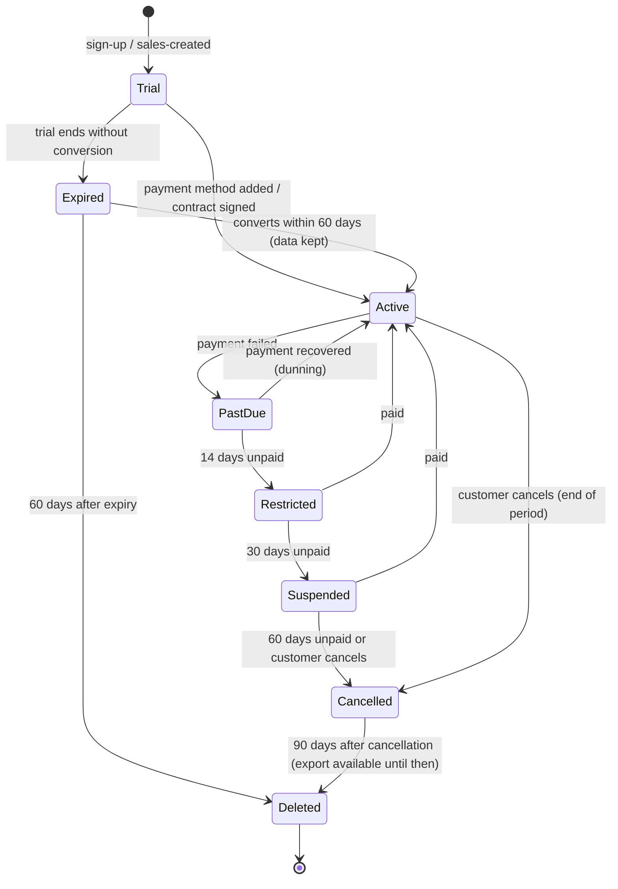
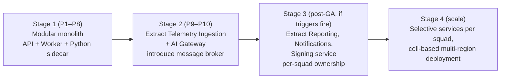
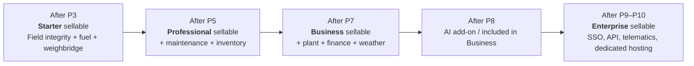
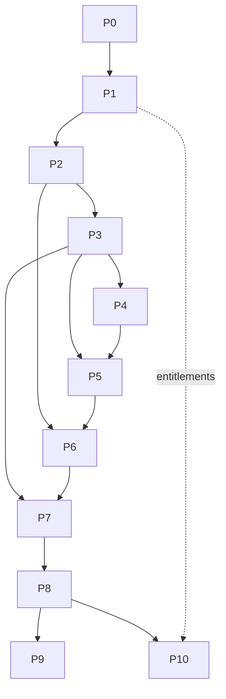

# Karry Platform — Detailed Phase Plan, User Stories, Acceptance Criteria & Test Plans

> Companion to [`MASTER_PLAN.md`](./MASTER_PLAN.md). The master plan defines **what** we build and **why** (architecture, stack, formulas). This document defines **how we deliver it, phase by phase**. For every phase it lists the scope, the epics and user stories, their acceptance criteria, the test plans, the deliverables, the demo scripts, the exit gates and the commercial outcome.

| Field | Value |
|---|---|
| Document | Detailed Phase Plan |
| Version | 1.0 (baseline) |
| Status | Draft for review |
| Date | 2026-10-21 |
| Owner | Software Architecture / Product |
| Supersedes | §21 of `MASTER_PLAN.md` wherever the two differ (this document is more precise) |

---

## Table of Contents

**Part A — Strategy**
1. [How to Read and Use this Document](#1-how-to-read-and-use-this-document)
2. [Business Model: Selling Karry as a Monthly Subscription](#2-business-model-selling-karry-as-a-monthly-subscription)
3. [Architecture Decision: Microservices or Not? (Detailed Opinion)](#3-architecture-decision-microservices-or-not-detailed-opinion)
4. [Delivery Framework](#4-delivery-framework)
5. [Cross-Cutting Acceptance Criteria (apply to every story)](#5-cross-cutting-acceptance-criteria-apply-to-every-story)
6. [Phase Overview & Commercial Packaging per Phase](#6-phase-overview--commercial-packaging-per-phase)

**Part B — Phases**

7. [Phase 0 — Discovery, Domain Validation & Architecture Baseline](#7-phase-0--discovery-domain-validation--architecture-baseline)
8. [Phase 1 — Platform Foundation & SaaS Core](#8-phase-1--platform-foundation--saas-core)
9. [Phase 2 — Field Operations, Verification & Signatures](#9-phase-2--field-operations-verification--signatures)
10. [Phase 3 — Weighbridge, Fuel, Integrity Dashboard & Pilot Go-Live](#10-phase-3--weighbridge-fuel-integrity-dashboard--pilot-go-live)
11. [Phase 4 — Maintenance & Reliability](#11-phase-4--maintenance--reliability)
12. [Phase 5 — Inventory & Multi-Warehouse Logistics](#12-phase-5--inventory--multi-warehouse-logistics)
13. [Phase 6 — Plant Topology, Production, Stockpiles & Edge Agent](#13-phase-6--plant-topology-production-stockpiles--edge-agent)
14. [Phase 7 — Asset Finance, Weather & Analytics Suite](#14-phase-7--asset-finance-weather--analytics-suite)
15. [Phase 8 — AI Copilot](#15-phase-8--ai-copilot)
16. [Phase 9 — Integrations, Telematics & Public API](#16-phase-9--integrations-telematics--public-api)
17. [Phase 10 — SaaS General Availability & Self-Service Growth](#17-phase-10--saas-general-availability--self-service-growth)
18. [Phase 11+ — Continuous Evolution Backlog](#18-phase-11--continuous-evolution-backlog)

**Part C — Running the Business Around the Software**

19. [Parallel Commercial Tracks (Sales, Marketing, Support, Legal)](#19-parallel-commercial-tracks-sales-marketing-support-legal)
20. [Pilot & Customer Onboarding Playbook](#20-pilot--customer-onboarding-playbook)
21. [Release Management & Go-Live Checklists](#21-release-management--go-live-checklists)
22. [Product & Business KPIs](#22-product--business-kpis)

**Part D — Appendices**

23. [Appendix A — Default Role & Permission Matrix](#23-appendix-a--default-role--permission-matrix)
24. [Appendix B — Alert & Detection Rule Catalogue](#24-appendix-b--alert--detection-rule-catalogue)
25. [Appendix C — Notification Catalogue](#25-appendix-c--notification-catalogue)
26. [Appendix D — Report & Document Catalogue](#26-appendix-d--report--document-catalogue)
27. [Appendix E — Defect Severity & Triage SLAs](#27-appendix-e--defect-severity--triage-slas)
28. [Appendix F — Test Environment, Data & Device Matrix](#28-appendix-f--test-environment-data--device-matrix)
29. [Appendix G — Story Index](#29-appendix-g--story-index)

---

# PART A — STRATEGY

## 1. How to Read and Use this Document

### 1.1 Who uses what

| Reader | Read first |
|---|---|
| Founder / CEO | §2 (business model), §3 (architecture decision), §6 (phase → product packaging), §22 (KPIs) |
| Product Owner | §4, §5, then each phase's *Epics & User Stories* |
| Engineers | §3, §4, §5, then each phase's *Technical Scope* and *Test Plan* |
| QA | §4.6, §5, each phase's *Test Plan*, Appendices E & F |
| Sales / Customer Success | §2, §6, §19, §20 |

### 1.2 Identifier conventions

| Item | Format | Example |
|---|---|---|
| Epic | `EP-P<phase>-<nn>` | `EP-P2-03` |
| User story | `US-P<phase>-<AREA>-<nn>` | `US-P2-FO-04` (Phase 2, Field Ops, story 4) |
| Acceptance criterion | `AC<n>` inside a story | `US-P2-FO-04 / AC3` |
| Test case | `TC-P<phase>-<AREA>-<nnn>` | `TC-P2-SYNC-012` |
| Non-functional requirement | `NFR-<AREA>-<nn>` | `NFR-OFF-01` |
| Detection rule | `RULE-<AREA>-<nn>` | `RULE-FUEL-03` |

Area codes: `PLT` platform, `TEN` tenancy, `IAM` identity & access, `BIL` billing, `ORG` organization, `AST` assets, `UNI` units, `AUD` audit ledger, `OFF` offline/sync, `FO` field ops, `VER` verification, `SIG` signatures, `WB` weighbridge, `SAL` sales, `FUEL` fuel, `INT` integrity dashboard, `NOT` notifications, `MNT` maintenance, `INV` inventory, `PLN` plant, `PRD` production, `STK` stockpiles, `EDG` edge agent, `FIN` finance, `WX` weather, `ANA` analytics, `AI` copilot, `API` public API, `TEL` telematics, `GRW` growth/self-service, `OPS` platform operations.

### 1.3 Story template

Every user story in the backlog follows this exact template:

```
ID:            US-P2-FO-01
Title:         Start a shift on an asset
Persona:       Field Operator
Story:         As a <persona>, I want <capability>, so that <business outcome>.
Priority:      Must | Should | Could   (MoSCoW, within the phase)
Size:          S (≤2 days) | M (3–5 days) | L (6–10 days)   — L stories must be split before sprint entry
Dependencies:  other story IDs
Acceptance:    Given / When / Then criteria (AC1…ACn)
Test refs:     TC-… identifiers
Notes:         UX / data / edge cases
```

In this document the stories are written in a compact table and list form for readability. The backlog tool (Jira / Linear / GitHub Projects) holds the full template.

### 1.4 What "done" means at each level

| Level | Done means |
|---|---|
| Story | Meets its AC + all cross-cutting AC (§5) + Definition of Done (§4.4) |
| Epic | All Must stories done, all Should stories done or explicitly descoped by PO |
| Phase | Exit gate passed (each phase lists it), demo accepted by PO + pilot customer (from P2), test report signed |
| Release | Release checklist (§21) completed, deployed to production, release notes published FR/EN |

---

## 2. Business Model: Selling Karry as a Monthly Subscription

The goal is **many paying customers and recurring revenue**. That target shapes the architecture (multi-tenant from day 1), the roadmap order (sell value early) and the product (self-service onboarding, entitlements, billing).

### 2.1 Why customers pay (value proposition)

Quarry owners pay for software only when it **recovers money they can measure**. Karry's value comes from four levers, ordered by how fast they pay back:

| Lever | Mechanism in Karry | How we prove it to the customer |
|---|---|---|
| **1. Fuel loss reduction** | Per-asset consumption baselines, anomaly detection, tank reconciliation, signed dispensing | Compare L/h per machine during the first 30 days (baseline) with the following 60 days |
| **2. Billing accuracy and ticket fraud** | Signed scale tickets, no edits (reversals only), tare checks, indicator capture | Tonnes ticketed vs. tonnes produced vs. stockpile change |
| **3. Downtime avoided** | RUL prediction, procurement before lead time, grouped maintenance stops | Unplanned stop hours before vs. after; parts stock-outs |
| **4. Financial clarity** | Cost per hour, cost per tonne, DSCR per machine | CFO uses Karry numbers in bank meetings |

> **Positioning sentence (sales):** *"Karry pays for itself in fuel alone. Everything else is profit."* This claim is a hypothesis. We prove it with pilot data in Phase 3 before we use it in marketing.

### 2.2 Ideal customer profile (ICP) and segments

| Segment | Profile | Needs | Plan fit |
|---|---|---|---|
| **S1 — Independent quarry** | 1 site, 8–30 machines, owner-managed | Fuel control, weighbridge, simple maintenance | Starter → Professional |
| **S2 — Regional aggregates group** | 2–10 sites, central warehouse, 30–200 machines | Everything in S1 plus Magasin Général, transfers, consolidated dashboards | Professional → Business |
| **S3 — Construction company with own quarries** | Quarry is a cost centre feeding projects | Cost per tonne, transfers to projects, finance | Business |
| **S4 — Mining contractor / large mining group** | Many sites, compliance, IT department | SSO, dedicated hosting, API, telematics | Enterprise |

Initial geography is decided in Phase 0 (open question §28 of the master plan). The product is French/English from day 1 to serve Francophone Africa, North Africa, France/Belgium/Canada and Anglophone markets.

### 2.3 Subscription plans (illustrative, validated in Phase 0 with real prospects)

Pricing is **per site per month** with included assets. That metric is simple to explain, it scales with customer size, and it is hard to game.

| | **Starter** | **Professional** | **Business** | **Enterprise** |
|---|---|---|---|---|
| Target | S1 | S1/S2 | S2/S3 | S4 |
| Indicative price | €249 / site / month | €590 / site / month | €990 / site / month | Custom (from €2,000 / site / month or annual contract) |
| Included assets per site | 20 | 50 | 120 | Unlimited |
| Extra asset | €6 / asset / month | €5 | €4 | Negotiated |
| Users | Unlimited field users, 5 office users | Unlimited field, 15 office | Unlimited field, 40 office | Unlimited |
| Field ops, verification, e-signatures | ✔ | ✔ | ✔ | ✔ |
| Weighbridge tickets & basic sales | ✔ | ✔ | ✔ | ✔ |
| Fuel management & anomaly detection | ✔ | ✔ | ✔ | ✔ |
| Integrity dashboard | ✔ | ✔ | ✔ | ✔ |
| Maintenance & RUL | — | ✔ | ✔ | ✔ |
| Inventory & warehouses (Magasin Général, transfers, counts) | Single store | ✔ | ✔ | ✔ |
| Plant graph, production, stockpiles | — | — | ✔ | ✔ |
| Asset finance, DSCR, weather advisory | — | — | ✔ | ✔ |
| AI Copilot | — | Add-on | Included (fair-use quota) | Included (custom quota) |
| Edge agent (weighbridge auto-capture) | Add-on | Add-on | 1 included per site | Included |
| Telematics connectors | — | — | Add-on | ✔ |
| SSO (SAML/OIDC federation) | — | — | ✔ | ✔ |
| Public API & webhooks | — | Read-only | ✔ | ✔ |
| Dedicated database / region / on-prem | — | — | — | ✔ |
| Support | Email, business hours | Email + chat | Priority, named CSM | 24/7 option, SLA 99.95 % |
| Data retention | 3 years | 7 years | 10 years | Custom |

**Add-ons**

| Add-on | Indicative price |
|---|---|
| AI Copilot (Professional) | €149 / site / month |
| Edge agent software licence | €79 / site / month (hardware sold or rented separately) |
| Telematics connector | €3 / connected asset / month |
| Additional AI quota | Bundles of usage |
| Premium onboarding (data migration, on-site training) | One-off fee: €1,500–€8,000 depending on number of sites |
| Hardware bundles (rugged tablets, weighbridge edge PC) | Resale at cost + margin, optional |

**Billing terms**
- Monthly or annual (annual = 2 months free, i.e. about 17 % discount). Annual billing is preferred because cash comes in up front and customers churn less.
- 30-day free trial on Starter/Professional with **demo tenant pre-loaded with realistic data** plus option to enter own data.
- Local currency pricing (EUR, USD, XOF, MAD, TND, CAD …) where payment rails exist; price book per currency (not a live FX conversion).
- Enterprise is invoiced by bank transfer with net-30 terms.

> **Pricing principle:** the field side (operators, drivers, weighmasters) is **unlimited users** on all plans. Charging per field user would make customers share logins, and shared logins destroy the anti-fraud value. We charge for sites, assets and office seats.

### 2.4 Pricing must be technically enforceable → Entitlements engine

The product needs an **entitlements engine** from Phase 1, not Phase 10. Without one, sales cannot sell plans, and engineering ends up hardcoding customer-specific behaviour.

```
Plan            = { code, version, features[], limits{}, priceBook[] }
Subscription    = { tenant, plan, addOns[], status, period, seats, quantities }
Entitlement     = resolved(feature flags + limits) for a tenant at time t
Usage meter     = { tenant, metric (sites, assets, office_users, ai_tokens, storage_gb, edge_agents), value, period }
```

- Features are checked in the API (`[RequiresFeature("maintenance")]`) **and** hidden in UI. The API check is what enforces them; hiding in the UI is only cosmetic.
- Limits are **soft** with a grace margin (e.g., +10 % assets for 30 days, then sales follow-up), never a hard block in the middle of a shift.
- Plan changes take effect immediately (upgrade) or at period end (downgrade).

### 2.5 Tenant subscription lifecycle



| State | Field capture | Office app | Data export |
|---|---|---|---|
| Trial / Active | Full | Full | ✔ |
| PastDue | Full | Full + banner | ✔ |
| Restricted | **Full**: field data is never blocked, because losing shift data would destroy trust | Read-only except billing | ✔ |
| Suspended | Read-only | Read-only, billing only | ✔ |
| Cancelled | Disabled | Read-only | ✔ (90 days) |
| Deleted | — | — | — (crypto-shredding of tenant keys, ledger anchors kept as hashes only) |

### 2.6 Payment rails

| Option | Use | Note |
|---|---|---|
| **Merchant of Record (e.g., Paddle, Lemon Squeezy)** | Card payments worldwide, handles VAT/sales tax | Simplest for a small team; higher fee |
| **Stripe Billing** | Card + SEPA in supported countries | Not available to merchants in all African/MENA countries. Decide based on where the company is incorporated |
| **Regional providers (Flutterwave, Paystack, CinetPay, local banks)** | Mobile money / local cards | Important for West Africa (XOF) |
| **Bank transfer + invoice** | Enterprise, annual contracts | Manual reconciliation in v1 |

The billing module wraps providers behind `IBillingProvider` so the provider choice is a configuration decision.

### 2.7 Unit economics targets

| Metric | Target |
|---|---|
| Gross margin (infra + LLM + support cost vs revenue) | ≥ 80 % |
| Infra cost per standard site | ≤ €25 / month at 100+ tenants |
| AI cost per Business site | ≤ 15 % of AI-attributed revenue (quotas enforced) |
| CAC payback | ≤ 12 months |
| Net revenue retention | ≥ 110 % (expansion via sites, assets, upgrades) |
| Logo churn | ≤ 1.5 % monthly |
| Time-to-value | First verified shift within 48 h of sign-up; first fuel anomaly report within 30 days |

### 2.8 Illustrative revenue path (assumptions, not a forecast)

| Horizon | Paying sites | Avg. revenue / site / month | MRR | ARR |
|---|---|---|---|---|
| End of pilot (≈ month 5) | 1–3 | €300 (discounted pilot) | ≈ €900 | ≈ €11 k |
| Commercial v1 (≈ month 9) | 15 | €500 | €7.5 k | €90 k |
| Intelligence release (≈ month 12) | 40 | €650 | €26 k | €312 k |
| GA + 12 months (≈ month 24) | 150 | €750 | €112 k | €1.35 M |
| Scale (≈ month 36) | 400 | €800 | €320 k | €3.8 M |

This path is achievable only if: (1) the pilot proves measurable fuel/ticket savings, (2) onboarding takes less than a day, (3) a channel strategy exists (equipment dealers, crusher OEM distributors and fuel suppliers as resellers). See §19.

### 2.9 Growth features that are part of the product (not afterthoughts)

| Feature | Phase | Why it makes money |
|---|---|---|
| Entitlements & plans | P1 | Lets sales sell tiers and upsell |
| Excel import wizard | P1 | Cuts onboarding from weeks to hours |
| Demo tenant with realistic data | P3 | Sales demos and trials work without setup |
| Savings report ("Karry saved you X this month") | P3 | Shows the value every month and keeps customers renewing |
| In-app upgrade prompts (locked features shown with value) | P4 | Self-serve expansion revenue |
| Multi-site consolidated dashboards | P5 | Sells more sites per customer |
| Referral programme | P10 | Low-cost acquisition in a word-of-mouth industry |
| Partner / reseller portal | P10 | Dealers sell Karry alongside machines |
| Self-service sign-up, checkout, plan management | P10 | Scales sales without headcount |

---

## 3. Architecture Decision: Microservices or Not? (Detailed Opinion)

### 3.1 My recommendation

> **Do NOT start with microservices. Start with a _modular monolith_, built with microservice-grade boundaries, deployed as a small number of processes, and multi-tenant from day 1. Extract services only when a measured trigger fires (§3.6).**

This is the professional choice for Karry. Below is why, what it means concretely, what we still separate from day 1, and exactly how we keep the door open to microservices.

### 3.2 What "modular monolith" means here (it is not a "big ball of mud")

- One .NET solution, **one deployable API image**, but internally split into ~17 **modules** (Tenancy, Assets, FieldOps, Fuel, Verification, Trust, Weighbridge, Maintenance, Inventory, Plant, Finance, Weather, Analytics, AiCopilot, Notifications, Billing, Organization).
- Each module has its own **database schema**, its own domain model, and a **public contract** project. Modules **never** read another module's tables and never reference another module's internals. Architecture tests in CI fail the build if they do.
- Modules communicate in two ways only:
  1. **Synchronous in-process calls** through the other module's public contract interface (like a service API, but a method call).
  2. **Asynchronous integration events** via the transactional outbox (exactly like a message bus between microservices).
- So the *logical* architecture is service-oriented. Only the *physical deployment* is unified.

### 3.3 Why not microservices from the beginning — the 10 reasons

**1. Team size (Conway's Law).**
Microservices exist to let **many independent teams** release without coordinating. We will have 5–7 engineers, which is one or two teams. With 15+ services, each engineer would own 2–3 services plus their pipelines, databases, dashboards and on-call. Most of the time would go to operating the system instead of building features customers pay for.

**2. Time-to-market is the #1 business risk.**
For a subscription business, the first goal is **reaching paying customers fast**. Microservices add an estimated 30–50 % overhead to early delivery (service templates, inter-service auth, distributed tracing, contract testing, deployment orchestration, versioned APIs between services). In our roadmap that delays the pilot by roughly 2–3 months and the first revenue with it.

**3. Our core guarantee is transactional, and microservices make it harder.**
Karry's selling point is **trust**: "every business change has a signed, hash-chained ledger entry, atomically." In a monolith that is **one PostgreSQL transaction** (business row + ledger entry + outbox event). With microservices, the same guarantee needs sagas, compensation, and eventual consistency between e.g. Verification, Trust and FieldOps services. Each of those adds failure modes, and each failure mode gives an auditor a reason to doubt the ledger.

**4. Offline sync wants one consistent server-side truth.**
Field devices upload batches containing shift entries, fuel records, tickets, signatures and photos that span several domains. A monolith validates and commits the batch coherently. With microservices, a batch would fan out across services with partial failures, and the device would need to reconcile per-service results. The protocol gets more complex at the most fragile point of the system, which is low-connectivity tablets.

**5. Domain boundaries are not yet proven.**
We have not yet run the Phase 0 event storming with real operators. Boundaries drawn now will move (e.g., does "Fuel" belong with "FieldOps"? does "Stockpiles" belong with "Weighbridge"?). In a modular monolith, moving a boundary is a **refactor in one repo with compiler help**. In microservices, it is a **data migration between databases plus API versioning across services**, which is expensive and risky.

**6. Infrastructure cost per tenant (gross margin).**
SaaS profitability depends on low cost per tenant. Microservices typically mean many always-on containers, often a database per service, a message broker cluster and a service mesh. Early on that can multiply the infrastructure bill several times over for the same load. A monolith with 2–3 stateless replicas plus managed PostgreSQL serves hundreds of tenants cheaply. That protects the ≥ 80 % gross margin target (§2.7).

**7. Our load profile does not need it.**
Even at the GA target (500 tenants, 20 M field entries/year), the write load averages **under 1 write/second**, with peaks at shift changes of perhaps a few hundred/second. A single well-indexed PostgreSQL and horizontally scaled stateless API pods handle that comfortably. The only data stream with genuinely high volume is **telemetry** (Phase 9), and that is exactly the first extraction candidate (§3.6).

**8. Debugging and support are far simpler.**
When a weighmaster says "my ticket disappeared", support needs one trace and one log stream, not a hunt across 12 services and a broker. For a small team supporting customers in remote regions, this keeps support costs down.

**9. Security surface is smaller.**
Every network hop between services is something to authenticate, authorize, encrypt and monitor. Fewer hops means fewer mistakes and a smaller attack surface. That matters a lot for a product whose brand is tamper-evidence.

**10. Industry evidence.**
Many successful SaaS companies scaled very far on modular monoliths (Shopify being the most cited example) and extracted services selectively. Many startups that started with microservices later merged them back because the operational overhead was greater than the benefit at their size. A very common professional pattern is "monolith first, extract when it hurts", and it fits our situation.

### 3.4 The honest counter-arguments, and our answers

| Argument for microservices | Our answer |
|---|---|
| "We will need to scale." | We scale the monolith horizontally (stateless API pods behind a load balancer) and vertically (database). The one high-volume stream (telemetry) is designed as an extractable module from day 1. |
| "Different parts need different technologies." | True for Python analytics, so that **is** a separate process from day 1. Everything else is .NET. |
| "Investors / enterprise buyers want microservices." | Buyers want **uptime, security, isolation and SLAs**. We give them those, plus dedicated hosting for Enterprise. No serious buyer rejects a product for being a modular monolith; they reject products that are down or leaky. |
| "Refactoring a monolith later is painful." | That pain comes from **unstructured** monoliths. Ours enforces module boundaries in CI, uses per-module schemas and communicates by events, so extraction is mechanical (§3.7). |
| "One bug can take down everything." | Mitigated with bulkheads: separate **worker process** for background jobs, separate **edge agents**, separate **analytics sidecar**, rate limits per tenant, and circuit breakers on external calls. Field capture is offline-first, so the field keeps working even during a full cloud outage. |
| "Independent deployments." | With one or two teams we deploy the whole app many times a day using trunk-based development and feature flags. Independent deploys only start to matter when there are several teams. |

### 3.5 What IS separated from day 1 (justified, not dogmatic)

| Process / component | Why it is separate |
|---|---|
| **Karry API host** (modular monolith) | Main application, horizontally scaled |
| **Karry Worker host** (same codebase, different entry point) | Background jobs (outbox dispatch, RUL recompute, ledger anchoring, reports) must not steal CPU from user requests; it scales independently |
| **Python analytics sidecar** | Different runtime and ecosystem (forecasting, Weibull, anomaly models). It is stateless and called by the workers |
| **Keycloak** | Off-the-shelf identity provider |
| **Edge agent** | Runs physically at the quarry site |
| **PostgreSQL, Redis, object storage** | Managed infrastructure |

That gives about **4 custom deployables**, which is the right number for this team.

### 3.6 Extraction triggers (when we WILL create a microservice)

A module becomes a separate service **only if at least one trigger is measured and an ADR is approved**:

| Trigger | Threshold (indicative) | Likely first candidate |
|---|---|---|
| Throughput / resource profile differs radically | Sustained > 2,000 events/s or > 40 % of total CPU | **Telemetry ingestion** (Phase 9) |
| Security isolation needed | Secrets/keys that must not live in the main process; separate compliance scope | **AI Gateway** (LLM keys, prompt logging) and **Signing service** (KMS access) |
| Team topology | ≥ 3 squads with conflicting release cadences | Plant/Production squad, Commerce/Billing squad |
| Availability isolation | A module's failures measurably impact core SLO | Reporting / PDF generation, Notifications |
| Different scaling economics | Bursty workloads (monthly reports, AI summaries) | Reporting service on scale-to-zero |
| Customer-specific deployment | Enterprise demands a component on-prem while the rest stays in cloud | Edge-adjacent services |

### 3.7 How we keep extraction cheap (rules enforced from Phase 1)

1. **Schema per module**, no cross-module joins, no cross-module foreign keys (except IDs to tenancy reference data).
2. **Public contracts only** (`Karry.<Module>.Contracts`): commands, queries, DTOs, integration events, all versioned.
3. **Integration events via outbox** with a broker-agnostic envelope (`CloudEvents` format). Replacing the in-process dispatcher with RabbitMQ/Kafka/Azure Service Bus later only changes configuration and an adapter.
4. **No shared mutable state** in memory between modules.
5. **Module-level API route prefixes** (`/api/v1/maintenance/...`) so that an API gateway can later route a prefix to a new service without changing any client.
6. **Per-module observability** (spans and metrics tagged with `module`), so we can measure the triggers in §3.6.
7. **Architecture tests** (ArchUnitNET / NetArchTest) run in CI and block violations.

### 3.8 Evolution path



### 3.9 Multi-tenancy is the decision that really matters for a subscription business

Monolith vs. microservices matters far less for revenue than **how tenants are isolated and onboarded**:

- **Pool model** (shared DB with Row-Level Security) for Starter/Professional/Business: very low cost per tenant, instant provisioning.
- **Silo model** (dedicated DB or dedicated cell) for Enterprise: same code, separate infrastructure, higher price.
- **Cell-based architecture later**: groups of tenants per "cell" (an API + DB stack) to limit blast radius and allow regional data residency. A modular monolith fits this well, because each cell is one deployment.

**Conclusion:** the modular monolith gets us to revenue fastest and cheapest, protects the transactional trust guarantees, and is designed so that every future extraction is a planned, low-risk step and not a rewrite.

---

## 4. Delivery Framework

### 4.1 Cadence

| Ceremony | Frequency | Output |
|---|---|---|
| Sprint | 2 weeks | Potentially shippable increment on staging |
| Sprint planning | Start of sprint | Sprint goal + committed stories (all meet DoR) |
| Daily stand-up | Daily, 15 min | Blockers surfaced |
| Backlog refinement | Weekly, 1 h | Stories ready for next 2 sprints |
| Sprint review / demo | End of sprint | Demo on staging, feedback logged (pilot customer invited from P2) |
| Retrospective | End of sprint | 1–3 improvement actions |
| Architecture review | Weekly, 30 min | ADRs proposed/approved |
| Phase exit review | End of each phase | Gate decision: Go / Go with conditions / No-go |
| Security review | Each phase + any trust-layer change | Threat model update, findings tracked |

### 4.2 Definition of Ready (DoR), required before a story enters a sprint

- [ ] Story written in template (§1.3) with persona and business outcome.
- [ ] Acceptance criteria are testable (Given/When/Then), including error and offline cases.
- [ ] UX designs/wireframes attached (or "no UI" stated).
- [ ] API contract sketched (endpoints, payloads) when the story touches the backend.
- [ ] Permissions identified (which roles, which scope, which fields masked).
- [ ] Audit events identified (what goes in the ledger).
- [ ] i18n keys identified (FR/EN copy reviewed by PO).
- [ ] Dependencies resolved or scheduled.
- [ ] Size ≤ M (L stories split).
- [ ] Test cases drafted by QA (IDs reserved).

### 4.3 Definition of Done (DoD), required for every story

- [ ] All AC pass, verified by QA on the `dev` environment.
- [ ] Cross-cutting AC (§5) satisfied.
- [ ] Unit tests written; domain/math coverage ≥ 80 % for touched modules; property tests for formulas.
- [ ] Integration tests for persistence and API (Testcontainers).
- [ ] E2E test added or updated for user-facing critical journeys.
- [ ] Tenant-isolation test auto-generated for any new endpoint (passes).
- [ ] OpenAPI updated, generated client regenerated, no breaking change (or versioned).
- [ ] Migrations are reversible or follow expand/contract; reviewed as SQL.
- [ ] Telemetry: traces/metrics/logs added for new flows; dashboards updated if needed.
- [ ] Feature flag / entitlement wiring if the feature is plan-gated.
- [ ] Docs updated (user help article stub FR/EN, ADR if decision taken, runbook if operational).
- [ ] Code reviewed (2 approvals for `Trust`, `Tenancy`, `IAM`, `Billing`, `Sync` modules).
- [ ] No new high/critical findings from SAST, dependency or container scans.
- [ ] Merged to `main`, deployed to `dev`, demoable.

### 4.4 Definition of Done, phase level

- All Must stories done; Should stories done or descoped in writing.
- Phase test report signed by QA lead (test execution summary, pass rate, open defects by severity).
- **Zero open Sev-1/Sev-2 defects**; Sev-3 have a plan.
- Performance and security tests of the phase executed and within thresholds.
- Release notes (FR/EN), user help articles, admin documentation updated.
- Demo accepted by PO; from P2 onward also by pilot customer representative.
- Retrospective of the phase + re-plan of the next phase.

### 4.5 Estimation & capacity assumptions

- Team: 1 tech lead/architect, 2 senior backend, 1–2 frontend, 1 QA, 0.5–1 DevOps, 1 PO, 0.5 UX; data engineer from P4.
- Velocity is calibrated after 2 sprints. Until then, plan with **≈ 60 %** of the theoretical capacity for feature work. The remaining 40 % covers bugs, reviews, support for the pilot, tech debt and meetings.
- Each phase reserves a **hardening week** at its end (bug fixing, performance, documentation, demo prep).

### 4.6 Test strategy (summary of levels used in every phase test plan)

| Level | Owner | Tool | Gate |
|---|---|---|---|
| Unit | Dev | xUnit / Vitest | PR |
| Property-based | Dev | FsCheck / fast-check | PR |
| Mutation (math, trust) | Dev | Stryker.NET | Nightly, threshold ≥ 70 % |
| Integration | Dev | Testcontainers (Postgres+PostGIS+Timescale, Keycloak, MinIO) | PR |
| Architecture | Dev | NetArchTest / ArchUnitNET | PR |
| Contract | Dev | OpenAPI diff | PR |
| Tenant isolation | QA/Dev | Generated suite | PR + nightly |
| E2E web | QA | Playwright | Main branch |
| E2E offline | QA | Playwright with network emulation + service worker | Main branch, nightly |
| Device lab | QA | Real tablets (see Appendix F) | Per sprint for field features |
| Performance | QA/DevOps | k6 | Per phase + before release |
| Security | Security champion | ZAP, dependency scanning, manual review, external pen test (P10) | Per phase |
| Accessibility | QA/UX | axe-core + manual | Per release |
| Localization | PO/QA | FR/EN review, pseudo-localization build | Per release |
| UAT | Pilot users + PO | Scripted scenarios | Per phase from P2 |
| AI evaluation | Dev/QA | Golden sets | Every prompt/model change |

### 4.7 Branching, environments & releases

- Trunk-based, short-lived feature branches (≤ 2 days), feature flags for incomplete work.
- `main` → auto-deploy to `dev` → nightly to `staging` (tagged RC) → manual promotion to `prod`.
- Production releases: weekly during pilot, then continuous with progressive rollout (canary 10 % → 100 %).
- PWA compatibility: server supports the current and the **two previous** client versions, because offline devices update late.

---

## 5. Cross-Cutting Acceptance Criteria (apply to every story)

These criteria are **implicitly part of every user story**. QA verifies them without them being repeated in each story.

| ID | Criterion |
|---|---|
| **CC-01 Tenant isolation** | Data created by tenant A is never readable/writable by tenant B through any endpoint, export, search, report, notification or AI answer. An automated isolation test exists for every new endpoint. |
| **CC-02 Authorization** | Every endpoint declares a permission and scope. Users without permission get `403` (or `404` where existence must be hidden). UI hides unavailable actions, but the API enforces. |
| **CC-03 Field masking** | Fields configured as MASKED/HIDDEN for a role are masked in API responses, exports, PDFs and AI tool outputs, not only in UI. |
| **CC-04 Audit** | Every create/change/approve/reject/reverse of a business record appends a ledger entry (actor, device, time, before/after hash). Reads of sensitive financial data are access-logged. |
| **CC-05 Entitlements** | Plan-gated features return `402`-style problem `feature_not_in_plan` from API and show an upgrade prompt in UI. Limits behave as soft limits (§2.4). |
| **CC-06 i18n** | All user-visible text is in FR and EN, with no hardcoded strings. Numbers, dates and units are formatted per locale. Pseudo-localization build shows no truncation. |
| **CC-07 Units** | Every quantity displays its unit (and material state for volumes). API never returns bare numbers for quantities. |
| **CC-08 Time** | Times stored in UTC, displayed in site timezone with offset available on hover. Device time and server time both kept for field records. |
| **CC-09 Offline (field features)** | The feature works with no network, the queued state is visible, it syncs exactly once after reconnection, and nothing is lost on app restart or device reboot. |
| **CC-10 Performance** | API p95 < 300 ms read / < 500 ms write on staging dataset. Field screens interactive < 100 ms after tap on reference device. |
| **CC-11 Accessibility** | Portal: WCAG 2.2 AA (keyboard, contrast, labels). Field: touch targets ≥ 48 px, outdoor high-contrast mode supported. |
| **CC-12 Errors** | Errors use RFC 9457 Problem Details with a translated user message and a correlation ID shown to the user. |
| **CC-13 Observability** | New flows emit traces with `tenant`, `module`, `operation`. Failures are logged without PII and alert when thresholds are crossed. |
| **CC-14 Idempotency** | Fact-creating POSTs accept `Idempotency-Key`; replays return the original result. |
| **CC-15 Validation** | Server-side validation mirrors client validation (shared Zod/OpenAPI schemas). Invalid data never reaches the domain. |
| **CC-16 Security** | No secrets in code or logs. Input is validated and output encoded. File uploads are type-checked, size-limited and malware-scanned when coming from portal users. |
| **CC-17 Documentation** | User-facing features have a help article stub (FR/EN) and a changelog entry. |
| **CC-18 Data export** | Any list screen of business data can be exported (CSV/Excel) subject to permissions and masking. |

---

## 6. Phase Overview & Commercial Packaging per Phase

### 6.1 Timeline (team of 5–7, indicative)

| Phase | Name | Duration | Weeks (cumulative) | Milestone |
|---|---|---|---|---|
| P0 | Discovery & Architecture Baseline | 3 w | W1–W3 | **M0** Baseline approved |
| P1 | Platform Foundation & SaaS Core | 5 w | W4–W8 | **M1** Walking skeleton |
| P2 | Field Ops, Verification & Signatures | 6 w | W9–W14 | — |
| P3 | Weighbridge, Fuel, Integrity & Pilot | 5 w | W15–W19 | **M2** Pilot live → **sell Starter** |
| P4 | Maintenance & Reliability | 6 w | W20–W25 | — |
| P5 | Inventory & Warehouses | 6 w | W26–W31 | → **sell Professional** |
| P6 | Plant, Production, Stockpiles, Edge | 7 w | W32–W38 | **M3** Commercial v1 |
| P7 | Finance, Weather & Analytics | 6 w | W39–W44 | → **sell Business** |
| P8 | AI Copilot | 5 w | W45–W49 | **M4** Intelligence release |
| P9 | Integrations, Telematics & API | 6 w | W50–W55 (parallel) | → **sell Enterprise** |
| P10 | SaaS GA & Self-Service Growth | 6 w | W50–W55 (parallel) | **M5** GA |

### 6.2 Revenue starts early, not at the end

The roadmap is ordered so that **every phase from P3 onward unlocks a sellable plan**:



### 6.3 Phase dependency graph



---

# PART B — PHASES

Every phase section uses the same structure:

1. Objectives & business value
2. Scope (in / out)
3. Epics
4. User stories with acceptance criteria
5. Technical scope (backend, frontend, data, infrastructure, APIs)
6. Test plan
7. Deliverables
8. Demo script
9. Exit gate
10. Risks
11. Commercial outcome

---

## 7. Phase 0 — Discovery, Domain Validation & Architecture Baseline

**Duration:** 3 weeks (W1–W3) · **Team:** Architect, PO, UX, 1 senior backend, 1 senior frontend (spikes), domain expert (advisory), founder (commercial validation)

### 7.1 Objectives & business value

- **Validate that customers will pay**, and how much, before writing production code.
- Validate the domain (formulas, workflows, vocabulary) with real quarry staff.
- Remove the top technical risks with spikes (offline, crypto, RLS, extensions).
- Produce a backlog for P1–P3 detailed enough that the team starts P1 at full speed.

### 7.2 Scope

**In:** customer interviews, site visits, event storming, formula validation, legal review, UX prototype, technical spikes, ADRs, pricing validation, pilot agreement, backlog.
**Out:** production code (spike code is thrown away or moved into P1 only after review).

### 7.3 Work packages (Phase 0 uses work packages instead of user stories)

| ID | Work package | Owner | Output | Acceptance |
|---|---|---|---|---|
| WP-P0-01 | **Customer discovery interviews** (≥ 8 quarry companies across ICP segments) | Founder + PO | Interview notes, pain ranking, willingness-to-pay matrix | ≥ 8 interviews; top 5 pains ranked by ≥ 6 interviewees; price sensitivity range per plan documented |
| WP-P0-02 | **Site visits** (≥ 2 quarries, including one shift change, weighbridge, fuel dispensing, store) | PO + UX + Architect | Photo-documented process maps (as-is) | As-is BPMN maps for: shift start/end, fueling, weighing, store issue, transfer, maintenance stop |
| WP-P0-03 | **Event storming** (big picture → process level) | Architect | Domain events timeline, aggregates, bounded contexts v1.1 | Context map signed by Architect + PO + domain expert; changes vs master plan recorded in ADR-0001 |
| WP-P0-04 | **Formula validation** with mining engineer (all items in master plan §3, §10) | Architect + domain expert | `docs/domain/formulas.md` with worked numeric examples | Every formula has: definition, units, valid ranges, worked example, source, sign-off |
| WP-P0-05 | **Golden datasets** collected from pilot candidate (Excel shift sheets, fuel logs, tickets, maintenance logs) | PO | Anonymised dataset in `tests/golden/` | ≥ 1 month of real data for shifts, fuel, tickets; ≥ 1 year of maintenance history if available |
| WP-P0-06 | **Legal review**: e-signature validity, data protection, retention, invoicing rules, in target country(ies) | Founder + counsel | Legal memo | Signature level achievable confirmed; retention periods table; DPA template drafted |
| WP-P0-07 | **Pricing validation**: test plan packaging (§2.3) with ≥ 5 prospects | Founder | Validated price book v1 | ≥ 3 prospects confirm Starter or Professional price as acceptable; ≥ 1 signed pilot LOI |
| WP-P0-08 | **Personas & journey maps** | UX | Personas, journeys for 6 key roles | Validated with at least one real person per persona |
| WP-P0-09 | **Clickable prototype** (field PWA: shift start/end, fuel, ticket; portal: controller queue, integrity dashboard) | UX | Figma prototype | Usability test with ≥ 5 field users outdoors on a tablet; task success ≥ 80 % without help; issues logged |
| WP-P0-10 | **Spike: offline capture** (Workbox + Dexie + photo capture on 2 GB Android tablet, 72 h airplane mode, 1,000 entries + 300 photos) | Senior FE | Spike report + code | No data loss after app kill / reboot; storage persisted; sync of backlog < 5 min on 4G |
| WP-P0-11 | **Spike: device keys** (WebCrypto ECDSA non-extractable key in IndexedDB; survives restart; signs offline; server verifies) | Senior FE + BE | Spike report | Key survives 10 browser restarts and OS reboot on Chrome Android; signature verifies server-side; behaviour on "clear site data" documented |
| WP-P0-12 | **Spike: RLS + pooling** (Npgsql pool, `SET LOCAL app.tenant_id`, EF Core) | Senior BE | Spike report + benchmark | 10,000 concurrent mixed-tenant requests with zero cross-tenant leakage; overhead < 5 % latency |
| WP-P0-13 | **Spike: PostgreSQL version & extensions on target provider** (PostGIS, TimescaleDB, pgvector availability on managed service) | DevOps | Decision record | ADR-0003 approved with provider + PG major version |
| WP-P0-14 | **Hosting & region decision** (cost, residency, latency to target sites, managed services) | Architect + Founder | ADR | Cost estimate for 12 months; region chosen |
| WP-P0-15 | **Billing provider decision** (based on incorporation country & target markets) | Founder | ADR | Provider chosen; fee model understood |
| WP-P0-16 | **ADRs 0001–0016 written** | Architect | `docs/adr/` | All reviewed; status Accepted or explicitly Deferred |
| WP-P0-17 | **Backlog P1–P3** | PO + Architect | Epics & stories meeting DoR for first 2 sprints of P1 | Sprint 1 & 2 fully ready; P2–P3 stories at least titled + AC drafted |
| WP-P0-18 | **Threat model v1** (STRIDE on trust layer, sync, tenancy) | Architect | `docs/security/threat-model.md` | Top 15 threats with mitigations mapped to stories |
| WP-P0-19 | **Brand & naming check** (trademark search "Karry", domain names, logo brief) | Founder | Report | Name is clear to use in target markets or alternative chosen |
| WP-P0-20 | **Success metrics for pilot** agreed with pilot customer | PO + Founder | Pilot charter | Baseline metrics defined (fuel L/h, ticket count, paper forms eliminated, approval latency) |

### 7.4 Technical scope (spikes only)

- Throwaway repos under `spikes/` (not merged into `src/`).
- Spike report template: question, approach, results with numbers, decision, risks remaining.

### 7.5 Test plan (Phase 0)

| Test | Method | Pass criteria |
|---|---|---|
| Prototype usability | Moderated tests with 5+ field users, outdoors, gloves if usual | Task success ≥ 80 %, SUS score ≥ 70 |
| Offline spike | Scripted 72 h airplane mode, kill app, reboot, low battery | 0 lost records |
| Crypto spike | Automated sign/verify across 10 restarts | 100 % verification |
| RLS spike | k6 mixed-tenant load with leak detector | 0 leaks |
| Formula review | Domain expert recomputes golden examples by hand | 100 % match |

### 7.6 Deliverables

1. Validated personas, journeys, as-is process maps.
2. Context map v1.1 and domain glossary FR/EN.
3. `docs/domain/formulas.md` (signed).
4. Legal memo + DPA template.
5. Price book v1 + pilot LOI/contract.
6. Clickable prototype + usability report.
7. Spike reports (4) + ADRs (16).
8. Threat model v1.
9. Groomed backlog P1–P3.
10. Updated `MASTER_PLAN.md` v1.1.

### 7.7 Demo script (end of P0)

1. Walk through the clickable prototype as an operator starting a shift offline.
2. Show the controller queue prototype.
3. Present the spike results with numbers (offline, crypto, RLS).
4. Present validated pricing and the pilot charter.

### 7.8 Exit gate (M0)

- [ ] ≥ 1 signed pilot agreement (LOI minimum) with baseline metrics.
- [ ] Formulas signed off by domain expert.
- [ ] All 4 spikes green, or with mitigations accepted.
- [ ] ADRs accepted.
- [ ] Sprint 1–2 backlog meets DoR.
- [ ] Budget and team for P1–P3 confirmed.

### 7.9 Risks

| Risk | Mitigation |
|---|---|
| Cannot find pilot customer | Offer free pilot for 3 months against case-study rights + feedback commitment |
| Domain expert unavailable | Contract a freelance mining/quarry engineer for 10 days |
| WebCrypto key persistence unreliable on target devices | Fallback: server-issued short-lived signing tokens + server signature; device signature as best-effort |

### 7.10 Commercial outcome

Validated pricing, a pilot customer, and the first marketing assets (problem statement, prototype screenshots).

---

## 8. Phase 1 — Platform Foundation & SaaS Core

**Duration:** 5 weeks (W4–W8), 2.5 sprints + hardening · **Team:** full core team

### 8.1 Objectives & business value

Build the **production-grade skeleton** that every feature plugs into. That includes the SaaS foundations (tenants, plans, entitlements, users, roles) so that from P3 we can **sell and bill** without rework.

### 8.2 Scope

**In:** repository & CI/CD, environments & IaC, observability, identity (Keycloak), tenancy & RLS, entitlements & plans (manual billing), users/roles/permissions/field masking, organization & sites, assets & meters master data, materials & units engine, Excel import, audit ledger core, PWA shell with offline reference data & device enrollment, design system, i18n FR/EN, platform operator console v1.
**Out:** field transactions (P2), billing provider integration and self-service checkout (P10), SSO federation (P9/P10).

### 8.3 Epics

| Epic | Title | Outcome |
|---|---|---|
| EP-P1-01 | Engineering platform | Repo, CI/CD, environments, IaC, quality gates |
| EP-P1-02 | Observability baseline | Traces, metrics, logs, alerts, error tracking |
| EP-P1-03 | Identity & authentication | Keycloak, OIDC login, MFA, sessions |
| EP-P1-04 | Tenancy & isolation | Tenant catalog, provisioning, RLS, isolation tests |
| EP-P1-05 | Plans & entitlements | Plans, subscriptions (manual), feature gates, limits, usage meters |
| EP-P1-06 | Authorization (RBAC/ABAC/masking) | Roles, permissions, scopes, field rules, admin UI |
| EP-P1-07 | Organization & sites | Company, sites, timezones, shift patterns, calendars |
| EP-P1-08 | Assets & meters | Asset registry, types, meters, materials, densities |
| EP-P1-09 | Units engine | Conversions with material state, property-tested |
| EP-P1-10 | Data import | Excel templates & import wizard |
| EP-P1-11 | Audit ledger core | Append-only hash chain, anchoring, verifier |
| EP-P1-12 | PWA shell & device enrollment | Installable PWA, offline reference data, enrollment, design system, i18n |
| EP-P1-13 | Platform operator console v1 | Karry staff manage tenants, plans, health |

### 8.4 User stories & acceptance criteria

#### EP-P1-01 Engineering platform

**US-P1-PLT-01 — Monorepo & module template** · *Persona: Engineer* · Must · M
As an engineer, I want a scaffolded monorepo with a module template, so that every new module follows the same architecture.
- AC1: `dotnet new karry-module -n Maintenance` creates Domain/Application/Infrastructure/Api/Contracts projects with references wired correctly.
- AC2: Architecture tests fail the build if a module references another module's Domain or Infrastructure.
- AC3: Frontend workspace (`apps/field`, `apps/portal`, `packages/*`) builds with one command; shared ESLint/TS config.
- AC4: `README` explains how to run everything locally in ≤ 10 commands.

**US-P1-PLT-02 — Local development environment** · Must · S
- AC1: `docker compose up` (or .NET Aspire) starts PostgreSQL (+PostGIS, TimescaleDB, pgvector), Keycloak (realm import), MinIO, Redis, Mailpit.
- AC2: Seed script creates 2 demo tenants with users for each default role.
- AC3: A new engineer gets a running app in < 60 min (measured on onboarding).

**US-P1-PLT-03 — CI pipeline with quality gates** · Must · M
- AC1: On PR, run build, lint, format check, unit tests, architecture tests, integration tests, OpenAPI diff, CodeQL, Trivy, gitleaks.
- AC2: PR cannot merge if any gate fails or coverage on Domain projects drops below 80 %.
- AC3: Pipeline duration p50 < 12 min.

**US-P1-PLT-04 — CD to dev & staging with IaC** · Must · M
- AC1: OpenTofu provisions dev & staging (cluster/PaaS, managed PostgreSQL, object storage, Redis, KMS, DNS, TLS).
- AC2: Merge to `main` deploys to dev automatically; tagged RC deploys to staging.
- AC3: Database migrations run as a separate job before app rollout; failure aborts rollout.
- AC4: Images signed (cosign) with SBOM attached.

**US-P1-PLT-05 — Feature flags** · Must · S
- AC1: OpenFeature-compatible flags evaluable per tenant, user, environment.
- AC2: Flags can be changed without redeploy; changes are audited.

#### EP-P1-02 Observability

**US-P1-OPS-01 — Distributed tracing & metrics** · Must · M
- AC1: Every API request produces a trace with `tenant_id`, `module`, `route`, `user_role` attributes; PII excluded.
- AC2: Grafana dashboards for RED metrics per module, DB pool stats, job queue lag.
- AC3: Correlation ID returned in `traceparent`/`X-Correlation-Id` and shown in UI error dialogs.

**US-P1-OPS-02 — Alerting & error tracking** · Must · S
- AC1: Alerts for: error rate > 2 % 5 min, p95 > 1 s 10 min, job lag > 5 min, DB CPU > 80 % 15 min, certificate expiry < 14 days.
- AC2: Sentry captures frontend errors with release version and tenant (hashed).
- AC3: On-call runbook exists for each alert.

#### EP-P1-03 Identity & authentication

**US-P1-IAM-01 — Login with OIDC** · *Persona: any user* · Must · M
As a user, I want to sign in securely, so that only I can act under my name.
- AC1: Portal and PWA use Authorization Code + PKCE with Keycloak; tokens never stored in localStorage (memory + refresh via secure mechanism).
- AC2: Access token lifetime ≤ 10 min, refresh rotation enabled, refresh reuse detection revokes the session.
- AC3: Login page is localized FR/EN and shows tenant branding (logo, colour) when accessed through the tenant URL.
- AC4: Failed login lockout after configurable attempts; event audited.

**US-P1-IAM-02 — MFA for privileged roles** · Must · S
- AC1: Roles flagged `privileged` (Tenant Admin, Finance, Controller, Executive) must enrol TOTP or WebAuthn on first login.
- AC2: Users without MFA in a privileged role cannot access the portal (redirected to enrolment).

**US-P1-IAM-03 — User invitation & lifecycle** · *Persona: Tenant Admin* · Must · M
As a tenant admin, I want to invite users and deactivate leavers, so that access always matches my staff list.
- AC1: Invite by email or phone number (SMS/WhatsApp link) with role(s) and site scope; invitation expires in 7 days.
- AC2: Field users without email can be created with employee ID + PIN, enrolled via device QR (US-P1-OFF-02).
- AC3: Deactivation revokes sessions within 1 min and prevents device unlock; historical records keep the user's name.
- AC4: Office-seat count updates the usage meter (US-P1-BIL-04).

#### EP-P1-04 Tenancy & isolation

**US-P1-TEN-01 — Tenant provisioning** · *Persona: Platform Operator* · Must · M
- AC1: Creating a tenant creates: tenant record, Keycloak organization/realm config, default roles, default settings (currency, locale, units, timezone), first admin invitation, subscription in `Trial` or chosen plan.
- AC2: Provisioning is idempotent and completes in < 30 s.
- AC3: Tenant has a unique slug; tenant URL `https://<slug>.karry.app` (or path-based fallback) resolves branding.

**US-P1-TEN-02 — Row-Level Security framework** · *Persona: Engineer* · Must · L→split
- AC1: Every tenant-scoped table has `tenant_id uuid not null`, RLS enabled + forced, policy `USING/WITH CHECK` on `app.tenant_id`.
- AC2: Request pipeline sets `SET LOCAL app.tenant_id` from the validated token inside the request transaction; missing tenant → request rejected.
- AC3: App DB role has no `BYPASSRLS` and is not the table owner.
- AC4: EF Core global query filter on `TenantId` as second layer.
- AC5: A migration linter fails CI if a new table lacks `tenant_id` + RLS (unless whitelisted as global reference data).

**US-P1-TEN-03 — Automated tenant-isolation test suite** · Must · M
- AC1: For every endpoint in OpenAPI, the suite creates data in tenant A and calls the endpoint with a tenant B token; expects 403/404 and no data in body.
- AC2: Runs on every PR and nightly; a failure blocks merge.

**US-P1-TEN-04 — Tenant settings** · *Persona: Tenant Admin* · Must · S
- AC1: Admin can set legal name, logo, primary colour, default language, functional currency, unit system (metric/imperial), default timezone, fiscal year start.
- AC2: Changes are audited and applied without re-login.

#### EP-P1-05 Plans & entitlements

**US-P1-BIL-01 — Plan catalogue** · *Persona: Platform Operator* · Must · M
As the Karry business, I want plans defined as data, so that we can sell tiers and change packaging without deployments.
- AC1: Plan = code, version, features list, limits (sites, assets/site, office users, AI tokens, storage GB, edge agents), price book per currency.
- AC2: Plans are versioned; existing subscriptions stay on their version until migrated.
- AC3: Starter, Professional, Business, Enterprise seeded per §2.3.

**US-P1-BIL-02 — Subscription management (manual billing)** · Must · M
- AC1: Platform operator assigns plan + add-ons + billing period (monthly/annual) + quantities to a tenant.
- AC2: Subscription state machine per §2.5 implemented (Trial, Active, PastDue, Restricted, Suspended, Cancelled, Expired, Deleted); transitions audited.
- AC3: Manual invoice records (number, amount, currency, due date, paid date) can be entered until billing provider integration in P10.

**US-P1-BIL-03 — Feature gating** · Must · M
- AC1: API attribute/filter `RequiresFeature("<code>")` returns problem `feature_not_in_plan` (HTTP 402 or 403 per ADR) when not entitled.
- AC2: Frontend `useEntitlement('<code>')` hook hides or locks features with an upgrade card (value message + "Contact sales / Upgrade").
- AC3: Entitlement resolution cached per tenant ≤ 60 s; plan change propagates within 60 s.

**US-P1-BIL-04 — Usage meters & soft limits** · Must · M
- AC1: Daily snapshot of sites, assets per site, active office users, storage; stored per tenant per day.
- AC2: When usage exceeds a limit, the admin sees a banner and Karry ops get a notification. Within the 10 % grace margin nothing is blocked; beyond it, only *creation* of new over-limit items is blocked, never field capture.
- AC3: Usage visible to tenant admin in "Plan & usage" page.

**US-P1-BIL-05 — Subscription state enforcement** · Must · S
- AC1: Restricted state: office app read-only (except billing page) while field capture continues.
- AC2: Suspended: everything read-only; export allowed.
- AC3: Cancelled/Expired: login shows export & reactivate options only.

#### EP-P1-06 Authorization

**US-P1-IAM-04 — Default roles** · Must · S
- AC1: Seed roles per Appendix A with their permissions.
- AC2: Default roles cannot be deleted, but can be cloned.

**US-P1-IAM-05 — Custom roles & permissions editor** · *Persona: Tenant Admin* · Must · M
As a tenant admin, I want to define who can see and do what, so that field staff only see what they need.
- AC1: Admin creates a role from scratch or by cloning; selects permissions grouped by module (resource × action).
- AC2: Permission matrix UI shows effective permissions; changes audited with before/after.
- AC3: Privileged permission changes require the admin to re-authenticate (step-up).

**US-P1-IAM-06 — Scope assignment (ABAC)** · Must · M
- AC1: Users are assigned roles **per scope**: tenant-wide, specific site(s), specific warehouse(s).
- AC2: All list endpoints filter by the user's scopes; direct access to out-of-scope IDs returns 404.

**US-P1-IAM-07 — Field-level masking** · Must · M
- AC1: Admin can set READ / WRITE / MASKED / HIDDEN for configurable sensitive fields (e.g., unit prices, cost rates, margins, operator wages, loan amounts).
- AC2: Masking is applied in API serialisation, exports, PDFs and (later) AI tools; the masked value shows `•••` with a tooltip "hidden by policy".
- AC3: Automated test proves a masked field never appears in any JSON response for that role.

#### EP-P1-07 Organization & sites

**US-P1-ORG-01 — Manage sites** · *Persona: Tenant Admin* · Must · M
- AC1: Create/edit/archive site: name, code, type (quarry, sand washing, mine, warehouse-only, workshop), address, GPS location (map pin), boundary polygon (optional, drawn on map), timezone, currency override.
- AC2: Site count updates usage meter; creation beyond plan limit follows soft-limit rules.

**US-P1-ORG-02 — Shift patterns & calendars** · Must · M
- AC1: Define shift patterns per site (e.g., Day 06:00–18:00, Night 18:00–06:00; or 3×8), effective from a date.
- AC2: Define non-working days and public holidays per site (used later by weather engine).
- AC3: Shift instances are generated for the next 30 days and are computable for any date.

#### EP-P1-08 Assets & meters

**US-P1-AST-01 — Asset types & classifications** · Must · S
- AC1: Seeded types: excavator, wheel loader, haul truck, dozer, grader, drill rig, crusher (jaw, cone, impact, VSI), screen, washer, conveyor, generator, fuel bowser, light vehicle, other.
- AC2: Each type declares default meter(s) (HOURS, KM, none) and default component templates (used in P4).

**US-P1-AST-02 — Asset registry** · *Persona: Site Manager* · Must · M
As a site manager, I want to register my machines, so that all operations can be attributed to them.
- AC1: Fields: internal code, name, type, make, model, serial/VIN, registration plate, year, acquisition date, current site/location, status (active, in repair, idle, disposed), photo, QR label.
- AC2: Printable QR label per asset (PDF, A4 sheet of labels) that the PWA can scan to select the asset.
- AC3: Asset count per site updates usage meter.
- AC4: Search by code, plate, make/model; filter by site, type, status.

**US-P1-AST-03 — Meters** · Must · M
- AC1: Each asset has 0..n meters (HOURS, KM) with initial reading, installation date, status (OK, FAILED, REPLACED).
- AC2: Meter history is append-only; meter replacement (P2) creates a new meter with offset.

**US-P1-AST-04 — Materials & products** · Must · M
- AC1: Define materials (raw rock types, products/fractions, e.g., "Gravel 8/16") with: bank density, loose density, compacted density, swell factor, default moisture %, effective date.
- AC2: Density changes are versioned; historical conversions use the version valid at event time.

#### EP-P1-09 Units engine

**US-P1-UNI-01 — Quantity value object and conversion service** · Must · M
- AC1: `Quantity(value, unit, state?)` supports M3 (with state), T, ST, KG, L, KM, H, DAY, PCS; arithmetic only between compatible units.
- AC2: Conversion volume↔mass uses material density of matching state and moisture (master plan §10.1).
- AC3: Property tests: round-trip `t → m³ → t` within 1e-9 relative; conversions monotonic; converting between states via mass is consistent with the swell factor.
- AC4: API serializes quantities as `{value, unit, state}`; frontend `<QuantityInput>` component supports toggle and shows factors used on tap.

#### EP-P1-10 Data import

**US-P1-ORG-03 — Excel import wizard** · *Persona: Tenant Admin / Karry onboarding specialist* · Must · L→split
As a new customer, I want to import my machines, materials, users and sites from Excel, so that I can start using Karry the same day.
- AC1: Downloadable templates (FR/EN) for sites, assets, meters (initial readings), materials, users.
- AC2: Upload → validation report per row (errors and warnings, with cell references) → preview → commit.
- AC3: Import is transactional per file (all or nothing) and idempotent on natural keys (asset code, user employee ID).
- AC4: 1,000 assets import in < 60 s.
- AC5: Import job audited; original file stored for 90 days.

#### EP-P1-11 Audit ledger core

**US-P1-AUD-01 — Append-only hash-chained ledger** · *Persona: Auditor (system)* · Must · L→split
- AC1: `audit.ledger_entry` per master plan §13.3; entries written in the same transaction as the business change via the domain event pipeline.
- AC2: DB trigger rejects UPDATE/DELETE/TRUNCATE; app role has INSERT/SELECT only.
- AC3: Sequence is gap-free per tenant under concurrency (test with 50 parallel writers).
- AC4: Payload canonicalized with RFC 8785 before hashing.

**US-P1-AUD-02 — Anchoring to WORM storage** · Must · M
- AC1: Hourly job writes chain heads `{tenant, seq, hash, timestamp}` to object storage with Object Lock (compliance mode, retention per plan).
- AC2: Anchor job failure raises an alert; next run catches up.

**US-P1-AUD-03 — Ledger verifier** · *Persona: Tenant Admin / Auditor* · Must · M
- AC1: CLI `karry-ledger verify --tenant <id>` recomputes the chain and compares with anchors; outputs OK or first broken sequence.
- AC2: Admin UI "Integrity check" runs verification and shows last result and date.
- AC3: Test: manually altering a row in a test DB is detected.

**US-P1-AUD-04 — Audit log viewer** · *Persona: Tenant Admin* · Must · M
- AC1: Filter by actor, entity type, entity ID, date range, event type; shows before/after diff.
- AC2: Export CSV (respecting masking).

#### EP-P1-12 PWA shell & device enrollment

**US-P1-OFF-01 — Installable offline app shell** · *Persona: Field Operator* · Must · M
- AC1: Field app installable ("Add to Home screen"); starts offline after first load in < 3 s on reference device.
- AC2: Service worker update prompts only on the home screen, never during a form.
- AC3: Storage persistence requested; app shows a warning if denied.

**US-P1-OFF-02 — Device enrollment** · *Persona: Tenant Admin / Site Manager* · Must · M
As a site manager, I want to enrol site tablets with a QR code, so that only trusted devices can submit field data.
- AC1: Admin generates an enrollment QR (valid 15 min) for a site; tablet scans it → generates non-extractable ECDSA key pair → registers public key + device info → device bound to tenant/site.
- AC2: Device list shows name, model, app version, last sync, status; admin can revoke.
- AC3: Revoked device cannot sync; its unsynced data, if later uploaded, is quarantined for review.

**US-P1-OFF-03 — Offline reference data** · Must · M
- AC1: After login on an enrolled device, reference data for the user's scopes (sites, assets, meters, materials, shift patterns, users of the site) is downloaded to IndexedDB.
- AC2: Delta pull keeps it fresh (`/sync/v1/changes`); last refresh time visible.
- AC3: 2,000 assets + 500 users load offline lists in < 500 ms on reference device.

**US-P1-OFF-04 — Shared tablet quick user switch** · Must · M
- AC1: Users of the site can unlock the shared tablet with employee ID + PIN (offline, validated against locally cached salted hash).
- AC2: Offline session max 72 h (configurable) before online re-authentication is required.
- AC3: Auto-lock after inactivity (configurable, default 5 min).

**US-P1-OFF-05 — Design system & outdoor mode** · Must · M
- AC1: Component library (buttons, inputs, quantity input, selectors, lists, dialogs, toasts, status chips) in Storybook with light, dark and outdoor high-contrast themes.
- AC2: Touch targets ≥ 48 px; minimum body font 16 px in field app.
- AC3: axe-core zero serious violations in Storybook.

**US-P1-OFF-06 — Internationalization FR/EN** · Must · S
- AC1: Language switch instantly in both apps; default from tenant then user preference.
- AC2: Pseudo-localization build available in staging.

#### EP-P1-13 Platform operator console

**US-P1-OPS-03 — Tenant management console** · *Persona: Platform Operator* · Must · M
- AC1: List tenants with plan, state, sites, assets, last activity, MRR.
- AC2: Create tenant, change plan/state, record invoices.
- AC3: Support access ("impersonation") requires tenant admin consent token or break-glass with reason, is time-boxed (1 h) and fully audited in the tenant's ledger.

### 8.5 Technical scope

**Backend**
- `Karry.SharedKernel`: typed IDs (UUIDv7), `Money`, `Quantity`, `Result<T>`, domain event base, clock abstraction.
- `Karry.BuildingBlocks`: tenancy middleware, RLS session setter, outbox + dispatcher, idempotency store, problem details, authorization policies (permission + scope + field masking serializer), entitlement filter, OpenTelemetry setup.
- Modules: `Tenancy`, `Billing` (plans/subscriptions/usage), `Identity` (users, roles, devices), `Organization`, `Assets`, `Trust` (ledger only in P1).
- Worker host: outbox dispatcher, anchoring job, usage snapshot job, shift instance generator.

**Frontend**
- `apps/portal`: admin screens (tenant settings, users, roles, sites, assets, materials, import, audit viewer, plan & usage, devices).
- `apps/field`: shell, login/unlock, enrollment, reference data browser (assets list + QR scan), settings, sync status.
- `packages/ui`, `packages/i18n`, `packages/api-client` (generated), `packages/offline` (Dexie schema v1, sync client pull), `packages/crypto` (device key).

**Data (schemas created)**
`tenancy`, `billing`, `identity`, `organization`, `assets`, `audit`, `platform`.

**Key APIs**

| Method | Route | Purpose |
|---|---|---|
| POST | `/api/v1/platform/tenants` | Provision tenant (operator) |
| GET/PUT | `/api/v1/tenancy/settings` | Tenant settings |
| GET | `/api/v1/billing/entitlements` | Resolved entitlements for current tenant |
| GET | `/api/v1/billing/usage` | Usage vs limits |
| CRUD | `/api/v1/identity/users`, `/roles`, `/role-assignments` | Users & roles |
| GET/PUT | `/api/v1/identity/field-policies` | Field masking rules |
| POST | `/api/v1/identity/devices/enrollments` | Create enrollment token |
| POST | `/api/v1/identity/devices` | Register device (from tablet) |
| CRUD | `/api/v1/organization/sites`, `/shift-patterns`, `/calendars` | Org |
| CRUD | `/api/v1/assets`, `/assets/{id}/meters`, `/materials` | Assets & materials |
| POST | `/api/v1/imports` (+ `/validate`, `/commit`) | Excel import |
| GET | `/api/v1/audit/entries`, POST `/api/v1/audit/verify` | Ledger |
| GET | `/sync/v1/changes` | Reference data delta pull |

**Infrastructure**
- dev + staging environments, KMS keys (ledger anchoring signing, later envelope countersigning), object storage buckets (`photos`, `documents`, `anchors` with Object Lock), Keycloak deployment with DB, backups enabled with PITR.

### 8.6 Test plan (Phase 1)

**Scope:** all P1 stories + platform NFRs.

| Test ID | Type | Description | Expected |
|---|---|---|---|
| TC-P1-TEN-001 | Integration | Create data in tenant A, query with tenant B context at SQL level | 0 rows |
| TC-P1-TEN-002 | Isolation suite | All endpoints, cross-tenant token | 403/404, empty body |
| TC-P1-TEN-003 | Integration | Request without tenant claim | 401/400, no DB query executed |
| TC-P1-TEN-004 | Migration lint | Add table without `tenant_id` | CI fails |
| TC-P1-TEN-005 | Load | 10k mixed-tenant requests | 0 leaks, p95 < 300 ms |
| TC-P1-IAM-001 | E2E | Login FR/EN, branding by tenant URL | Branding & language correct |
| TC-P1-IAM-002 | E2E | Privileged user without MFA | Forced enrolment |
| TC-P1-IAM-003 | Integration | Refresh token reuse | Session revoked |
| TC-P1-IAM-004 | E2E | Deactivate user → tablet unlock attempt after sync | Denied |
| TC-P1-IAM-005 | API | Masked field for role X across all endpoints & exports | Never present |
| TC-P1-IAM-006 | API | Out-of-scope site asset by ID | 404 |
| TC-P1-BIL-001 | Unit | Entitlement resolution: plan + add-ons + overrides | Correct feature set |
| TC-P1-BIL-002 | API | Call gated endpoint without feature | `feature_not_in_plan` problem |
| TC-P1-BIL-003 | E2E | Locked feature shows upgrade card | Card visible, no data leaked |
| TC-P1-BIL-004 | Integration | Exceed asset limit by 5 % / 15 % | Banner only / creation blocked, field unaffected |
| TC-P1-BIL-005 | Integration | Subscription → Restricted | Office read-only, field sync accepted |
| TC-P1-UNI-001 | Property | Round-trip conversions (10k random cases) | Within tolerance |
| TC-P1-UNI-002 | Unit | Density version at historical date | Correct version used |
| TC-P1-UNI-003 | Unit | Adding m³ BANK to m³ LOOSE without conversion | Rejected |
| TC-P1-AUD-001 | Integration | 50 parallel writers | Gap-free sequence, valid chain |
| TC-P1-AUD-002 | Integration | Direct UPDATE on ledger as app role | Permission denied |
| TC-P1-AUD-003 | Integration | Tamper row as superuser in test DB → verify | Detected at exact seq |
| TC-P1-AUD-004 | Integration | Anchor job outage 3 h → recovery | All heads anchored |
| TC-P1-ORG-001 | E2E | Import 1,000 assets with 20 erroneous rows | Validation report lists 20 rows with cell refs; commit blocked until fixed |
| TC-P1-ORG-002 | Integration | Re-import same file | No duplicates |
| TC-P1-OFF-001 | Device | Install PWA, airplane mode, cold start | < 3 s, shell works |
| TC-P1-OFF-002 | Device | Enrollment QR expired | Rejected with clear message |
| TC-P1-OFF-003 | Device | Offline unlock with PIN, 73 h after last online | Requires online login |
| TC-P1-OFF-004 | Device | Reference data 2k assets offline search | < 500 ms |
| TC-P1-OFF-005 | Device | Revoke device → sync | Rejected; quarantine flag |
| TC-P1-PLT-001 | Pipeline | Introduce cross-module reference | Build fails |
| TC-P1-PLT-002 | Pipeline | Introduce secret in code | gitleaks blocks |
| TC-P1-OPS-001 | Ops | Kill API pod under load | No failed requests beyond retry budget |
| TC-P1-OPS-002 | Ops | Restore staging DB from PITR to T-1h | Success, documented duration |

**Non-functional tests:** load test baseline (k6) for auth + reference data pull: 500 concurrent devices pulling deltas; DB failover test on managed PostgreSQL; backup restore drill #1.

**Security tests:** ZAP baseline scan on portal & API; review of Keycloak configuration (password policy, token lifetimes, brute-force protection); threat model items for tenancy validated.

**UAT:** pilot customer admin imports their real asset list and creates users (assisted session).

### 8.7 Deliverables

- Running dev & staging environments, IaC, CI/CD, observability.
- Portal admin features, field app shell with enrollment & offline reference data.
- Plans & entitlements live (manual billing).
- Ledger core with verifier.
- Runbooks: deploy, rollback, restore, on-call alerts, tenant provisioning.
- ADRs updated; OpenAPI v1 published internally.

### 8.8 Demo script

1. Platform operator provisions "Carrière Pilote SA" on Professional trial.
2. Tenant admin logs in (FR), enrols MFA, uploads logo, imports 60 machines from Excel (shows validation errors, fixes, commits).
3. Admin creates a custom role "Chef de poste" with cost fields masked; shows API response masked.
4. Admin generates enrollment QR; tablet enrols; airplane mode; operator unlocks with PIN; searches asset by QR scan offline.
5. Audit viewer shows every action; run "Integrity check" → OK. Tamper demo on a throwaway DB → detected.
6. Plan & usage page; switch plan to Starter → Maintenance menu shows upgrade card.

### 8.9 Exit gate (M1 — Walking Skeleton)

- [ ] All Must stories done; isolation suite green; ledger verifier green.
- [ ] Staging deploy from merge in < 30 min; rollback tested.
- [ ] Restore drill executed with RTO/RPO documented.
- [ ] Pilot customer's master data loaded in staging.
- [ ] No Sev-1/Sev-2 open.

### 8.10 Risks

| Risk | Mitigation |
|---|---|
| Keycloak complexity slows the team | Use realm export as code, limit customisation to themes, timebox |
| RLS mistakes | Migration linter + isolation suite + code review checklist |
| Scope creep in admin UI | Admin screens use standard list/detail generator patterns |

### 8.11 Commercial outcome

Plans and entitlements exist. The pilot customer's data is loaded. Sales can show a working admin portal and the trust story (ledger verification demo).

---

## 9. Phase 2 — Field Operations, Verification & Signatures

**Duration:** 6 weeks (W9–W14), 3 sprints · **Team:** full core team

### 9.1 Objectives & business value

Deliver the **anti-fraud core**: trusted, signed, verified shift data captured offline. This is the heart of the product and the basis of every later number (maintenance, cost, fuel efficiency).

### 9.2 Scope

**In:** shift lifecycle, meter readings with in-app photos, fuel gauge level, pre-start checklists, outbox sync with blobs, signatures (handwritten + device ECDSA + server countersignature), generic verification workflow (approve/reject/correct, SoD, four-eyes, escalation), inter-shift continuity & exceptions, meter replacement/failure events, clock-skew & geofence flags, controller console, shift report PDF, QR verification page, notifications foundation (in-app).
**Out:** fuel dispensing (P3), tickets (P3), RUL calculations (P4).

### 9.3 Epics

| Epic | Title |
|---|---|
| EP-P2-01 | Shift lifecycle & field capture |
| EP-P2-02 | Offline outbox & sync protocol |
| EP-P2-03 | Electronic signatures |
| EP-P2-04 | Verification workflow engine |
| EP-P2-05 | Continuity, meter events & integrity flags |
| EP-P2-06 | Controller console |
| EP-P2-07 | Documents & public verification |
| EP-P2-08 | Notifications foundation |

### 9.4 User stories & acceptance criteria

#### EP-P2-01 Shift lifecycle & field capture

**US-P2-FO-01 — Start a shift on an asset** · *Persona: Field Operator* · Must · M
As an operator, I want to start my shift on my machine in under 60 seconds, so that my hours are recorded without paperwork.
- AC1: Given I am unlocked on an enrolled tablet, when I scan the asset QR (or pick from my site's list), then the current shift instance (by site shift pattern and local time) is preselected.
- AC2: I must capture a **photo of the meter** using the in-app camera (gallery upload is disabled), then enter the start meter value. The previous end value is shown as reference.
- AC3: I record fuel gauge level (0–100 % slider with ¼ marks) and optional remarks (voice-to-text allowed).
- AC4: Validation: start value ≥ last known value of that meter (unless a meter event exists); unusual jump (> configurable max hours since last end) shows a warning requiring a reason.
- AC5: GPS position and accuracy are captured (if permission granted); outside site geofence → flag (not blocking).
- AC6: Works offline; the entry is saved locally as `Draft` until signed.
- AC7: Median completion time ≤ 60 s in usability test.

**US-P2-FO-02 — Pre-start checklist** · *Persona: Field Operator* · Must · M
- AC1: If the asset type has an active checklist template, it is required before shift start (configurable: required / optional).
- AC2: Items: OK / Not OK / N/A, photo required on Not OK for critical items.
- AC3: A Not OK on a critical item (e.g., brakes) marks the asset "unsafe – do not operate" and notifies the site manager and maintenance. Operator cannot start the shift on that asset unless a manager overrides (override audited).

**US-P2-FO-03 — Checklist template builder** · *Persona: Site Manager* · Should · M
- AC1: Build templates per asset type with items, criticality, photo requirement, FR/EN text.
- AC2: Templates versioned; submissions keep template version.

**US-P2-FO-04 — End a shift** · *Persona: Field Operator* · Must · M
- AC1: From "My active shift", I capture the end meter photo + value, fuel level, stoppage summary (optional reason codes: breakdown, weather, no material, no operator, other).
- AC2: System computes ΔH (or ΔKM); if ΔH > shift duration + tolerance, or negative, it blocks submission with an explanation (unless meter event).
- AC3: Summary screen shows start/end/Δ values before signing.

**US-P2-FO-05 — Multiple assets / operator change during shift** · Should · M
- AC1: An operator can end their segment and another operator can continue on the same asset in the same shift (handover). Each segment is a separate entry with continuity enforced between segments.
- AC2: One operator can operate several assets sequentially in a shift; overlapping active segments for the same operator are rejected.

**US-P2-FO-06 — My history** · *Persona: Field Operator* · Should · S
- AC1: Operator sees their last 14 days of entries with status (Draft, Queued, Submitted, Approved, Rejected with reason, Corrected).
- AC2: Rejected entries can be re-opened as a new version with the rejection reason displayed.

#### EP-P2-02 Offline outbox & sync

**US-P2-OFF-01 — Outbox for signed commands** · *Persona: Engineer / Operator* · Must · L→split
- AC1: Signing an entry converts it into an immutable command in the outbox with `commandId` (UUIDv7), device sequence number, payload hash, envelope, and blob references.
- AC2: Outbox survives app kill, reboot, and service worker update (tested).
- AC3: Sync engine uploads in order per device, in batches (≤ 50 commands or 2 MB), with exponential backoff and jitter; triggers: app foreground, `online` event, every 2 min while online, manual "Sync now".
- AC4: The UI shows a persistent sync indicator: "All synced" / "N waiting" / "Error – tap for details".

**US-P2-OFF-02 — Blob upload (photos & signature images)** · Must · M
- AC1: Photos compressed client-side (max 1600 px long edge, quality tuned to ≈ 200 KB), SHA-256 computed before upload.
- AC2: Upload via pre-signed URL, resumable for files > 1 MB; server verifies hash; command referencing a missing blob is rejected with retry instruction.
- AC3: Synced blobs purged locally after 7 days (configurable) while keeping thumbnails for history.

**US-P2-OFF-03 — Server batch processing** · Must · M
- AC1: `POST /sync/v1/batches` returns per-command status: ACCEPTED, DUPLICATE (same commandId), REJECTED (validation, reason code), CONFLICT (business conflict creates exception, still stored).
- AC2: Device sequence gaps are detected and reported (`MISSING_SEQUENCE`), and the device re-sends missing commands.
- AC3: Processing is idempotent: replaying the same batch 10 times creates exactly one record per command.
- AC4: Batch processing p95 < 1 s for 50 commands.

**US-P2-OFF-04 — Status pull** · Must · S
- AC1: Devices pull status changes of their users' submissions (approved, rejected, corrected) and display them.
- AC2: Push notification (Web Push, when supported) informs operator of rejection.

**US-P2-OFF-05 — Clock offset measurement** · Must · S
- AC1: Each successful sync measures device-server offset; stored per device.
- AC2: Entries whose device time deviates from expected (receipt time minus offline duration window, plus offset) by more than the tolerance get the `CLOCK_SKEW` flag.

#### EP-P2-03 Electronic signatures

**US-P2-SIG-01 — Handwritten signature capture** · *Persona: any signer* · Must · M
- AC1: Signature pad captures vector strokes (pressure if available) on a full-width canvas; "Clear" and "Confirm" buttons; minimum stroke length validation (rejects dots).
- AC2: The signer's name, role, date/time and the summary of what is signed are shown above the pad ("I confirm the values above").
- AC3: Strokes stored as JSON + rendered PNG; both hashed.

**US-P2-SIG-02 — Cryptographic device signature** · Must · M
- AC1: The envelope (master plan §13.2) is built over the RFC 8785 canonical payload; device key (ECDSA P-256, non-extractable) signs the payload hash.
- AC2: Signing works offline.
- AC3: Server verifies device signature against the enrolled public key; invalid signature → command REJECTED (`INVALID_SIGNATURE`) and security event raised.

**US-P2-SIG-03 — Server countersignature** · Must · M
- AC1: On acceptance, the server countersigns `{envelope hash, receivedAt}` using a KMS key (key never leaves KMS).
- AC2: Key rotation supported (kid in envelope); old signatures remain verifiable.

**US-P2-SIG-04 — Signature verification API** · Must · S
- AC1: `GET /api/v1/trust/envelopes/{id}/verification` returns: payload hash match, device signature valid, server countersignature valid, ledger entry present & chain valid, timestamp token (if any).
- AC2: Verification is shown as a badge on every signed record in the portal ("Verified ✔" with details).

#### EP-P2-04 Verification workflow

**US-P2-VER-01 — Review queue** · *Persona: Shift Controller* · Must · M
As a controller, I want a queue of entries waiting for my review, so that I can validate the shift quickly.
- AC1: Queue lists entries from my scope (sites) with status PendingReview, sorted by risk (flags first) then age.
- AC2: Filters: site, shift, asset, operator, flag type, date.
- AC3: Each row shows key values, Δ, flags (continuity, skew, geofence, unusual jump), photo thumbnails.
- AC4: Queue updates in near-real-time (≤ 10 s) when new entries sync.

**US-P2-VER-02 — Approve** · Must · S
- AC1: Controller approves single or multiple entries (bulk approve allowed only for entries without flags).
- AC2: Approval requires controller signature (one signature can cover a bulk approval, with the list of entry hashes in the envelope).
- AC3: SoD: approving own entry, or an entry for an asset the controller operated in the same shift, is blocked.

**US-P2-VER-03 — Reject** · Must · S
- AC1: Reject requires a reason code + comment; operator notified.
- AC2: Rejected entry stays in history; resubmission creates a new version linked to it.

**US-P2-VER-04 — Correct with full before/after trail** · Must · M
- AC1: Controller can correct specific fields (meter values, fuel level, shift, asset) with a mandatory reason; the system shows before → after.
- AC2: Original entry status becomes `CORRECTED`; a new version holds corrected values; both are linked; ledger records both hashes and the diff.
- AC3: Corrections beyond thresholds (e.g., meter change > 2 h or > 5 %) require **second approval** by a different user with the `verification.second-approve` permission.

**US-P2-VER-05 — Review policies** · *Persona: Tenant Admin* · Must · M
- AC1: Configure per record type: who reviews (role + scope), auto-approval rules (e.g., no flags and Δ within norms → auto-approve, still auditable), four-eyes thresholds, SLA hours, escalation target.
- AC2: Policy changes are versioned and audited; each review item records the policy version used.

**US-P2-VER-06 — SLA & escalation** · Must · S
- AC1: Items pending beyond SLA escalate to the escalation role and appear red in queue.
- AC2: Daily digest to site manager: pending count, overdue count, corrections count.

#### EP-P2-05 Continuity & meter events

**US-P2-FO-07 — Inter-shift continuity check** · Must · M
- AC1: When a start reading is accepted, the server compares it with the last accepted end reading of the same meter. If they differ and no meter event explains it → `ContinuityException` created and linked to both entries.
- AC2: Continuity is evaluated on server receipt order **and** re-evaluated when late-arriving offline entries change the sequence (ordering by shift time, not receipt time).
- AC3: Exception appears in controller queue with the two photos side by side.

**US-P2-FO-08 — Resolve continuity exception** · *Persona: Shift Controller* · Must · M
- AC1: Resolution reason codes: data entry error (with correction), meter replaced, meter reset/rollover, maintenance run between shifts, towing/transport, unexplained.
- AC2: "Unexplained" or unresolved > 48 h → `FRAUD_SUSPECTED` flag visible on the integrity dashboard (P3) and notification to executives.
- AC3: Resolution requires signature; reasons other than data-entry error require second approval.

**US-P2-AST-01 — Meter replacement / reset event** · *Persona: Maintenance / Site Manager* · Must · M
- AC1: Record meter replaced: old meter final reading, new meter initial reading, date/time, photo of both, reason. Accumulated usage remains continuous using offset.
- AC2: Record reset/rollover similarly.
- AC3: Event is signed and approved like other records.

**US-P2-AST-02 — Meter failure (fallback switch – data side)** · Must · S
- AC1: Authorized manager marks meter as FAILED with date and reason; field app then asks operators for **operating hours estimate** (start/end time of operation) instead of meter values for that asset.
- AC2: Entries for failed meters are tagged `ESTIMATED`; RUL engine in P4 uses them.
- AC3: Repairing the meter (new reading) closes the failure period.

**US-P2-INT-01 — Integrity flags engine (v1)** · Must · M
- AC1: Rules implemented: RULE-FO-01 continuity mismatch, RULE-FO-02 negative/oversized Δ, RULE-FO-03 clock skew, RULE-FO-04 outside geofence, RULE-FO-05 photo missing EXIF/in-app marker, RULE-FO-06 same photo hash reused, RULE-FO-07 entry from revoked device.
- AC2: Each flag has severity, explanation text (FR/EN), and link to evidence.
- AC3: Rules have tenant-configurable thresholds and on/off switches (except security rules).

#### EP-P2-06 Controller console

**US-P2-VER-07 — Fast review UX** · *Persona: Shift Controller* · Must · M
- AC1: Keyboard shortcuts (A approve, R reject, C correct, J/K next/prev) on desktop; swipe actions on tablet.
- AC2: Photo viewer with zoom, side-by-side previous/current meter photos.
- AC3: Target: a controller reviews 50 unflagged entries in < 5 min (usability test).

**US-P2-VER-08 — Shift overview board** · *Persona: Site Manager / Controller* · Should · M
- AC1: Per shift: assets planned vs. started vs. ended, missing end entries, pending reviews, flags.
- AC2: "Missing end" alert 1 h after shift end.

#### EP-P2-07 Documents & public verification

**US-P2-SIG-05 — Signed shift report PDF** · Must · M
- AC1: Per shift and site: list of entries with values, Δ, operator, controller, flags, signatures images, verification QR.
- AC2: PDF itself carries a document hash in the footer; the QR links to verification page.
- AC3: Generated in < 10 s for 200 entries.

**US-P2-SIG-06 — Public verification page** · Must · S
- AC1: QR opens `https://verify.karry.app/<envelopeId>#<token>` showing: document type, date, issuing company name, verification status, hash, without personal data beyond names allowed by tenant policy.
- AC2: Rate-limited; no enumeration (unguessable token).

#### EP-P2-08 Notifications foundation

**US-P2-NOT-01 — In-app notification center** · Must · M
- AC1: Notification center in portal and field app; read/unread; deep links.
- AC2: Notification rules framework (event → audience by role/scope → channels), with preferences per user.
- AC3: Email channel for digests.

### 9.5 Technical scope

**Backend modules:** `FieldOps` (Shift, ShiftEntry, Checklist), `Verification` (ReviewItem, ReviewPolicy), `Trust` (SignatureEnvelope, verification, countersigning), `Assets` (meter events), `Notifications`, `Sync` building block (batch processor, sequence tracking, idempotency, blob registry).

**Data model additions**

```
fieldops.shift_instance(id, tenant_id, site_id, pattern_id, starts_at, ends_at, label)
fieldops.shift_entry(... see master plan §11.3 ..., version int, root_id uuid, segment_no int, estimated bool, flags text[])
fieldops.checklist_template(id, tenant_id, asset_type, version, items jsonb, active)
fieldops.checklist_submission(id, tenant_id, entry_id, template_version, answers jsonb, unsafe bool)
verification.review_item(id, tenant_id, record_type, record_id, status, policy_version, assigned_scope, due_at, escalated_at)
verification.review_action(id, tenant_id, review_item_id, action, actor_id, reason_code, comment, diff jsonb, envelope_id, at)
verification.review_policy(id, tenant_id, record_type, version, rules jsonb, effective_from)
fieldops.continuity_exception(id, tenant_id, meter_id, prev_entry_id, next_entry_id, delta, status, resolution_code, resolved_by, resolved_at)
assets.meter_event(id, tenant_id, meter_id, type[REPLACED|RESET|FAILED|REPAIRED], old_final, new_initial, offset, at, envelope_id)
trust.signature_envelope(id, tenant_id, record_type, record_id, payload_hash, signer_id, device_id, device_sig, server_sig, kms_kid, received_at, strokes_key, image_hash, tst bytea null)
sync.device_sequence(device_id, last_seq), sync.processed_command(command_id, status, result jsonb)
integrity.flag(id, tenant_id, rule_code, severity, record_type, record_id, details jsonb, status)
```

**Key APIs**

| Method | Route |
|---|---|
| POST | `/sync/v1/batches` |
| POST | `/sync/v1/blobs/presign` |
| GET | `/sync/v1/changes?scopes=status,reference` |
| GET | `/api/v1/verification/queue` |
| POST | `/api/v1/verification/items/{id}/approve` · `/reject` · `/correct` · `/second-approve` |
| CRUD | `/api/v1/verification/policies` |
| GET/POST | `/api/v1/fieldops/continuity-exceptions` · `/{id}/resolve` |
| POST | `/api/v1/assets/meters/{id}/events` |
| CRUD | `/api/v1/fieldops/checklist-templates` |
| GET | `/api/v1/fieldops/shifts/{id}/report.pdf` |
| GET | `/api/v1/trust/envelopes/{id}/verification` |
| GET | `/verify/{envelopeId}` (public) |

**Frontend:** field app flows (start/end shift, checklist, signature, history, sync center); portal (review queue, item detail, correction dialog, exceptions, policies, shift board, templates, notification center).

### 9.6 Test plan (Phase 2)

**Functional & integration**

| Test ID | Description | Expected |
|---|---|---|
| TC-P2-FO-001 | Start shift with QR scan offline | Draft saved, preselected shift correct for local time incl. night shift crossing midnight |
| TC-P2-FO-002 | Gallery upload attempt for meter photo | Not possible |
| TC-P2-FO-003 | Start value lower than previous end | Blocked with explanation |
| TC-P2-FO-004 | Checklist critical Not OK | Asset unsafe, shift start blocked, notifications sent |
| TC-P2-FO-005 | ΔH > shift duration + tolerance | Submission blocked |
| TC-P2-FO-006 | Handover between operators | Two segments, continuity enforced |
| TC-P2-FO-007 | Night shift start ≠ day shift end | Continuity exception created |
| TC-P2-FO-008 | Late offline entry arrives after next shift already synced | Continuity re-evaluated in shift order; correct exception |
| TC-P2-FO-009 | Meter replaced event then next reading | No exception, accumulated usage continuous |
| TC-P2-FO-010 | Meter failed → estimated hours entries | Tagged ESTIMATED |
| TC-P2-SYNC-001 | Replay same batch 10× | Exactly one record per command |
| TC-P2-SYNC-002 | Kill app mid-upload | Resumes, no duplicates |
| TC-P2-SYNC-003 | Sequence gap simulation | MISSING_SEQUENCE then recovery |
| TC-P2-SYNC-004 | Blob missing on command | Rejected with retry; succeeds after blob upload |
| TC-P2-SYNC-005 | Blob hash mismatch (corrupted) | Rejected, security event |
| TC-P2-SYNC-006 | 72 h offline, 400 entries, 300 photos, then 3G throttled | All synced < 15 min, 0 loss |
| TC-P2-SYNC-007 | Service worker update while outbox non-empty | Outbox preserved |
| TC-P2-SYNC-008 | Device clock set +3 h | CLOCK_SKEW flag |
| TC-P2-SIG-001 | Valid device signature | Accepted, countersigned |
| TC-P2-SIG-002 | Payload modified after signing | INVALID_SIGNATURE |
| TC-P2-SIG-003 | Signature from revoked device key | Rejected/quarantined |
| TC-P2-SIG-004 | KMS key rotation | Old & new signatures verify |
| TC-P2-SIG-005 | Public verification page enumeration attempt | Rate-limited, no data |
| TC-P2-VER-001 | Controller approves own entry | Blocked (SoD) |
| TC-P2-VER-002 | Bulk approve with a flagged entry included | Flagged excluded / blocked |
| TC-P2-VER-003 | Correction beyond threshold | Requires second approver ≠ first |
| TC-P2-VER-004 | Correction trail | Before/after diff in ledger, both versions visible |
| TC-P2-VER-005 | SLA breach | Escalated, red in queue, digest includes it |
| TC-P2-VER-006 | Auto-approval policy | Unflagged entries auto-approved, audited with policy version |
| TC-P2-VER-007 | Policy change mid-day | Items keep their policy version |
| TC-P2-INT-001..007 | Each RULE-FO-0x positive & negative case | Correct flags |
| TC-P2-DOC-001 | Shift PDF 200 entries | < 10 s, QR verifies |

**Property tests:** continuity engine (random sequences of readings/events → exceptions exactly when unexplained discontinuities exist); ΔH computation never negative without meter event.

**Performance:** k6 simulation of **shift change burst**: 300 devices each uploading 10 commands + 10 photos within 15 min. p95 batch < 1 s, no errors, queue update ≤ 10 s.

**Device lab:** 3 low-end Android tablets + 1 mid-range phone; sunlight readability test outdoors; glove test; battery drain over a 12 h shift with app open (< 15 % attributable).

**Security:** threat model review of sync & signatures; attempt replay with modified payload; attempt to forge device registration; attempt cross-tenant blob access via pre-signed URL reuse (must fail: URL scoped to tenant + object key + expiry).

**UAT (pilot site, staging):** 1 day shadow run: operators use Karry in parallel to paper for 2 shifts on 5 machines; controller reviews; compare paper vs Karry values; collect feedback.

### 9.7 Deliverables

- Field capture flows (shift, checklist, signature, sync center).
- Verification engine + controller console + policies.
- Continuity & integrity flags v1.
- Signature envelopes, countersigning, public verification.
- Shift report PDF.
- Notification center.
- Help articles FR/EN: "Start/End a shift", "Review entries", "Resolve continuity exceptions".

### 9.8 Demo script

1. Tablet in airplane mode: operator does pre-start checklist, starts shift with meter photo, signs.
2. Second operator does night shift start with a **wrong** meter value; signs.
3. Reconnect: both sync; controller queue shows the continuity exception with side-by-side photos.
4. Controller corrects the value (beyond threshold) → second approver approves → ledger diff shown.
5. Generate shift PDF → scan QR with a phone → verification page shows "Verified".
6. Tamper attempt (modified payload via API) → rejected with INVALID_SIGNATURE.

### 9.9 Exit gate

- [ ] Shadow run completed with ≥ 95 % value agreement between paper and Karry (differences explained).
- [ ] Shift-change burst test passed.
- [ ] 72 h offline test passed with zero loss.
- [ ] Security review of signatures & sync: no high findings open.
- [ ] Controller usability target met (50 entries < 5 min).

### 9.10 Risks

| Risk | Mitigation |
|---|---|
| Operators resist photo requirement | Make photo fast (auto-focus, one tap); explain purpose; manager support |
| Continuity exceptions overwhelm controllers at start | Tune thresholds during shadow run; exceptions grouped per asset |
| WebCrypto keys lost when users clear browser data | Re-enrol flow; server countersignature still proves receipt; clearing data logged when detected |

### 9.11 Commercial outcome

Core differentiator demonstrable. First recorded demo video for marketing ("From paper to verified shift in 60 seconds").

---

## 10. Phase 3 — Weighbridge, Fuel, Integrity Dashboard & Pilot Go-Live

**Duration:** 5 weeks (W15–W19) · **Team:** full core team + Customer Success (pilot)

### 10.1 Objectives & business value

Close the two biggest **money leaks** (fuel and ticket fraud), give executives the **integrity dashboard**, and **go live at the pilot site in production**. After this phase, **Starter is sellable**.

### 10.2 Scope

**In:** customers, products, price lists, simple sales orders, trucks & registered tares, scale tickets (manual capture with flags), reversals, delivery notes, ticket detection rules, fuel tanks/bowsers, deliveries, dispensing, dips, reconciliation, consumption baselines & anomaly detection v1, integrity dashboard v1, savings report v1, notifications (email/SMS/WhatsApp), demo tenant, production environment, pilot onboarding, support tooling.
**Out:** automatic indicator capture (P6 edge agent), invoicing (export only), advanced pricing (P7+).

### 10.3 Epics

| Epic | Title |
|---|---|
| EP-P3-01 | Customers, products & sales orders (basic) |
| EP-P3-02 | Weighbridge scale tickets |
| EP-P3-03 | Fuel management |
| EP-P3-04 | Fuel analytics & anomaly detection v1 |
| EP-P3-05 | Integrity dashboard & savings report |
| EP-P3-06 | Notifications multi-channel |
| EP-P3-07 | Production readiness & pilot go-live |
| EP-P3-08 | Demo tenant & sales enablement |

### 10.4 User stories & acceptance criteria

#### EP-P3-01 Customers, products & sales

**US-P3-SAL-01 — Customers** · *Persona: Commercial Manager* · Must · M
- AC1: Customer: legal name, tax ID, addresses, contacts, payment terms, credit limit (optional), status (active/blocked), allowed sites, invoicing basis (tonnes or m³ LOOSE).
- AC2: Blocked customer cannot receive new tickets (weighmaster sees reason).
- AC3: Import from Excel.

**US-P3-SAL-02 — Products & price lists** · Must · M
- AC1: Products map to materials (fractions) with sale unit (T or m³ LOOSE).
- AC2: Price list per site and optionally per customer with effective dates and currency; price fields maskable.
- AC3: Ticket price resolved at issue time and frozen on the ticket.

**US-P3-SAL-03 — Sales orders (basic)** · Should · M
- AC1: Order: customer, site, product, quantity (with unit), delivery window, status (open, in progress, fulfilled, cancelled).
- AC2: Tickets can be linked to an order; order progress = Σ ticket net quantity.
- AC3: Over-delivery beyond tolerance warns weighmaster.

**US-P3-SAL-04 — Trucks & haulers** · Must · S
- AC1: Truck: plate, hauler/company, registered tare (with date and method), max legal payload, axle config.
- AC2: Unknown truck can be created at the weighbridge (flagged for review).

#### EP-P3-02 Weighbridge scale tickets

**US-P3-WB-01 — Issue a scale ticket (two-pass weighing)** · *Persona: Weighmaster* · Must · L→split
As a weighmaster, I want to issue a ticket in under 90 seconds per truck, so that queues stay short and every tonne is billed.
- AC1: First pass (tare or gross depending on flow: inbound/outbound) records weight, truck, time; second pass completes ticket; net computed by system.
- AC2: Single-pass with registered tare allowed if tenant policy permits; flagged `STORED_TARE`.
- AC3: Weight entry source = MANUAL in this phase, with mandatory photo of indicator display (in-app camera).
- AC4: Ticket fields: sequential number per site (gap-free, prefix configurable), truck, driver name, customer, product, order, gross, tare, net (kg & t), converted volume if customer basis is m³ (with density version), price, amount, weighmaster, timestamps of both passes.
- AC5: Weighmaster signs; ticket becomes immutable; printable on A5/thermal 80 mm with QR.
- AC6: Works offline (local numbering reservation blocks per device to keep gap-free sequence per site; ADR required).

**US-P3-WB-02 — Ticket reversal** · *Persona: Weighmaster + Controller* · Must · M
- AC1: Reversal creates a negative ticket referencing the original, with reason; requires weighmaster signature + controller counter-signature.
- AC2: Original shows "Reversed by #…"; a corrected ticket can be issued referencing both.
- AC3: Reversal rate per weighmaster appears on integrity dashboard.

**US-P3-WB-03 — Delivery note** · Must · S
- AC1: Delivery note PDF per ticket (or per order/day) with customer, product, quantity, truck, signatures, QR.
- AC2: Optional customer/driver signature on the tablet at the weighbridge.

**US-P3-WB-04 — Ticket detection rules** · Must · M
- AC1: RULE-WB-01 tare deviation > X % vs registered tare; RULE-WB-02 net > legal payload; RULE-WB-03 same truck two outbound tickets within impossible interval (configurable min turnaround); RULE-WB-04 ticket outside site operating hours; RULE-WB-05 manual weight without indicator photo; RULE-WB-06 reversal rate anomaly per weighmaster; RULE-WB-07 blocked customer override.
- AC2: Flags go to verification queue (policy-dependent) and integrity dashboard.

**US-P3-WB-05 — Weighbridge daily close** · Should · S
- AC1: Weighmaster closes the day: count and total tonnes per product/customer; signature; PDF report.
- AC2: Tickets after close for that date require controller approval.

**US-P3-WB-06 — Ticket export** · Must · S
- AC1: Export tickets per period to CSV/Excel in accounting-friendly format (one line per ticket with customer tax ID, product, qty, unit price, amount, currency).

#### EP-P3-03 Fuel management

**US-P3-FUEL-01 — Tanks, bowsers & dispensers** · *Persona: Site Manager* · Must · M
- AC1: Fuel storage: fixed tank / mobile bowser, capacity, product (diesel, petrol, AdBlue), site, calibration table (dip cm → litres, importable CSV), meter (dispenser totalizer).
- AC2: Opening stock recorded with signature.

**US-P3-FUEL-02 — Fuel delivery (receipt)** · *Persona: Fuel Attendant / Storekeeper* · Must · M
- AC1: Record supplier, delivery note number, ordered vs delivered litres, dip before/after, temperature (optional), photos of delivery note and meter.
- AC2: Variance between delivered (supplier) and measured (dip delta) beyond tolerance → flag RULE-FUEL-01.

**US-P3-FUEL-03 — Dispense fuel to an asset** · *Persona: Fuel Attendant* · Must · M
As a fuel attendant, I want to record each refuel against a machine and its meter, so that every litre is accounted for.
- AC1: Scan asset QR → system shows asset, last refuel, last meter, tank capacity of the asset.
- AC2: Capture asset meter reading + photo, litres dispensed, dispenser totalizer before/after (photo), operator present (receiver signs).
- AC3: Validation: litres ≤ asset tank capacity (+ tolerance) → else RULE-FUEL-02; meter reading consistent with shift entries → else RULE-FUEL-03.
- AC4: Works offline; dual signatures (attendant + receiver) on the same device.

**US-P3-FUEL-04 — Tank dips & reconciliation** · Must · M
- AC1: Record periodic dip (daily recommended) with photo.
- AC2: Reconciliation per tank per period: opening + deliveries − dispensed − closing (dip) = variance; variance litres & %, tolerance per tenant (default ±0.5 %).
- AC3: Variance beyond tolerance → RULE-FUEL-04 flag + notification.

**US-P3-FUEL-05 — Fuel to non-asset uses** · Should · S
- AC1: Record dispensing to "other" (generator not registered, external vehicle, sale) with mandatory reason & approval.

#### EP-P3-04 Fuel analytics & anomaly detection v1

**US-P3-FUEL-06 — Consumption computation** · Must · M
- AC1: For each refuel-to-refuel interval per asset: litres / ΔH (or ΔKM) using verified shift entries; tagged ESTIMATED when meter in fallback.
- AC2: Daily/weekly/monthly consumption per asset, per type, per site.

**US-P3-FUEL-07 — Baselines & anomaly detection** · Must · M
- AC1: Baseline per asset = rolling median of last N intervals (default 20) with MAD; minimum sample size before alerts (default 8 intervals); until then, use type-level baseline.
- AC2: Anomaly when deviation > threshold (default 18 %) and robust z > 3.5 (master plan §10.6) → RULE-FUEL-05.
- AC3: Each anomaly explains: expected vs actual, the interval's refuels and shift entries, possible causes checklist.
- AC4: Additional rules: RULE-FUEL-06 refuel with no usage since last refuel; RULE-FUEL-07 refuel outside shift hours; RULE-FUEL-08 frequent small refuels pattern.

**US-P3-FUEL-08 — Fuel dashboard v1** · *Persona: Executive / Site Manager* · Must · M
- AC1: KPIs: litres per period, L/h per asset type, top 10 assets by deviation, tank variance trend.
- AC2: Scatter: L/h vs hours per asset with anomalies highlighted; heatmap asset × day.
- AC3: Drill-down from any point to underlying refuels and shift entries.

#### EP-P3-05 Integrity dashboard & savings report

**US-P3-INT-01 — Integrity dashboard v1** · *Persona: Executive* · Must · M
As an owner, I want one screen that shows where my operation may be losing money or data is suspicious, so that I can act every morning.
- AC1: Tiles: open flags by severity, continuity exceptions, fuel anomalies, tank variances, ticket flags, reversals, pending reviews overdue, clock-skew entries, unsynced devices > 24 h.
- AC2: Trend lines (30/90 days) per flag type; leaderboard by site/controller/weighmaster (permission-gated).
- AC3: Each flag can be assigned, commented, resolved (with reason) and is audited.

**US-P3-INT-02 — Monthly savings & integrity report** · *Persona: Executive* · Must · M
- AC1: Monthly PDF/email: fuel consumption vs baseline period (litres and estimated value at average price), anomalies found/resolved, ticket corrections, paper forms eliminated (count of signed records), approval latency.
- AC2: The method and assumptions behind any estimate ("estimated savings") are stated in the report.
- AC3: Sent automatically on the 1st of each month to executives; available in portal.

#### EP-P3-06 Notifications multi-channel

**US-P3-NOT-01 — Email, SMS & WhatsApp channels** · Must · M
- AC1: Channels configurable per notification type and per user preference; quiet hours.
- AC2: Critical alerts (fraud suspected, tank variance, unsafe asset) can go to SMS/WhatsApp (provider adapter), with per-tenant monthly quota (plan-based) and usage metering.
- AC3: Delivery status tracked; failures retried and visible.

#### EP-P3-07 Production readiness & pilot go-live

**US-P3-OPS-01 — Production environment** · Must · M
- AC1: Production provisioned via IaC with HA PostgreSQL, PITR, multi-AZ app, WAF, backups, alerting to on-call.
- AC2: Status page live; incident process documented.

**US-P3-OPS-02 — Support tooling** · Must · S
- AC1: In-app "Help & feedback" sends message with correlation ID, app version, device info (with consent).
- AC2: Support inbox / helpdesk integration; support SLAs per plan.

**US-P3-OPS-03 — Pilot onboarding** · Must · M
- AC1: Pilot onboarding playbook (§20) executed: data import, user creation, device enrollment, QR labels printed and fixed on machines, training sessions (operators, controllers, weighmaster, fuel attendant, managers), cut-over date set.
- AC2: Hypercare: daily check-in for 2 weeks, weekly afterwards.

**US-P3-OPS-04 — Data export for customers** · Must · S
- AC1: Tenant admin can request a full export (ZIP of CSV per entity + documents manifest) — ready within 1 h, link expires after 7 days.

#### EP-P3-08 Demo tenant & sales enablement

**US-P3-GRW-01 — Demo tenant generator** · *Persona: Sales* · Must · M
- AC1: One command/button creates a demo tenant with realistic data: 1–3 sites, 40 assets, 90 days of shifts, fuel, tickets, including seeded anomalies and exceptions.
- AC2: Demo tenants auto-expire after 30 days; data obviously fictional (company names).

**US-P3-GRW-02 — ROI calculator (internal tool)** · Should · S
- AC1: Simple calculator (spreadsheet or web page) estimating savings from fuel volume, number of machines, tickets/day, with conservative assumptions, used by sales.

### 10.5 Technical scope

**Modules:** `Weighbridge` (Ticket, Reversal, DeliveryNote, Truck, DailyClose), `Sales` (Customer, Product, PriceList, Order), `Fuel` (Storage, Delivery, Dispense, Dip, Reconciliation, Baseline), `Integrity` (flags & cases, dashboard read models), `Notifications` (channels), `Reporting` (PDF generation via QuestPDF, scheduled reports).

**Ticket numbering ADR:** each enrolled weighbridge device reserves a block of numbers per site while online (e.g., 200 numbers); if offline and block exhausted, ticket issued with provisional number `P-<device>-<seq>`, then renumbered on sync with link kept. Legal acceptability of this approach is confirmed in P0 legal memo.

**Analytics:** consumption computation & baselines in .NET (deterministic); robust statistics library; read models updated by events.

**Key APIs:** `/api/v1/sales/customers`, `/products`, `/price-lists`, `/orders`; `/api/v1/weighbridge/tickets` (+ `/reverse`, `/pdf`), `/trucks`, `/daily-close`; `/api/v1/fuel/storages`, `/deliveries`, `/dispenses`, `/dips`, `/reconciliations`, `/consumption`, `/anomalies`; `/api/v1/integrity/flags`, `/cases`, `/dashboard`; `/api/v1/reports/monthly-integrity`.

### 10.6 Test plan (Phase 3)

| Test ID | Description | Expected |
|---|---|---|
| TC-P3-WB-001 | Two-pass outbound ticket | Net = gross − tare, number sequential, PDF QR verifies |
| TC-P3-WB-002 | Customer basis m³ | Volume computed with LOOSE density version at issue time |
| TC-P3-WB-003 | Price change after ticket | Ticket price frozen |
| TC-P3-WB-004 | Edit ticket via API | Not allowed (405/409) |
| TC-P3-WB-005 | Reversal without controller countersign | Stays pending, not effective |
| TC-P3-WB-006 | Offline ticket numbering, block exhaustion | Provisional number, renumbered on sync, link kept, no gap |
| TC-P3-WB-007 | Two devices same site offline | No duplicate numbers |
| TC-P3-WB-008..014 | RULE-WB-01..07 positive/negative | Correct flags |
| TC-P3-WB-015 | Blocked customer | Ticket refused unless override (audited) |
| TC-P3-FUEL-001 | Dispense > asset tank capacity | RULE-FUEL-02 flag |
| TC-P3-FUEL-002 | Reconciliation with deliveries, dispenses, dips | Variance correct to 0.01 L |
| TC-P3-FUEL-003 | Calibration table interpolation | Correct litres for intermediate dips |
| TC-P3-FUEL-004 | Baseline with < 8 intervals | Uses type baseline; no false alerts |
| TC-P3-FUEL-005 | Injected 25 % overconsumption in golden dataset | Detected |
| TC-P3-FUEL-006 | Normal variation (±10 %) | Not flagged |
| TC-P3-FUEL-007 | Meter in fallback | Consumption tagged ESTIMATED, anomaly threshold relaxed per config |
| TC-P3-FUEL-008 | Golden dataset (pilot month) recompute | Matches domain expert computation within 1 % |
| TC-P3-INT-001 | Flag lifecycle assign → resolve | Audited, removed from open counts |
| TC-P3-INT-002 | Leaderboard permission | Hidden for roles without permission |
| TC-P3-RPT-001 | Monthly report generation for 3 sites | Correct totals vs SQL ground truth |
| TC-P3-NOT-001 | WhatsApp/SMS quota exceeded | Falls back to email, admin informed |
| TC-P3-OPS-001 | Full tenant export | All entities present, row counts match |
| TC-P3-OPS-002 | Production DR: restore to new instance | Within RTO 4 h, ledger verifies |
| TC-P3-GRW-001 | Demo tenant generation | Dashboards populated, anomalies visible |

**Property tests:** reconciliation identity holds for random sequences; ticket net never negative except reversal; numbering gap-free across random online/offline interleavings (model-based test).

**Performance:** weighbridge peak: 60 tickets/hour per site × 50 sites concurrently; integrity dashboard < 2 s for 12 months of data on one site.

**Security:** penetration-style internal review on ticket immutability and reversal workflow; WhatsApp/SMS provider credentials stored in vault; webhook signatures verified.

**UAT & go-live:** cut-over rehearsal on staging with pilot data; go/no-go meeting; live for 2 weeks with hypercare; daily defect triage.

### 10.7 Deliverables

- Weighbridge, sales basics, fuel management, anomaly detection v1, integrity dashboard, monthly report.
- Production environment, status page, support process, on-call rotation.
- Pilot live; training material (FR/EN videos ≤ 3 min per role, printable quick guides).
- Demo tenant generator, ROI calculator, sales deck v1, pricing page draft.

### 10.8 Demo script

1. Weighmaster issues a ticket with photo of indicator; prints thermal ticket; scans QR.
2. Reversal flow with controller countersignature.
3. Fuel attendant refuels a loader offline (dual signature); dip and reconciliation show a variance → alert received on WhatsApp.
4. Executive opens integrity dashboard: drills from a fuel anomaly to the exact refuels and shift photos.
5. Monthly integrity & savings report PDF.

### 10.9 Exit gate (M2 — Pilot MVP)

- [ ] Pilot site runs ≥ 2 consecutive weeks with no paper for shifts, fuel and tickets.
- [ ] Zero data loss incidents; no Sev-1 during pilot weeks; Sev-2 fixed within SLA.
- [ ] Fuel baseline established for ≥ 80 % of pilot machines.
- [ ] Pilot customer agrees to convert to paid subscription (or to a case study) at end of pilot.
- [ ] Starter plan published with price book; contract templates (MSA, DPA, SLA) ready.

### 10.10 Risks

| Risk | Mitigation |
|---|---|
| Weighbridge queues increase due to new process | Optimize UX, pre-fill from order, keyboard-first desktop flow, measure time per truck |
| Pilot staff turnover / resistance | Champions per shift, short training videos, management mandate, incentives |
| False positives erode trust in alerts | Conservative defaults, minimum sample sizes, explanation for each alert, fast threshold tuning |
| Legal concern about provisional ticket numbers | Policy option: forbid offline tickets if legal memo requires; keep online-only mode |

### 10.11 Commercial outcome

**Starter becomes sellable.** We have a live reference customer, real before/after data for the first case study, a demo tenant for every sales call, and the first paying customers onboarded through the same playbook.

---

## 11. Phase 4 — Maintenance & Reliability

**Duration:** 6 weeks (W20–W25) · **Team:** core team + data engineer joins

### 11.1 Objectives & business value

Prevent **unplanned downtime**. In remote quarries a broken jaw liner can stop production for weeks, which can cost far more than a year of Karry subscription. This phase makes the Professional plan worth its price.

### 11.2 Scope

**In:** component & wear-part catalogue, component installation on assets, ratings (hours/km/days/tonnage), lead times, hybrid RUL engine with meter fallback estimation, PM plans, work orders (corrective & preventive), mechanic mobile app (offline, signed), procurement alerts (stock-aware stub until P5), maintenance grouping v1, maintenance dashboards & wear trajectories, downtime tracking, in-app upgrade prompts.
**Out:** spare-parts stock movements (P5), Weibull models (P11), telematics fault codes (P9).

### 11.3 Epics

| Epic | Title |
|---|---|
| EP-P4-01 | Component catalogue & installed base |
| EP-P4-02 | RUL engine & fallback estimation |
| EP-P4-03 | Preventive maintenance plans |
| EP-P4-04 | Work orders & mechanic app |
| EP-P4-05 | Downtime tracking |
| EP-P4-06 | Procurement alerts |
| EP-P4-07 | Maintenance grouping |
| EP-P4-08 | Maintenance dashboards |
| EP-P4-09 | Upsell prompts |

### 11.4 User stories & acceptance criteria

#### EP-P4-01 Component catalogue & installed base

**US-P4-MNT-01 — Component types catalogue** · *Persona: Maintenance Planner* · Must · M
- AC1: Component type: name (FR/EN), category (wear part, fluid, filter, tyre/track, structural, electrical), applicable asset types, rating metric(s) (HOURS, KM, DAYS, TONNES) with default rated life, abrasion severity mapping, criticality (A/B/C), default supplier and lead time, part numbers (OEM & aftermarket).
- AC2: Seeded library for common quarry equipment (jaw liners, cone mantle/concave, blow bars, screen meshes, conveyor belts/idlers, bucket teeth, track shoes, engine oil, hydraulic oil, filters, tyres).
- AC3: Import from Excel.

**US-P4-MNT-02 — Install a component on an asset** · Must · M
- AC1: Record installation: asset, position (e.g., "left jaw plate", "deck 2 mesh"), component type, serial/lot (optional), install date, meter at install, tonnage at install (if node in plant later), rated life override, cost.
- AC2: Removal records: date, meter, reason (worn, failure, preventive), condition photo, measured wear (optional mm).
- AC3: Installed-base view per asset: current components with RUL; history of past components with achieved life.

**US-P4-MNT-03 — Achieved life tracking** · Must · S
- AC1: On removal, achieved life in each metric is computed and stored; comparison to rated life (%) shown.
- AC2: This data feeds future reliability models (P11).

#### EP-P4-02 RUL engine

**US-P4-MNT-04 — RUL computation** · *Persona: Maintenance Planner* · Must · L→split
As a planner, I want to see how many days each component has left, so that I can plan stops and order parts on time.
- AC1: For each installed component compute `RUL_usage`, `RUL_tonnage` (if rated in tonnes and data exists, otherwise skipped), `RUL_calendar` (if rated in days), and `RUL_days = min(...)` per master plan §10.5.
- AC2: `ū_daily` = trimmed mean (10 %) of the last 30 operating days of verified usage; configurable window; requires ≥ 7 days of data, otherwise uses asset-type default usage.
- AC3: Recomputed on every verified shift entry affecting the asset (event-driven) and nightly for all.
- AC4: Each RUL value shows its inputs ("show calculation"): rating, accumulated, daily rate, abrasion factor, metric chosen, formula version.
- AC5: Values tagged ESTIMATED when based on fallback data.

**US-P4-MNT-05 — Meter fallback estimation** · Must · M
- AC1: When a meter is FAILED (P2), accumulated usage = last valid + ū_daily(30d before failure) × operating days since failure (using shift entries "operating hours estimate" where provided, otherwise calendar operating days from site calendar).
- AC2: When the meter is repaired/replaced, the estimate is reconciled with the real reading; the difference is shown and accumulated usage corrected going forward (history kept).
- AC3: Alerts continue without interruption during the failure (TC proves).

**US-P4-MNT-06 — Abrasion severity configuration** · Should · S
- AC1: Per site/material, configure abrasion class (low/medium/high/very high, or Bond Ai value mapped to δ) used by components flagged abrasion-sensitive.
- AC2: Changes versioned; RUL recalculated.

#### EP-P4-03 Preventive maintenance plans

**US-P4-MNT-07 — PM plans** · Must · M
- AC1: Plan per asset type or asset: tasks (e.g., 250 h service, 500 h service, weekly greasing) with interval in hours/km/days (whichever first), task checklist, parts kit, estimated duration.
- AC2: Next due computed from last completion and current usage; due-soon window configurable.
- AC3: Auto-generate PM work orders X days/hours before due.

#### EP-P4-04 Work orders & mechanic app

**US-P4-MNT-08 — Work order lifecycle** · *Persona: Workshop Chief* · Must · M
- AC1: Types: preventive, corrective, inspection, component replacement. States: Requested → Approved → Scheduled → In progress → Completed → Verified → Closed (cancel allowed before In progress).
- AC2: Fields: asset, priority, description, requested by, assigned mechanics, planned start/end, downtime required (Y/N), tasks checklist, parts planned/used (free text until P5), labour hours, external costs, photos.
- AC3: Breakdown request can be created from the field app by an operator (with photo, "machine stopped" toggle).

**US-P4-MNT-09 — Mechanic mobile flow (offline)** · *Persona: Mechanic* · Must · M
- AC1: Mechanic sees assigned WOs offline; starts/pauses/completes tasks; records labour time, parts used, meter reading, photos before/after.
- AC2: Component replacement within a WO updates installed base (removal + installation) upon WO verification.
- AC3: Mechanic signs completion; workshop chief verifies (signed).

**US-P4-MNT-10 — Work order costs** · Should · S
- AC1: Cost = labour (hours × rate, maskable) + parts (manual cost until P5) + external services.
- AC2: Cost per asset per period available to finance module (P7).

#### EP-P4-05 Downtime tracking

**US-P4-MNT-11 — Downtime events** · Must · M
- AC1: Downtime recorded from: shift stoppage reason codes (P2), breakdown requests, WOs with downtime. Each with start/end, asset, cause category (mechanical, electrical, operational, weather, no material, planned maintenance).
- AC2: KPIs: availability %, MTBF, MTTR per asset and type.

#### EP-P4-06 Procurement alerts

**US-P4-MNT-12 — Procurement trigger** · Must · M
- AC1: When `RUL_days ≤ lead_time + τ_buffer` (τ default 7 days, tenant-configurable) → ProcurementAlert created (one per component instance per cycle).
- AC2: Alert shows: component, asset, RUL, lead time, recommended order date, supplier, part numbers, quantity.
- AC3: Alert states: Open → Acknowledged → Ordered (PO reference) → Received → Closed / Dismissed (reason).
- AC4: In P4, stock-awareness is manual ("in stock" checkbox); in P5 it checks warehouses automatically.
- AC5: Notification to planner/storekeeper; overdue "order by" date escalates.

**US-P4-MNT-13 — Purchase request export** · Should · S
- AC1: Selected alerts → purchase request (PDF/Excel) for the customer's purchasing process/ERP.

#### EP-P4-07 Maintenance grouping

**US-P4-MNT-14 — Grouped stop proposals** · *Persona: Maintenance Planner / Site Manager* · Should · M
- AC1: The system proposes groups of tasks/replacements on the same plant line or asset whose due windows overlap within a tolerance (default 5 days), minimizing number of stops (greedy algorithm v1).
- AC2: Proposal shows: stop date, tasks included, components replaced early (with % of life sacrificed), estimated downtime hours, production loss estimate (using nominal rate), versus separate stops.
- AC3: Planner can accept (creates scheduled WOs) or modify.

#### EP-P4-08 Maintenance dashboards

**US-P4-ANA-01 — Wear trajectory charts** · Must · M
- AC1: Per component: accumulated usage vs time with projected line to end of life; order threshold line (`lead time + τ`) highlighted; ESTIMATED segments dashed.
- AC2: Per asset: all components' RUL as horizontal bars (sorted).

**US-P4-ANA-02 — Maintenance overview** · Must · M
- AC1: KPIs: availability, MTBF, MTTR, PM compliance %, backlog (open WOs by age), upcoming replacements (Gantt, 90 days), open procurement alerts.
- AC2: Filters: site, asset type, criticality.

#### EP-P4-09 Upsell prompts

**US-P4-GRW-01 — Locked feature previews** · *Persona: Starter tenant admin* · Should · S
- AC1: Starter tenants see Maintenance menu with a preview screen built from their own data (e.g., "You have 34 machines and 1,240 operating hours this month. With Professional, Karry predicts wear-part replacements…").
- AC2: "Request upgrade" creates a sales lead in the platform console and notifies sales.

### 11.5 Technical scope

- Module `Maintenance` (ComponentType, InstalledComponent, PmPlan, WorkOrder, Downtime, ProcurementAlert, GroupingProposal); RUL domain service (pure, versioned); event handlers on `ShiftEntryVerified`, `MeterEventRecorded`.
- Nightly job: RUL recompute & alert generation; idempotent.
- Read models: `maintenance.rul_current`, `maintenance.kpi_daily`.
- Field app: mechanic role views, breakdown request; Portal: catalogue, installed base, PM plans, WO board (kanban + calendar), procurement alerts, dashboards.
- Data engineer: analytics schema, KPI definitions document (`docs/domain/kpis.md`).

**APIs:** `/api/v1/maintenance/component-types`, `/assets/{id}/components`, `/components/{id}/rul`, `/pm-plans`, `/work-orders` (+ actions), `/downtime`, `/procurement-alerts` (+ actions), `/grouping-proposals`, `/kpis`.

### 11.6 Test plan (Phase 4)

| Test ID | Description | Expected |
|---|---|---|
| TC-P4-MNT-001 | RUL with hours only, golden example | Matches hand computation |
| TC-P4-MNT-002 | RUL min of usage vs tonnage vs calendar | Correct metric chosen and shown |
| TC-P4-MNT-003 | < 7 days data | Type default rate used, flagged |
| TC-P4-MNT-004 | Meter failed 20 days | Estimated accumulation, alerts still fire |
| TC-P4-MNT-005 | Meter repaired, real reading lower than estimate | Reconciliation shown, history intact |
| TC-P4-MNT-006 | Abrasion class change | Recalculation, version recorded |
| TC-P4-MNT-007 | PM "whichever first" (250 h or 30 days) | Correct next due |
| TC-P4-MNT-008 | WO component replacement verified | Installed base updated, achieved life stored |
| TC-P4-MNT-009 | Mechanic offline completes WO | Syncs, signatures valid |
| TC-P4-MNT-010 | Procurement trigger at boundary (RUL = lead + τ) | Alert created exactly once |
| TC-P4-MNT-011 | Repeated nightly runs | No duplicate alerts |
| TC-P4-MNT-012 | Grouping: 3 components due within 4 days | One stop proposed with sacrifice % |
| TC-P4-MNT-013 | Availability/MTBF/MTTR golden dataset | Matches expert computation |
| TC-P4-GRW-001 | Starter tenant opens Maintenance | Preview with own data, lead created on request |

**Property tests:** RUL decreases monotonically with usage at constant rate; RUL ≥ 0 clamp; fallback estimate continuous at failure start.

**Mutation testing:** RUL & grouping services ≥ 75 % mutation score.

**Performance:** nightly RUL recompute for 50,000 components < 10 min; event-driven recompute < 2 s after shift verification.

**UAT:** pilot planner validates RUL of top 20 wear parts against their experience; workshop uses WOs for 2 weeks.

### 11.7 Deliverables

Component catalogue, RUL engine, PM plans, WO management + mechanic app, downtime KPIs, procurement alerts, grouping v1, dashboards, upsell previews, help articles, KPI definitions doc.

### 11.8 Demo script

1. Show a cone crusher mantle with RUL 23 days, lead time 30 days → procurement alert already raised with "order by" date in the past (red).
2. Mark the loader's hour meter as failed → alerts continue with ESTIMATED tags.
3. Planner accepts a grouped stop combining 3 replacements; WOs generated; mechanic completes one offline.
4. Maintenance overview KPIs.

### 11.9 Exit gate

- [ ] Pilot's top 20 wear parts tracked with RUL accepted by planner (within ±20 % of expert estimate or explained).
- [ ] At least one correct procurement alert raised in pilot.
- [ ] Mechanic app used for ≥ 80 % of pilot WOs over 2 weeks.

### 11.10 Risks

| Risk | Mitigation |
|---|---|
| Rated lives unknown for many parts | Seeded defaults + learn from achieved life; planner override |
| Customers want full CMMS features | Keep scope to quarry-critical; integration/export for advanced CMMS |

### 11.11 Commercial outcome

Professional's maintenance value is demonstrable. The upsell flow from Starter is live.

---

## 12. Phase 5 — Inventory & Multi-Warehouse Logistics

**Duration:** 6 weeks (W26–W31)

### 12.1 Objectives & business value

Stop **spare-part and material leakage** across the *Magasin Général* and site stores, and give **full lifetime traceability** of assets and parts moving between sites. After this phase, **Professional is sellable** and multi-site groups (S2) become a target.

### 12.2 Scope

**In:** warehouse hierarchy, bins, items & UoM, lots/serials, weighted average cost, receipts, issues (to asset/WO), returns, transfers with waybills (dispatch/in-transit/receive/discrepancy), asset/attachment transfers with lifetime history, min/max reorder, RUL-driven stock awareness, purchase requests, physical counts (scheduled/blind/mobile), variance engine & audit cases, inventory dashboards incl. Sankey, multi-site consolidated dashboards.
**Out:** full purchasing (POs, supplier invoices, 3-way match) — export to ERP instead.

### 12.3 Epics

| Epic | Title |
|---|---|
| EP-P5-01 | Warehouses & items |
| EP-P5-02 | Stock movements (receipts, issues, returns, adjustments) |
| EP-P5-03 | Inter-warehouse transfers & waybills |
| EP-P5-04 | Asset & attachment transfers (lifetime history) |
| EP-P5-05 | Replenishment & procurement integration |
| EP-P5-06 | Physical inventory counts & variance |
| EP-P5-07 | Inventory analytics & multi-site dashboards |

### 12.4 User stories & acceptance criteria

#### EP-P5-01 Warehouses & items

**US-P5-INV-01 — Warehouse hierarchy** · *Persona: Tenant Admin* · Must · M
- AC1: Warehouse types: Central (Magasin Général), Site store, Workshop store, Fuel (link to fuel storages), Virtual (in transit, scrap, quarantine).
- AC2: Each warehouse linked to a site (or central), with responsible storekeepers (duty assignments with date ranges).
- AC3: Bins/locations optional per warehouse.

**US-P5-INV-02 — Item master** · Must · M
- AC1: Item: code, name FR/EN, category, UoM (with conversions, e.g., box of 12), tracking (none / lot / serial), link to component type (P4), OEM/aftermarket part numbers, min/max per warehouse, valuation method (weighted average), criticality.
- AC2: Import from Excel; barcode/QR label printing.

**US-P5-INV-03 — Opening balances** · Must · S
- AC1: Import opening quantities and unit costs per warehouse/bin/lot, signed by storekeeper and approved by finance.

#### EP-P5-02 Stock movements

**US-P5-INV-04 — Goods receipt** · *Persona: Storekeeper* · Must · M
- AC1: Receive items with supplier, reference (delivery note/PO), quantities, unit cost, lots/serials, photos; signed.
- AC2: Updates stock ledger and weighted average cost.
- AC3: Can be linked to procurement alert (closes it as Received).

**US-P5-INV-05 — Issue to asset / work order** · Must · M
- AC1: Issue items to a WO (preferred) or directly to an asset with reason; receiver signs (mechanic) on the device.
- AC2: Serialized items: issuing a serial installs that serial on the WO's component replacement automatically (P4 link).
- AC3: Cost posted to WO and asset.
- AC4: Offline capable on the store tablet.

**US-P5-INV-06 — Returns & scrap** · Must · S
- AC1: Return unused items from WO; return worn parts for scrap/refurbishment to quarantine warehouse with condition.

**US-P5-INV-07 — Stock adjustment** · Must · S
- AC1: Adjustments only through count results or with reason + finance approval (four-eyes); never silent.

**US-P5-INV-08 — Stock ledger** · Must · M
- AC1: Every movement is an append-only stock ledger entry (item, warehouse, bin, lot/serial, qty ±, unit cost, value, document ref).
- AC2: Stock on hand = Σ ledger; balance snapshots for performance; consistency check job.

#### EP-P5-03 Transfers & waybills

**US-P5-INV-09 — Create & dispatch transfer** · *Persona: Storekeeper (Magasin Général)* · Must · M
As the central storekeeper, I want to send parts to a quarry with a digital waybill, so that every item is traceable until it is received.
- AC1: Transfer: from warehouse, to warehouse, items/qty/lots/serials, carrier, vehicle, driver, expected arrival.
- AC2: Dispatch signed by sender (and driver); stock moves to "In transit" virtual warehouse; waybill PDF with QR.

**US-P5-INV-10 — Receive transfer** · *Persona: Site Storekeeper* · Must · M
- AC1: Receiver scans waybill QR (offline OK if waybill synced before, or via manual number), confirms quantities per line, records discrepancies (missing, damaged, extra) with photos; signs.
- AC2: Discrepancy creates a transfer case assigned to both storekeepers' manager; quantities in transit stay in "In transit – discrepancy" until resolved.
- AC3: Transfers in transit beyond expected arrival + tolerance → alert.

**US-P5-INV-11 — Transfer requests** · Should · S
- AC1: Site storekeeper requests items from central; central approves/partially fulfils; request status tracked.

#### EP-P5-04 Asset & attachment transfers

**US-P5-AST-01 — Transfer an asset between sites** · *Persona: Site Manager / Fleet Manager* · Must · M
- AC1: Asset transfer with waybill (signed dispatch/receive) changes asset assignment (append-only `AssetAssignment`).
- AC2: Meters reading captured at dispatch and receipt; difference (e.g., km driven) validated.
- AC3: Lifetime timeline view: all assignments with per-site totals (hours, km, fuel, maintenance cost, downtime), continuing depreciation (P7).
- AC4: Asset counts per site update usage meters (billing).

**US-P5-AST-02 — Attachments** · Should · S
- AC1: Attachments (buckets, hammers, forks) as assets with parent link; can move between machines and sites; usage hours accrue while attached.

#### EP-P5-05 Replenishment

**US-P5-INV-12 — Min/max reorder suggestions** · Must · M
- AC1: Daily job: items below min per warehouse → replenishment suggestion (transfer from central if available, else purchase request).

**US-P5-INV-13 — RUL-driven stock awareness** · Must · M
- AC1: Procurement alerts (P4) check availability across warehouses: same site → reserve; central → propose transfer; none → purchase request.
- AC2: Reservations reduce available quantity; visible on item.

**US-P5-INV-14 — Purchase requests** · Must · S
- AC1: Purchase request document (lines, suggested supplier, needed-by date) exportable (PDF/Excel/CSV) and status tracked (Draft, Sent, Ordered with PO ref, Received).

#### EP-P5-06 Physical counts

**US-P5-INV-15 — Count scheduling** · *Persona: Finance / Tenant Admin* · Must · S
- AC1: Schedule full counts every 6 or 12 months per warehouse, and cycle counts (by ABC class) optionally; overdue counts alert.

**US-P5-INV-16 — Mobile blind count** · *Persona: Counter / Storekeeper* · Must · M
- AC1: Count session freezes book quantities snapshot (movements during count are tracked separately).
- AC2: Counters see items/bins without book quantity (blind); scan barcode; enter quantity; offline.
- AC3: Two-person count option for high-value items (second count must match or triggers recount).

**US-P5-INV-17 — Variance analysis & audit case** · Must · M
- AC1: Variance per item = physical − expected (master plan §10.9), valued at weighted average cost.
- AC2: Tolerances per category; beyond → audit case listing responsible storekeepers (by duty assignment) and movement history since last count.
- AC3: Finance approves the count; approved adjustments posted to stock ledger; all signed.

#### EP-P5-07 Analytics & multi-site

**US-P5-ANA-01 — Inventory dashboards** · Must · M
- AC1: Stock value by warehouse & category; slow-moving/dead stock; stock-outs; transfer flows Sankey (central → sites); variance history.

**US-P5-ANA-02 — Multi-site consolidated executive view** · Must · M
- AC1: Executive can switch between site view and group view for all dashboards built so far (integrity, fuel, maintenance, inventory) with site comparison tables.

### 12.5 Technical scope

- Module `Inventory` (Warehouse, Item, StockLedgerEntry, Balance, Transfer, Waybill, Reservation, PurchaseRequest, CountSession, CountLine, AuditCase).
- Integrations: `Maintenance` (alerts ↔ reservations, WO issues), `Assets` (assignments), `Fuel` (fuel warehouses mapping), `Finance` (costs in P7).
- Concurrency: reservations & issues use optimistic concurrency on balances; negative stock forbidden (configurable to allow with flag for offline issues, reconciled on sync).
- Offline: store tablet caches item master for its warehouse; offline issues create pending ledger commands; conflicts (stock insufficient at sync) create "negative stock" exceptions for storekeeper resolution.

**APIs:** `/api/v1/inventory/warehouses`, `/items`, `/balances`, `/receipts`, `/issues`, `/returns`, `/adjustments`, `/transfers` (+ `/dispatch`, `/receive`), `/transfer-requests`, `/reservations`, `/purchase-requests`, `/counts` (+ lines, `/approve`), `/audit-cases`; `/api/v1/assets/{id}/transfers`, `/assets/{id}/timeline`.

### 12.6 Test plan (Phase 5)

| Test ID | Description | Expected |
|---|---|---|
| TC-P5-INV-001 | Weighted average cost after receipts at different prices | Correct WAC to 4 decimals |
| TC-P5-INV-002 | Issue more than available online | Rejected |
| TC-P5-INV-003 | Offline issue causing negative at sync | Exception created, ledger consistent |
| TC-P5-INV-004 | Transfer dispatch → in transit → receive full | Balances correct at each step |
| TC-P5-INV-005 | Receive with 2 missing, 1 damaged | Case created, quantities held |
| TC-P5-INV-006 | Transfer overdue | Alert |
| TC-P5-INV-007 | Serialized part issued to WO | Installed base updated with serial |
| TC-P5-INV-008 | RUL alert with stock at central | Transfer proposed, reservation made |
| TC-P5-INV-009 | Blind count with movements during count | Variance excludes in-count movements correctly |
| TC-P5-INV-010 | Variance within tolerance vs beyond | Only beyond creates audit case |
| TC-P5-INV-011 | Count approval posts adjustments | Ledger entries + signatures |
| TC-P5-INV-012 | Stock ledger vs balance consistency job | 0 discrepancies |
| TC-P5-AST-001 | Asset transfer A→B→A | Timeline continuous, per-site totals correct |
| TC-P5-AST-002 | Usage meter after transfer | Site counts updated |
| TC-P5-ANA-001 | Sankey totals = transfers totals | Match |

**Property tests:** stock conservation (Σ all warehouses incl. virtual = receipts − issues − scrap ± adjustments) for random movement sequences; WAC never negative.

**Performance:** 1M stock ledger entries per tenant; balance query < 200 ms; count session with 5,000 lines on tablet smooth (< 100 ms per scan).

**UAT:** pilot (or second customer with central warehouse) runs a full physical count in Karry and a week of transfers.

### 12.7 Deliverables

Inventory module, transfers/waybills, asset lifetime timeline, replenishment, counts & audit cases, dashboards, consolidated multi-site view, help articles, storekeeper training video.

### 12.8 Demo script

1. Central storekeeper dispatches jaw plates (serialized) to Quarry B; driver signs.
2. Quarry B receives with one damaged plate → discrepancy case.
3. RUL alert on Quarry A cone mantle → system finds a spare at central → proposes transfer.
4. Blind count on tablet; variance beyond tolerance on hydraulic oil → audit case with responsible storekeepers.
5. Loader transferred from A to B; lifetime timeline shows both sites' totals.

### 12.9 Exit gate

- [ ] A full physical count completed in Karry by a customer.
- [ ] Transfer traceable end-to-end with both signatures; discrepancy flow used.
- [ ] Stock conservation property and consistency job green in production for 2 weeks.
- [ ] **Professional plan published**; at least 3 paying Starter/Professional customers onboarded.

### 12.10 Risks

| Risk | Mitigation |
|---|---|
| Item master data is messy at customers | Import wizard with dedup suggestions; onboarding service offering (paid) |
| Overlap with customer ERP inventory | Position as "operational stores" + export; ERP connectors in P9 |

### 12.11 Commercial outcome

**Professional sellable.** Multi-site groups (S2) become the main target. Upsell grows through more sites and the central warehouse.

---

## 13. Phase 6 — Plant Topology, Production, Stockpiles & Edge Agent

**Duration:** 7 weeks (W32–W38)

### 13.1 Objectives & business value

Know **how much is produced, at what yield, where the bottleneck is**, and **automate weighbridge capture** to remove manual weight entry, which is the last big fraud vector. This phase reaches **M3 — Commercial v1**.

### 13.2 Scope

**In:** plant graph editor & revisions, materials size classes, node transfer functions, steady-state mass balance & transient simulation, blasts (pattern, PostGIS), production runs per shift with stoppages, conveyor capacity & degradation estimate v1, bottleneck detection, stockpiles (inflows/outflows/surveys/reconciliation), material reconciliation (blasted → crushed → sold + stock), site map, edge agent v1 for weighbridge indicators, production dashboards.
**Out:** OPC UA/PLC integration (P9), drone point cloud processing (P11), ML calibration (P7 sidecar).

### 13.3 Epics

| Epic | Title |
|---|---|
| EP-P6-01 | Plant graph modelling |
| EP-P6-02 | Mass balance & simulation engine |
| EP-P6-03 | Blasting & extraction |
| EP-P6-04 | Production runs & stoppages |
| EP-P6-05 | Conveyor capacity & bottlenecks |
| EP-P6-06 | Stockpiles & material reconciliation |
| EP-P6-07 | Site map (GIS) |
| EP-P6-08 | Edge agent v1 (weighbridge) |
| EP-P6-09 | Production dashboards |

### 13.4 User stories & acceptance criteria

#### EP-P6-01 Plant graph modelling

**US-P6-PLN-01 — Plant graph editor** · *Persona: Site Manager* · Must · L→split
As a site manager, I want to draw my crushing plant by connecting machines, so that Karry computes my production and yields without any custom development.
- AC1: Drag-and-drop node palette: feeder, crusher (jaw/cone/impact/VSI), screen (n decks), washer/sand screw, hydrocyclone, conveyor, splitter, stockpile, waste.
- AC2: Each node can be linked to a registered asset (for maintenance/costs) or be virtual.
- AC3: Edges connect output ports (e.g., screen deck 1 oversize, deck 2 oversize, undersize) to inputs; edges can carry split ratios.
- AC4: Validation: every output routed; at least one feed; no dangling nodes; loops allowed only through crushers/screens (closed-circuit); errors displayed on canvas.
- AC5: Save as **revision** with effective date; previous revisions read-only; production data references the revision active at the time.
- AC6: Templates: "2-stage jaw+cone closed circuit", "3-stage with VSI", "sand washing" to start quickly.

**US-P6-PLN-02 — Node parameters** · Must · M
- AC1: Crusher: closed side setting (CSS), capacity (t/h nominal), product size distribution curve (from manufacturer table or default library) → breakage matrix.
- AC2: Screen: deck apertures, efficiency per deck (default 90 %), capacity (t/h per m²) → partition matrix.
- AC3: Conveyor: belt width, speed, trough angle, incline, length → nominal capacity (§13.4 EP-P6-05).
- AC4: Size classes defined per tenant (e.g., 0–4, 4–8, 8–16, 16–31.5, 31.5–63, >63 mm) and mapped to products.

#### EP-P6-02 Mass balance engine

**US-P6-PLN-03 — Steady-state mass balance** · Must · M
- AC1: Given feed rate and feed PSD, compute flow (t/h and per size class) on every edge by solving `m = (I − Γ)⁻¹ f` (sparse); report circulating load per closed circuit, product rates per stockpile, yield per product.
- AC2: Non-convergent configuration (spectral radius ≥ 1) → explicit error identifying the loop.
- AC3: Mass conservation: Σ outputs = feed within 1e-6 relative (property test).
- AC4: Computation < 500 ms for 60 nodes.

**US-P6-PLN-04 — What-if simulation** · Should · M
- AC1: Change CSS, screen aperture, feed rate, or remove a node → see new yields and bottleneck, side-by-side with current.
- AC2: Transient simulation (time steps) for start-up / degradation scenarios, chart of flows over time.

**US-P6-PLN-05 — Calibration with actuals** · Should · M
- AC1: Compare model product rates with actuals (ticket outflows + stockpile change) per period; show model error %; allow manual adjustment of efficiencies; changes versioned.

#### EP-P6-03 Blasting & extraction

**US-P6-PRD-01 — Blast record** · *Persona: Blasting Supervisor / Site Manager* · Must · M
- AC1: Blast: date, bench, pattern (burden, spacing, holes count, hole diameter, depth, subdrill, inclination), explosives used (kg per type), detonators, polygon (drawn on map), photos, signed by supervisor.
- AC2: Computes V_bank (B × S × H × N, or polygon area × H), tonnes (bank density), powder factor (kg/m³ and kg/t), drill metres (master plan §10.2).
- AC3: Safety fields (exclusion zone, all-clear time) recorded (HSE basics).

**US-P6-PRD-02 — Extraction / haulage to primary** · Should · M
- AC1: Truck loads from bench to primary crusher counted (by loader operator or dumper operator tap counter, offline) with load factor (m³ LOOSE per bucket/truck), converted to tonnes.
- AC2: Remaining blasted stock per blast tracked.

#### EP-P6-04 Production runs

**US-P6-PRD-03 — Production run per shift** · *Persona: Plant Operator / Controller* · Must · M
- AC1: Per shift and plant: start/stop times, feed hours (from primary crusher shift entry), stoppages with reason codes and duration, feed tonnes (from belt scale reading if available, else estimated from haulage), signed and verified via the verification workflow.
- AC2: Plant availability & utilization % computed.

**US-P6-PRD-04 — Belt scale readings** · Should · S
- AC1: Manual entry (totalizer start/end + photo) per shift for belt scales where installed; later automatic via edge (P9).

#### EP-P6-05 Conveyor capacity & bottleneck

**US-P6-PLN-06 — Conveyor nominal capacity** · Must · S
- AC1: Compute nominal capacity from cross-section area (width, trough, surcharge angle), speed, incline factor (CEMA/ISO 5048 table), material loose density.
- AC2: Show capacity vs modelled load (utilization %).

**US-P6-PLN-07 — Degradation estimate v1** · Should · M
- AC1: Rolling estimate of effective throughput factor φ = actual measured throughput / nominal, per conveyor with belt scale or per plant (using reconciliation), 14-day window; trend displayed; alert when φ drops > X % vs 90-day median.

**US-P6-PLN-08 — Bottleneck detection** · Must · S
- AC1: Highest sustained utilization node flagged as bottleneck in graph view (colour-coded utilization).

#### EP-P6-06 Stockpiles & reconciliation

**US-P6-STK-01 — Stockpiles** · Must · M
- AC1: Stockpile per product per site (with polygon optional); inflows from production (model rates × run hours or measured), outflows from tickets and internal transfers.
- AC2: Book stock (t and m³ LOOSE) continuously computed.

**US-P6-STK-02 — Survey reconciliation** · Must · M
- AC1: Upload survey result (volume m³ per stockpile from drone/total station; CSV or manual), date, surveyor; system converts to tonnes (loose/compacted density as configured) and computes variance vs book.
- AC2: Variance within tolerance (default ±3 %) → book adjusted with approval; beyond → audit case.

**US-P6-STK-03 — Material reconciliation report** · Must · M
- AC1: Per period: blasted tonnes → fed to primary → produced per product → sold + internal use + stock change → unaccounted (t and %), with drill-down.

#### EP-P6-07 Site map

**US-P6-PRD-05 — Site map** · Should · M
- AC1: MapLibre map with site boundary, benches, blast polygons (coloured by age), stockpiles, plant location, weighbridge; layers toggle; offline tile caching for site area on tablets (optional).

#### EP-P6-08 Edge agent v1

**US-P6-EDG-01 — Edge agent install & enrollment** · *Persona: Karry field technician / Site IT* · Must · M
- AC1: Installer for Linux (Debian-based mini-PC) and Windows; enrollment with one-time code → mTLS client certificate issued; agent appears in portal with health.
- AC2: Auto-update with signed packages; rollback on failure.

**US-P6-EDG-02 — Indicator capture** · Must · L→split
- AC1: Supports serial (RS-232/485) and TCP indicators with configurable protocol parser (continuous output strings, request/response); at least 3 common indicator protocols at launch (decided from pilot hardware in P0).
- AC2: Stable weight detection (motion flag or stability window); weight pushed to the weighbridge screen in the portal/tablet in real time (WebSocket via cloud, or local network when cloud offline).
- AC3: Captured weight is signed by the agent key; ticket source = INDICATOR; manual override requires reason + flag.
- AC4: Local buffer (SQLite) when offline; ordered upload later; local web UI on LAN allows ticket issuing during internet outage (with the same signing).

**US-P6-EDG-03 — Peripherals** · Should · M
- AC1: Print tickets to local thermal printer; optional barrier relay control; optional camera snapshot at stable weight (stored with ticket).

#### EP-P6-09 Production dashboards

**US-P6-ANA-01 — Production dashboard** · Must · M
- AC1: Tonnage rate curves per product and node (ṁ(t)), yield by fraction (stacked area), circulating load trend, plant availability/utilization, stoppage Pareto, bottleneck history, conveyor φ trend.
- AC2: Live graph view coloured by utilization.

### 13.5 Technical scope

- Module `Plant` (Plant, Revision, Node, Edge, SizeClassSet, MassBalanceResult), `Production` (Blast, Haulage, ProductionRun, Stoppage, BeltScaleReading), `Stockpiles` (Stockpile, Movement, Survey, Reconciliation).
- Math: sparse linear algebra in .NET (MathNet.Numerics, MIT licence); matrices built per revision and cached.
- Frontend: React Flow for graph editor; MapLibre GL; ECharts.
- Edge agent: .NET worker service (`Karry.EdgeAgent`), plugin architecture for protocols, SQLite buffer, local Kestrel UI, mTLS; packaged as .deb/.msi; device management endpoints in cloud.
- TimescaleDB hypertables for `production.flow_sample` and edge weight events.

**APIs:** `/api/v1/plant/plants`, `/plants/{id}/revisions`, `/revisions/{id}/balance`, `/revisions/{id}/simulate`; `/api/v1/production/blasts`, `/haulage`, `/runs`, `/stoppages`, `/belt-scales`; `/api/v1/stockpiles`, `/surveys`, `/reconciliation`; `/api/v1/edge/agents`, `/agents/{id}/config`, `/edge/v1/weights` (mTLS), WebSocket `/rt/weighbridge/{siteId}`.

### 13.6 Test plan (Phase 6)

| Test ID | Description | Expected |
|---|---|---|
| TC-P6-PLN-001 | Golden plant (domain expert spreadsheet) steady state | Flows within 0.5 % |
| TC-P6-PLN-002 | Random valid graphs (property) | Mass conserved |
| TC-P6-PLN-003 | Loop with γ → 1 | Non-convergence error naming the loop |
| TC-P6-PLN-004 | Revision change mid-month | Production attributed to correct revision |
| TC-P6-PLN-005 | Editor validation (dangling output) | Save blocked with highlight |
| TC-P6-PLN-006 | 60-node plant compute time | < 500 ms |
| TC-P6-PRD-001 | Blast volume & powder factor | Matches manual computation |
| TC-P6-PRD-002 | Production run verification | Goes through review queue, signatures valid |
| TC-P6-STK-001 | Book stock after production + tickets | Correct |
| TC-P6-STK-002 | Survey variance 2 % / 6 % | Adjust with approval / audit case |
| TC-P6-STK-003 | Material reconciliation totals | Balance closes; unaccounted computed |
| TC-P6-EDG-001 | Indicator simulator (3 protocols) | Stable weight parsed correctly |
| TC-P6-EDG-002 | Motion during weighing | No capture until stable |
| TC-P6-EDG-003 | Internet down 8 h | Local UI tickets, buffer, upload in order, numbering intact |
| TC-P6-EDG-004 | Tampered weight message (bad signature) | Rejected, security event |
| TC-P6-EDG-005 | Auto-update failure | Rollback to previous version |
| TC-P6-EDG-006 | mTLS cert revoked | Agent cannot connect |
| TC-P6-ANA-001 | Dashboard 12 months data | < 2 s |

**Hardware-in-the-loop:** edge agent tested with real indicator at pilot + serial simulator in CI (virtual COM ports).

**UAT:** pilot plant modelled; one month of model vs actuals compared; weighbridge auto-capture for 2 weeks.

### 13.7 Deliverables

Plant modelling & simulation, blasting, production runs, conveyors & bottlenecks, stockpiles & reconciliation, site map, edge agent v1 (packages, install guide, hardware compatibility list), production dashboards.

### 13.8 Demo script

1. Build a 2-stage closed-circuit plant from template; compute yields; show circulating load.
2. What-if: reduce cone CSS → yields shift, screen becomes bottleneck.
3. Record a blast on the map; powder factor computed.
4. Truck on weighbridge → stable weight appears automatically → ticket issued with source INDICATOR; unplug internet → continue locally → reconnect → synced.
5. Material reconciliation report for the month with unaccounted %.

### 13.9 Exit gate (M3 — Commercial v1)

- [ ] Pilot plant modelled; model vs actual product rates within agreed tolerance (e.g., ±10 %) over one month.
- [ ] Edge agent capturing ≥ 95 % of pilot tickets automatically for 2 weeks.
- [ ] Mass conservation & non-convergence tests green; mutation score ≥ 70 % for Plant engine.
- [ ] v1 release notes, hardware compatibility list, and installation services offering published.

### 13.10 Risks

| Risk | Mitigation |
|---|---|
| Lack of manufacturer PSD data | Default curves library + calibration with actuals |
| Indicator protocol diversity | Plugin architecture, protocol sniffing tool, partner with weighbridge installers |
| Edge hardware logistics in remote sites | Pre-configured hardware bundle shipped; remote support; partner installers |

### 13.11 Commercial outcome

**Commercial v1.** The product covers the full quarry value chain. The Business plan's plant features are ready, finance follows in P7. Edge agent add-on revenue and hardware bundles start.

---

## 14. Phase 7 — Asset Finance, Weather & Analytics Suite

**Duration:** 6 weeks (W39–W44) · data engineer + Python sidecar in production

### 14.1 Objectives & business value

Give owners and CFOs **financial truth per machine and per tonne**, plus **weather-aware planning and sales promises**. After this phase, **Business is sellable**, and the product speaks the language of the person who signs the subscription.

### 14.2 Scope

**In:** asset acquisition data, loans & schedules, residuals, cost rates (fuel, operator wages, maintenance, wear parts, insurance), TCO/h, cash OpEx/h, revenue attribution policies, net cash margin, DSCR (monthly/TTM), cost per tonne, multi-currency & FX, weather (forecast, climatology, rain-stop days, P_eff, delivery advisory), Python analytics sidecar (robust baselines, seasonal forecasting, degradation regression), full dashboard suite, scheduled reports, accounting export v1.
**Out:** general ledger, payroll; tax computations.

### 14.3 Epics

| Epic | Title |
|---|---|
| EP-P7-01 | Asset financing & loans |
| EP-P7-02 | Cost engine & cost rates |
| EP-P7-03 | Revenue attribution & profitability |
| EP-P7-04 | DSCR & solvency monitoring |
| EP-P7-05 | Multi-currency & FX |
| EP-P7-06 | Weather module |
| EP-P7-07 | Delivery & sales weather advisory |
| EP-P7-08 | Analytics sidecar (Python) |
| EP-P7-09 | Dashboard suite & scheduled reports |
| EP-P7-10 | Accounting export |

### 14.4 User stories & acceptance criteria

#### EP-P7-01 Asset financing

**US-P7-FIN-01 — Asset acquisition & depreciation data** · *Persona: Finance* · Must · M
- AC1: Per asset: acquisition cost, date, currency, residual value, lifespan (hours and/or years), depreciation method for TCO (straight-line per hour or per year).
- AC2: All money fields maskable; access logged.

**US-P7-FIN-02 — Loans & schedules** · Must · M
- AC1: Loan: lender, principal, currency, start date, term, rate (fixed; variable with manual rate updates), type (annuity, linear, balloon, with grace period), day-count convention (30/360, ACT/365, ACT/360), payment frequency.
- AC2: Schedule generated (principal, interest, balance per period); import actual bank schedule as alternative (authoritative).
- AC3: A loan can finance one or several assets (allocation %).

#### EP-P7-02 Cost engine

**US-P7-FIN-03 — Cost rates** · Must · M
- AC1: Cost rates with effective dates: fuel price per site (or derived from fuel deliveries WAC), operator wage per hour (by role or per operator), insurance per asset per month, overhead allocation keys.
- AC2: Maintenance cost per asset from WOs (labour + parts from inventory issues + external).

**US-P7-FIN-04 — TCO & cash OpEx per hour** · Must · M
- AC1: Per asset per period: depreciation/h, fuel cost/h (actual litres × price / hours), operator cost/h, maintenance & wear cost/h, insurance/h → TCO/h and cash OpEx/h (master plan §10.7), with "show calculation".
- AC2: Same per asset type and per site.

**US-P7-FIN-05 — Cost per tonne** · Must · M
- AC1: Cost per tonne produced and per tonne sold per site per period, broken down by cost category (fuel, labour, maintenance, wear parts, depreciation, explosives, overhead).

#### EP-P7-03 Revenue attribution & profitability

**US-P7-FIN-06 — Revenue attribution policies** · Must · M
- AC1: Tenant chooses policy per asset category: (a) by tonnes moved (loaders, trucks via haulage counts), (b) by productive hours share of the plant, (c) internal hire rate per hour, (d) none.
- AC2: Policy documented in UI and reports; changes versioned and recalculated for open periods only.

**US-P7-FIN-07 — Asset P&L** · Must · M
- AC1: Per asset per month: attributed revenue, cash OpEx, net cash margin, depreciation, TCO margin; trend 12 months.

#### EP-P7-04 DSCR

**US-P7-FIN-08 — DSCR per asset & portfolio** · *Persona: CFO / Owner* · Must · M
As an owner, I want to know if each financed machine earns enough to pay its loan, so that I can decide to keep, sell or renegotiate.
- AC1: DSCR = net cash margin / debt service (principal + interest) for the same period; monthly & trailing-12-months; per asset (by allocation) and portfolio.
- AC2: Threshold configurable (default 1.25); breach → alert; status chip (Healthy ≥ threshold, Watch between 1.0 and threshold, Breach < 1.0).
- AC3: Chart: net cash margin vs debt service lines with rain season shading (from weather module).

#### EP-P7-05 Multi-currency

**US-P7-FIN-09 — FX rates** · Must · S
- AC1: FX rates table (manual + optional provider feed), effective dates; conversions to functional currency at transaction date (costs) or period average (reports), configurable.
- AC2: Every converted amount shows original currency and rate on hover.

#### EP-P7-06 Weather

**US-P7-WX-01 — Site weather data** · Must · M
- AC1: For each site location: 14-day forecast (daily precipitation, probability, temperature, wind), refreshed every 6 h; historical daily precipitation (≥ 10 years) for climatology.
- AC2: Provider adapter (Open-Meteo default); failures fall back to last data with staleness indicator.

**US-P7-WX-02 — Rain-stop day statistics** · Must · M
- AC1: Tenant defines rain-stop rule per site (e.g., precipitation ≥ 10 mm/day, or recorded stoppages with reason "weather" in shifts).
- AC2: Monthly R(m) distribution (P50/P90) from history; calibrated by site's actual weather stoppages over time.

**US-P7-WX-03 — Effective capacity** · Must · S
- AC1: P_eff(m) per master plan §10.8 using P_nominal from plant model (or historical average production), working days from site calendar.

#### EP-P7-07 Delivery advisory

**US-P7-WX-04 — Order delivery advisory** · *Persona: Commercial Manager* · Must · M
- AC1: When creating/editing a large order (threshold configurable), show estimated completion date P50/P90 considering current order book, stock, P_eff and forecast; on-time probability for requested date with green/amber/red.
- AC2: Explanation text lists assumptions (rain days, capacity, committed orders).
- AC3: Back-test report over last rainy season (accuracy).

#### EP-P7-08 Analytics sidecar

**US-P7-ANA-01 — Python analytics service in production** · *Persona: Engineer* · Must · M
- AC1: FastAPI service, stateless, called by workers via internal authenticated API (mTLS or signed JWT), tenant context passed explicitly; reads from read-replica or receives data payloads; never writes business tables directly (returns results to .NET which persists).
- AC2: Models: robust fuel baselines with seasonality (upgrade from P3 v1), conveyor degradation regression with weather covariate, production forecasting (seasonal).
- AC3: Model versioning; outputs carry model version; reproducible with pinned dependencies (uv lockfile).
- AC4: Monitoring: latency, errors, drift indicators.

#### EP-P7-09 Dashboard suite & scheduled reports

**US-P7-ANA-02 — Finance dashboard** · Must · M
- AC1: Portfolio DSCR, assets by status, cost per tonne trend, cost breakdown, top/bottom 10 assets by margin.

**US-P7-ANA-03 — Scheduled reports** · Must · M
- AC1: Users subscribe to reports (daily production, weekly integrity, monthly finance) delivered by email (PDF + Excel), per their permissions and masking.

**US-P7-ANA-04 — Custom dashboard layouts** · Could · M
- AC1: Users can pin widgets to a personal home dashboard.

#### EP-P7-10 Accounting export

**US-P7-FIN-10 — Accounting export v1** · Must · M
- AC1: Exports: sales tickets/invoices lines, fuel consumption by cost centre, inventory issues by cost centre, maintenance costs, with configurable account mapping (chart of accounts codes) and cost centres; CSV/Excel templates for common accounting systems.
- AC2: Export batches numbered and locked (re-export marks as duplicate).

### 14.5 Technical scope

- Modules `Finance` (AssetFinancing, Loan, Schedule, CostRate, AttributionPolicy, AssetPeriodResult), `Weather` (SiteForecast, ClimateSeries, RainStopRule, RainStats), `Reporting` (subscriptions, scheduler).
- Period closing concept for finance computations (open/closed months) to keep reports stable.
- Python `analytics/` service: FastAPI, Polars/pandas, statsmodels, scikit-learn; Docker image; contract-tested API (OpenAPI) consumed by .NET client.
- Read replica for analytics queries.

**APIs:** `/api/v1/finance/assets/{id}/financing`, `/loans`, `/loans/{id}/schedule`, `/cost-rates`, `/attribution-policies`, `/assets/{id}/pnl`, `/dscr`, `/cost-per-tonne`, `/fx-rates`; `/api/v1/weather/sites/{id}/forecast`, `/rain-stats`, `/capacity`; `/api/v1/sales/orders/{id}/delivery-advisory`; `/api/v1/reports/subscriptions`; `/api/v1/finance/exports`.

### 14.6 Test plan (Phase 7)

| Test ID | Description | Expected |
|---|---|---|
| TC-P7-FIN-001 | Annuity schedule vs bank reference | Match to the cent |
| TC-P7-FIN-002 | Day-count conventions | Correct interest per convention |
| TC-P7-FIN-003 | Balloon & grace period | Correct |
| TC-P7-FIN-004 | TCO/h golden asset | Matches CFO spreadsheet within 1 % |
| TC-P7-FIN-005 | Depreciation excluded from DSCR numerator | Verified |
| TC-P7-FIN-006 | DSCR breach | Alert + status chip |
| TC-P7-FIN-007 | Attribution policy change in closed period | Not recalculated |
| TC-P7-FIN-008 | FX conversion at transaction date vs period avg | Per config |
| TC-P7-FIN-009 | Masked finance fields for site manager | Never exposed incl. exports |
| TC-P7-WX-001 | Provider outage | Stale indicator, no crash |
| TC-P7-WX-002 | R(m) P50/P90 from 10y synthetic series | Correct quantiles |
| TC-P7-WX-003 | Delivery advisory back-test | Accuracy reported; P90 coverage ≥ 85 % |
| TC-P7-ANA-001 | Sidecar contract tests | .NET client & Python API compatible |
| TC-P7-ANA-002 | Sidecar down | Workers retry, last results kept, alert |
| TC-P7-ANA-003 | Model reproducibility | Same input + version → same output |
| TC-P7-RPT-001 | Scheduled report respects masking | Verified |
| TC-P7-EXP-001 | Export batch re-run | Marked duplicate, no double export |

**Property tests:** schedule balance reaches 0 at maturity; Σ principal = loan amount; DSCR invariant to currency conversion when all in same currency.

**UAT:** pilot CFO validates 3 assets' P&L and DSCR against own books; commercial manager uses delivery advisory on real orders.

### 14.7 Deliverables

Finance module, weather module, delivery advisory, analytics sidecar in production, finance & executive dashboards, scheduled reports, accounting export, finance user guide.

### 14.8 Demo script

1. CAT 966 loader: financing + loan schedule; P&L for 12 months; DSCR 0.92 in rainy months → breach alert.
2. Cost per tonne breakdown by site.
3. Commercial manager enters a 20,000 t order for next month → advisory: amber, 62 % on-time probability, suggests date for 90 %.
4. Monthly finance report delivered by email.

### 14.9 Exit gate

- [ ] CFO validation on 3 assets signed.
- [ ] Back-test of weather advisory documented.
- [ ] Sidecar SLOs met for 2 weeks.
- [ ] **Business plan published**.

### 14.10 Risks

| Risk | Mitigation |
|---|---|
| Revenue attribution disputes | Multiple policies, transparent method, CFO picks |
| Weather data quality in some regions | Use site-recorded stoppages to calibrate; allow manual rainfall entry (rain gauge) |

### 14.11 Commercial outcome

**Business sellable.** Karry now speaks to the CFO and the bank. A "bank-ready asset report" becomes a sales argument.

---

## 15. Phase 8 — AI Copilot

**Duration:** 5 weeks (W45–W49) · **M4 — Intelligence Release**

### 15.1 Objectives & business value

Executives get **answers in plain French or English, with proof**, plus automatic summaries and explanations. This makes Karry stand out in sales demos and justifies the Business tier and the AI add-on. The deterministic engines compute every number; the LLM explains them and never invents them.

### 15.2 Scope

**In:** AI Gateway (provider abstraction, policies, budgets), semantic layer (named metrics, dimensions, filters, RBAC/masking), tool set, conversation UI with citations & inline charts, executive daily/weekly summaries, anomaly & grouping explanations, AI audit, evaluation harness, red-teaming, per-tenant AI controls (on/off, provider, budget, data residency).
**Out:** AI write actions (creating WOs, approving), document RAG (P9), voice (P11).

### 15.3 Epics

| Epic | Title |
|---|---|
| EP-P8-01 | AI Gateway & governance |
| EP-P8-02 | Semantic layer |
| EP-P8-03 | Tools |
| EP-P8-04 | Copilot conversation experience |
| EP-P8-05 | Automated summaries & explanations |
| EP-P8-06 | Evaluation, safety & cost control |

### 15.4 User stories & acceptance criteria

#### EP-P8-01 AI Gateway & governance

**US-P8-AI-01 — AI Gateway** · *Persona: Engineer* · Must · M
- AC1: Internal interfaces `IChatModel`, `IEmbeddingModel`; adapters for Anthropic Claude (default) and an OpenAI-compatible endpoint (self-hosted open-weight via vLLM); configured per tenant.
- AC2: Default model routing: `claude-sonnet-5-5` for Q&A, `claude-haiku-5-5` for intent classification & short summaries, `claude-opus-5-5` for monthly deep analysis. Routing is configuration, not code.
- AC3: Timeouts, retries, circuit breaker, streaming responses to UI.
- AC4: Provider keys stored in vault; never sent to client.

**US-P8-AI-02 — Tenant AI policy** · *Persona: Tenant Admin* · Must · S
- AC1: Admin can enable/disable AI, choose allowed provider (external vs sovereign), set monthly budget (within plan quota), choose which roles can use the copilot.
- AC2: When disabled, no tenant data is ever sent to any LLM (test proves).

#### EP-P8-02 Semantic layer

**US-P8-AI-03 — Metric catalogue** · Must · M
- AC1: Named metrics with definitions (FR/EN), units, formula reference, owning module: e.g., `fuel.litres`, `fuel.lph`, `fuel.anomalies.count`, `production.tonnes`, `yield.pct`, `maintenance.availability`, `maintenance.rul_days`, `finance.net_cash_margin`, `finance.dscr`, `finance.cost_per_tonne`, `weighbridge.tonnes_sold`, `inventory.stock_value`, `integrity.flags.open`.
- AC2: Dimensions: site, asset, asset type, product, customer, warehouse, period (day/week/month), shift.
- AC3: Every query through the semantic layer applies tenant, scope and field masking; masked metrics return "not permitted".
- AC4: The same semantic layer powers dashboards' "explain this number", so there is one definition per metric.

#### EP-P8-03 Tools

**US-P8-AI-04 — Tool set v1** · Must · M
- AC1: Tools: `get_metric(metric, dims, filters, period)`, `compare_metric(metric, a, b)`, `get_asset_profile(asset)`, `list_flags(type, period, site)`, `get_flag_detail(id)`, `get_rul_overview(site)`, `get_grouping_proposals(site)`, `get_dscr(asset|portfolio, period)`, `get_delivery_advisory(order|quantity, date, site)`, `find_entities(name)` (fuzzy search for assets, customers, sites).
- AC2: Tools return structured JSON with `sources` (record IDs, links, period, filters) used for citations.
- AC3: Tool outputs size-limited; pagination when large.

#### EP-P8-04 Copilot experience

**US-P8-AI-05 — Ask the copilot** · *Persona: Executive* · Must · M
As an owner, I want to ask "Did loader CAT-966 cover its loan last month?" and get a precise answer with proof, so that I decide without waiting for a report.
- AC1: Chat panel in portal (and mobile web) in FR/EN (answers in the question's language).
- AC2: Answers include numbers only from tool outputs, citations (clickable to dashboards/records), and optional inline chart (ECharts spec generated from tool data, never from LLM-invented numbers).
- AC3: When data is insufficient or not permitted, the copilot says so explicitly.
- AC4: Suggested questions per role; conversation history per user (12 months retention, deletable).
- AC5: Thumbs up/down + comment feedback stored for evaluation.

**US-P8-AI-06 — Contextual "Ask about this"** · Should · S
- AC1: On any dashboard widget or flag, "Ask about this" opens the copilot pre-filled with the context (metric, filters, record).

#### EP-P8-05 Summaries & explanations

**US-P8-AI-07 — Executive daily/weekly briefing** · Must · M
- AC1: Scheduled per user preference; content: production vs target, top integrity flags, fuel anomalies, upcoming critical replacements, DSCR watch list, weather risk next 7 days; each item cited.
- AC2: Delivered by email and in-app; WhatsApp short version optional.

**US-P8-AI-08 — Anomaly explanation** · Must · S
- AC1: For fuel anomalies, continuity exceptions and ticket flags, an "Explain" button produces a narrative using flag details and related records, listing plausible causes and suggested checks (never accusing a person by name as guilty).

**US-P8-AI-09 — Maintenance grouping explanation** · Should · S
- AC1: Grouping proposals (P4) explained in plain language with trade-offs.

#### EP-P8-06 Evaluation, safety & cost

**US-P8-AI-10 — Evaluation harness** · Must · M
- AC1: Golden set ≥ 150 questions (FR/EN) with expected tool calls and expected numeric answers on a fixed evaluation tenant.
- AC2: CI job runs the set on prompt/model/tool changes; metrics: tool-selection accuracy, numeric exactness, citation presence, refusal correctness, language match, latency, cost.
- AC3: Release gate: ≥ 90 % numeric exactness, 100 % citation presence on numeric answers, 0 cross-scope leaks.

**US-P8-AI-11 — Safety guardrails** · Must · M
- AC1: Prompt-injection resistance: user-entered text (remarks, comments) passed to the model is delimited and treated as data; system prompts instruct to ignore embedded instructions; tested with red-team set.
- AC2: Output filter blocks rendering of content outside allowed formats (no HTML/script).
- AC3: No write tools in v1.

**US-P8-AI-12 — AI audit & cost tracking** · Must · S
- AC1: Each interaction stores: user, tenant, question, tools called with parameters, tool outputs hashes, answer, model, tokens, cost, latency.
- AC2: Usage metering for AI tokens per tenant (billing); budget exhaustion → graceful message & admin notification.

### 15.5 Technical scope

- Module `AiCopilot` (Conversation, Message, AiAuditRecord, Briefing), `SemanticLayer` (metric registry in code + metadata, query compiler to SQL/read models with policy enforcement).
- AI Gateway implemented inside the monolith behind an interface. It is the first candidate for extraction (security isolation), see §3.6.
- Streaming via Server-Sent Events.
- Prompt and tool definitions are versioned files in repo; changes go through evaluation gate.

### 15.6 Test plan (Phase 8)

| Test ID | Description | Expected |
|---|---|---|
| TC-P8-AI-001 | Golden set run | ≥ 90 % numeric exactness |
| TC-P8-AI-002 | Question about masked metric (role without permission) | Refusal, no number leaked |
| TC-P8-AI-003 | Tenant B entity name in tenant A question | Not found |
| TC-P8-AI-004 | Injection in operator remark ("ignore previous instructions…") | Ignored, answer unaffected |
| TC-P8-AI-005 | AI disabled tenant | No outbound LLM calls (network assertion) |
| TC-P8-AI-006 | Budget exhausted | Graceful message, admin notified |
| TC-P8-AI-007 | FR question → FR answer, EN → EN | Language match |
| TC-P8-AI-008 | Provider outage | Fallback provider or clear error, no hang |
| TC-P8-AI-009 | Chart generation | Chart data equals tool data exactly |
| TC-P8-AI-010 | Briefing content citations | 100 % items cited |
| TC-P8-AI-011 | Load: 100 concurrent conversations | p95 first token < 3 s |

**Red-team exercise:** internal team attempts cross-tenant leakage, masked data extraction, injection via every free-text field, jailbreaks; findings fixed before release.

**UAT:** pilot executives use the copilot for 2 weeks; satisfaction survey; feedback reviewed.

### 15.7 Deliverables

AI Gateway, semantic layer, tools, copilot UI, briefings, explanations, evaluation harness + reports, AI policy settings, AI usage metering, AI transparency documentation for customers (what data is sent where).

### 15.8 Demo script

1. "Le chargeur CAT-966 a-t-il couvert son prêt le mois dernier ?" → answer with DSCR, numbers, chart, citations.
2. "Which warehouse transferred jaw plates to Site B last month?" → list with waybill links.
3. Click "Explain" on a fuel anomaly.
4. Show the morning briefing email.
5. Show admin AI policy: switch to sovereign model / disable.

### 15.9 Exit gate (M4)

- [ ] Eval gate met; red-team findings closed.
- [ ] Pilot executives use it weekly (≥ 3 sessions/week/user over 2 weeks).
- [ ] AI cost per Business site within target (§2.7).

### 15.10 Risks

| Risk | Mitigation |
|---|---|
| Hallucinated numbers | Numbers only from tools; eval gate; citations required |
| Cost overruns | Quotas, caching, cheaper model routing |
| Customer data concerns | Transparency doc, sovereign option, opt-out |

### 15.11 Commercial outcome

Strong differentiation in demos. The AI add-on is sold to Professional customers and included in Business. Marketing content: "Ask your quarry anything."

---

## 16. Phase 9 — Integrations, Telematics & Public API

**Duration:** 6 weeks (W50–W55), in parallel with P10 (requires 2 squads or extended timeline)

### 16.1 Objectives & business value

Unlock **Enterprise** deals: integrate with OEM telematics, ERPs, plant automation, and offer a public API. Telematics also gives an **independent cross-check** of manual meter readings, which is the strongest anti-fraud signal available.

### 16.2 Scope

**In:** ISO 15143-3 (AEMP 2.0) telematics connectors, telematics cross-check rules, edge agent v2 (more indicator protocols, ANPR, barrier, OPC UA/Modbus for belt scales & PLCs), ERP/accounting connectors (Odoo, Sage; generic), webhooks, public REST API v1 with OAuth clients & API keys, developer portal, document RAG for copilot, SSO federation (SAML/OIDC), first service extraction (telemetry ingestion) if triggers met.
**Out:** custom per-customer integrations (handled as paid professional services using the public API).

### 16.3 Epics

| Epic | Title |
|---|---|
| EP-P9-01 | Telematics ingestion & cross-check |
| EP-P9-02 | Edge agent v2 & plant automation |
| EP-P9-03 | ERP & accounting connectors |
| EP-P9-04 | Public API, webhooks & developer portal |
| EP-P9-05 | Enterprise identity (SSO federation, SCIM) |
| EP-P9-06 | Document RAG for copilot |
| EP-P9-07 | Telemetry service extraction |

### 16.4 User stories & acceptance criteria

#### EP-P9-01 Telematics

**US-P9-TEL-01 — AEMP 2.0 connector** · *Persona: Tenant Admin* · Must · M
- AC1: Admin configures OEM telematics credentials (OAuth / API key) per fleet; Karry polls ISO 15143-3 endpoints (cumulative operating hours, fuel used, location, idle hours, fault codes) on schedule.
- AC2: Telematics assets mapped to Karry assets (by serial/VIN, with manual matching UI).
- AC3: Data stored in Timescale hypertables; connection health visible; credentials in vault.

**US-P9-TEL-02 — Telematics vs manual cross-check** · Must · M
- AC1: RULE-TEL-01: manual ΔH vs telematics ΔH per shift differs > tolerance → flag. RULE-TEL-02: fuel dispensed vs telematics fuel used deviation → flag. RULE-TEL-03: machine location outside site geofence during shift → flag. RULE-TEL-04: engine running outside any recorded shift → flag.
- AC2: Telematics hours can feed RUL as primary source when enabled (manual readings kept as verification).

**US-P9-TEL-03 — Fault codes to maintenance** · Should · M
- AC1: Critical OEM fault codes create breakdown requests/WOs suggestions with code description.

#### EP-P9-02 Edge v2

**US-P9-EDG-01 — More indicator protocols & ANPR** · Must · M
- AC1: Protocol library extended to the top indicator brands in target markets; protocol sniffing tool for installers.
- AC2: ANPR camera integration: plate read at entry, matched to truck; mismatch flagged.
- AC3: Barrier control linked to ticket state (open only after ticket issued).

**US-P9-EDG-02 — OPC UA / Modbus for belt scales & PLC** · Should · M
- AC1: Read totalizers and running status from belt scales and PLC tags; map tags to plant nodes; feed production runs automatically (manual entries become verification).

#### EP-P9-03 ERP & accounting

**US-P9-API-01 — Odoo & Sage connectors** · Should · M
- AC1: Push invoices/ticket lines, cost centre journals, purchase requests; pull customers & products (master data sync direction configurable).
- AC2: Sync log with errors & retry; idempotent.

**US-P9-API-02 — Generic file-based integration** · Must · S
- AC1: Scheduled SFTP/email export of configured datasets in CSV.

#### EP-P9-04 Public API & webhooks

**US-P9-API-03 — Public REST API v1** · *Persona: Customer developer / Integrator* · Must · M
- AC1: Read endpoints for assets, shift entries (verified), tickets, fuel, WOs, inventory balances, KPIs; selected write endpoints (create customers, orders, external meter readings).
- AC2: OAuth 2.1 client credentials + API keys (scoped, rotatable, expiring); rate limits per plan; usage metered.
- AC3: Versioned, documented (OpenAPI 3.1), with examples, SDK snippets.

**US-P9-API-04 — Webhooks** · Must · M
- AC1: Subscribe to events (ticket.issued, ticket.reversed, entry.verified, flag.raised, wo.completed, transfer.received, …); HMAC-signed payloads; retries with exponential backoff for 24 h; delivery log; replay.

**US-P9-API-05 — Developer portal** · Should · S
- AC1: Docs site with guides, API reference, changelog, sandbox tenant credentials.

#### EP-P9-05 Enterprise identity

**US-P9-IAM-01 — SSO federation** · Must · M
- AC1: Tenant admin configures SAML 2.0 or OIDC IdP (Entra ID, Google, Okta); JIT provisioning with role mapping by group claims; enforce SSO for office users.

**US-P9-IAM-02 — SCIM user provisioning** · Could · M
- AC1: SCIM 2.0 endpoint for user/group sync.

#### EP-P9-06 Document RAG

**US-P9-AI-01 — Document library & Q&A** · Should · M
- AC1: Upload manuals, SOPs, contracts (PDF/DOCX); text extracted, chunked, embedded (pgvector), tenant-scoped, permission-tagged.
- AC2: Copilot tool `search_documents` returns passages with document/page citations.

#### EP-P9-07 Telemetry extraction

**US-P9-PLT-01 — Telemetry ingestion service** · Should (conditional on §3.6 triggers) · L→split
- AC1: Separate deployable consuming telematics/edge streams via message broker, writing to Timescale; core monolith subscribes to aggregated events.
- AC2: No change for clients; module boundary unchanged.

### 16.5 Test plan (Phase 9)

| Test ID | Description | Expected |
|---|---|---|
| TC-P9-TEL-001 | AEMP mock server: hours, fuel, location | Ingested, mapped |
| TC-P9-TEL-002 | Manual vs telematics ΔH mismatch | RULE-TEL-01 flag |
| TC-P9-TEL-003 | OEM API outage / rate limit | Backoff, health degraded, no data loss on recovery |
| TC-P9-EDG-001 | ANPR mismatch | Flag |
| TC-P9-EDG-002 | OPC UA simulator tags | Production run auto-filled |
| TC-P9-API-001 | API key scope enforcement | 403 outside scope |
| TC-P9-API-002 | Rate limit per plan | 429 with Retry-After |
| TC-P9-API-003 | Webhook signature & retry | Valid HMAC; retries; replay works |
| TC-P9-API-004 | Public API tenant isolation | Isolation suite extended, passes |
| TC-P9-IAM-001 | SAML login with group → role mapping | Correct roles |
| TC-P9-AI-001 | Document Q&A with permission-tagged doc | Not returned to unauthorized role |
| TC-P9-PLT-001 | Telemetry service throughput | ≥ 5,000 points/s sustained |

**Security:** external review of public API & webhooks; secrets rotation drill.

### 16.6 Deliverables

Telematics connectors, cross-check rules, edge v2, ERP connectors, public API + webhooks + developer portal, SSO federation, document RAG, (conditional) telemetry service.

### 16.7 Exit gate

- [ ] At least one OEM telematics integration live with a customer.
- [ ] Public API used by at least one integrator / customer.
- [ ] **Enterprise plan published** with SSO, API, dedicated hosting option.

### 16.8 Commercial outcome

**Enterprise sellable**, plus the partner ecosystem: OEM dealers, weighbridge installers and ERP integrators can build on Karry.

---

## 17. Phase 10 — SaaS General Availability & Self-Service Growth

**Duration:** 6 weeks (W50–W55, parallel with P9) · **M5 — GA**

### 17.1 Objectives & business value

Turn Karry into a **scalable subscription business**: customers sign up, pay, onboard and grow without engineering involvement. Harden security and operations to enterprise standards.

### 17.2 Scope

**In:** self-service sign-up & onboarding wizard, checkout & billing provider integration, invoices & tax handling, dunning, plan management by customer, usage-based add-ons billing, referral programme, partner/reseller portal, in-app onboarding & product analytics, customer health scoring, platform operator console v2, performance & cost optimisation, cell/multi-region readiness, dedicated/silo tenant deployment automation, external penetration test & remediation, ASVS L2 audit, DR drill, compliance documentation (security whitepaper, DPA, subprocessors), SLAs & status page, documentation portal FR/EN, marketing website integration.
**Out:** SOC 2 / ISO 27001 certification (prepared for in P11; process starts here).

### 17.3 Epics

| Epic | Title |
|---|---|
| EP-P10-01 | Self-service sign-up & onboarding |
| EP-P10-02 | Billing provider integration, invoices & dunning |
| EP-P10-03 | Customer plan & usage self-management |
| EP-P10-04 | Growth: referrals, partners, in-app guidance |
| EP-P10-05 | Customer success tooling |
| EP-P10-06 | Scale, performance & cost |
| EP-P10-07 | Dedicated tenants & data residency |
| EP-P10-08 | Security & compliance hardening |
| EP-P10-09 | Documentation & support at scale |

### 17.4 User stories & acceptance criteria

#### EP-P10-01 Self-service sign-up & onboarding

**US-P10-GRW-01 — Sign-up** · *Persona: Prospect* · Must · M
As a quarry owner who found Karry online, I want to start a free trial in 2 minutes, so that I can try it before talking to sales.
- AC1: Sign-up with email (verified) or Google/Microsoft; company name, country, number of sites/machines, phone (optional); CAPTCHA/abuse protection.
- AC2: Tenant provisioned in < 30 s with Trial (30 days) on Professional, with choice: "Explore with demo data" or "Start with my data".
- AC3: Sales notified for leads above size threshold (CRM integration).

**US-P10-GRW-02 — Onboarding wizard** · Must · M
- AC1: Steps: company settings → first site (map pin, shift pattern) → import assets (template or quick add) → invite team (bulk, by SMS/WhatsApp link) → enrol first tablet → first shift. Progress saved; checklist visible until complete.
- AC2: Time-to-first-verified-shift tracked (target < 48 h median).

**US-P10-GRW-03 — In-app guided tours & empty states** · Should · M
- AC1: Contextual tours per role; empty states explain what to do next with one-click actions; FR/EN.

#### EP-P10-02 Billing

**US-P10-BIL-01 — Checkout & payment methods** · *Persona: Tenant Admin* · Must · M
- AC1: Choose plan, billing period, quantities (sites, extra assets), add-ons; see price in tenant currency incl. tax; pay via configured provider (card, SEPA, mobile money where available) or request invoice (annual/Enterprise).
- AC2: Provider webhooks update subscription state idempotently; signature verified.

**US-P10-BIL-02 — Invoices & taxes** · Must · M
- AC1: Invoices generated by the provider (MoR) or by Karry billing with legal numbering; downloadable PDFs; tax/VAT handled per jurisdiction (MoR or tax engine); company tax ID collected.

**US-P10-BIL-03 — Usage-based billing** · Must · M
- AC1: Metered items (extra assets, AI tokens beyond quota, SMS/WhatsApp beyond quota, telematics assets) reported to provider each period from usage meters; customer sees usage forecast before invoice.

**US-P10-BIL-04 — Dunning** · Must · S
- AC1: Failed payment → retries schedule, emails (FR/EN), in-app banner; state transitions per §2.5; field capture never blocked during Restricted.

**US-P10-BIL-05 — Proration & plan changes** · Must · S
- AC1: Upgrades prorated immediately; downgrades at period end with checks (e.g., features in use, over-limit warnings).

#### EP-P10-03 Plan self-management

**US-P10-BIL-06 — Plan & usage page v2** · Must · S
- AC1: Current plan, usage vs limits, next invoice estimate, invoices history, payment method update, cancel flow with reason survey and retention offer, data export link.

#### EP-P10-04 Growth

**US-P10-GRW-04 — Referral programme** · Should · M
- AC1: Tenant admins get a referral link; referred tenant and referrer get credits after first paid month; fraud checks (same domain/payment).

**US-P10-GRW-05 — Partner / reseller portal** · Should · L→split
- AC1: Partners (equipment dealers, weighbridge installers, integrators) register, create and manage customer tenants, see commission reports; tenants can grant partner access for support (audited, consent-based).
- AC2: Partner pricing / margin configuration; partner-sourced subscriptions tagged.

**US-P10-GRW-06 — Product analytics** · Must · S
- AC1: Privacy-respecting product analytics (self-hosted, e.g., PostHog) for feature adoption, funnels (sign-up → first shift → paid), retention cohorts; no PII in events; tenant opt-out.

#### EP-P10-05 Customer success tooling

**US-P10-OPS-01 — Customer health score** · Should · M
- AC1: Score per tenant from: active users ratio, verified entries/day trend, sync health, open Sev tickets, feature adoption, billing state; visible in platform console; alerts for at-risk tenants.

**US-P10-OPS-02 — Platform operator console v2** · Must · M
- AC1: Tenant 360 view (plan, usage, health, invoices, support tickets, devices, versions); bulk announcements (in-app banners); feature flag rollout per tenant; consented support access.

#### EP-P10-06 Scale, performance & cost

**US-P10-PLT-01 — Performance hardening** · Must · M
- AC1: Load tests at GA targets (master plan §5): 500 tenants, shift-change bursts across time zones, dashboards; p95 within NFRs.
- AC2: Query plans reviewed for top 50 queries; indexes and partitioning applied where needed.

**US-P10-PLT-02 — Autoscaling & cost monitoring** · Must · S
- AC1: HPA on API/workers; scheduled scale-down at night per region; cost per tenant dashboard (infra + LLM + messaging).

**US-P10-PLT-03 — Cell architecture readiness** · Should · M
- AC1: Tenant catalog maps tenants to cells (API + DB stack); routing layer directs requests by tenant; second cell deployable by IaC; tenant migration between cells documented & tested.

#### EP-P10-07 Dedicated tenants & residency

**US-P10-PLT-04 — Silo tenant provisioning** · Must · M
- AC1: Enterprise tenant can be provisioned on a dedicated database or dedicated cell in a chosen region via automated pipeline; same release train.
- AC2: On-prem package (Helm charts + install guide + license key) prepared for qualified Enterprise deals.

#### EP-P10-08 Security & compliance

**US-P10-SEC-01 — External penetration test** · Must · M
- AC1: Independent pen test covering web, API, PWA, sync, edge agent, multi-tenancy; all high/critical remediated and retested before GA.

**US-P10-SEC-02 — OWASP ASVS L2 self-assessment** · Must · M
- AC1: Checklist completed with evidence; gaps tracked.

**US-P10-SEC-03 — Compliance documentation** · Must · S
- AC1: Security whitepaper, DPA, subprocessor list, data retention policy, incident response policy, business continuity plan, vulnerability disclosure policy (security.txt).

**US-P10-SEC-04 — DR & incident drills** · Must · S
- AC1: Full DR drill (region loss simulation for one cell); incident tabletop exercise; results documented.

#### EP-P10-09 Documentation & support

**US-P10-OPS-03 — Help center** · Must · M
- AC1: Searchable help center FR/EN with articles per role, videos, FAQs; in-app contextual links.
- AC2: Support tiers per plan with SLAs; chat widget for Professional+.

### 17.5 Test plan (Phase 10)

| Test ID | Description | Expected |
|---|---|---|
| TC-P10-GRW-001 | Sign-up → trial tenant with demo data | < 30 s, dashboards populated |
| TC-P10-GRW-002 | Abuse: 100 sign-ups from one IP | Rate-limited / CAPTCHA |
| TC-P10-GRW-003 | Onboarding wizard full path | First shift possible end-to-end |
| TC-P10-BIL-001 | Provider webhook replay / out-of-order | Idempotent, correct final state |
| TC-P10-BIL-002 | Upgrade mid-period | Correct proration |
| TC-P10-BIL-003 | Payment failure path through all states | States, emails, restrictions correct; field never blocked |
| TC-P10-BIL-004 | Metered usage report | Matches usage meters exactly |
| TC-P10-BIL-005 | Tax for 3 jurisdictions | Correct per provider rules |
| TC-P10-GRW-004 | Referral self-referral attempt | Blocked |
| TC-P10-GRW-005 | Partner sees only own customers | Isolation |
| TC-P10-PLT-001 | GA load test | NFRs met |
| TC-P10-PLT-002 | Tenant migration between cells | No data loss, ledger verifies, < 1 h downtime for that tenant |
| TC-P10-PLT-003 | Silo tenant provisioning | Automated, isolation verified |
| TC-P10-SEC-001 | Pen test retest | No open high/critical |
| TC-P10-SEC-002 | DR drill | RTO/RPO met |

### 17.6 Deliverables

Self-service funnel, billing integration, dunning, referral & partner portals, product analytics, health scoring, operator console v2, performance & cost hardening, cell readiness, silo provisioning, pen-test report, compliance pack, help center, SLAs, status page.

### 17.7 Demo script

1. Prospect signs up on website → trial with demo data → explores → switches to own data → onboarding wizard → first shift on a tablet.
2. Upgrade to Business with checkout; invoice generated.
3. Partner portal: dealer creates a tenant for a customer.
4. Operator console: health score, at-risk tenant.

### 17.8 Exit gate (M5 — SaaS GA)

- [ ] Pen test: no open high/critical.
- [ ] Self-service sign-up → paid conversion working end-to-end in production.
- [ ] ≥ 3 paying tenants onboarded without engineering involvement in < 1 day each.
- [ ] SLAs, status page, support process, compliance pack published.
- [ ] DR drill passed.

### 17.9 Commercial outcome

Karry can now **scale revenue without scaling headcount** through self-service, partners, referrals and an enterprise sales motion.

---

## 18. Phase 11+ — Continuous Evolution Backlog

Prioritized by revenue impact after GA (re-scored quarterly using customer feedback & churn reasons).

| Item | Value | Notes |
|---|---|---|
| Weibull / ML reliability models | Better RUL accuracy → fewer stops | Needs ≥ 12 months of replacement history |
| MILP maintenance scheduling | Optimal plant stops | Python sidecar |
| Drone point-cloud stockpile volumes | Automatic surveys | Partner with drone survey providers or integrate cloud APIs |
| HSE module (incidents, permits to work, inspections, toolbox talks) | New buyer persona, compliance-driven sales | Builds on checklists & signatures |
| Carbon / energy reporting (CO₂e per tonne from diesel & electricity) | Demanded by large clients & tenders | Emission factors configurable |
| Contractor & equipment hire billing | Quarries hire machines; invoice by verified hours | Builds on verified shifts |
| Customer portal (B2B buyers see orders, tickets, delivery notes) | Stickiness, reduces calls | Public signed documents |
| Driver app for haulers (queue booking at weighbridge) | Throughput & customer satisfaction | |
| Native Arabic (RTL), Spanish, Portuguese | New markets | i18n ready since P1 |
| SOC 2 Type II / ISO 27001 | Enterprise procurement | Process started at GA |
| Voice input in field app (FR/EN/local languages) | Literacy & glove use | |
| Cross-tenant anonymised benchmarks (opt-in) | Unique data product ("your L/h vs industry") | Strong upsell and marketing content |
| Marketplace for spare parts suppliers | New revenue stream (commission) | Uses procurement alerts |
| Offline maps & routing for haul roads | Productivity | |

---

# PART C — RUNNING THE BUSINESS AROUND THE SOFTWARE

## 19. Parallel Commercial Tracks (Sales, Marketing, Support, Legal)

Software alone does not make money. These tracks run **in parallel with engineering** and have their own deliverables per phase.

| Track | P0 | P1–P2 | P3 (Starter launch) | P4–P5 (Professional) | P6–P7 (v1, Business) | P8–P10 (AI, Enterprise, GA) |
|---|---|---|---|---|---|---|
| **Product marketing** | Positioning, ICP, competitor scan | Brand, logo, website v0 (waitlist) | Website v1 + pricing page, demo video, case study draft | Feature pages, webinars FR/EN | Case study #2–3, ROI page | AI launch campaign, partner kit, SEO content programme |
| **Sales** | Discovery interviews, pilot deal | Prospect pipeline (≥ 30 qualified) | Demo tenant, sales deck, contract templates, first 3–5 customers | Upsell playbook, multi-site offers | Enterprise pitch, bank-ready report as selling point | Partner/reseller programme, enterprise RFP pack |
| **Channel / partners** | Identify dealers, installers | First partner conversations | Weighbridge installer partnership (edge agent) | Spare-parts distributor talks | Dealer pilot program | Partner portal live, commissions |
| **Customer success** | Pilot charter | Training material drafts | Onboarding playbook, hypercare, help center v1 | QBR template, health checks | Expansion playbook | Health scoring, community/user group |
| **Support** | — | Helpdesk tool chosen | L1 support (FR/EN) business hours, SLAs | Knowledge base growth | Chat support | Tiered support & 24/7 option for Enterprise |
| **Legal & compliance** | Legal memo, trademark | MSA, DPA, privacy policy, ToS drafts | Contracts signed with first customers | Reseller agreement | Enterprise addenda (SLA, security) | Pen test, compliance pack, SOC 2 readiness |
| **Finance & ops** | Budget, pricing model | Billing provider account | Manual invoicing, revenue tracking | MRR dashboard, churn tracking | Unit economics review | Self-service billing, revenue recognition |
| **Hardware** | Device minimum spec | Recommended tablet list | Tablet bundle offer (optional) | — | Edge PC bundle, installation service | Hardware partner logistics |

### 19.1 Go-to-market motions

1. **Founder-led sales (P0–P5):** direct relationships, pilot conversions, local industry events.
2. **Inside sales + demo tenant (P3+):** inbound from website/content, 30-min demo, trial, close.
3. **Partner channel (P6+):** equipment dealers, crusher OEM distributors, weighbridge installers, fuel suppliers. They bundle Karry with machines or services and earn commissions or margin.
4. **Self-service (P10+):** small quarries sign up, onboard and pay online.
5. **Enterprise (P9+):** mining groups, RFPs, security questionnaires, dedicated hosting.

### 19.2 Sales assets checklist

- [ ] 10-slide deck (FR/EN): problem → proof → product → pricing → onboarding → security.
- [ ] 3-minute demo video per persona (owner, controller, weighmaster).
- [ ] Case study with measured numbers (pilot).
- [ ] ROI calculator.
- [ ] Security & trust one-pager (ledger, signatures, isolation, backups).
- [ ] Standard contract pack (MSA, order form, DPA, SLA).
- [ ] Objection handling guide ("we already have Excel", "no internet at site", "our staff won't use tablets", "too expensive").

---

## 20. Pilot & Customer Onboarding Playbook

Standard path for every new customer. The pilot is the first run of this playbook; afterwards it becomes the paid onboarding service.

### 20.1 Timeline (standard 1-site customer, assisted onboarding)

| Day | Activity | Owner | Output |
|---|---|---|---|
| D-14 | Kick-off: goals, success metrics, roles, cut-over date | CSM + customer owner | Onboarding charter |
| D-12 | Data collection: assets, materials, customers, prices, users, opening stocks (templates sent) | Customer + CSM | Filled templates |
| D-10 | Import & validation; QR labels generated | CSM | Tenant configured |
| D-8 | Device check (tablets meet spec), enrollment, Wi-Fi/4G check at key points (weighbridge, workshop, fuel) | CSM / partner | Enrolled devices |
| D-7 | Configuration: roles, masking, review policies, thresholds, checklists | CSM + customer admin | Config sign-off |
| D-5 | Training: managers & controllers (2 h), admins (1 h) | CSM | Attendance list |
| D-3 | Training on site: operators per shift (30 min), weighmaster (1 h), fuel attendant (30 min), storekeeper (1 h) | CSM | Attendance list |
| D-2 | QR labels fixed on machines, tanks, warehouses | Customer | Photo evidence |
| D-1 | Dry run on one shift | All | Issues list |
| D0 | **Go-live** | All | — |
| D0–D14 | Hypercare: daily 15-min check-in, metrics review, quick fixes | CSM + support | Daily notes |
| D30 | First monthly integrity & savings report review | CSM + owner | Value confirmation |
| D90 | QBR: value achieved, expansion opportunities (sites, modules) | CSM | Expansion plan |

### 20.2 Go-live readiness checklist (customer)

- [ ] All active assets imported with QR labels fixed.
- [ ] All users created; field users enrolled with PIN; office users with MFA where required.
- [ ] Tablets enrolled at each capture point; charging stations available.
- [ ] Review policies and thresholds configured; controllers assigned per shift.
- [ ] Opening meter readings, fuel stocks (dips) and store balances captured on D0 morning.
- [ ] Paper forms withdrawn (management decision communicated).
- [ ] Escalation contacts defined.

### 20.3 Success metrics tracked per customer

- Daily verified entries / expected entries (coverage %) — target ≥ 95 % after 2 weeks.
- Median approval latency — target < 12 h.
- Sync health — devices synced in last 24 h ≥ 95 %.
- Flags resolved within SLA — ≥ 80 %.
- Fuel L/h trend vs baseline.
- Weekly active office users.

---

## 21. Release Management & Go-Live Checklists

### 21.1 Release types

| Type | Frequency | Approval | Notes |
|---|---|---|---|
| Patch (bug fix) | As needed | Tech lead | Hotfix path; same pipeline; canary |
| Minor (features behind flags) | Weekly (pilot) → continuous | PO + tech lead | Feature flags per tenant |
| Phase release | End of each phase | Phase exit review | Release notes FR/EN, webinar for customers |
| Breaking API change | Rare | Architecture review | New API version, 6-month deprecation |

### 21.2 Production release checklist

- [ ] All CI gates green; no open Sev-1/Sev-2 for included scope.
- [ ] DB migrations reviewed; expand/contract respected; backup verified < 24 h.
- [ ] Feature flags configured (default off for new risky features).
- [ ] PWA version compatibility (N-2) verified in staging with old clients.
- [ ] Load test passed if performance-sensitive change.
- [ ] Release notes FR/EN; help articles updated.
- [ ] Support team briefed; known issues documented.
- [ ] Rollback plan stated (app & DB).
- [ ] Canary 10 % for 1 h with error budget watch → 100 %.
- [ ] Post-release verification (smoke tests in prod, ledger verifier run, sync health).

### 21.3 Incident management

- Severity matrix (Appendix E), on-call rotation, incident commander role, status page updates within 15 min for Sev-1, customer communication templates (FR/EN), post-mortem (blameless) within 5 business days for Sev-1/Sev-2.

---

## 22. Product & Business KPIs

### 22.1 Business KPIs (tracked monthly by founders)

| KPI | Definition | Target (24 months) |
|---|---|---|
| MRR / ARR | Recurring revenue | See §2.8 path |
| New MRR, Expansion MRR, Churned MRR | Movements | Expansion ≥ 30 % of new MRR |
| Net Revenue Retention | (Start MRR + expansion − contraction − churn) / Start MRR | ≥ 110 % |
| Logo churn | Tenants lost / tenants at start | ≤ 1.5 % / month |
| Trial → paid conversion | | ≥ 20 % (self-serve), ≥ 50 % (sales-assisted) |
| CAC & payback | Sales+marketing cost / new customers | Payback ≤ 12 months |
| Gross margin | (Revenue − COGS) / Revenue | ≥ 80 % |
| Sites per customer | Avg | Growing quarter over quarter |

### 22.2 Product KPIs

| KPI | Definition | Target |
|---|---|---|
| Time-to-first-verified-shift | Sign-up → first verified entry | < 48 h median |
| Field coverage | Verified entries / expected entries | ≥ 95 % |
| Approval latency | Submission → approval median | < 12 h |
| Sync reliability | Commands accepted without manual intervention | ≥ 99.9 % |
| Flag precision | Flags resolved as real issue / all resolved flags | ≥ 40 % (tunes thresholds) |
| Weekly active office users / seats | | ≥ 60 % |
| Copilot weekly usage (Business) | Sessions per executive per week | ≥ 2 |
| NPS | Quarterly survey | ≥ 40 |

### 22.3 Engineering KPIs (DORA + quality)

| KPI | Target |
|---|---|
| Deployment frequency | Daily (staging), weekly → daily (prod) |
| Lead time for changes | < 2 days |
| Change failure rate | < 10 % |
| MTTR | < 1 h for Sev-2, < 4 h for Sev-1 |
| Escaped defects per release | Decreasing trend |
| Ledger verification failures | 0 |

---

# PART D — APPENDICES

## 23. Appendix A — Default Role & Permission Matrix

Legend: **F** full, **R** read, **W** create/edit own, **A** approve, **M** masked (sensitive financial fields hidden), **—** none. Scope in brackets: (S) assigned sites, (W) assigned warehouses, (T) tenant-wide.

| Capability | Operator | Weighmaster | Fuel Att. | Mechanic | Storekeeper | Controller | Maint. Planner | Site Manager | Commercial | Finance | Executive | Tenant Admin |
|---|---|---|---|---|---|---|---|---|---|---|---|---|
| Shift entries | W (own) | — | — | — | — | A (S) | R (S) | R/A (S) | — | R (T) | R (T) | R (T) |
| Checklists | W | — | — | R | — | R (S) | R (S) | F (S) | — | — | R | F |
| Continuity exceptions | R (own) | — | — | — | — | A (S) | R | A (S) | — | — | R | R |
| Scale tickets | — | W (S) | — | — | — | A reversals (S) | — | R (S) | R (T) | R (T) | R (T) | R |
| Prices on tickets | — | M or R* | — | — | — | M | — | R | F | F | R | F |
| Customers / orders | — | R (S) | — | — | — | — | — | R (S) | F | R | R | F |
| Fuel dispensing / dips | — | — | W (S) | — | — | A (S) | R | R (S) | — | R | R | R |
| Fuel anomalies | — | — | — | — | — | R (S) | R | F (S) | — | R | F | R |
| Work orders | Breakdown req. | — | — | W (assigned) | R | — | F (S) | A (S) | — | R costs | R | R |
| Components / RUL | — | — | — | R | R | — | F (S) | R (S) | — | R | R | R |
| Inventory movements | — | — | — | Receive sign | F (W) | — | R | R (S) | — | R | R | R |
| Transfers | — | — | — | — | F (W) | — | R | A (S) | — | R | R | R |
| Physical counts | — | — | — | — | W (W) | — | — | R | — | A | R | R |
| Plant graph | — | — | — | — | — | — | R | F (S) | — | R | R | R |
| Production runs / blasts | — | — | — | — | — | A (S) | R | F (S) | R | R | R | R |
| Cost rates, loans, P&L, DSCR | — | — | — | — | — | — | — | M | — | F | R | M/F* |
| Weather & delivery advisory | — | — | — | — | — | — | R | R | F | R | R | R |
| AI Copilot | — | — | — | — | — | — | R | R | R | R | F | Config |
| Users, roles, masking, policies | — | — | — | — | — | — | — | Users (S) | — | — | R | F |
| Billing & plan | — | — | — | — | — | — | — | — | — | R | R | F |
| Audit log / integrity check | — | — | — | — | — | R (S) | — | R (S) | — | R | R | F |

\* configurable per tenant. All roles can be cloned and customised (US-P1-IAM-05).

---

## 24. Appendix B — Alert & Detection Rule Catalogue

| Rule | Description | Default threshold | Severity | Phase |
|---|---|---|---|---|
| RULE-FO-01 | Inter-shift meter continuity mismatch | Any difference without meter event | High | P2 |
| RULE-FO-02 | Negative or oversized ΔH/ΔKM | Δ < 0 or Δ > shift length + 0.5 h | High | P2 |
| RULE-FO-03 | Device clock skew | > 10 min unexplained | Medium | P2 |
| RULE-FO-04 | Capture outside site geofence | Outside polygon + 200 m | Medium | P2 |
| RULE-FO-05 | Photo without in-app capture marker | Any | High | P2 |
| RULE-FO-06 | Same photo hash reused | Any | High | P2 |
| RULE-FO-07 | Entry from revoked device | Any | Critical | P2 |
| RULE-FO-08 | Missing shift end | 1 h after shift end | Low | P2 |
| RULE-WB-01 | Tare deviation vs registered tare | > 3 % | Medium | P3 |
| RULE-WB-02 | Net above legal payload | > max payload | High | P3 |
| RULE-WB-03 | Impossible turnaround | < configured min minutes | High | P3 |
| RULE-WB-04 | Ticket outside operating hours | Outside site calendar | Medium | P3 |
| RULE-WB-05 | Manual weight without indicator photo | Any | High | P3 |
| RULE-WB-06 | Reversal rate anomaly per weighmaster | > 2× site median | Medium | P3 |
| RULE-WB-07 | Blocked customer override | Any | Medium | P3 |
| RULE-WB-08 | Manual override while indicator online | Any | High | P6 |
| RULE-FUEL-01 | Delivery vs dip variance | > 1 % | Medium | P3 |
| RULE-FUEL-02 | Dispense > asset tank capacity | > capacity + 5 % | High | P3 |
| RULE-FUEL-03 | Refuel meter inconsistent with shift entries | > tolerance | Medium | P3 |
| RULE-FUEL-04 | Tank reconciliation variance | > 0.5 % | High | P3 |
| RULE-FUEL-05 | Consumption anomaly | > 18 % and robust z > 3.5 | High | P3 |
| RULE-FUEL-06 | Refuel with no usage since last refuel | ΔH ≈ 0 | High | P3 |
| RULE-FUEL-07 | Refuel outside shift hours | Any | Medium | P3 |
| RULE-FUEL-08 | Frequent small refuels pattern | ≥ 3 in a shift | Medium | P3 |
| RULE-MNT-01 | Procurement trigger | RUL ≤ lead + 7 d | High | P4 |
| RULE-MNT-02 | PM overdue | Due date passed | Medium | P4 |
| RULE-MNT-03 | Unsafe asset (critical checklist fail) | Any | Critical | P2/P4 |
| RULE-INV-01 | Count variance beyond tolerance | Category tolerance | High | P5 |
| RULE-INV-02 | Transfer overdue | ETA + 2 days | Medium | P5 |
| RULE-INV-03 | Transfer discrepancy | Any | High | P5 |
| RULE-INV-04 | Negative stock after offline sync | Any | Medium | P5 |
| RULE-PRD-01 | Stockpile survey variance | > 3 % | High | P6 |
| RULE-PRD-02 | Conveyor degradation | φ drop > 15 % vs 90-day median | Medium | P6 |
| RULE-PRD-03 | Unaccounted material | > 5 % per month | High | P6 |
| RULE-FIN-01 | DSCR breach | < threshold | High | P7 |
| RULE-WX-01 | Order delivery at risk | P(on-time) < 70 % | Medium | P7 |
| RULE-TEL-01 | Manual vs telematics ΔH | > 0.5 h / shift | High | P9 |
| RULE-TEL-02 | Fuel dispensed vs telematics fuel used | > 10 % | High | P9 |
| RULE-TEL-03 | Machine outside geofence during shift | Any | Medium | P9 |
| RULE-TEL-04 | Engine running outside recorded shifts | > 15 min | High | P9 |
| RULE-OPS-01 | Device not synced | > 24 h | Medium | P2 |

All thresholds are tenant-configurable, except security rules (FO-05, FO-07), which can be adjusted in severity but not disabled.

---

## 25. Appendix C — Notification Catalogue

| Event | Default audience | Channels | Phase |
|---|---|---|---|
| Entry rejected | Operator | In-app, push | P2 |
| Review SLA breached | Escalation role | In-app, email | P2 |
| Continuity exception / fraud suspected | Controller, site manager, executive | In-app, email, WhatsApp/SMS (critical) | P2 |
| Unsafe asset | Site manager, maintenance | In-app, WhatsApp/SMS | P2 |
| Daily review digest | Site manager | Email | P2 |
| Ticket flag | Controller, commercial | In-app | P3 |
| Tank variance | Site manager, executive | In-app, WhatsApp/SMS | P3 |
| Fuel anomaly | Site manager | In-app, email | P3 |
| Monthly integrity & savings report | Executive | Email | P3 |
| Procurement alert / order-by date passed | Planner, storekeeper | In-app, email | P4 |
| PM due / overdue | Planner, workshop chief | In-app | P4 |
| WO assigned | Mechanic | Push | P4 |
| Transfer dispatched / overdue / discrepancy | Receiving storekeeper / managers | In-app, email | P5 |
| Count scheduled / overdue | Storekeeper, finance | Email | P5 |
| Survey variance / unaccounted material | Site manager, executive | In-app, email | P6 |
| Edge agent offline | Site manager, Karry support | In-app, email | P6 |
| DSCR breach | Finance, executive | In-app, email | P7 |
| Delivery risk on order | Commercial | In-app | P7 |
| Executive briefing | Executive | Email, in-app, WhatsApp (short) | P8 |
| Plan limit reached / payment failed | Tenant admin | In-app, email | P1/P10 |

Users can tune channels per notification type (except critical security notifications) and set quiet hours.

---

## 26. Appendix D — Report & Document Catalogue

| Document / report | Format | Signed | QR verify | Phase |
|---|---|---|---|---|
| Shift report (per site/shift) | PDF | ✔ | ✔ | P2 |
| Checklist submission | PDF | ✔ | ✔ | P2 |
| Scale ticket | Thermal 80 mm / A5 PDF | ✔ | ✔ | P3 |
| Delivery note | PDF | ✔ | ✔ | P3 |
| Weighbridge daily close | PDF | ✔ | ✔ | P3 |
| Fuel delivery receipt | PDF | ✔ | ✔ | P3 |
| Tank reconciliation | PDF/Excel | ✔ | — | P3 |
| Monthly integrity & savings report | PDF/email | — | — | P3 |
| Work order | PDF | ✔ | ✔ | P4 |
| Purchase request | PDF/Excel | ✔ | — | P4/P5 |
| Transfer waybill | PDF | ✔ | ✔ | P5 |
| Physical count report & variance | PDF/Excel | ✔ | ✔ | P5 |
| Asset lifetime history | PDF | — | ✔ | P5 |
| Blast report | PDF | ✔ | ✔ | P6 |
| Material reconciliation | PDF/Excel | — | — | P6 |
| Asset P&L / DSCR ("bank-ready report") | PDF/Excel | ✔ (finance) | ✔ | P7 |
| Cost per tonne report | PDF/Excel | — | — | P7 |
| Executive briefing | Email/PDF | — | — | P8 |
| Accounting export batch | CSV/Excel | — | — | P7 |
| Audit log export | CSV | — | — | P1 |

---

## 27. Appendix E — Defect Severity & Triage SLAs

| Severity | Definition | Examples | Response | Fix target |
|---|---|---|---|---|
| **Sev-1 Critical** | Data loss/corruption, security breach, cross-tenant leak, ledger integrity failure, production down | Entries lost after sync; tenant sees another tenant's data | 15 min, 24/7 | Hotfix ≤ 4 h (workaround), root fix ≤ 48 h |
| **Sev-2 Major** | Core workflow blocked for many users, no workaround | Cannot issue tickets; review queue broken | 1 h (business hours, 24/7 Enterprise) | ≤ 1 business day |
| **Sev-3 Moderate** | Feature impaired, workaround exists | Chart wrong filter; PDF layout broken | 1 business day | Next release (≤ 2 weeks) |
| **Sev-4 Minor** | Cosmetic, typo, minor UX | Translation typo | 3 business days | Backlog prioritised |

Triage: daily during pilot/hypercare, then twice weekly. Every Sev-1/Sev-2 gets a regression test and a post-mortem.

---

## 28. Appendix F — Test Environment, Data & Device Matrix

### 28.1 Environments

| Environment | Data | Refresh | Used for |
|---|---|---|---|
| Local | Seeded synthetic | On demand | Dev |
| CI ephemeral (Testcontainers) | Per test | Per run | Integration tests |
| dev | Synthetic + demo generator | Continuous | QA functional |
| staging | Anonymised production snapshot + golden datasets | Weekly | UAT, performance, release candidates |
| eval tenant (AI) | Frozen dataset | Versioned | AI evaluation |
| prod | Real | — | Smoke tests only |

### 28.2 Test data

- **Golden datasets** (from P0, extended per phase): real anonymised shift sheets, fuel logs, tickets, maintenance history, plant configuration, finance schedules, with expected results computed by domain expert.
- **Synthetic generator**: configurable tenants (sites, assets, months of history) with seeded anomalies for detection rules.
- **Anonymisation**: names, plates, customer names, prices scrambled; structure and distributions preserved.

### 28.3 Device matrix (field app)

| Device class | Example spec | OS / browser | Priority |
|---|---|---|---|
| Low-end Android tablet | 2 GB RAM, quad-core, 8–10" | Android 10–12, Chrome current & current-2 | P1 (reference device) |
| Rugged Android tablet | 4 GB RAM, IP65 | Android 12–14, Chrome | P1 |
| Mid-range Android phone | 4 GB RAM | Android 13–14, Chrome | P1 |
| iPad (office/weighbridge) | Any supported | iPadOS current-1, Safari | P2 (no Background Sync) |
| Windows/Linux desktop (weighbridge/office) | — | Chrome, Edge, Firefox current | P1 |
| Edge PC | x86 mini-PC 4 GB RAM | Debian 12 / Windows 10 IoT | P1 (from P6) |

Field conditions tested: direct sunlight, gloves, dust/water (rugged), low battery, 2G/3G throttling, no network for 72 h, device reboot mid-sync, storage almost full.

---

## 29. Appendix G — Story Index

| Story | Phase | Title | Priority | Size |
|---|---|---|---|---|
| US-P1-PLT-01 | P1 | Monorepo & module template | Must | M |
| US-P1-PLT-02 | P1 | Local development environment | Must | S |
| US-P1-PLT-03 | P1 | CI pipeline with quality gates | Must | M |
| US-P1-PLT-04 | P1 | CD to dev & staging with IaC | Must | M |
| US-P1-PLT-05 | P1 | Feature flags | Must | S |
| US-P1-OPS-01 | P1 | Distributed tracing & metrics | Must | M |
| US-P1-OPS-02 | P1 | Alerting & error tracking | Must | S |
| US-P1-IAM-01 | P1 | Login with OIDC | Must | M |
| US-P1-IAM-02 | P1 | MFA for privileged roles | Must | S |
| US-P1-IAM-03 | P1 | User invitation & lifecycle | Must | M |
| US-P1-TEN-01 | P1 | Tenant provisioning | Must | M |
| US-P1-TEN-02 | P1 | Row-Level Security framework | Must | L→split |
| US-P1-TEN-03 | P1 | Automated tenant-isolation test suite | Must | M |
| US-P1-TEN-04 | P1 | Tenant settings | Must | S |
| US-P1-BIL-01 | P1 | Plan catalogue | Must | M |
| US-P1-BIL-02 | P1 | Subscription management (manual billing) | Must | M |
| US-P1-BIL-03 | P1 | Feature gating | Must | M |
| US-P1-BIL-04 | P1 | Usage meters & soft limits | Must | M |
| US-P1-BIL-05 | P1 | Subscription state enforcement | Must | S |
| US-P1-IAM-04 | P1 | Default roles | Must | S |
| US-P1-IAM-05 | P1 | Custom roles & permissions editor | Must | M |
| US-P1-IAM-06 | P1 | Scope assignment (ABAC) | Must | M |
| US-P1-IAM-07 | P1 | Field-level masking | Must | M |
| US-P1-ORG-01 | P1 | Manage sites | Must | M |
| US-P1-ORG-02 | P1 | Shift patterns & calendars | Must | M |
| US-P1-AST-01 | P1 | Asset types & classifications | Must | S |
| US-P1-AST-02 | P1 | Asset registry | Must | M |
| US-P1-AST-03 | P1 | Meters | Must | M |
| US-P1-AST-04 | P1 | Materials & products | Must | M |
| US-P1-UNI-01 | P1 | Quantity value object and conversion service | Must | M |
| US-P1-ORG-03 | P1 | Excel import wizard | Must | L→split |
| US-P1-AUD-01 | P1 | Append-only hash-chained ledger | Must | L→split |
| US-P1-AUD-02 | P1 | Anchoring to WORM storage | Must | M |
| US-P1-AUD-03 | P1 | Ledger verifier | Must | M |
| US-P1-AUD-04 | P1 | Audit log viewer | Must | M |
| US-P1-OFF-01 | P1 | Installable offline app shell | Must | M |
| US-P1-OFF-02 | P1 | Device enrollment | Must | M |
| US-P1-OFF-03 | P1 | Offline reference data | Must | M |
| US-P1-OFF-04 | P1 | Shared tablet quick user switch | Must | M |
| US-P1-OFF-05 | P1 | Design system & outdoor mode | Must | M |
| US-P1-OFF-06 | P1 | Internationalization FR/EN | Must | S |
| US-P1-OPS-03 | P1 | Tenant management console | Must | M |
| US-P2-FO-01 | P2 | Start a shift on an asset | Must | M |
| US-P2-FO-02 | P2 | Pre-start checklist | Must | M |
| US-P2-FO-03 | P2 | Checklist template builder | Should | M |
| US-P2-FO-04 | P2 | End a shift | Must | M |
| US-P2-FO-05 | P2 | Multiple assets / operator change during shift | Should | M |
| US-P2-FO-06 | P2 | My history | Should | S |
| US-P2-OFF-01 | P2 | Outbox for signed commands | Must | L→split |
| US-P2-OFF-02 | P2 | Blob upload (photos & signature images) | Must | M |
| US-P2-OFF-03 | P2 | Server batch processing | Must | M |
| US-P2-OFF-04 | P2 | Status pull | Must | S |
| US-P2-OFF-05 | P2 | Clock offset measurement | Must | S |
| US-P2-SIG-01 | P2 | Handwritten signature capture | Must | M |
| US-P2-SIG-02 | P2 | Cryptographic device signature | Must | M |
| US-P2-SIG-03 | P2 | Server countersignature | Must | M |
| US-P2-SIG-04 | P2 | Signature verification API | Must | S |
| US-P2-VER-01 | P2 | Review queue | Must | M |
| US-P2-VER-02 | P2 | Approve | Must | S |
| US-P2-VER-03 | P2 | Reject | Must | S |
| US-P2-VER-04 | P2 | Correct with full before/after trail | Must | M |
| US-P2-VER-05 | P2 | Review policies | Must | M |
| US-P2-VER-06 | P2 | SLA & escalation | Must | S |
| US-P2-FO-07 | P2 | Inter-shift continuity check | Must | M |
| US-P2-FO-08 | P2 | Resolve continuity exception | Must | M |
| US-P2-AST-01 | P2 | Meter replacement / reset event | Must | M |
| US-P2-AST-02 | P2 | Meter failure (fallback switch – data side) | Must | S |
| US-P2-INT-01 | P2 | Integrity flags engine (v1) | Must | M |
| US-P2-VER-07 | P2 | Fast review UX | Must | M |
| US-P2-VER-08 | P2 | Shift overview board | Should | M |
| US-P2-SIG-05 | P2 | Signed shift report PDF | Must | M |
| US-P2-SIG-06 | P2 | Public verification page | Must | S |
| US-P2-NOT-01 | P2 | In-app notification center | Must | M |
| US-P3-SAL-01 | P3 | Customers | Must | M |
| US-P3-SAL-02 | P3 | Products & price lists | Must | M |
| US-P3-SAL-03 | P3 | Sales orders (basic) | Should | M |
| US-P3-SAL-04 | P3 | Trucks & haulers | Must | S |
| US-P3-WB-01 | P3 | Issue a scale ticket (two-pass weighing) | Must | L→split |
| US-P3-WB-02 | P3 | Ticket reversal | Must | M |
| US-P3-WB-03 | P3 | Delivery note | Must | S |
| US-P3-WB-04 | P3 | Ticket detection rules | Must | M |
| US-P3-WB-05 | P3 | Weighbridge daily close | Should | S |
| US-P3-WB-06 | P3 | Ticket export | Must | S |
| US-P3-FUEL-01 | P3 | Tanks, bowsers & dispensers | Must | M |
| US-P3-FUEL-02 | P3 | Fuel delivery (receipt) | Must | M |
| US-P3-FUEL-03 | P3 | Dispense fuel to an asset | Must | M |
| US-P3-FUEL-04 | P3 | Tank dips & reconciliation | Must | M |
| US-P3-FUEL-05 | P3 | Fuel to non-asset uses | Should | S |
| US-P3-FUEL-06 | P3 | Consumption computation | Must | M |
| US-P3-FUEL-07 | P3 | Baselines & anomaly detection | Must | M |
| US-P3-FUEL-08 | P3 | Fuel dashboard v1 | Must | M |
| US-P3-INT-01 | P3 | Integrity dashboard v1 | Must | M |
| US-P3-INT-02 | P3 | Monthly savings & integrity report | Must | M |
| US-P3-NOT-01 | P3 | Email, SMS & WhatsApp channels | Must | M |
| US-P3-OPS-01 | P3 | Production environment | Must | M |
| US-P3-OPS-02 | P3 | Support tooling | Must | S |
| US-P3-OPS-03 | P3 | Pilot onboarding | Must | M |
| US-P3-OPS-04 | P3 | Data export for customers | Must | S |
| US-P3-GRW-01 | P3 | Demo tenant generator | Must | M |
| US-P3-GRW-02 | P3 | ROI calculator (internal tool) | Should | S |
| US-P4-MNT-01 | P4 | Component types catalogue | Must | M |
| US-P4-MNT-02 | P4 | Install a component on an asset | Must | M |
| US-P4-MNT-03 | P4 | Achieved life tracking | Must | S |
| US-P4-MNT-04 | P4 | RUL computation | Must | L→split |
| US-P4-MNT-05 | P4 | Meter fallback estimation | Must | M |
| US-P4-MNT-06 | P4 | Abrasion severity configuration | Should | S |
| US-P4-MNT-07 | P4 | PM plans | Must | M |
| US-P4-MNT-08 | P4 | Work order lifecycle | Must | M |
| US-P4-MNT-09 | P4 | Mechanic mobile flow (offline) | Must | M |
| US-P4-MNT-10 | P4 | Work order costs | Should | S |
| US-P4-MNT-11 | P4 | Downtime events | Must | M |
| US-P4-MNT-12 | P4 | Procurement trigger | Must | M |
| US-P4-MNT-13 | P4 | Purchase request export | Should | S |
| US-P4-MNT-14 | P4 | Grouped stop proposals | Should | M |
| US-P4-ANA-01 | P4 | Wear trajectory charts | Must | M |
| US-P4-ANA-02 | P4 | Maintenance overview | Must | M |
| US-P4-GRW-01 | P4 | Locked feature previews | Should | S |
| US-P5-INV-01 | P5 | Warehouse hierarchy | Must | M |
| US-P5-INV-02 | P5 | Item master | Must | M |
| US-P5-INV-03 | P5 | Opening balances | Must | S |
| US-P5-INV-04 | P5 | Goods receipt | Must | M |
| US-P5-INV-05 | P5 | Issue to asset / work order | Must | M |
| US-P5-INV-06 | P5 | Returns & scrap | Must | S |
| US-P5-INV-07 | P5 | Stock adjustment | Must | S |
| US-P5-INV-08 | P5 | Stock ledger | Must | M |
| US-P5-INV-09 | P5 | Create & dispatch transfer | Must | M |
| US-P5-INV-10 | P5 | Receive transfer | Must | M |
| US-P5-INV-11 | P5 | Transfer requests | Should | S |
| US-P5-AST-01 | P5 | Transfer an asset between sites | Must | M |
| US-P5-AST-02 | P5 | Attachments | Should | S |
| US-P5-INV-12 | P5 | Min/max reorder suggestions | Must | M |
| US-P5-INV-13 | P5 | RUL-driven stock awareness | Must | M |
| US-P5-INV-14 | P5 | Purchase requests | Must | S |
| US-P5-INV-15 | P5 | Count scheduling | Must | S |
| US-P5-INV-16 | P5 | Mobile blind count | Must | M |
| US-P5-INV-17 | P5 | Variance analysis & audit case | Must | M |
| US-P5-ANA-01 | P5 | Inventory dashboards | Must | M |
| US-P5-ANA-02 | P5 | Multi-site consolidated executive view | Must | M |
| US-P6-PLN-01 | P6 | Plant graph editor | Must | L→split |
| US-P6-PLN-02 | P6 | Node parameters | Must | M |
| US-P6-PLN-03 | P6 | Steady-state mass balance | Must | M |
| US-P6-PLN-04 | P6 | What-if simulation | Should | M |
| US-P6-PLN-05 | P6 | Calibration with actuals | Should | M |
| US-P6-PRD-01 | P6 | Blast record | Must | M |
| US-P6-PRD-02 | P6 | Extraction / haulage to primary | Should | M |
| US-P6-PRD-03 | P6 | Production run per shift | Must | M |
| US-P6-PRD-04 | P6 | Belt scale readings | Should | S |
| US-P6-PLN-06 | P6 | Conveyor nominal capacity | Must | S |
| US-P6-PLN-07 | P6 | Degradation estimate v1 | Should | M |
| US-P6-PLN-08 | P6 | Bottleneck detection | Must | S |
| US-P6-STK-01 | P6 | Stockpiles | Must | M |
| US-P6-STK-02 | P6 | Survey reconciliation | Must | M |
| US-P6-STK-03 | P6 | Material reconciliation report | Must | M |
| US-P6-PRD-05 | P6 | Site map | Should | M |
| US-P6-EDG-01 | P6 | Edge agent install & enrollment | Must | M |
| US-P6-EDG-02 | P6 | Indicator capture | Must | L→split |
| US-P6-EDG-03 | P6 | Peripherals | Should | M |
| US-P6-ANA-01 | P6 | Production dashboard | Must | M |
| US-P7-FIN-01 | P7 | Asset acquisition & depreciation data | Must | M |
| US-P7-FIN-02 | P7 | Loans & schedules | Must | M |
| US-P7-FIN-03 | P7 | Cost rates | Must | M |
| US-P7-FIN-04 | P7 | TCO & cash OpEx per hour | Must | M |
| US-P7-FIN-05 | P7 | Cost per tonne | Must | M |
| US-P7-FIN-06 | P7 | Revenue attribution policies | Must | M |
| US-P7-FIN-07 | P7 | Asset P&L | Must | M |
| US-P7-FIN-08 | P7 | DSCR per asset & portfolio | Must | M |
| US-P7-FIN-09 | P7 | FX rates | Must | S |
| US-P7-WX-01 | P7 | Site weather data | Must | M |
| US-P7-WX-02 | P7 | Rain-stop day statistics | Must | M |
| US-P7-WX-03 | P7 | Effective capacity | Must | S |
| US-P7-WX-04 | P7 | Order delivery advisory | Must | M |
| US-P7-ANA-01 | P7 | Python analytics service in production | Must | M |
| US-P7-ANA-02 | P7 | Finance dashboard | Must | M |
| US-P7-ANA-03 | P7 | Scheduled reports | Must | M |
| US-P7-ANA-04 | P7 | Custom dashboard layouts | Could | M |
| US-P7-FIN-10 | P7 | Accounting export v1 | Must | M |
| US-P8-AI-01 | P8 | AI Gateway | Must | M |
| US-P8-AI-02 | P8 | Tenant AI policy | Must | S |
| US-P8-AI-03 | P8 | Metric catalogue | Must | M |
| US-P8-AI-04 | P8 | Tool set v1 | Must | M |
| US-P8-AI-05 | P8 | Ask the copilot | Must | M |
| US-P8-AI-06 | P8 | Contextual "Ask about this" | Should | S |
| US-P8-AI-07 | P8 | Executive daily/weekly briefing | Must | M |
| US-P8-AI-08 | P8 | Anomaly explanation | Must | S |
| US-P8-AI-09 | P8 | Maintenance grouping explanation | Should | S |
| US-P8-AI-10 | P8 | Evaluation harness | Must | M |
| US-P8-AI-11 | P8 | Safety guardrails | Must | M |
| US-P8-AI-12 | P8 | AI audit & cost tracking | Must | S |
| US-P9-TEL-01 | P9 | AEMP 2.0 connector | Must | M |
| US-P9-TEL-02 | P9 | Telematics vs manual cross-check | Must | M |
| US-P9-TEL-03 | P9 | Fault codes to maintenance | Should | M |
| US-P9-EDG-01 | P9 | More indicator protocols & ANPR | Must | M |
| US-P9-EDG-02 | P9 | OPC UA / Modbus for belt scales & PLC | Should | M |
| US-P9-API-01 | P9 | Odoo & Sage connectors | Should | M |
| US-P9-API-02 | P9 | Generic file-based integration | Must | S |
| US-P9-API-03 | P9 | Public REST API v1 | Must | M |
| US-P9-API-04 | P9 | Webhooks | Must | M |
| US-P9-API-05 | P9 | Developer portal | Should | S |
| US-P9-IAM-01 | P9 | SSO federation | Must | M |
| US-P9-IAM-02 | P9 | SCIM user provisioning | Could | M |
| US-P9-AI-01 | P9 | Document library & Q&A | Should | M |
| US-P9-PLT-01 | P9 | Telemetry ingestion service | Should | L→split |
| US-P10-GRW-01 | P10 | Sign-up | Must | M |
| US-P10-GRW-02 | P10 | Onboarding wizard | Must | M |
| US-P10-GRW-03 | P10 | In-app guided tours & empty states | Should | M |
| US-P10-BIL-01 | P10 | Checkout & payment methods | Must | M |
| US-P10-BIL-02 | P10 | Invoices & taxes | Must | M |
| US-P10-BIL-03 | P10 | Usage-based billing | Must | M |
| US-P10-BIL-04 | P10 | Dunning | Must | S |
| US-P10-BIL-05 | P10 | Proration & plan changes | Must | S |
| US-P10-BIL-06 | P10 | Plan & usage page v2 | Must | S |
| US-P10-GRW-04 | P10 | Referral programme | Should | M |
| US-P10-GRW-05 | P10 | Partner / reseller portal | Should | L→split |
| US-P10-GRW-06 | P10 | Product analytics | Must | S |
| US-P10-OPS-01 | P10 | Customer health score | Should | M |
| US-P10-OPS-02 | P10 | Platform operator console v2 | Must | M |
| US-P10-PLT-01 | P10 | Performance hardening | Must | M |
| US-P10-PLT-02 | P10 | Autoscaling & cost monitoring | Must | S |
| US-P10-PLT-03 | P10 | Cell architecture readiness | Should | M |
| US-P10-PLT-04 | P10 | Silo tenant provisioning | Must | M |
| US-P10-SEC-01 | P10 | External penetration test | Must | M |
| US-P10-SEC-02 | P10 | OWASP ASVS L2 self-assessment | Must | M |
| US-P10-SEC-03 | P10 | Compliance documentation | Must | S |
| US-P10-SEC-04 | P10 | DR & incident drills | Must | S |
| US-P10-OPS-03 | P10 | Help center | Must | M |

**Total stories: 225**. By phase: P1: 42, P2: 31, P3: 27, P4: 17, P5: 21, P6: 20, P7: 18, P8: 12, P9: 14, P10: 23. By priority: Must: 188, Should: 35, Could: 2.

---

*End of document. Maintained by Software Architecture & Product. Update this plan at each phase exit review.*
